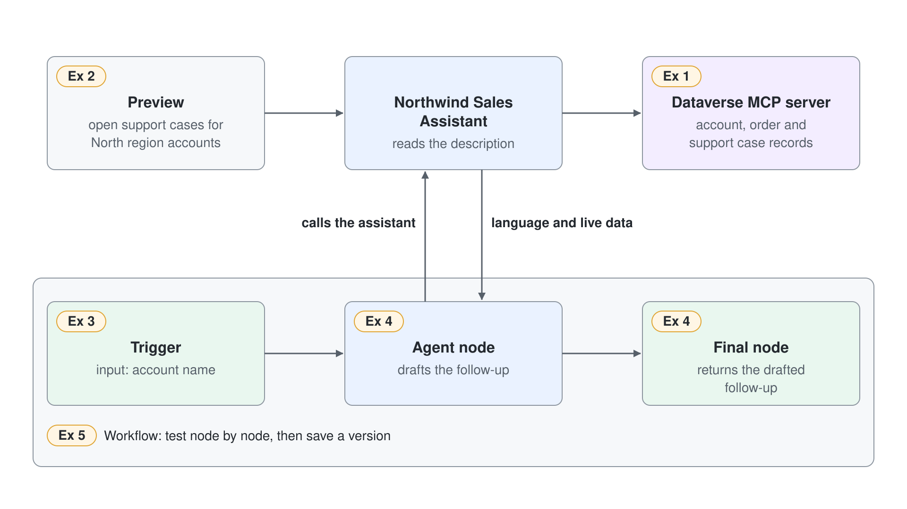
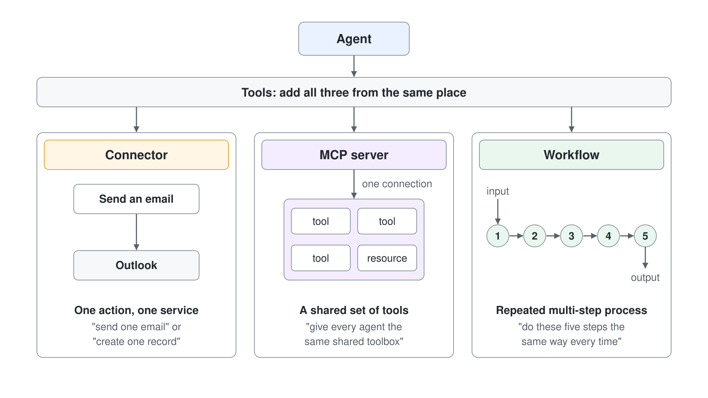

# Connect an MCP Server and Automate with a Workflow


Northwind Traders sellers can now ask the Sales Assistant about products and pricing, but the assistant still cannot see live account records: which orders are open, which support cases are unresolved, which accounts sit in which region. In this demo you give the Northwind Sales Assistant live Dataverse data through a prebuilt Microsoft MCP server, then automate a repeatable post-call follow-up with a workflow that hands a drafting step to the agent. You go from an agent that only knows your documents to one that reads live records and drives a saved, testable follow-up process.

## What you'll build

- The prebuilt Dataverse MCP server attached to the Northwind Sales Assistant as a tool, with a description the orchestrator uses to decide when to call it.
- A Preview conversation proving the orchestrator calls the server on its own to answer a live-data question, with no topic wiring.
- A workflow in the new designer that takes an account name as input and returns a drafted post-call follow-up.
- An agent node inside that workflow that calls the Northwind Sales Assistant to draft the follow-up text.
- A workflow tested node by node, with a saved version you can roll back to.



## Related Topics

This demo puts [Tools, MCP, and the New Workflows Designer](readme.md) into practice by adding an MCP server and building a workflow from the same Tools surface. It builds on [The Unified Build Surface and the New Orchestrator](../02-unified-build-and-orchestrator/readme.md), because the enhanced orchestration runtime is what reads the server description and decides, on its own, when to call the tool.

## Prerequisites

- A Copilot Studio environment where you have the maker role and the **New agent** menu on the **Agents** page offers **Agent** with the **GitHub Copilot** badge.
- The Northwind Sales Assistant you built in [Build and Ground Your First GitHub Copilot Agent](../01-standard-vs-github-copilot/demo-01-build-and-ground-an-agent.md). This demo continues that agent; do not create a new one.
- A prebuilt Dataverse MCP server available in your environment (the Microsoft-published Dataverse, GitHub, and Outlook servers appear in the wizard without any custom setup).
- Sign in at [copilotstudio.microsoft.com](https://copilotstudio.microsoft.com) and open the assistant on the **Build** tab.

## Exercise 1: Add the prebuilt Dataverse MCP server

A GitHub Copilot agent lists three kinds of tools on one surface, and each is fit for a different purpose. A connector wraps a single named action against a known API (send this mail, create this row). An MCP server attaches a standardized bundle of related tools that a vendor maintains, so you get a whole capability without wiring each action. A workflow automates a repeatable, deterministic process you define.

You want live account records here, so the MCP server is the right fit, and using a prebuilt Microsoft server makes the wizard a few fields instead of a custom build.



1. On the **Build** tab, select **+** next to **Tools** in the right panel. The **Add a tool** dialog opens with the tabs **Featured**, **MCP**, **Connectors** and **Workflows**.
2. On the **MCP** tab, select **Microsoft Dataverse MCP Server**.
3. If prompted, supply the Server name, the Server description, and the Server URL.
4. In the Server description field, paste the following:

```text
Look up Northwind account, order, and support case records in Dataverse. Use when a seller asks about a specific account's records, orders, or open cases.
```

5. For the auth type, choose **None**, **API key**, or **OAuth 2.0** as the server requires, then select **Add**. When **Select a connection** follows, choose **Create new connection**, give it a display name, select **Create**, then **Add**.
6. Select the new entry under **Tools** to open **Edit tool**, read the tool list, then select **Done** and the **Save** icon.

Expected: the server appears under **Tools**. **Edit tool** shows **MCP server**, the connection, **Authentication** set to **End user account** (or **Shared account**), and **Tool permissions** with **Allow all** on, listing every tool the server exposes. Nothing has been tested yet; you have attached the capability, not confirmed the agent uses it.

> **Tip:** Your own MCP server goes through the same dialog: **+ Add** > **Model Context Protocol (MCP)** opens **Add MCP server** with **Server name**, **Server description**, **Server URL** and **Authentication**. The live run used it for a food catalog server with authentication **None**, and the connection step still followed.

> **Note:** The Server description is not documentation, it is routing logic. The orchestrator reads that text at runtime to decide whether a given question should call this server, so write it in terms of the questions a seller actually asks.

## Exercise 2: Trigger the MCP tool from Preview

You confirm the wiring by asking a natural question, not by clicking the tool. That is the point of a GitHub Copilot agent: the orchestrator, not a hand-authored topic, decides to call the server based on the description you wrote. In a Standard agent this behavior requires generative orchestration to be turned on, and a topic cannot call an MCP server directly. In a GitHub Copilot agent the enhanced orchestration runtime is always on, so there is no setting to flip.



1. Open the **Preview** tab next to **Build**; **Debug mode** is on by default.
2. Send the following message:

```text
Which open support cases do we have for accounts in the North region?
```

3. Read the response and note whether the answer draws on live Dataverse records rather than general knowledge.

Expected: while the agent works, the step list shows **Using tool:** with the server tool's name, then **Used tool:** once it returns; expanding that line shows the raw **Output** and the **Latency**. The answer lists open support cases for North region accounts using that data. If the agent answers vaguely or from general knowledge instead, sharpen the Server description from Exercise 1 so it matches this kind of question, then ask again.

> **Tip:** MCP uses a Streamable transport, so a change made on the server side is reflected in your agent without republishing. If the server owner adds a new record type today, your next Preview question can use it immediately.

## Exercise 3: Start a workflow and add the input trigger

A workflow is the third tool type, and it exists for a different job than the MCP server. Where the orchestrator decides on the fly whether to call a server, a workflow runs a fixed sequence of steps you defined, on demand, the same way every time. That determinism is exactly what you want for a repeated process like a post-call follow-up, where the steps should not vary run to run. The new workflows designer is in public preview and supports node-by-node testing and versioning.

1. On the **Build** tab, select **+** next to **Tools**, then **+ Add** > **Workflow**. The designer opens with two nodes already placed: the trigger **When an agent calls the flow** and the final node **Respond to the agent**.
2. Select the trigger. Its type is **When an agent calls the workflow**; the list also offers **Manual**, **Recurrence**, **Connector** and **When a HTTP request is received**.
3. Select **+ Add an input**, then **Text**, and name the input `AccountName`, so a run always starts from a named account.
4. Paste the description below into the input's description field.

```text
Account name for the customer call that just ended. The workflow uses it to draft a follow-up.
```

5. Select the title **Untitled workflow**, enter a name such as `Northwind Follow-up Draft`, and select the **Save** icon.

Expected: a banner reads "Your workflow has been saved. After publishing, it'll be ready to test or run." The canvas shows the trigger with its `AccountName` input above **Respond to the agent**, and the workflow is ready for its middle node. No follow-up is produced yet; you have only defined the entry point.

## Exercise 4: Add an agent node that drafts the follow-up

A workflow can hand a step to an agent through an agent node, which is what lets a deterministic process reuse the reasoning you already built into the Northwind Sales Assistant. Instead of scripting the wording of a follow-up, you let the agent draft it from the account name the trigger provided. A final node then returns or composes that draft so the run produces a usable result.

1. An agent node can call only a published agent, and it calls the published version. Open the Northwind Sales Assistant, select **Publish** and then **Publish agent**, so the published version includes the Dataverse tool from Exercise 1.
2. Back in the workflow designer, select the **+** between the trigger and **Respond to the agent**, and under **Actions** select **Agent**.
3. In the node's **Agent** list, select the Northwind Sales Assistant. The list offers **New agent for this workflow** plus your published agents.
4. In **Message**, paste the drafting instruction below, then use the lightning icon to insert the trigger's `AccountName` input after "named account".

```text
Draft a short, professional post-call follow-up email for the named account. Summarize any open orders and open support cases, list one clear next step, and keep it under 120 words.
```

5. Select **Respond to the agent**, then **+ Add an output** > **Text**, name it `FollowUp`, and use the lightning icon to set its value to the Agent node's **Result**.
6. Select the **Save** icon.

Expected: the canvas shows three nodes in order, trigger then agent node then final node, with the agent node calling the Northwind Sales Assistant from inside the workflow. The follow-up is defined but not yet run.

> **Warning:** If the assistant is still a draft, the **Agent** list shows it under "Unpublished agents must be published before they can be used in this workflow." Publish the agent; picking **New agent for this workflow** instead builds a separate agent that knows nothing about your assistant.

> **Note:** The agent node reuses the same assistant you gave Dataverse access to in Exercise 1, so the drafted follow-up can reference live orders and cases. The workflow supplies the structure; the agent supplies the language and the live data.

## Exercise 5: Test node by node and save a version

Node-by-node testing lets you confirm a step in isolation before you trust the whole run, so when something fails you know exactly which node to fix rather than guessing across the chain. Versioning then keeps every saved state, giving you a point to return to before you change anything. Together they make a multi-step workflow debuggable and safe to iterate on.

Use this account name for both runs:

```text
Alpine Ski House
```

1. Select the agent node, open its **Run node** tab, enter the account name in the trigger input field, and select **Run**. This works on a draft workflow.
2. Select **Publish** on the workflow and wait until its status shows **Published**; the toolbar **Run** button stays disabled until then.
3. Select **Run**, enter the account name in **Enter trigger inputs**, and start the run.
4. Select the clock icon to open **Version history**.

Expected: the **Run node** tab shows the node's inputs, its thinking and the drafted follow-up under **Outputs**. The full run succeeds and lists each node with its duration (in the live run, the agent node took about 17 seconds), and **Respond to the agent** returns the follow-up as `FollowUp`. **Version history** reads "Synced with Dataverse" with one version per save and publish, the published one marked **LIVE**, and each version's menu offers **Preview**, **Compare to current** and **Restore**.

> **Note:** Only action nodes such as **Agent** have a **Run node** tab. The trigger and **Respond to the agent** are tested through the full run, and there is no separate "save a version" action, because every save creates one.

## Troubleshooting

| Symptom | Likely cause | Fix |
|---------|--------------|-----|
| **Add a tool** has no **MCP** tab | The agent is a Standard agent, where topics cannot call MCP directly | Use the Northwind Sales Assistant created as a GitHub Copilot agent and reopen it |
| The assistant is listed under "Unpublished agents must be published before they can be used in this workflow." | Agent nodes call published agents only | Publish the assistant, then pick it in the node again |
| The toolbar **Run** button is greyed out | The workflow is still a draft | Select **Publish** on the workflow, then **Run** |
| The agent node ignores the Dataverse tool | The node calls the published version, which predates Exercise 1 | Republish the assistant |
| Preview answers from general knowledge, not Dataverse | The Server description does not match the question, so the orchestrator did not route to the server | Rewrite the description in Exercise 1 to name accounts, orders, and cases, then re-ask |
| Agent node returns nothing in the workflow | The trigger's account name is not being passed into the agent node | Map the trigger input to the agent node's input, save, and re-run the node |
| A server-side data change does not appear | Assumed a republish is needed | No republish is required; the Streamable transport reflects server changes, so simply re-ask in Preview |
| No version to roll back to | The workflow was never saved | Select the **Save** icon; every save and publish adds a version under the clock icon |

## Summary

You connected the Northwind Sales Assistant to live account data and automated a repeatable follow-up. You can now:

- Attach a prebuilt Microsoft MCP server and write a Server description that the orchestrator uses to route questions.
- Confirm from Preview that the orchestrator calls the server on its own, with no topic wiring.
- Build a workflow in the new designer with a trigger, an agent node, and a return node.
- Test the agent node on its own, publish and run the workflow end to end, and restore a version from its history.

Next, put this together end to end in [Sales Account Assistant](../../../labs/06-cs-gh-copilot/04-workflows-and-mcp/lab-01-sales-account-assistant.md), where you ground an agent, wire live data, and automate the seller's follow-up as one connected deliverable.
