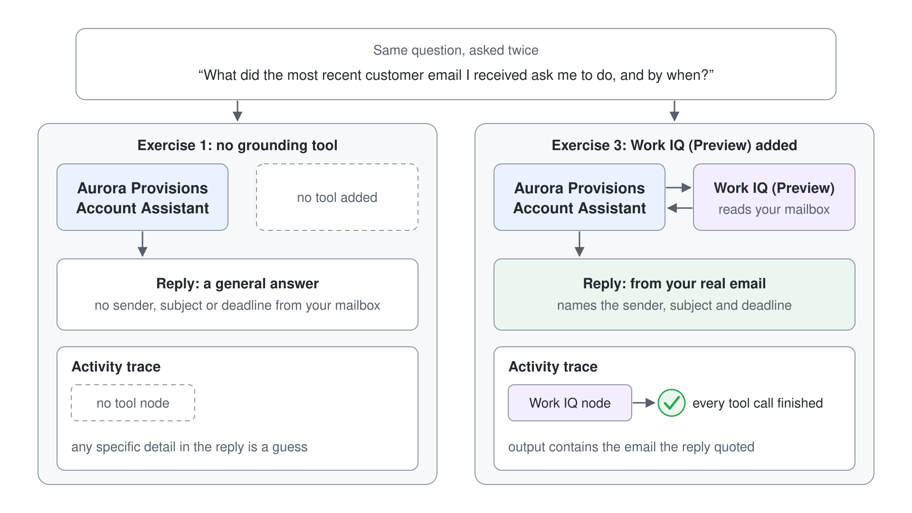

# Ground an Agent in Your Work Context with Work IQ


A seller who asks an agent about yesterday's customer email gets a confident answer only when the agent can read that email. Without a grounding tool, the agent answers from general knowledge, and the reply can sound right while naming nothing from your mailbox. In this demo you ask the same question before and after you add Work IQ, then open the activity trace to show the call that made the difference.

What you practice here: adding a grounding tool to an agent and proving the grounding in the activity trace.

Duration: about 15 minutes.

## What you'll build

- A GitHub Copilot agent named Aurora Account Assistant (agent names take at most 30 characters).
- A before and after pair of replies to the same work question: one from general knowledge, one from your own mailbox.
- A Work IQ (Preview) connection in the agent's Tools section.
- A trace view that shows the Work IQ call and what it returned.



## Related Topics

This demo applies [Grounding Agents with Work IQ, Foundry IQ, and Fabric IQ](readme.md) to a live agent. The lab repeats the steps with learners and adds routing instructions: [Ground an Agent with Work IQ and Route Work Questions to It](../../../labs/06-cs-gh-copilot/05-iq-grounding/lab-01-ground-with-iq.md).

## Prerequisites

- A Copilot Studio environment where you can create agents (maker role), where the **New agent** menu on the **Agents** page offers **Agent** with the **GitHub Copilot** badge. The agent's top tabs read Build, Preview, Evaluate, and Monitor.
- Work IQ enabled for your tenant, with your user assigned to the usage-based billing plan. An administrator completes the one-time setup in [Enable your tenant for Work IQ](https://learn.microsoft.com/microsoft-365/copilot/extensibility/work-iq/enable-work-iq). Confirm this before the session starts.
- A mailbox with a thread you can name in advance, such as a customer email from this week. Every input is in this guide, so nothing needs to be downloaded.

## Exercise 1: Ask an agent that cannot see your work

The baseline comes first, so the audience sees what the agent does with no grounding. You create the agent from a short description, then ask about a real thread in your mailbox. The question is specific on purpose: a grounded answer must name your thread, and an ungrounded answer cannot.

1. On the Copilot Studio **Home** page, select the card **Agent** with the **GitHub Copilot** badge. The agent opens straight on the **Build** tab as **Untitled Agent**, with no creation dialog.
2. Enter the name `Aurora Account Assistant`, paste the description below into the **Instructions** editor, and select the **Save** icon in the top bar.

```text
You are the Aurora Provisions Account Assistant. You help Aurora Provisions account managers prepare for customer calls. Keep answers short and professional, and say which source you used.
```

3. Open the **Preview** tab, leave **Debug mode** on, and send this question:

```text
What did the most recent customer email I received ask me to do, and by when?
```

Expected: a toast confirmed "Your agent has been saved." before the test. The reply does not name a sender, subject, or deadline from your mailbox; in the live run it said "I couldn't find any of your emails" and asked you to paste or upload the email. The step list above the reply, **Reasoned through your request**, shows reasoning but no **Used tool** line, so any specific detail in the reply would be a guess.

## Exercise 2: Add Work IQ from the Tools panel

Work IQ gives the agent a tool that reads Microsoft 365 work context for the account you sign in with. Pick **Work IQ (Preview)** from the MCP list. The workload-specific tools sit beside it, and selecting one of them by mistake is the most common error in this step.

1. Open the **Build** tab and select **+** next to **Tools** in the right panel. The **Add a tool** dialog has the tabs **Featured**, **MCP**, **Connectors** and **Workflows**.
2. On the **MCP** tab, select **Work IQ (Preview)**. Its page reads "Work IQ (Preview) MCP server"; select **+ Add**.
3. Select the new **Work IQ (Preview)** entry under **Tools** to open **Edit tool**. Under **Connection**, check the green check next to the presenter account; if no connection exists yet, open the list, select **Create new connection** and sign in with the presenter account.
4. Leave **Tool permissions** on **Allow all**, select **Done**, then select the **Save** icon.

Expected: a toast reads "Work IQ (Preview) added", and Work IQ (Preview) appears under **Tools**. **Tool permissions** lists its 12 tools, among them **Retrieve**, **Fetch** and **Ask**. When the presenter account already has a Work IQ connection, the tool reuses it, so no sign-in appears.

> **Warning:** Do not select Mail, Teams, OneDrive, SharePoint, or the other workload-specific tools. Learn says to use Work IQ (Preview) in their place, because those tools belong to a legacy experience with its own licensing.

## Exercise 3: Ask the same question with Work IQ

The question stays identical to Exercise 1, so any change in the reply comes from the tool. On a connection's first use, the agent asks for consent, because Work IQ connects to Microsoft 365 services for the signed-in account.

1. Open the **Preview** tab, select **New chat**, and send the Exercise 1 question unchanged.
2. If you are asked to allow Work IQ to connect and use services, select **Allow**.
3. Read the reply.

Expected: the step list shows **Used tool: retrieve** and several **Used tool: fetch** lines, and the reply names the subject and deadline of a real email, which you can check against your inbox. In the live run it ended with "Sources: your Outlook mailbox (inbox and Sent Items)." Same question, new content: that difference is what grounding adds.

> **Tip:** "Most recent customer email" means whatever arrived last, and in the live run that was a test mail without a deadline, so the agent moved on to an older thread. On a mailbox full of test mails, name the customer or subject in the question.

## Exercise 4: Read the activity trace

A reply that names your email could still come from memory, so the trace is the evidence. The trace sits inline above the reply: each step the agent takes is a line, and expanding a line shows its input and output.

1. Keep the **Preview** tab open and confirm that **Debug mode** is on; with it off, the **Used tool** lines stay but can't be expanded.
2. Select **Used tool: retrieve** above the reply.
3. Read the **Input** the agent sent (the `Email` capability and its search query) and the **Output** the tool returned, plus the **Latency**.
4. Check the grey check-circle on each tool line.

Expected: the **Output** of **retrieve** lists the email thread your reply quoted, and every tool line carries a check-circle, which shows that the call finished. Point at both the reply and the line that supplied it.

> **Note:** **Monitor** shows "Monitor data starts after you publish" for a draft agent, so for this demo the Preview trace is the only place to read the calls.

> **Tip:** Keep the Exercise 1 reply in a second window so the audience can compare the before and after side by side.

## Troubleshooting

| Symptom | Likely cause | Fix |
|---------|--------------|-----|
| Work IQ (Preview) does not appear in the MCP list | The tenant is not set up for Work IQ, or your user is not on the usage-based billing plan | Ask an administrator to complete the one-time setup in Enable your tenant for Work IQ and assign your user to the billing plan |
| Work IQ calls fail with `The caller has exhausted the AI credit quota for WorkIQ.` | The spending policy that covers you reached its monthly limit | Raise the limit as described in [Configure Copilot Credits for the Work IQ API](../../../setup/work-iq-credit-quota.md) |
| The reply is still generic after you add Work IQ | Consent was not given, or the connection uses a different account | Confirm the connection under Tools, then send the question again and select **Allow** at the consent prompt |
| The trace shows no **Used tool** line for Work IQ | The agent answered from memory, or the question does not match the tool's scope | Ask about one specific thread from your mailbox, then send again |
| Tool lines can't be expanded | **Debug mode** is off | Turn on **Debug mode** at the top of **Preview** |
| The agent name is cut off | Agent names take at most 30 characters | Use a shorter name such as `Aurora Account Assistant` |
| A workload tool such as Mail appears in Tools | The wrong tool was added in Exercise 2 | Remove that tool from Tools and add Work IQ (Preview) |

## Summary

You grounded an agent in work context. You created it, asked the same question before and after adding Work IQ (Preview), and used the activity trace to tie the reply to a Work IQ call. You can now:

- Add Work IQ (Preview) from the Tools panel through the MCP tab.
- Compare a grounded reply with an ungrounded one in Preview.
- Read the activity trace to confirm which tool produced an answer.

Foundry IQ and Fabric IQ use the same Tools panel with different sources, and the lab's optional step adds them. Next, practice the routing in [Ground an Agent with Work IQ and Route Work Questions to It](../../../labs/06-cs-gh-copilot/05-iq-grounding/lab-01-ground-with-iq.md).
