# Grounding Agents with Work IQ, Foundry IQ, and Fabric IQ

Uploaded knowledge files give an agent a fixed copy of your documents. Three IQ connections ground an agent in sources that stay where they live: Work IQ in your Microsoft 365 work context, Foundry IQ in a knowledge base a team built in Microsoft Foundry, and Fabric IQ in a semantic model in Microsoft Fabric.

This topic explains what each connection grounds on, who tunes it, how you add it, and what it costs to run. It closes with a table that helps you choose one.

| Section | Description |
|---------|-------------|
| Grounding versus uploaded knowledge | Why a live source differs from a file you upload |
| What each IQ grounds on | The source each connection reads and who tunes it |
| Adding an IQ to an agent | Where each connection lives in a GitHub Copilot agent |
| Status, licensing, and billing | Preview and general availability status, and Copilot Credits |
| Choosing between the three | A table that matches a question to a source |
| Hands-On Demo | Presenter-led demo of Work IQ with the activity trace |
| Hands-On Lab | Learner lab that routes work questions to Work IQ |
| Key Topics covered in this module | Learn articles behind each claim |

## Grounding versus uploaded knowledge

Grounding means the agent's answer rests on a source it reads when the question arrives. An uploaded knowledge file works differently: the agent indexes a copy you supplied, and you change what it knows by uploading a new version. An IQ connection points at a source that already exists elsewhere, so the answer reflects that source's current state.

The difference matters most for questions about information that moves, such as a customer email from this morning or a figure refreshed overnight. A file uploaded last week cannot answer those questions. The activity trace also shows which lookups ran, so you can verify grounding without relying on the wording of the reply.

## What each IQ grounds on

### Work IQ

Work IQ grounds an agent in your Microsoft 365 work context. Microsoft describes it as unifying signals from files, emails, meetings, chats, and Business Applications across Microsoft 365. The maker does not tune Work IQ: administrators govern it in the Microsoft 365 admin center, and it is read-only unless an administrator turns on write operations. Your control as the maker is when the agent calls it, which you set in Instructions.

#### Retrieving work context from code

Agents you build in code reach the same context through the Work IQ MCP server. Its `ask` tool returns a finished answer from Microsoft 365 Copilot, while the `retrieve` tool (public preview, announced in October 2026) returns grounding content instead: Markdown with inline citations to pass to your model, plus structured `retrievalHits` with source URLs and sensitivity labels for citations and auditing. The `strategy` parameter keeps a search in the Microsoft 365 index (`grounding`, the default) or adds connected enterprise sources (`copilot`), and `capabilities` narrows one call to sources such as a SharePoint site or a shared mailbox. Retrieval runs as the signed-in user, so it never returns content that user can't open.

Microsoft positions `retrieve` as the evolution of the Copilot Retrieval API for agentic apps, and moving an app over changes its pipeline as well as its endpoint. The app stops reading per-hit document extracts from a Graph REST call and passes the cited Markdown to its model, while `retrievalHits` feeds citations, evaluation, and audit records. The app needs the delegated `WorkIQAgent.Ask` permission with admin consent, and its users need a spending policy that includes **Work IQ API**, because a Microsoft 365 Copilot license or Retrieval API pay-as-you-go setup doesn't cover Work IQ. Keep the Retrieval API for now if you need a fixed REST schema (Work IQ tools are planned over REST in November 2026) or depend on KQL and `filterExpression` filters.

| Area | Copilot Retrieval API | Work IQ MCP `retrieve` |
|------|-----------------------|------------------------|
| Protocol | Microsoft Graph REST | MCP `tools/call` |
| Sources | One retrieval source per request | Microsoft 365 data, plus connected enterprise sources with `copilot` |
| Grounding content | Per-hit extracts | Markdown with inline citations |
| Source constraints | Source selection and KQL filter expressions | Capabilities shaped like a declarative agent's |
| Billing | Microsoft 365 Copilot license or pay-as-you-go | Copilot Credits through a Work IQ API spending policy |

A pro-code agent in Microsoft Foundry reaches the same context through the Work IQ tool (preview), which hands a natural-language task to Work IQ as a peer agent over the Agent-to-Agent (A2A) protocol, on behalf of the signed-in user. You add the tool to a prompt agent directly, or to a toolbox that a hosted agent uses, then publish the agent to Teams and Microsoft 365 Copilot. The AI Skills Navigator module [Integrate your agent with Microsoft 365](https://aiskillsnavigator.microsoft.com/explore/search/module-e806d4ecdbb55c123de5446afe2c056eb8f0345880ad7b10853767da98afeb48) walks that path end to end in 1 hour 14 minutes and expects Foundry experience. The Teams activity samples in [Python](https://github.com/microsoft-foundry/foundry-samples/tree/main/samples/python/hosted-agents/agent-framework/responses/07-teams-activity) and [.NET](https://github.com/microsoft-foundry/foundry-samples/tree/main/samples/csharp/hosted-agents/agent-framework/teams-activity) are working starting points.

### Foundry IQ

Foundry IQ grounds an agent in a knowledge base that someone built in Microsoft Foundry. A knowledge base bundles one or more enterprise data sources with retrieval and relevance settings, so your agent can answer over that content without you rebuilding the setup in Copilot Studio. The team that owns the knowledge base tunes it in Microsoft Foundry by changing its sources, retrieval instructions, or ranking. Copilot Studio holds only the connection, so removing it leaves the knowledge base unchanged.

### Fabric IQ

Fabric IQ connects an agent to business data and analytics in Microsoft Fabric, grounded in a semantic model. The agent can then answer data questions from the tables and measures that model contains. The owner of the Fabric workspace and semantic model decides what the model holds, and the picker shows only the items your account can access.

## Adding an IQ to an agent

A GitHub Copilot agent (Learn: GitHub Copilot harness) adds all three from the Tools panel on the Build tab. Each connection becomes a tool, so the orchestrator decides whether to call it from the tool's name and description. Learn asks you to make the Foundry IQ description as detailed as possible for that reason.

Work IQ connects through the MCP tab of the Add a tool dialog and needs a sign-in connection. Foundry IQ asks for a connection to your Search Service endpoint, using one of four authentication types, and then you pick a knowledge base. An agent holds one Foundry IQ connection. Fabric IQ comes from the same dialog and needs access to the Fabric workspace and semantic model.

## Status, licensing, and billing

Status tells you what you can promise a customer. Learn marks Work IQ and Fabric IQ as preview. The Foundry IQ article carries no preview label, and Microsoft announced general availability of Foundry IQ in Copilot Studio in October 2026.

| IQ | Status | Billing |
|----|--------|---------|
| Work IQ | Preview | Usage-based billing in Copilot Credits. An administrator creates a separate spending policy for Work IQ usage, and the tenant needs a usage-based billing plan. |
| Foundry IQ | No preview label on the Learn article; general availability announced October 2026 | Usage-based billing applies to using, building, testing, and evaluating agents. |
| Fabric IQ | Preview | Usage-based billing applies to using, building, testing, and evaluating agents. |

The legacy workload tools, such as Mail and Teams, appear in the same tool catalog but run on the standard harness with standard licensing. They are a different path, so choose Work IQ (Preview) when the goal is grounding in Microsoft 365 context. Work IQ is the most accessible of the three in a class tenant, but it still needs the one-time tenant setup. The admin steps are in [Tenant setup: Copilot Credits](../../../setup/tenant-credit-setup.md), and [Configure Copilot Credits for the Work IQ API](../../../setup/work-iq-credit-quota.md) fixes the quota error.

## Choosing between the three

| Choose | When the answer lives in | Who tunes the source |
|--------|--------------------------|----------------------|
| Work IQ | Your Microsoft 365 email, meetings, chats, and files | Tenant administrators govern it; you control when the agent calls it through Instructions |
| Foundry IQ | A knowledge base a team already built and tuned in Microsoft Foundry | The knowledge base owner, in Microsoft Foundry |
| Fabric IQ | A semantic model in Microsoft Fabric | The owner of the Fabric workspace and semantic model |
| Uploaded knowledge file | A document set you own and can replace with a new version | You, by uploading the new version |

## Hands-On Demo

- [Ground an Agent in Your Work Context with Work IQ](./demo-05-ground-with-iq.md): the presenter asks the same work question before and after adding Work IQ, then opens the activity trace to show the call that changed the reply.

## Hands-On Lab

- [Ground an Agent with Work IQ and Route Work Questions to It](../../../labs/06-cs-gh-copilot/05-iq-grounding/lab-01-ground-with-iq.md): learners add Work IQ, write Instructions that route work questions to it, and read the trace. An optional step adds Foundry IQ or Fabric IQ when the resources exist.

## Key Topics covered in this module

[Add Work IQ to an agent](https://learn.microsoft.com/microsoft-copilot-studio/agents-experience/add-work-iq)

[Enable your tenant for Work IQ](https://learn.microsoft.com/microsoft-365/copilot/extensibility/work-iq/enable-work-iq)

[Use the retrieve tool in Work IQ MCP](https://learn.microsoft.com/microsoft-365/copilot/extensibility/work-iq/mcp/retrieve)

[Migrate agentic retrieval workflows to Work IQ MCP](https://learn.microsoft.com/microsoft-365/copilot/extensibility/work-iq/mcp/migrate-retrieval-api)

[Connect Foundry agents to Microsoft 365 with Work IQ](https://learn.microsoft.com/azure/foundry/agents/how-to/tools/work-iq)

[Integrate your agent with Microsoft 365 (AI Skills Navigator)](https://aiskillsnavigator.microsoft.com/explore/search/module-e806d4ecdbb55c123de5446afe2c056eb8f0345880ad7b10853767da98afeb48)

[Connect to Foundry IQ from an agent](https://learn.microsoft.com/microsoft-copilot-studio/agents-experience/foundry-iq-connect)

[Connect to Fabric IQ from an agent](https://learn.microsoft.com/microsoft-copilot-studio/agents-experience/fabric-iq-connect)

[Use the activity trace to debug your agent](https://learn.microsoft.com/microsoft-copilot-studio/agents-experience/authoring-activity-trace)

[Add a tool to an agent](https://learn.microsoft.com/microsoft-copilot-studio/agents-experience/add-tools-custom-agent)

[Manage costs for agents powered by the GitHub Copilot harness](https://learn.microsoft.com/power-platform/admin/manage-copilot-studio-copilot-credits-capacity)
