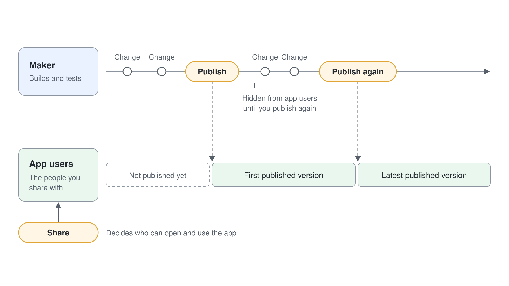

# Build an App from a Description

Aurora Provisions sales reps log customer tasting requests in email, so nobody can see which requests are open or who owns them. In this demo you describe a small tracker app in plain language, refine it twice by conversation, read the generated code, then publish and share it. The app runs on sample data, which keeps the focus on the build loop and away from connections.



What you practice here: turning a plain-language description into a published app through small, checked refinements.

Duration: about 20 minutes.

---

Setup: sign in to Copilot Studio, open the **Home** page, and confirm that the **App (preview)** tile with the **GitHub Copilot** badge appears. New apps are created in your personal environment, and building one consumes Copilot Credits from the start, so an administrator must make credits available to that environment before the session; without them, the first message stops with "No usage quota is available for your account, so this request couldn't be completed." [Tenant setup: Apps in Copilot Studio](../../../setup/09-copilot-studio-apps-setup.md) covers the admin side.

## What you'll build

- A tasting request tracker that lists requests and counts the open ones by status.
- A priority field and a status summary, both added by conversation.
- A published app that a colleague can open from a link.

## Exercise 1: Describe the app and let Copilot draft it

The first message sets the scope. Name the outcome, the people, the data, and the actions in one message. Copilot Studio asks follow-up questions when something is missing, then builds the draft. Sample data is enough here, because this exercise is about the shape of the app.

1. Sign in to Copilot Studio and select the **App (preview)** tile on the **Home** page. The page opens with "Let's spark some app ideas together below." and an input box, **Or describe the problem you're trying to solve**.
2. Paste the description below into that box and select **Send**.

```text
Build a tasting request tracker for Aurora Provisions, a fictional provisions company. Sales reps log a customer tasting request with the customer name, the product, the requested date, and the status. Include a list of all requests and a summary that counts open requests by status. Use sample data for now.
```

3. Watch the steps scroll by under **Working on it**. When Copilot asks "Save this app's data to SharePoint so it persists across sessions?", select **No, keep it local** and then **Submit**; answer any other follow-up question in one sentence.

Expected: after about five minutes the chat reports "Tasting Request Tracker is built and published:" with a link, and "The app passed its code, type and build checks before publishing." The chat moves to the left pane and the preview fills the right: a summary with the open count and a count per status, a list of 11 sample requests grouped by month, and a **Log request** button. In the live run Copilot picked five statuses itself (Requested, Scheduled, Samples Sent, Completed, Cancelled) and listed that choice under "Decisions for you", so check the result against the description you sent.

> **Note:** The first draft is published right away, so the link already works for you. Every later change stays in the preview until you publish again in Exercise 5.

## Exercise 2: Refine with one specific change

Refinement is where the app takes shape. A specific change works better than a general wish, because the app updates its data model, logic, and screens together, and you see the effect in the preview straight away.

1. In the conversation area, paste the change below and select **Send**.

```text
Add a priority field with the choices High, Medium, and Low. Sort the list so High priority requests appear first.
```

2. Check the preview before you send another change.

Expected: the list regroups into **HIGH PRIORITY**, **MEDIUM PRIORITY** and **LOW PRIORITY** sections, each row carries a High, Medium or Low badge, and the **Log request** form offers the three choices, with new requests starting at Medium. The reply ends with "The change is only in the preview. The published version stays the same until you ask me to publish it."

> **Tip:** Compare the preview with the change you asked for before you send the next one. If the reply describes the change but the preview does not show it, send a shorter, more specific request.

## Exercise 3: Refine the logic behind a label

The second refinement changes a rule. Changing the status choices also changes what the summary counts, so you can watch the logic move together with the interface.

1. Paste the change below and select **Send**.

```text
Change the status choices to New, Scheduled, Completed, and Cancelled. Count New and Scheduled as open in the summary, and count Completed and Cancelled as closed.
```

2. Open the summary in the preview and add up the counts.

Expected: the status menu in each row, the status filter and the form offer the four choices, and Copilot moves the sample rows onto them. The open and closed counts together equal the number of requests in the list: in the live run, 3 New and 5 Scheduled made 8 open, and 2 Completed and 1 Cancelled made 3 closed, for 11 requests.

## Exercise 4: Read the code view

Every app has real code behind it. The code view shows what Copilot Studio generated. The view is read-only, so you learn from the code but make every change through the conversation. Reading the priority field shows how your sentence became a data structure.



1. In the bar above the preview, select the **Code view** icon (**</>**) next to the **App preview** eye. The **Code preview** pane opens with a file tree and **Search file names**.
2. Open `src`, then `data`, then `tasting-requests.ts`, and find the priority field and its choices.
3. Click into a line and type a character. The view does not accept edits, so return to the conversation and describe the change there.

Expected: `tasting-requests.ts` holds `PRIORITIES = ["High", "Medium", "Low"]`, the `STATUSES` list and a `priority` field in the request type, and your typing changes nothing. The conversation remains the only place where changes stick.

## Exercise 5: Publish and share

Publishing and sharing are separate actions. Publish makes the latest version available to the people you share it with. Share decides who can open it. Test the main scenario first, because changes made after publishing stay hidden until you publish again.



1. In the preview, test one scenario: open the status menu of a New request, select **Completed**, and check that the summary updates.
2. Select **Publish** at the top right. The button shows **Publishing** for a few minutes; afterwards the app name menu at the top reads "Published" with the date and time.
3. Select the **Share** icon next to **Publish**. In **Share Tasting Request Tracker**, enter a colleague's work account under **Add people** and share; **Link sharing** offers **People in your org can use** and **Copy link**.
4. Open the app's link from the chat and confirm that the published version shows the priority sections and the four statuses.

Expected: in step 1, the open count drops by one and **Completed** rises by one. The link opens the published version with the priority sections and the four statuses, and its sample data starts fresh, so the status change from step 1 is gone. The records you see come from the sample data inside the app, because sample records can be part of the app itself. Sharing the app does not give your colleague access to a connected list, which the lab covers.

## Troubleshooting

| Symptom | Likely cause | Fix |
|---------|--------------|-----|
| No **App (preview)** tile on the **Home** page | Apps aren't offered in this environment, or an administrator turned app creation off | Switch to an environment that offers GitHub Copilot agents and apps; if the tile is still missing, ask your administrator |
| "No usage quota is available for your account, so this request couldn't be completed." and the banner "Your organization hasn't set up a pool of credits yet." | Your personal environment, where apps are built, has no Copilot Credits | An administrator adds that personal developer environment to a pay-as-you-go billing plan or allocates prepaid credits to it, as described in [Tenant setup: Apps in Copilot Studio](../../../setup/09-copilot-studio-apps-setup.md) |
| The preview stays empty or the agent keeps asking questions | The description is too broad | Answer the follow-up questions in one message, or start with a smaller app and add to it |
| Changes disappear after the app reloads | The app is using sample data, which can reset | Expected for sample data; the lab connects a real list so changes persist |
| The **Share** choice you expect is missing | Environment or administrator policy hides it | Use the share method that appears, or ask your administrator which methods the environment allows |
| The build slows down or warns about credits | Building and previewing consume Copilot Credits | Keep follow-up requests short and ask your instructor how many credits the class environment has |

## Summary

You described an app in plain language, refined it twice, read its code, published it, and shared it. You can now:

- Write a description that names the outcome, the people, the data, and the actions.
- Refine an app with one specific change at a time and check each change in the preview.
- Explain why the code view is read-only and where changes belong.
- Explain why publishing and sharing are two separate actions.

Next, the lab connects the same kind of app to a SharePoint list, then proves that data access needs its own permission.
