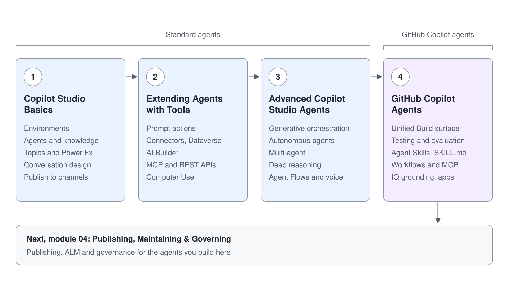

# GitHub Copilot Agents in Copilot Studio

In June 2026 Microsoft shipped a rebuilt Copilot Studio, delivered as a production-ready preview and rolled out worldwide. Today a maker picks the kind of agent when creating it: the **New agent** menu offers an **Agent** with the **GitHub Copilot** badge (Learn: GitHub Copilot harness) and, under **Other ways to build**, an **Agent** with the **Standard** badge (Learn: standard harness). Both stay supported side by side, and an agent built as one kind can't be converted to the other. This sub-module teaches GitHub Copilot agents next to the Standard agents students build in [Basics](../03-cs-basics/readme.md), [Tools](../04-cs-tools/readme.md), and [Advanced](../05-cs-advanced/readme.md).

Treat Standard agents as the primary teaching track and GitHub Copilot agents as guided demos. Existing agents and ALM pipelines are Standard agents, many clients still build them, and not every feature exists on both kinds yet. For each GitHub Copilot agent idea, the theory and demos show the Standard equivalent so the concept transfers when a team starts building GitHub Copilot agents.

## Topics

| Topic | What it teaches |
|-------|-----------------|
| [Standard vs. GitHub Copilot Agents](01-standard-vs-github-copilot/readme.md) | The **New agent** menu, coexistence, the one-way conversion rule, and how to tell which kind of agent you are in |
| [The Unified Build Surface and the New Orchestrator](02-unified-build-and-orchestrator/readme.md) | The four-tab Build surface, the component map from Standard agents, and the enhanced orchestration runtime |
| [Agent Skills in Copilot Studio](03-agent-skills/readme.md) | The Agent Skills open format, `SKILL.md`, and importing Claude Code or GitHub Copilot skills |
| [Tools, MCP, and the New Workflows Designer](04-workflows-and-mcp/readme.md) | Connectors, MCP servers, and the new node-by-node workflows designer with agent nodes |
| [Grounding Agents with Work IQ, Foundry IQ, and Fabric IQ](05-iq-grounding/readme.md) | What each IQ grounds on, how it is added to a GitHub Copilot agent, and how to choose between Work IQ, Foundry IQ, and Fabric IQ |
| [Building Apps in Copilot Studio](06-apps/readme.md) | Apps generated from a description beside agents and workflows: refining by conversation, publish versus share, and data access |
| [Test and Evaluate Copilot Studio Agents](07-evaluations/readme.md) | Test sets and graders for both kinds of agent, the Evaluate tab of GitHub Copilot agents, diagnosing a failing case, and post-release analytics from thumbs to CSAT to themes |

## Demos

| Topic | Demo |
|-------|------|
| [Standard vs. GitHub Copilot Agents](01-standard-vs-github-copilot/readme.md) | [Build and Ground Your First GitHub Copilot Agent](01-standard-vs-github-copilot/demo-01-build-and-ground-an-agent.md) |
| [The Unified Build Surface and the New Orchestrator](02-unified-build-and-orchestrator/readme.md) | [Trace the Agentic Reasoning Loop](02-unified-build-and-orchestrator/demo-02-trace-agent-reasoning.md) |
| [Agent Skills in Copilot Studio](03-agent-skills/readme.md) | [Add and Tune an Agent Skill](03-agent-skills/demo-03-add-a-reusable-skill.md) |
| [Tools, MCP, and the New Workflows Designer](04-workflows-and-mcp/readme.md) | [Connect an MCP Server and Automate with a Workflow](04-workflows-and-mcp/demo-04-connect-mcp-and-workflow.md) |
| [Grounding Agents with Work IQ, Foundry IQ, and Fabric IQ](05-iq-grounding/readme.md) | [Ground an Agent in Your Work Context with Work IQ](05-iq-grounding/demo-05-ground-with-iq.md) |
| [Building Apps in Copilot Studio](06-apps/readme.md) | [Build an App from a Description](06-apps/demo-06-build-an-app.md) |

## Labs

| Lab | Focus |
|-----|-------|
| [Compare Standard and GitHub Copilot Agents Side by Side](../../labs/06-cs-gh-copilot/01-standard-vs-github-copilot/lab-01-compare-standard-and-github-copilot.md) | Stand up a minimal Northwind assistant as a GitHub Copilot agent and contrast it with a Standard agent: the **New agent** menu, coexistence, navigation tells, and the one-way conversion rule |
| [Build, Evaluate, and Monitor a Northwind Sales Assistant](../../labs/06-cs-gh-copilot/02-unified-build-and-orchestrator/lab-01-evaluate-and-monitor-agent.md) | Work all four Build-surface tabs, then build a test set in Evaluate and review runs in Monitor |
| [Package Team Knowledge into a Portable Skill](../../labs/06-cs-gh-copilot/03-agent-skills/lab-01-portable-skill.md) | Author a `SKILL.md`, reuse it across two agents, and contrast with Standard agent topics |
| [Build a Sales Account Assistant as a GitHub Copilot Agent](../../labs/06-cs-gh-copilot/04-workflows-and-mcp/lab-01-sales-account-assistant.md) | Capstone: build, ground, tool up, skill, and publish a GitHub Copilot agent end to end |
| [Ground an Agent with Work IQ and Route Work Questions to It](../../labs/06-cs-gh-copilot/05-iq-grounding/lab-01-ground-with-iq.md) | Add Work IQ to a GitHub Copilot agent, route work-context questions to it in Instructions, and verify the routing in the activity trace |
| [Build and Share a Business App](../../labs/06-cs-gh-copilot/06-apps/lab-01-build-an-app.md) | Connect a generated app to a SharePoint list, publish and share it with a classmate, and confirm that data access is a separate permission |
| [Evaluate a GitHub Copilot Agent with Test Sets](../../labs/06-cs-gh-copilot/07-evaluations/lab-01-evaluate-with-test-sets.md) | Fill a conversation test set three ways, run a baseline, diagnose each failure into a component bucket, change one thing, and prove the fix with a second run |

## Standard to GitHub Copilot quick reference

| Task | Standard agent | GitHub Copilot agent |
|------|----------------|----------------------|
| Create one | **New agent** menu, **Other ways to build**, **Agent** with the **Standard** badge | **New agent** menu, **Agent** with the **GitHub Copilot** badge |
| Open an existing one | **Agents** list (marked Standard), or **...** > **Open classic experience** | **Agents** list |
| Primary navigation | Topics, Knowledge, Tools, Settings | Build, Preview, Evaluate, Monitor |
| Configure an agent | Nine-plus config areas | Unified Build components panel |
| Orchestration | Configurable, classic or generative | Enhanced runtime, always on |
| Reusable behaviour | Topics, plugins | Skills panel, `SKILL.md` create or upload |
| Add an MCP server | Tools, add tool, requires generative orchestration | Tools, Add a tool, Model Context Protocol |
| Test | Test pane | Preview tab, then Evaluate and Monitor |

## Labs to draw from

The official [microsoft/mcs-labs](https://github.com/microsoft/mcs-labs) repo carries the closest hands-on material. The in-class capstone above is based on [Orchestration with Copilot Studio](https://microsoft.github.io/mcs-labs/labs/mcs-orchestration/) (Level 300, roughly 60 minutes), which builds a Sales Account Assistant as a GitHub Copilot agent and packages behaviour into a Skill. For a full day, extend into [Advanced Agent in a Day](https://microsoft.github.io/mcs-labs/workshops/advanced-agent-in-a-day/). Note that the older Copilot Developer Camp labs retire on 2026-06-30 in favour of the [Copilot Studio Agent Academy](https://microsoft.github.io/agent-academy/).

## Links & Resources

[Agents powered by the GitHub Copilot harness overview](https://learn.microsoft.com/microsoft-copilot-studio/agents-experience/overview)

[Harnesses in Copilot Studio](https://learn.microsoft.com/microsoft-copilot-studio/harnesses-overview)

[Access standard harness agents and agent flows](https://learn.microsoft.com/microsoft-copilot-studio/agents-experience/switch-experiences)

[Skills overview (preview)](https://learn.microsoft.com/microsoft-copilot-studio/agents-experience/skills-overview)

[What's new in Copilot Studio](https://learn.microsoft.com/microsoft-copilot-studio/whats-new)

[Meet the new Copilot Studio (announcement)](https://techcommunity.microsoft.com/blog/copilot-studio-blog/meet-the-new-copilot-studio-rebuilt-for-more-complex-multi-step-work/4526488)
