# Meet Autopilot: Digital Teammates in Microsoft 365

Most agents in this course wait for a person to start them. A digital teammate is different: you give it an objective and boundaries, and it keeps the work going across days, in the same Teams channels and mail threads your colleagues use. This topic explains what turns an agent into a teammate, introduces Autopilot, and places it on the map you built in [Agents & Copilots for Microsoft 365](../../01-intro/01-agents-copilots/readme.md).

## What Makes an Agent a Teammate

Four properties separate a teammate from an assistant. It has its own identity, so its actions are attributed to it and admins can audit it like any other account. It keeps memory, so context one person explains carries into the next conversation. It works where people already work (Teams, Outlook, chats, channels, and documents), and colleagues reach it with an @mention.

The fourth property is persistence. A teammate watches channels, follows up on threads, runs recurring work, and picks a project back up days later without a new prompt. That is the line between delegating one task to Cowork and handing a whole process to an agent that owns it.

| Property | Assistant (Chat, Cowork) | Teammate (Autopilot, agent account) |
|---|---|---|
| Identity | Acts as you, with your permissions | Acts as itself, with its own scoped access |
| Memory | Personal to you | Kept for the process, shared with the team |
| Reach | Your chat or task pane | Teams, Outlook, documents, and @mentions |
| Start | You send a prompt | A goal, a schedule, or an incoming signal |

## Autopilot in the New Copilot

On September 25, 2026, Microsoft introduced a redesigned Copilot with three parts. Home is the new starting point where Chat and Cowork come together, and Copilot will route each request to Chat, Cowork, or Code. Code lets anyone describe an app, tracker, dashboard, or automation in natural language; it is powered by the same underlying technology as GitHub Copilot and runs in a sandbox that can be hosted in your tenant.

Autopilot is the third part. Microsoft describes it as a persistent, proactive, and personal agent that keeps working even when you're not, and as your digital teammate. You give it a name, a role, and a goal, and it goes to work: Microsoft's example is a supplier review process where Autopilot builds the schedule and workback plan, handles prep and follow-ups, and reaches out to stakeholders for updates.

Autopilot is cloud-hosted and lives in your tenant with its own identity, memory, computer, and workspace. It is built on Microsoft IQ, so it grounds its work in how your organization operates. You set the objective and the boundaries; permissions, audit, and governance sit behind every action.

## Scout, Autopilot, and the Name Collision

Autopilot was previously called Microsoft Scout. Microsoft Learn still documents the product under the Scout name, as a Frontier preview desktop app for Windows and macOS, and has no Autopilot page as of October 2026. The announcement describes Autopilot as cloud-hosted, so read the Scout pages as the documented behavior of its predecessor, not as a final specification.

Two other products share the word. Windows Autopilot is Intune device provisioning and has nothing to do with agents. The GitHub Copilot app also has an Autopilot session mode, which lets a coding session run fully autonomously.

## Where Autopilot Sits Beside Your Other Agents

| Need | Reach for | Why |
|---|---|---|
| A quick answer or draft | Copilot Chat | One turn, you stay in the loop on every step |
| A multi-step task done for you today | [Cowork](../../02-cowork/readme.md) | You delegate the task and approve its actions |
| A small app or tracker for your team | Code | Built from a description, hosted in the tenant |
| A process with an owner that never sleeps | Autopilot | Persistent, proactive, reachable like a colleague |
| A governed process agent with your own tools and triggers | [Agent account](../03-agent-accounts/readme.md) | A maker controls instructions, tools, and triggers in Copilot Studio |

## Availability and Billing

Microsoft expanded Autopilot to private preview at the end of September 2026 and has not announced a general availability date. Cowork, Code, and Autopilot run on usage-based billing, so plan consumption through Copilot Credits rather than a per-user seat. Home and Code roll out through the Frontier program first.

Autopilot gets the same Plugins menu as the plugin registry rollout reaches a tenant.

## Hands-On Demo

Planned: **Place the Teammate on the Map**. The instructor runs one supplier-review request through Chat, Cowork, and a teammate agent and compares who owns the follow-up a week later.

## Hands-On Lab

Planned: [Write a Teammate Brief](../../../labs/08-ai-teammates/readme.md). You define the name, role, goal, boundaries, and escalation rules for a supplier-review teammate and decide whether Autopilot or an agent account should carry it. The lab needs no preview access.

## Key Topics covered in this module

[Introducing the new Copilot with Home, Code and Autopilot](https://blogs.microsoft.com/blog/2026/09/25/introducing-the-new-copilot-with-home-code-and-autopilot/)

[Introducing Microsoft Scout](https://www.microsoft.com/en-us/copilot/blog/2026/06/02/introducing-microsoft-scout-your-always-on-personal-agent/)

[Microsoft Scout (Frontier) overview](https://learn.microsoft.com/microsoft-scout/overview)

[Introducing the plugin registry](https://techcommunity.microsoft.com/blog/microsoft-copilot-blog/introducing-the-plugin-registry---one-place-to-discover-and-govern-plugins-for-m/4559682)
