# Agent Accounts: Give a Copilot Studio Agent Its Own Identity

Autopilot is the teammate a user sets up. When a process needs your own instructions, tools, and triggers, you build the teammate yourself in Copilot Studio and give it an account. An account gives the agent its own Microsoft Entra ID, mailbox, and presence across Microsoft 365, so it can take a business process from start to finish on its own.

## What the Account Changes

Without an account, a Copilot Studio agent answers inside a channel you publish it to. With one, it works as a member of your organization. It has a mailbox, so it can send and receive email and join distribution lists; it appears in Teams and the directory, where people find and @mention it like a colleague; and admins govern and audit it like any other identity.

Two identities are created. Agent 365 provisions and governs the account, which gives admins user-grade visibility and control, and Copilot Studio also creates a Microsoft Entra Agent ID for the agent that admins manage separately. Copilot Studio has created an Entra Agent ID for every new agent since mid-2026; the account is what adds the mailbox, Teams presence, and directory entry.

| Capability | Agent without an account | Agent with an account |
|---|---|---|
| Reached through | The channels you publish to | Email, Teams, the directory, and Office comments |
| Acts as | The signed-in user, or connector credentials | Itself, with its own scoped access rights |
| Shows up in Teams | As an app | As a colleague you can @mention |
| Audited as | An agent | An identity, like any member of the organization |

## Build It: From Agent Account to Publish

Agent accounts live in Copilot Studio Preview, on an environment that uses the early release cycle, and run on the [GitHub Copilot harness](../../06-cs-gh-copilot/02-unified-build-and-orchestrator/readme.md). You add the account to a new agent before you publish it for the first time. The account becomes active only when you publish.

1. Open Copilot Studio Preview and switch to the early release environment.
2. Create a new agent, give it a name, description, and instructions, and do not save it yet.
3. Under the agent's name, select **Agent account**, then **Add account**.
4. Review the page and select **Continue**; the **Create an agent identity** page appears.
5. Adjust the display name and the configurable part of the email address, add an optional job title, and select **Create account**.
6. Select **Publish** and wait for publishing to complete.

Publishing provisions the mailbox, Teams presence, directory entry, and Entra Agent IDs, and assigns one Microsoft 365 Frontier for AI Teammates license to the agent. If no license is free, publishing fails until an admin frees one or buys more.

## Plan the Identity Before You Publish

The email address uses your own alias as a fixed prefix, and the agent reports to you. During the preview you cannot change that prefix or the reporting relationship, and you cannot change the email address after you publish. Pick a name your colleagues will recognize in a mail thread, because that name is how the process will know it.

## Tools and Authentication

When you add the account, **Agent account** becomes the default authentication mode for every tool that supports it, and you can change it per tool. Tools set to end-user authentication still need each person to complete their own consent through **Go to Agent Management**. The account does not grant every tool permission automatically, so check which identity each tool uses and grant only the access the job needs.

## Know the Preview Limits

| Limitation | What it means for your design |
|---|---|
| No external users | The agent does not respond to anyone outside its tenant |
| No co-authoring | It generates new documents but does not edit existing ones in place |
| Office comments | @mentions in comments support limited scenarios only |
| Email audience | It replies only in conversations with up to 250 people (error reference MCS-4043) |
| Protected documents | It cannot read files labeled **Confidential** or **Internal Only** |
| Microsoft Graph | Not every Graph operation and permission scope is supported yet |

Design the process around these limits rather than discovering them in production. A review agent that writes a fresh document each cycle works today; one that edits a shared tracker in place does not.

## Hands-On Demo

Planned: **Hire Your First Agent**. The instructor adds an account to a new agent, publishes it, and finds it in the Teams people picker and the organization directory.

## Hands-On Lab

Planned: [Create the Cadence Agent with an Account](../../../labs/08-ai-teammates/readme.md). You build Cadence, the execution-review agent from the Learn example, give it an account, set tool authentication, and publish it. Requires the admin activation in [topic 5](../05-memory-governance/readme.md).

## Key Topics covered in this module

[Give your agent an account (Frontier)](https://learn.microsoft.com/microsoft-copilot-studio/agents-experience/authoring-agent-account)

[Microsoft Entra Agent IDs for Copilot Studio agents](https://learn.microsoft.com/microsoft-copilot-studio/admin-use-entra-agent-identities)

[Harnesses in Copilot Studio](https://learn.microsoft.com/microsoft-copilot-studio/harnesses-overview)
