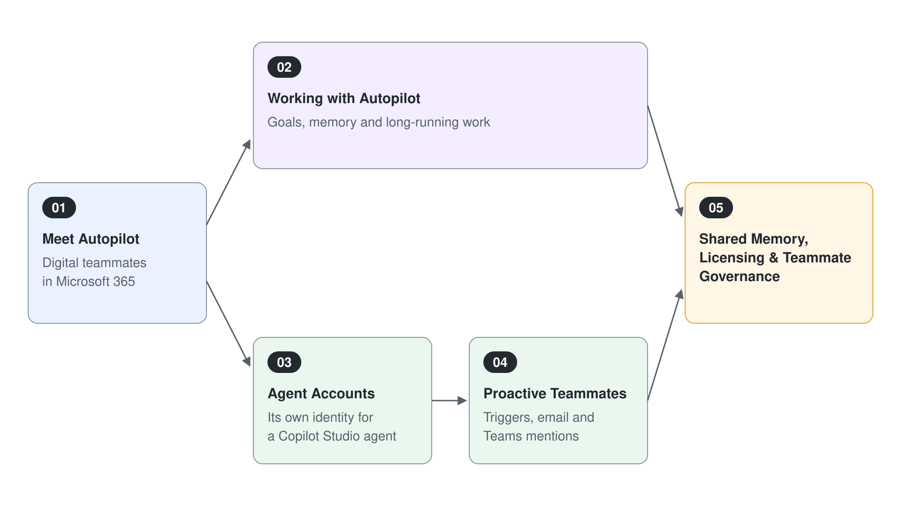

# AI Teammates: Autopilot & Agent Accounts

Cowork completes the work you hand it, and a Copilot Studio agent answers when someone asks. A teammate agent goes one step further: it holds its own identity in the tenant, remembers what the team tells it, and keeps a business process moving without waiting for a prompt. This module covers the two ways Microsoft 365 delivers that model today: Autopilot, the persistent personal agent announced on September 25, 2026, and agent accounts, which give a Copilot Studio agent its own Entra ID, mailbox, and Teams presence.

Both are Frontier previews as of October 2026. Autopilot is in private preview with no general availability date, and agent accounts need a Frontier-enrolled tenant, an early release environment, and dedicated per-agent licenses. Treat the module as a forward look you can run in a prepared tenant, and plan the prerequisites in [Shared Memory, Licensing & Teammate Governance](./05-memory-governance/readme.md) before the class starts.

## Topics

| # | Topic | What you learn |
|---|-------|----------------|
| 1 | [Meet Autopilot: Digital Teammates in Microsoft 365](./01-meet-autopilot/readme.md) | What makes an agent a teammate, Autopilot (previously Scout) in the new Copilot with Home and Code, and where it sits beside Chat, Cowork, and Copilot Studio agents |
| 2 | [Working with Autopilot: Goals, Memory & Long-Running Work](./02-autopilot-at-work/readme.md) | Name, role, and goal, background modes, approvals and permissions, skills, and the Scout documentation that describes how the agent works |
| 3 | [Agent Accounts: Give a Copilot Studio Agent Its Own Identity](./03-agent-accounts/readme.md) | The maker flow from Agent account to Publish, what the account provisions, tool authentication, and the preview limitations |
| 4 | [Proactive Teammates: Triggers, Email & Teams Mentions](./04-proactive-teammates/readme.md) | Email and schedule triggers on the GitHub Copilot harness, @mentions in Teams, Outlook, and Office comments, and the Cadence execution-review agent |
| 5 | [Shared Memory, Licensing & Teammate Governance](./05-memory-governance/readme.md) | How shared memory works and what it never keeps, the Frontier for AI Teammates license pool, admin activation, and Agent 365 controls |

## How the Two Paths Relate

Autopilot is the ready-made teammate a user sets up in Copilot, and an agent account is the build path for a maker who needs control over instructions, tools, and triggers. Both end in the same place: an identity that admins govern like any other member of the organization.

## Duration & Audience

This module extends the four-day course for Power Platform makers, solution architects, and engineers who already built agents in [Module 3: Copilot Studio](../03-cs-basics/readme.md). Topics 1, 3, and 5 carry the core path; topics 2 and 4 deepen it for tenants with preview access.

## Prerequisites

- The Copilot Studio module, in particular [GitHub Copilot Agents in Copilot Studio](../06-cs-gh-copilot/readme.md), because agent accounts and triggers run on the GitHub Copilot harness
- A Microsoft 365 tenant enrolled in the Frontier program, with the admin steps in [topic 5](./05-memory-governance/readme.md) completed before the class
- For agent accounts: an early release environment and a maker license (Microsoft 365 E5 with the Agent 365 add-on, or Microsoft 365 E7)

## Links & Resources

- [Introducing the new Copilot with Home, Code and Autopilot](https://blogs.microsoft.com/blog/2026/09/25/introducing-the-new-copilot-with-home-code-and-autopilot/)
- [Give your agent an account (Frontier)](https://learn.microsoft.com/microsoft-copilot-studio/agents-experience/authoring-agent-account)
- [FAQ for agent accounts (Frontier)](https://learn.microsoft.com/microsoft-copilot-studio/faq-agent-accounts)
- [Microsoft Scout (Frontier) overview](https://learn.microsoft.com/microsoft-scout/overview)
- [Overview of Microsoft Agent 365](https://learn.microsoft.com/microsoft-agent-365/overview)
- [Preview Microsoft Agent 365 features through the Frontier program](https://learn.microsoft.com/microsoft-agent-365/frontier)
