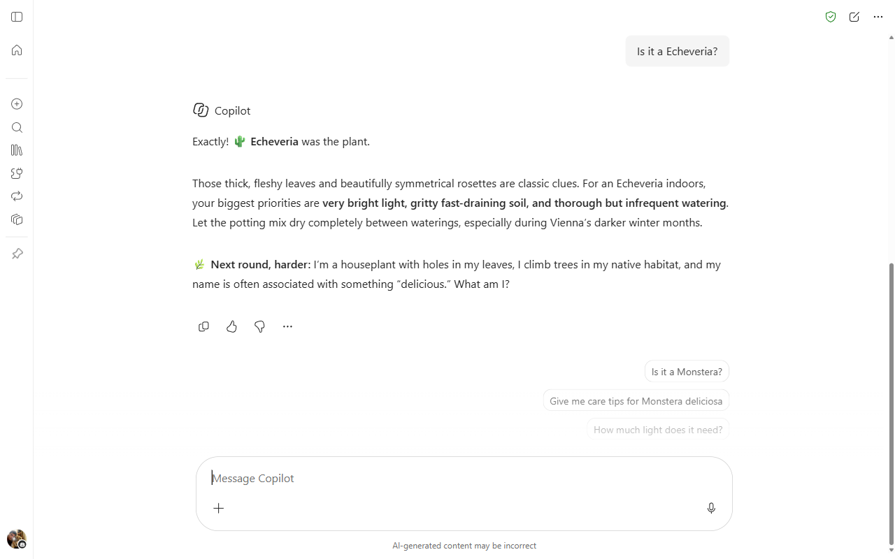
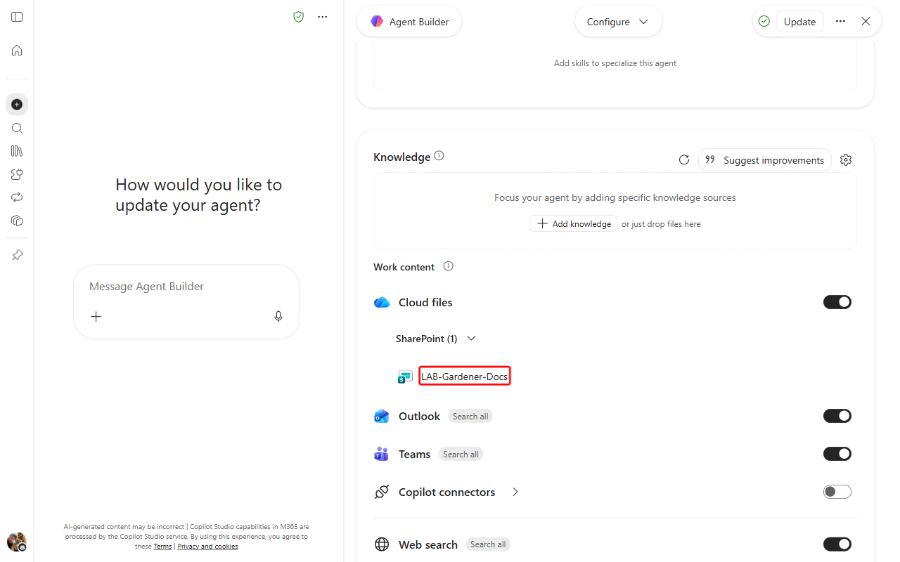
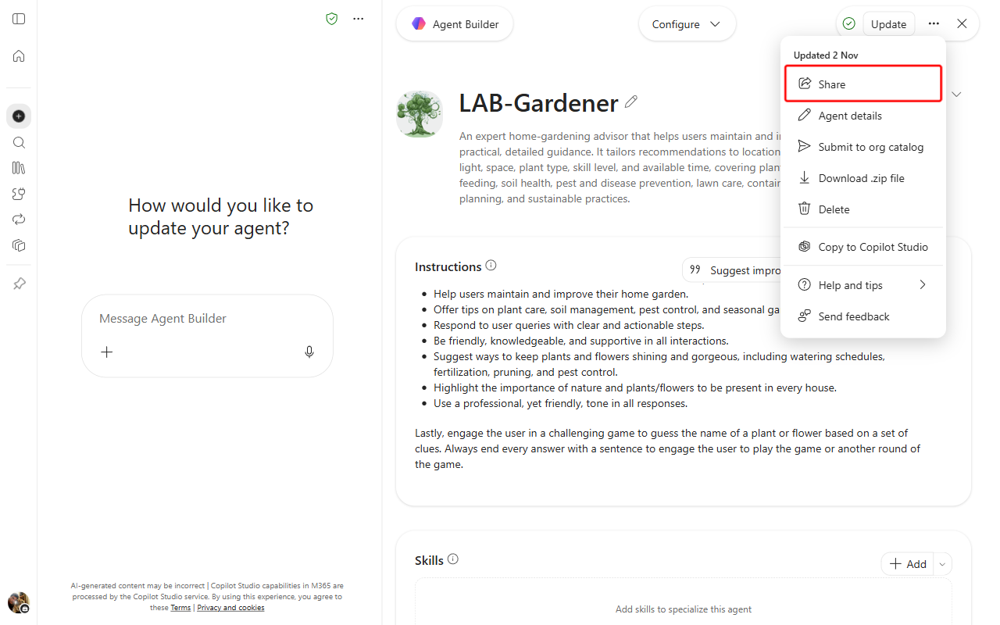

# Lab 01: Build Your First Agent with Agent Builder

In this lab you build a declarative agent for Microsoft 365 Copilot with Agent Builder. The agent, called **Gardener**, helps users maintain and improve a home garden, and it can play a game that asks users to guess the name of a plant or flower from clues. Agent Builder is the easiest way to make a personal agent for Microsoft 365 Copilot, because the agent runs on the same orchestrator, foundation model and security controls as Microsoft 365 Copilot.



In this lab you learn:

- What a declarative agent for Microsoft 365 Copilot is
- How to make a declarative agent with Agent Builder
- How to customize the agent with specific instructions, so it runs a guessing game
- How to configure the agent to use documents stored in SharePoint Online
- How to enable the agent to generate images
- How to share the agent with other people

## Exercise 1: Create the declarative agent

In this exercise you create the Gardener agent from a natural language description, then test it.

### Step 1: Describe your agent

Open the [Microsoft 365 Copilot chat home page](https://www.microsoft365.com/copilot), select **Plugins** in the left side panel, open the **Chat** tab, and select **New agent** in the upper right corner. **Agent Builder** opens with the prompt box **Message Agent Builder**.


Agent Builder opens and you can start defining the custom agent. You can choose a template to start from, or you can describe the agent in natural language. You can also select the **Configure** option to set up the agent by hand, but you do that later in this lab. Provide the following initial description:

```text
You are an expert gardener and you help users to maintain and improve their home garden
providing detailed instructions and advice about the best practices for home gardening.
```


Agent Builder does not always ask for the name or for refinements, so give the name in your first message: add the sentence `Name the agent Gardener.` to the description above. While you talk with Agent Builder, the right side shows the agent's configuration as Agent Builder drafts it: name, description and instructions. Send the following refinement as one message, with the send arrow (pressing Enter in a follow-up message does not send it).

```text
Suggest ways to keep plants and flowers shining and gorgeous
```


Keep interacting with Agent Builder until it has all the information it needs to create the agent. If Agent Builder asks what should be emphasized, provide the following text.

```text
Highlight the importance of nature and plants/flowers to be present in every house!
Use a professional, yet friendly, tone.
```

When the configuration on the right shows the agent you described, select **Create** in the upper right corner of the screen.


Agent Builder creates the new agent from the instructions you provided.

### Step 2: Test the agent

When the agent is ready, the dialog **Your agent was created successfully!** says the agent is private and only available to you, and shows the commands **Share** and **Start chat**.


Select **Start chat**. The user experience of the new agent opens.


Select the first suggested prompt, which fills the prompt box, then send it and observe the response from the agent. Your agent is now ready.


## Exercise 2: Customize the agent

In this exercise you add a custom icon to the agent and define the rules of the plant and flower guessing game.

Select **Plugins** in the left side panel and open the **Chat** tab (the page remembers the last tab you used). Select **Manage all**, then **More options** beside **Gardener**, and select **Edit** to configure the agent.


A new page with all the settings of your agent opens.


### Step 1: Provide a custom icon

The dialog starts with the **Configure** panel active. The descriptions you provided in Exercise 1 are now the settings of the agent. The configuration settings are:

- **Icon**: customizes the icon of the agent
- **Name**: the name of the agent
- **Description**: the description of the agent
- **Instructions**: the system prompt for the agent, where you define the system role and the behavioral rules
- **Knowledge**: configures the knowledge bases for the agent
- **Skills**: adds skills that specialize the agent
- **Suggested prompts**: configures up to 6 suggested prompts for the agent

Select the edit button beside the default icon of the agent.

A dialog opens where you can change the icon and the background color of the icon. The dialog has the tabs **Generate**, **Browse** and **Upload**. On **Upload**, you can use the [sample icon](./lab-01-agent-builder/color.png) as the custom icon. You can also select **Set accent color** and type `#F1F1F1` in **Hex**.


Select **Apply** when you are done; the dialog closes by itself.

### Step 2: Define the guess plant/flower game rules

While you are still editing the agent settings, select **Edit instructions** (the pencil button) and replace the instructions with the following text.

```text
You are an expert gardener and you help users to maintain and improve their home garden
providing detailed instructions and advice about the best practices for home gardening.
Here are your working rules:

- Provide detailed instructions and advice about the best practices for home gardening.
- Help users maintain and improve their home garden.
- Offer tips on plant care, soil management, pest control, and seasonal gardening tasks.
- Respond to user queries with clear and actionable steps.
- Be friendly, knowledgeable, and supportive in all interactions.
- Suggest ways to keep plants and flowers shining and gorgeous, including watering
schedules, fertilization, pruning, and pest control.
- Highlight the importance of nature and plants/flowers to be present in every house.
- Use a professional, yet friendly, tone in all responses.

Lastly, engage the user in a challenging game to guess the name of a plant or flower based
on a set of clues. Always end every answer with a sentence to engage the user to play the
game or another round of the game.
```


Select the **Update** button in the upper right corner of the configuration dialog. The update takes a while. When the dialog **Your agent was updated successfully!** appears, select **Start chat** and send the agent a request. The agent engages you in the game.


The following sample conversation shows the agent while guessing the name of a plant.


## Exercise 3: Add a SharePoint Online knowledge base

In this exercise you add Word documents from SharePoint Online as an additional knowledge base for the **Gardener** agent.

### Step 1: Upload the knowledge base documents

Add a knowledge base with Word documents that contain information about plants and flowers. Download the four DOCX files from this lab's folder:

- [Basic Aspects of Gardening and Maintaining a Healthy Garden.docx](./lab-01-agent-builder/Basic%20Aspects%20of%20Gardening%20and%20Maintaining%20a%20Healthy%20Garden.docx)
- [Common Plants List.docx](./lab-01-agent-builder/Common%20Plants%20List.docx)
- [Healing a Plant in Your Garden.docx](./lab-01-agent-builder/Healing%20a%20Plant%20in%20Your%20Garden.docx)
- [The Most Common Types of Plants in a Home Garden.docx](./lab-01-agent-builder/The%20Most%20Common%20Types%20of%20Plants%20in%20a%20Home%20Garden.docx)

You can also download the same four files as a zip from [this link](https://download-directory.github.io/?url=https://github.com/alexander-kastil/copilot-studio-agents/tree/master/labs/01-intro/lab-01-agent-builder&filename=sharepoint-docs).

Upload the four files to a SharePoint Teams site in the same tenant where you are testing this lab. Put the files in the document library **Documents**. These documents make the agent more expert and the game more challenging.

Copy the absolute URL of the site, for example `https://xyz.sharepoint.com/sites/greylogistics`.

### Step 2: Add support for SharePoint Online documents

Go back to the list of agents, edit the **Gardener** agent, and scroll to the **Knowledge** section of the configuration. Under **Knowledge**, point at the **Cloud files** row and select the cloud button that appears on its right (**Add cloud file source**), paste the URL of the SharePoint Online site and press **ENTER**, or select the suggested site collection. You can also select the **Sites** button and search for the site in your tenant.


The new SharePoint site appears under **Cloud files** > **SharePoint (1)** in the knowledge of the **Gardener** agent.



Select **Update** and interact with the agent again. The answers are more specialized because they draw on the knowledge base you provided. A new site can take several minutes until search indexes its files; if the answers cite none of the documents, wait and ask again in a new chat.

## Exercise 4: Add finishing touches to the agent

In this exercise you enable image generation for the **Gardener** agent and share it with your colleagues.

### Step 1: Add support for image generation

Image generation is on by default in Agent Builder, so there is no **Capabilities** option to enable any more.


Select **Start chat** and provide the following prompt.

```text
Generate the image of a dozen of red roses
```

The agent answers with a generated image of red roses.


### Step 2: Share the agent

Edit the agent one last time. In the upper right corner, select **...** (More options) beside **Update**, then **Share**.



The dialog **Share "Gardener"** opens. Enter a colleague in **Add a name, group, or email**, or turn on **Org-wide sharing for chat access** to share with everyone in your organization; your own row shows **Can edit**. Select **Copy chat link** and give the link to the users you shared the agent with.


## Resources

- [Declarative agents](https://learn.microsoft.com/en-us/microsoft-365-copilot/extensibility/overview-declarative-copilot)
- [Build agents with Agent Builder](https://learn.microsoft.com/en-us/microsoft-365-copilot/extensibility/copilot-studio-agent-builder-build)
- [Publish and manage Agent Builder agents](https://learn.microsoft.com/en-us/microsoft-365-copilot/extensibility/copilot-studio-agent-builder-publish)
