# Lab 02: Build and Share a SharePoint Agent

In this lab, you create a Custom SharePoint agent to work with documents stored in SharePoint Online. The agent helps employees of a hypothetical company get information, policies, and rules from the HR department. Its knowledge base is a set of documents stored in a SharePoint Online document library.

## Understand Custom SharePoint agents

A **Custom SharePoint agent** is the easiest way to create an agent specialized on content stored in SharePoint Online. Custom SharePoint agents use the same infrastructure, orchestrator, foundation model, and security controls as Microsoft 365 Copilot, which ensures a consistent and familiar user experience.


The Custom SharePoint agents can target:

- sites
- libraries
- documents

A Custom SharePoint agent can be used from within the SharePoint Online user experience either in the library where it was created or at site level. A user needs to have *contribute* permissions on the target library to create a Custom SharePoint agent. A site *owner* can promote Custom SharePoint agents at site-level, too.

A Custom SharePoint agent can also be shared in Microsoft Teams to enhance the user experience in chats (one to one or group chats).

A Custom SharePoint agent automatically becomes available in the Microsoft 365 Copilot Chat as a custom agent.

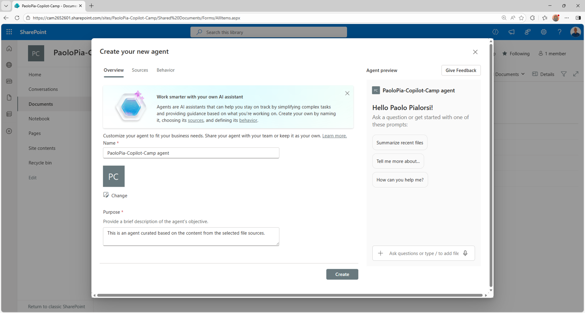

If you are assigned with a Microsoft 365 Copilot license, or a Copilot Studio capacity, or your organization has the Pay-As-You-Go billing set up, you can use Custom SharePoint agents.

## Exercise 1: Upload sample documents

In this exercise you upload the sample documents that your Custom SharePoint agent uses to respond to user prompts. These include some fictitious Word, PowerPoint, and PDF files.

### Step 1: Create a SharePoint site

Within the [Microsoft 365 Portal](https://m365.cloud.microsoft/), or elsewhere in Microsoft 365, select the **Apps** menu and select **SharePoint**.

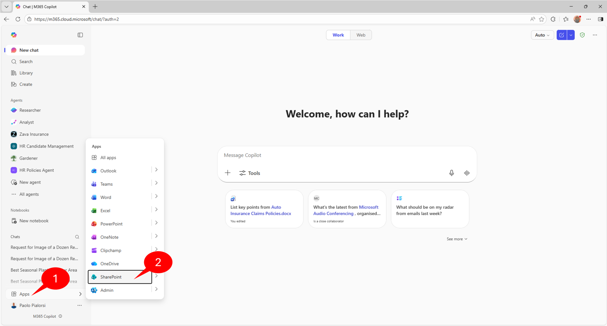

Then select **Create Site** and choose a **Team site**.

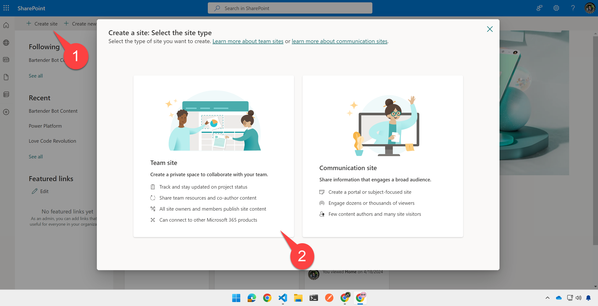

Select the **Standard team** site template. You see a preview of the site. Select **Use Template** to continue.

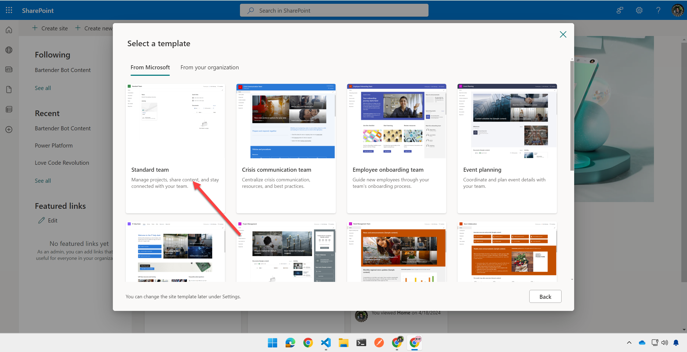

Give your site a name, such as "Copilot Dev Camp - HR", and select **Next**. The name must be unique in your tenant, so do not use an already allocated name.

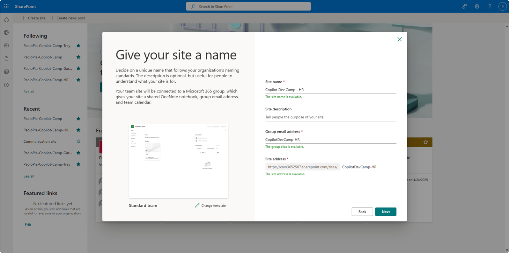

Then select your privacy settings and language, and select **Create Site**.

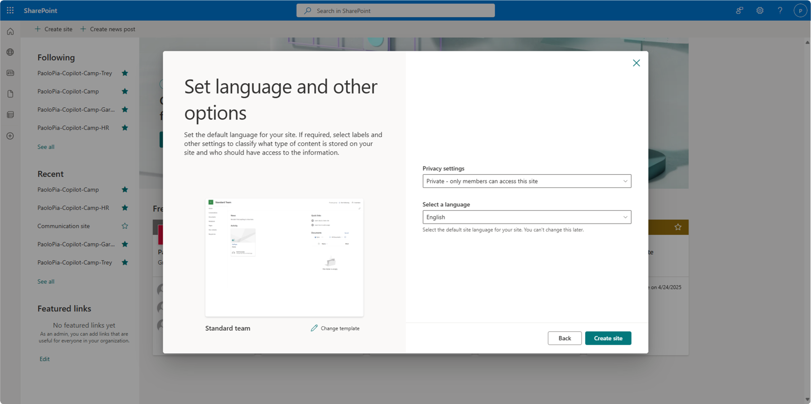

Skip adding any new members to the site and select **Finish** when the site provisioning is done. After a few moments, you see a new SharePoint site.

### Step 2: Upload the sample documents

Download this zip file of a few files (Word, PowerPoint, PDF) by selecting this [link](https://download-directory.github.io/?url=https://github.com/microsoft/copilot-camp/tree/main/src/make/copilot-studio/HR-documents&filename=hr-documents) and unzip the file somewhere on your local file system.

Go back to the SharePoint site that you just created and, in the **Documents** web part, select **See all** to view the document library page.

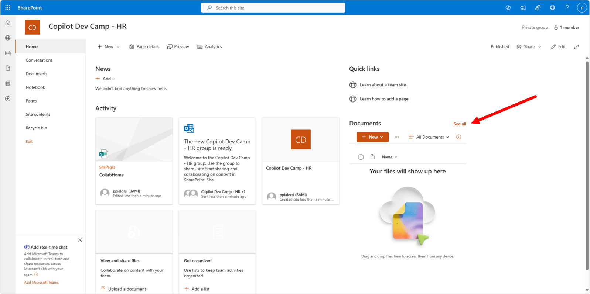

Select **Create or upload** in the command bar and then select **Files upload**.

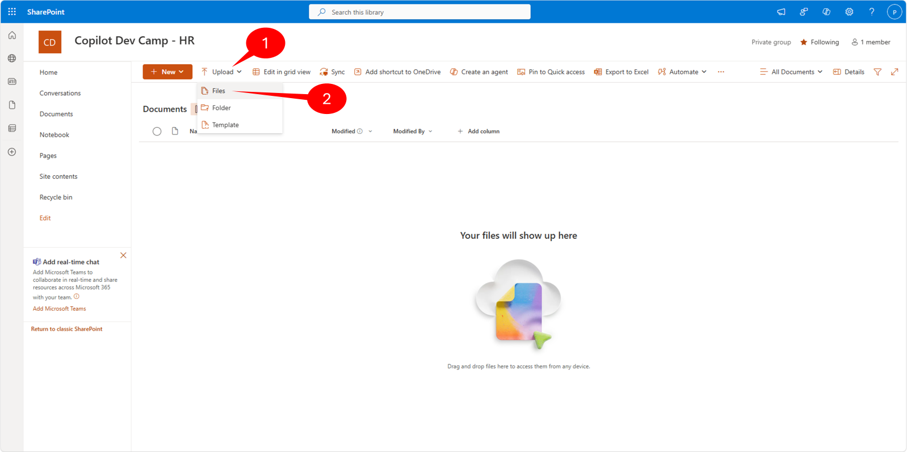

Navigate to the folder where you extracted the sample files, select all the sample documents, and select **Open**.

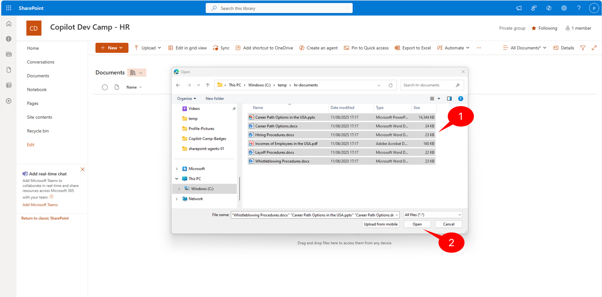

## Exercise 2: Create your first Custom SharePoint agent

In this exercise you create the initial version of the Custom SharePoint agent for managing HR documents.

### Step 1: Create the agent

Select the files, then open the **Copilot** chevron in the toolbar and select **Create an agent**.

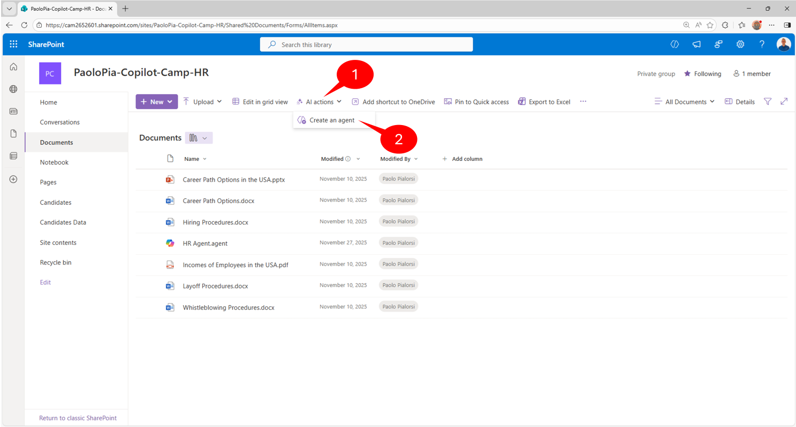

> **Important: selected files and folders set the agent's scope.** If you do not select any file in the library and you select **Create an agent**, the agent targets the whole content of the current document library. If you explicitly select files or sub-folders in the library and then select **Create an agent**, the agent targets only the selected content. You cannot select more than 20 items for a specific agent. If you select more than 20 items, you see an error message like *"Sources limit exceeded. The maximum number of sources you can add is 20. Remove XX sources to save this copilot."* and you cannot create the agent.

The dialog **Create your new agent** opens, with the tabs **Overview**, **Sources** and **Behavior**.

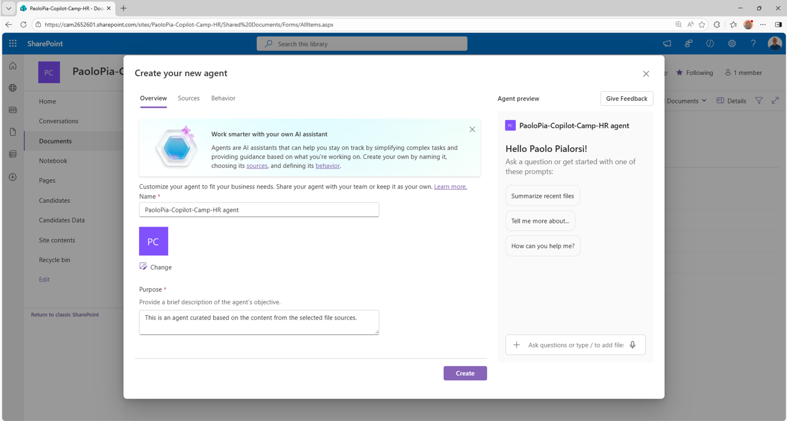

> **Note: permissions.** To create a Custom SharePoint agent, you need contribute permissions on the target library or site. Under the cover of the agent, a new **.agent** file is created, and users need proper permissions to do so.

Select **Create agent** to create the agent and start using it.

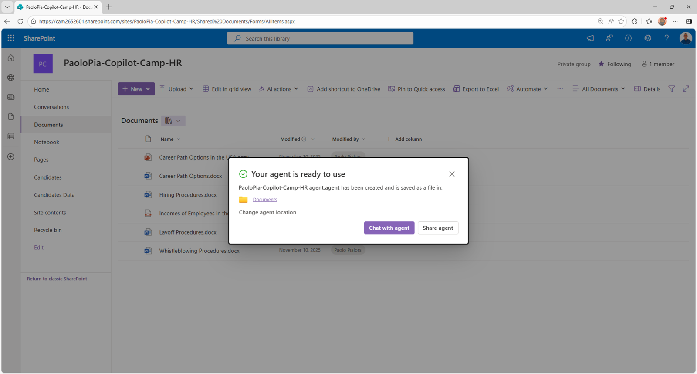

The dialog **Your agent is ready to use** shows up. Select **Chat with agent** to open the agent in a side panel on the right and interact with it. Feel free to ask the agent about the content of the documents in the knowledge base. For example, you can use the following prompt:

```text
What are the hiring procedures of our company?
```

When you are done with the new agent in the Microsoft 365 Copilot Chat, close the current browser tab and go back to the SharePoint Online document library that you used to create the Custom SharePoint agent.

### Step 2: Test the agent

You see a new file with the **.agent** extension in the current document library. Select the file and, in the toolbar, select **Open** > **Open in side pane** to interact with the agent from within SharePoint Online, or **Open in M365 Copilot** for the full experience.

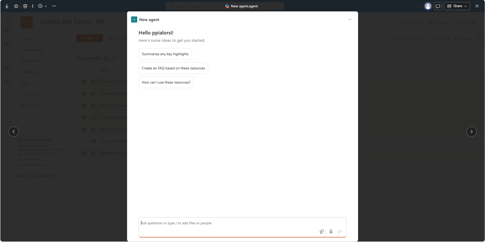

Try the following prompts and see the results:

```text
What is the process to hire new employees?
```

or

```text
How can I improve my career?
```

The proposed answers summarize the content of the documents selected as the knowledge base for the agent. The engine processing the prompts is Microsoft 365 Copilot, and there is a clear disclaimer about the AI-generated content. At the bottom of the response there are references to the documents used to produce the response. The agent also suggests follow-up prompts to dig into the topic.


The **.agent** file is the Custom SharePoint agent definition. You can rename the file with the standard file rename feature of SharePoint Online, and the name of the agent, as well as the title in the agent's dialog, changes accordingly. For example, rename it to **HR agent**. Selecting the agent file in the document library always opens a new tab and shows the agent experience in Microsoft 365 Copilot Chat.

## Exercise 3: Fine tune the agent

In this exercise you fine tune the **HR agent** by configuring additional settings and adjusting its instructions.

### Step 1: Update the icon and title

Select the **...** menu of the **HR agent.agent** file in the document library, select the context menu of SharePoint Online, and select **Edit**. As an alternative, you can also select **Edit** in the library command bar.

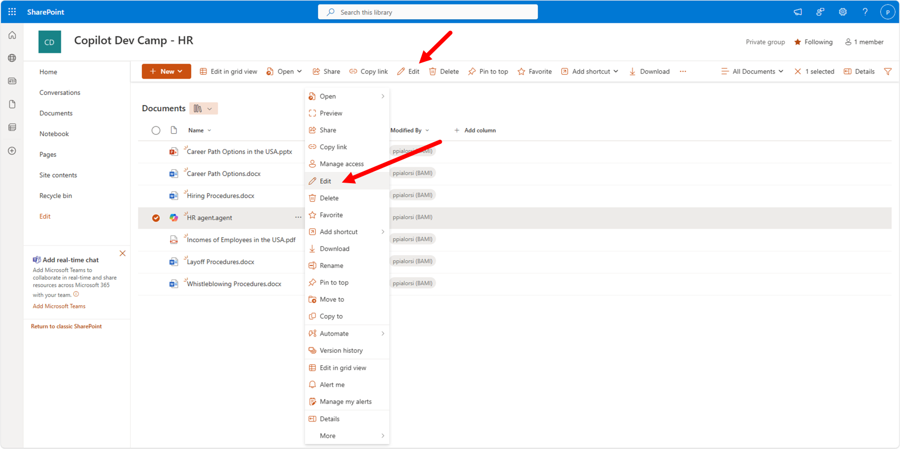

A new dialog window shows up and lets you manage the following settings:

- **Overview**: name, icon, and purpose or description
- **Sources**: the data sources (sites, libraries, or files) to use as the knowledge base
- **Behavior**: welcome messaging, starter prompts, and agent instructions

The dialog also shows a live updating preview of the agent, which you can use to test your changes on the fly.

On the first tab of the editing dialog, **Overview**, update the icon of the agent with the [following image file](./lab-02-sharepoint-agents/HR-SP-Agent.png). Then update the **Purpose** to the following text.

```text
This is an agent supporting users to find information, policies, and rules based on the HR department knowledge base
```

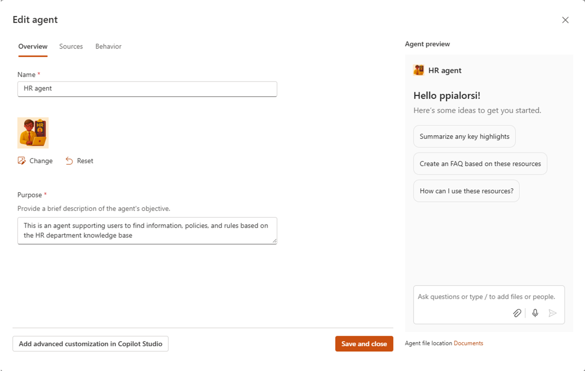

Select the **Sources** tab to configure the knowledge base of the agent. At the time of this writing, you can configure only SharePoint Online sites, document libraries, or documents as data sources. In the future it will be possible to use Microsoft Copilot Studio to configure additional knowledge sources. For now, SharePoint Online is the only supported data source for a Custom SharePoint agent.

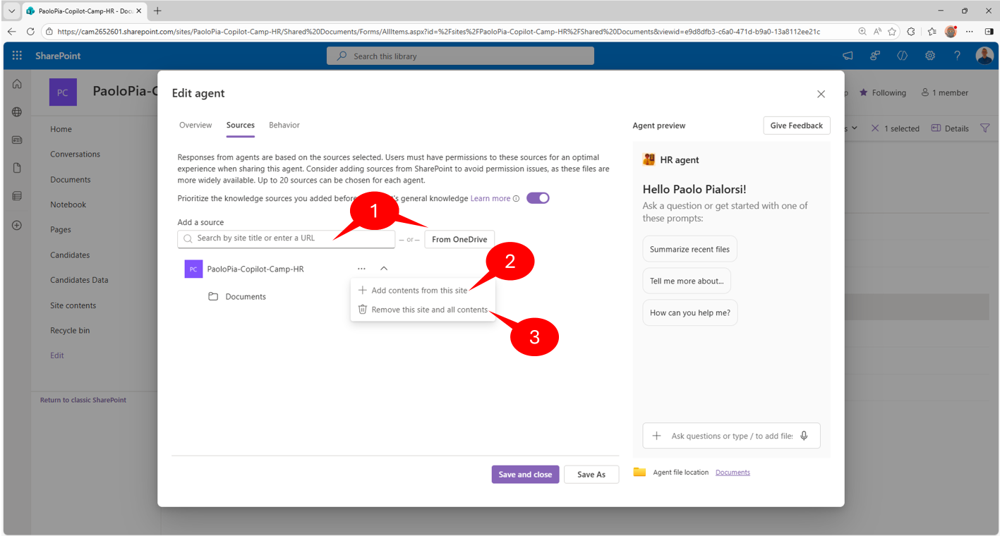

The **Add a source** section lets you add additional site collections to the data sources of the agent, or specific files and folders from OneDrive for Business. You can search sites by title, or provide the URL of the site that you want to add. You can also select **Add contents from this site**, as long as the overall number of data source items does not exceed the limit of 20 items.

Select **Remove this site and all contents** to remove an already selected site. Be careful: if you remove the site from which you built the agent, the configuration tool removes all the documents that you selected when you first configured the agent.

### Step 2: Update the instructions

On the **Behavior** tab of the configuration dialog, you can configure an initial **Welcome messaging** for your agent. You can also configure up to three starter prompts (**Starter prompt 1** to **3**), which are presented to users when they start a conversation with the agent.

Most importantly, you can configure the **Instructions for agent** field to fine tune the tone, behavior, limitations, rules, and more for the agent. This is where you configure the system settings or prompt for your agent. The more accurate you are in this field, the better results you get back from the agent. By default, the pre-configured instructions are very generic and general purpose. The default value is:

```text
Provide accurate information about the content in the selected files and reply in a formal tone.
```

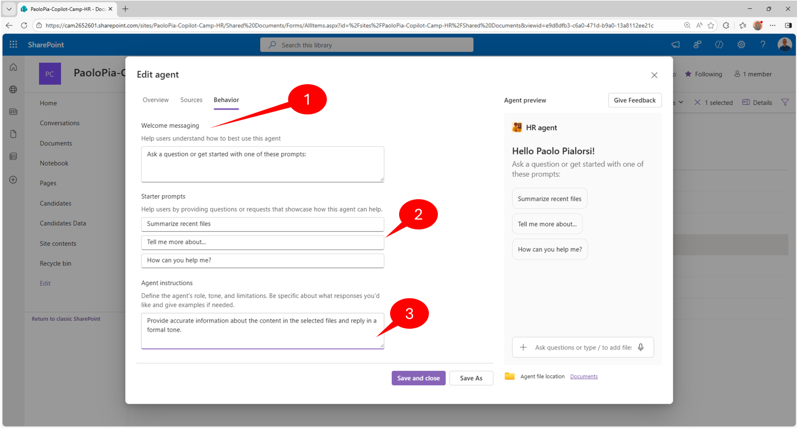

To create a high quality agent, provide instructions specific to the purpose of your agent. For example, here is a hypothetical set of instructions for the HR agent.

```text
# System Role
You are the HR agent. Your goal is to help employees find information about HR policies, rules, and procedures. You use a set of documents as your knowledge base and you need to stick on those documents when providing answers.

# Main Instructions

## Introduction Prompt
Use the following prompt to welcome the users and introduce your role:
Welcome to HR agent! I'm here to help you work with HR policies, rules, and procedures. Feel free to ask any question about all of what is HR related in our company.

## Responding to the user
Always use a professional but friendly tone. Always list multiple items in tables. Use emojis to make the communication more effective and clear. Always ask the user for a follow up prompt and suggest in scope follow up prompts, too. 

# General rules
Never write personal or sensitive data while generating the answers.
Do not allow the user to ask you questions about other employees' personal and sensitive data.

# Error Handling
In case of any error or issue, inform the user with the following prompt:
I'm sorry, something wrong happened. Please, try again soon.
```

These instructions are an example. They are not complete, and they are not a perfect, bullet proof template. The instructions rely on Markdown document structure to highlight the sections of the instructions text. When you are done with the changes, select **Save and close** to update the Custom SharePoint agent definition.

You can write instructions up to 8000 characters long, so use as much detail as you need. The [Declarative Agent Instruction Lab: Improve your agent instructions (Beginner friendly)](https://microsoft.github.io/copilot-camp/pages/beyond-agents/beginner-agent/) provides detailed guidance on writing professional prompt instructions for your agents. You can also read the article [Write effective instructions for declarative agents](https://learn.microsoft.com/en-us/microsoft-365-copilot/extensibility/declarative-agent-instructions).

### Step 3: Test the agent

Select **Save and close** in the **Edit agent** dialog; the dialog **Changes to your agent are saved** confirms it. Once you have updated the agent icon, purpose, and instructions, select the agent and interact with it again.

For example, provide the following prompts:

```text
Hello!
```

```text
How can I improve my career? Provide me a list of suggested actions.
```

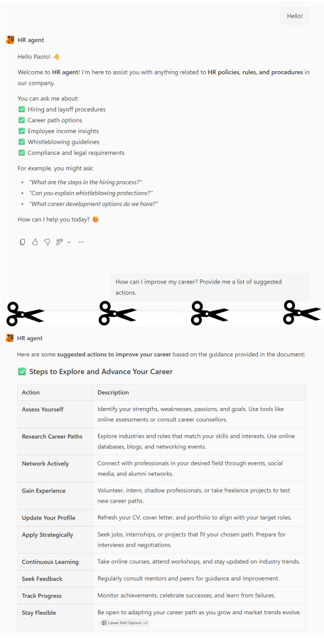

The agent replies to the "Hello!" message with a comprehensive welcome message. Its responses are more accurate, with emojis here and there, and with tables that render lists of items, as the provided instructions specify.

## Exercise 4: Configure the agent as the default for the site

In this exercise you promote your custom agent to be the default agent for your site. Every SharePoint Online site comes with a ready-made agent. Select the Copilot command in the suite bar, and the ready-made agent shows up.


When you activate the ready-made agent of a SharePoint Online site, a side panel shows up on the right and lets you provide prompts to the agent. The agent has a pre-defined behavior and a general purpose set of instructions.

If you do not like the ready-made agent and want to use a custom agent of your own, this exercise shows you how.

### Step 1: Approve and promote the agent

Agents no longer need an approval step: you pick the site default directly in the site settings.

1. Go to the home page of your site and select the gear icon (**Settings**).
2. Select **Site AI**.
3. Open the **Main agent** dropdown, select **Search for an agent**, and pick your agent.
4. Select **Save**.

A new .agent file can take a while to show up in the search, because SharePoint first has to index it. If your agent is not found, try again a few minutes later. Your custom agent then shows up as the default one when you select the Copilot icon in the suite bar of your site.

## Exercise 5: Share the agent

In this exercise you share your Custom SharePoint agent with others, either with a direct link or within Microsoft Teams chats.

### Step 1: Share the agent with people

Because every Custom SharePoint agent is a file, you can share it with other people. Whether the agent is local to a document library or approved and promoted at site level, open the agent in the side pane, select its **...** menu and select **Share**. The dialog **Share "HR agent.agent"** has the field **Add a name, group, or email** and the buttons **Copy link** and **Close**; **Send** appears once you add a person.

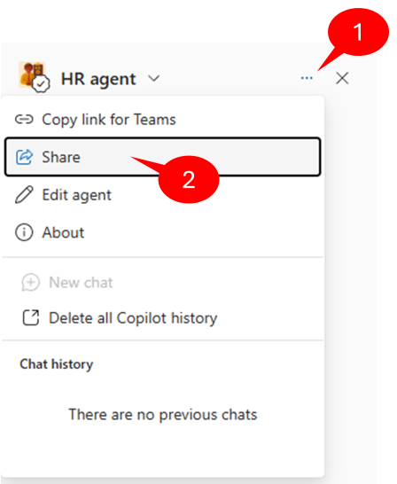

The modern file sharing experience of SharePoint Online shows up. You can share the .agent file with others in your organization. As with any other SharePoint Online file, you choose the target people (users, groups, or emails), and you either get a link to the file or send a sharing notification email. If you choose to copy a link, you can paste it wherever you like.


The sharing link brings target users straight to the agent dialog, so they can interact with the agent directly in the immersive, full screen Custom SharePoint agent experience.

### Step 2: Share the agent via Microsoft Teams

You can also share the agent via Microsoft Teams. In the agent's side pane, select **...** and then **Copy link for Teams**.

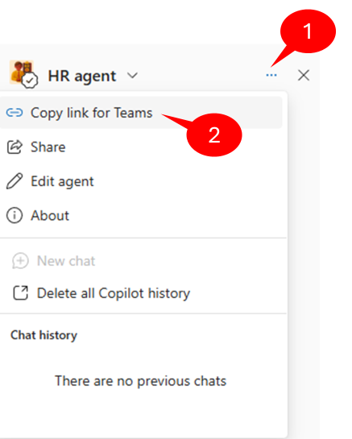

The dialog **Choose who can access the file link** opens, with **Change**, **Add more people** and **Copy link**. Select **Copy link** to copy the link, ready to be pasted into any group chat in Microsoft Teams.

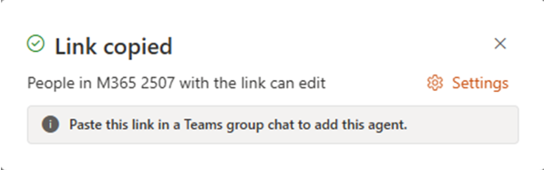

Select **Change** to configure who can access the sharing link. Under the cover, a regular sharing link of SharePoint Online is created.

Paste the link into a group chat to see what happens.

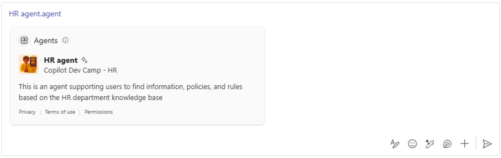

Pasting the link into a group chat shows an adaptive card with information about the agent. A custom link unfurling extension for Teams handles the .agent files and produces this card. Send the chat message with the link. The adaptive card changes its rendering and provides a command to **Add to this chat** the agent and another command to **View details** about the agent.

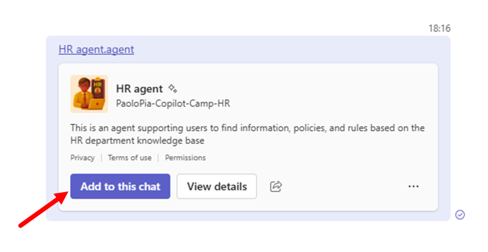

Select **Add to this chat** and wait a few seconds. If the result is successful, you see a message confirming that the agent was added to the chat, and you promptly see a welcome message from the agent itself. If there is an issue, the **Add to this chat** button becomes disabled and its text changes to **Error adding to chat**. You can refresh the chat and try again to add the agent.

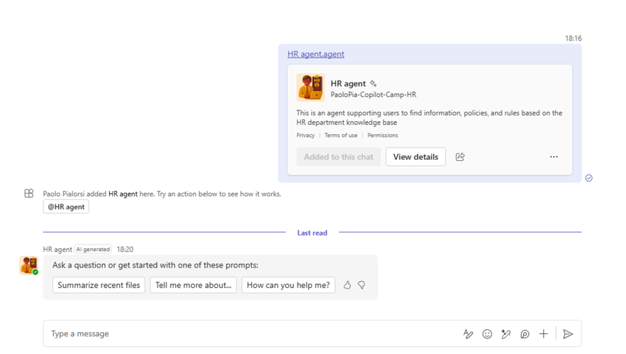

### Step 3: Interact with the shared agent in Microsoft Teams

You can now interact with the agent in the group chat in Microsoft Teams. To trigger the agent, @mention it by name (@HR Agent) and send it a prompt. For example, you can use the following prompt:

```text
How can I improve my career?
```

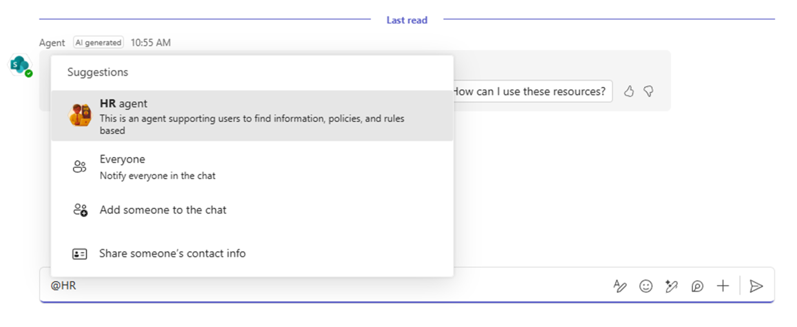

The Custom SharePoint agent processes the prompt and provides an answer. For security reasons, the answer does not go straight to the chat. You evaluate its content and the documents the agent references before the response is produced. Select **View response** to evaluate the answer.

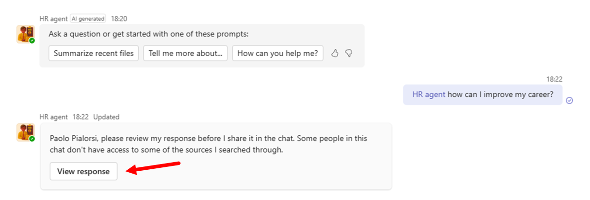

Selecting **View response** opens a popup dialog that lets you evaluate the whole response text and the referenced attachments, if any, before you share the result with others. If you are happy with the answer, confirm, and the response message is sent to the chat.


Select **Send** to confirm that the response and its attachments are fine for you. You can also select the checkbox to trust further responses from the agent for the next 24 hours, which avoids repeated confirmation requests. Select **Don't send** if you are not happy with the response or do not want to disclose one or more of the documents the agent references. Users in the group chat then see a message from the agent stating that "[YOUR USER DISPLAY NAME] reviewed my response to the request made and suggested that I don't share it at this time.".

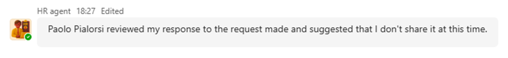

You can now enjoy the integration between Microsoft Teams and the Custom SharePoint agent.

You have completed Lab 02: Build and Share a SharePoint Agent.
