# Lab 05: Share and Use SharePoint Agents

In this lab you share an agent with other users, share it in a Microsoft Teams chat, and then use agents in SharePoint and Microsoft Copilot Chat. You also learn how to pin agents, refer to specific files in a chat, and manage your chat history.

Sharing an agent extends its benefits to a broader audience in your organization. Your colleagues can then use the agent's capabilities to improve their own work processes. Sharing also keeps the knowledge built into the agent available to the right people at the right time.

## Exercise 1: Share an agent with other users

In this exercise you learn the sharing options for agents in Copilot Chat, share a live agent, and approve or set a default agent in SharePoint.

Sharing an agent ensures that all relevant team members who have the necessary permissions can use its capabilities. Team members can then find answers and perform tasks without leaving the agent's SharePoint or Copilot Chat environment. Sharing also helps maintain consistency across the team, because everyone receives the same guidance from one centralized source. This reduces the risk of errors and discrepancies, provided the shared users have access to the same knowledge sources.

When you share an agent in Copilot Chat, the **Share** dialog offers these choices:

- **Add a name, group, or email**: specific people, security groups or Microsoft 365 groups in your tenant can use the agent.
- **Org-wide sharing for chat access**: anyone in your organization can use the agent.
- Nobody added and the toggle off: only you, the author, can use the agent. This is the default.

**Copy chat link** copies the link to the agent.

These sharing options don't apply to SharePoint agents. Instead, SharePoint relies on an approval process by the site owner or site administrator to make an agent available to site members and site visitors. The sharing and approval processes for agents in Copilot Chat and SharePoint are designed to fit the specific needs and workflows of each platform.

Both Copilot Chat and SharePoint agents can only return information from knowledge sources that the shared users can access. For Copilot Chat agents that contain knowledge sources from SharePoint files and folders, Microsoft recommends that you share the agent with specific people or groups in your organization through security groups. Doing so automatically shares the files with users, so the agent can return responses from those sources.

> **Note:** When you share an agent in Copilot Chat or approve an agent for sharing in SharePoint, the people who can use the shared agent can't edit it. This restriction maintains the integrity and functionality of the agent, ensuring that only the owner can modify its settings or behavior.

### Consider when to keep an agent private

Sharing an agent can be beneficial for collaboration and efficiency. However, there are scenarios where it might be best to keep the agent private or limit its sharing, for example:

- **Sensitive information**. If the agent handles sensitive or confidential data, such as financial records, personal employee details, or proprietary business strategies, sharing it broadly could pose a security risk. Restrict access so that only authorized personnel can view or interact with this information.
- **Incomplete or unverified agents**. Agents that are still in development or testing phases might not be fully reliable. Wait until the agent is thoroughly tested and verified for accuracy before sharing it with a wider audience.
- **Specific use cases**. Some agents are designed for specific tasks or departments. An agent created for the finance department might include functionalities and data relevant only to finance professionals.
- **Compliance and governance**. Sharing agents that don't comply with organizational and legal policies could lead to regulatory issues or penalties. Make sure that any shared agent meets all organizational and legal standards.
- **Resource constraints**. If an agent requires significant computational resources or incurs high usage costs, limit its sharing. Overloading systems with resource-intensive agents can affect performance and lead to increased expenses.

### Step 1: Share an agent with individuals in your organization

Unlike sharing an agent in SharePoint, no approval from an administrator is required before the user who created the agent can share it in Copilot Chat. You can share an agent at the time you create it, or after the agent is live. When you share an agent, the people you share it with can use it but can't edit it.

> **Note:** Users you share your agent with must have a Microsoft 365 Copilot license or access through a metered Copilot Chat environment configured by their organization.

After you select the **Create** button, Microsoft Copilot creates the agent and shows the dialog **Your agent was created successfully!** with the commands **Share** and **Start chat**. Select **Share** to open the **Share** dialog.

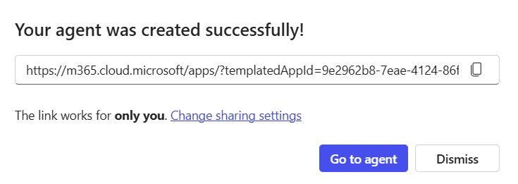

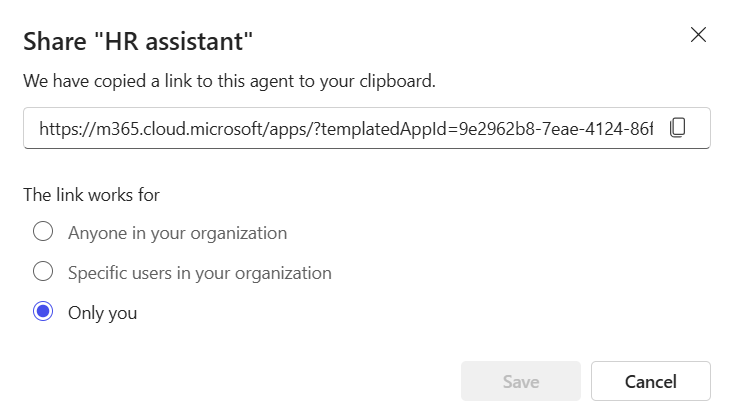

> **Caution:** When you search in **Add a name, group, or email**, the search results might include [distribution groups](https://learn.microsoft.com/en-us/microsoft-365/admin/create-groups/compare-groups). Sharing an agent with a distribution group can cause the share to fail.

You can still share an agent once it's live. Choose one of the following two ways to do so.

1. Sign in to **Microsoft Copilot** with your work or school account. The **Microsoft Copilot Chat** page appears by default.
2. Select **Plugins** in the left side panel and open the **Chat** tab. Select **Manage all**, then **More options** beside the agent and **Edit**, and select **Share** next to the **Update** button.

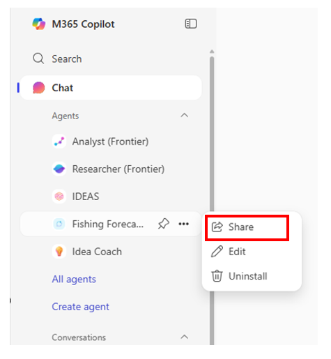

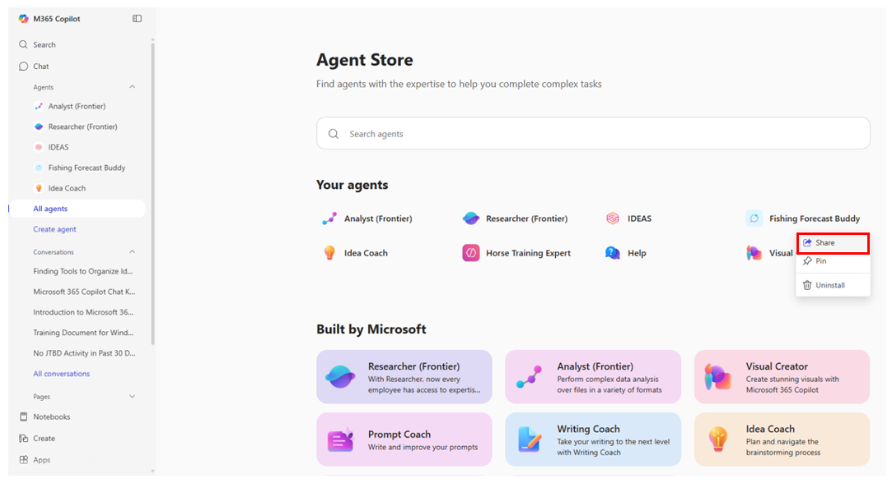

3. In the **Change sharing settings** window that appears, select the sharing option that you want to apply.

### Step 2: Share the agent through external applications

Sharing through an external application lets you share your agent through apps such as Facebook, LinkedIn, WhatsApp, or Outlook. When you share an agent through an app, the agent's link goes to that platform, so that it can be used across different communication and collaboration tools.

1. From the navigation pane on the Microsoft Copilot home page, right-click the agent in the agent pane. In the menu that appears, select **Share**.
2. In the **Share** window that appears, select the application that you want to use to share the agent.

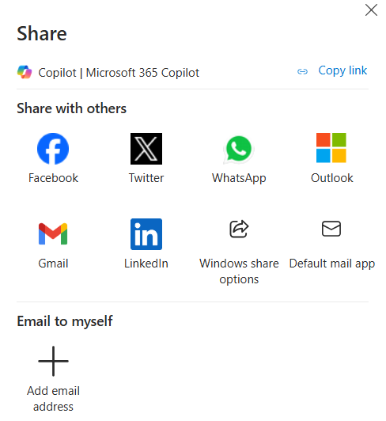

When you select an app, the app opens and presents a corresponding method for sharing the agent. For example, if you select a social media platform such as Facebook, a window appears that lets you create a post that includes the link to the agent. If you select an email app such as Outlook, a New Email page appears that displays the link for the agent in the body of the message. Fill out the email form and send it to whomever you want to share the agent with.

### Automatically share SharePoint files and folders in Copilot Chat agents

When you share a Copilot Chat agent, the users it is shared with might not have access to its underlying knowledge sources. The agent respects the end user's information and access privileges. If the user doesn't have access to a knowledge source, the agent can't include content from it when it generates a response. You can automatically share the underlying knowledge sources with security groups when the Share option is set to **Specific users in your organization**.

> **Note:** Only files and folders added to the agent can be automatically shared. A site administrator must grant user permissions through site settings.

When you share an agent that uses files or folders as knowledge sources, those files and folders are automatically made available to the users to whom the agent is shared. The sharing process depends on the permissions set for those files or folders. If the author of the agent doesn't have the necessary permissions to share, or to update the sharing permissions of, the files or folders, the sharing fails. Any file sensitivity labels applied to files in SharePoint or OneDrive are respected, which can further restrict sharing.

If the sharing of a file or folder fails, the agent itself is still shared with the user. However, Copilot can't use those files and folders when it generates answers to the user's queries. To resolve this issue, the agent's author must contact the file owners or the SharePoint site administrator and ask them to grant permission to the file or folder directly from SharePoint.

When a user's access to the agent is removed, it doesn't affect their access to the shared files or folders. Use file permission management in SharePoint to manage a user's access to those files and folders.

### Step 3: Set an agent as the site default

SharePoint agents no longer need an approval step. A site owner picks the agent that opens by default in the site's Copilot pane:

1. Go to the home page of the site and select the gear icon (**Settings**).
2. Select **Site AI**.
3. Open the **Main agent** dropdown, pick your agent, and select **Save**.

The Copilot pane of the site now opens with your agent. A new .agent file can take a while to appear in the dropdown, because SharePoint first has to index it.

To share a SharePoint agent with people, open its .agent file and select **Share** in the agent pane: it is a regular file share (**Add people**, **Change** for who can access the link, **Copy link**).

### Troubleshoot sharing errors

When you share an agent and its knowledge sources, you might encounter the errors listed in the following table.

| **Error code** | **Description** |
| --- | --- |
| **Something went wrong** | An internal service error message. Contact Microsoft Support if this error continues to occur. |
| **Couldn't share** | Insufficient privileges to update the sharing permissions on certain files. The error identifies the files that couldn't be shared. The agent owner should go into SharePoint and try updating these permissions manually. For more information, see [Share a document](https://support.microsoft.com/office/share-a-document-using-sharepoint-or-onedrive-807de6cf-1ece-41b9-a2b3-250d9a48f1e8) and [Sharing errors in SharePoint and OneDrive](https://learn.microsoft.com/en-us/sharepoint/sharepoint-onedrive-error-message). |

If sharing fails, users who don't have access to the folder and files don't receive responses generated from those knowledge sources. Selecting the option to share with specific users in your organization through security groups ensures the underlying knowledge sources are shared. Files can only be shared with valid individuals or security groups in your directory.

## Exercise 2: Share an agent in Microsoft Teams

In this exercise you add a SharePoint or Copilot Chat agent to a Teams group chat, @mention it, and remove it again.

Agents created in Microsoft Copilot Chat and SharePoint help users with everyday tasks without requiring technical expertise. When these agents are integrated with Microsoft Teams, they give organizations a seamless environment to access and manage content directly within Teams. This integration fosters better communication, document sharing, and project management.

The agent responds based on the permissions of the person asking the question. When you share an agent with others, they can only access the sources for which they have permissions. The permissions for the sites, pages, and files included in the agent don't adjust automatically when the agent is shared. You might need to update the sharing permissions on the agent's resources so that others can fully use the agent.

### Practical use cases of sharing agents in Microsoft Teams

Integrating agents with Microsoft Teams boosts collaboration by embedding the agent directly into group chats or channels. Team members can use the **@** mention feature to interact with the agent and incorporate it into their daily workflow. Some practical examples are:

- **Daily stand-up meeting reminders**. An agent can send a reminder message to a Teams channel at a set time each day, share a summary of key tasks pulled from a SharePoint list that tracks project deadlines, and provide links to the documents or resources needed during the stand-up meeting.
- **Project status updates**. An agent can pull information from SharePoint lists or Copilot Chat to summarize the status of tasks and deadlines, post updates in a designated Teams channel such as a weekly or bi-weekly summary, and notify project stakeholders through email or Teams messages.
- **Onboarding new team members**. An agent can send a welcome message to a new team member in a Teams channel, share links to important documents such as the project plan, team guidelines, and training materials, and schedule introductory meetings with key team members and stakeholders.

### Step 1: Add an agent to a Teams chat

Adding an agent to a group chat gives your team a shared assistant. The agent can maintain up-to-date summaries of key decisions, action items, and open questions to resolve. Agents also run on a secure platform that applies label inheritance and data loss prevention policies.

Perform the following steps to add a SharePoint or Copilot Chat agent to a Teams chat for your teammates to use:

1. Sign in to SharePoint or Copilot Chat with your work account.
2. Select the Copilot icon at the upper right from any site, page, document library, or Copilot Chat interface.
3. Find the agent you want to share in the agent list. You can only share a custom-made agent.

> **Note:** You can't share the ready-made agent that comes with a SharePoint site.

4. In the pane of a SharePoint agent, select the **ellipsis** icon (the three dots) and then **Copy link for Teams**. In the dialog **Choose who can access the file link**, select **Copy link**. For an agent in Copilot Chat, the agent's **More** menu offers **Add to Teams** instead.

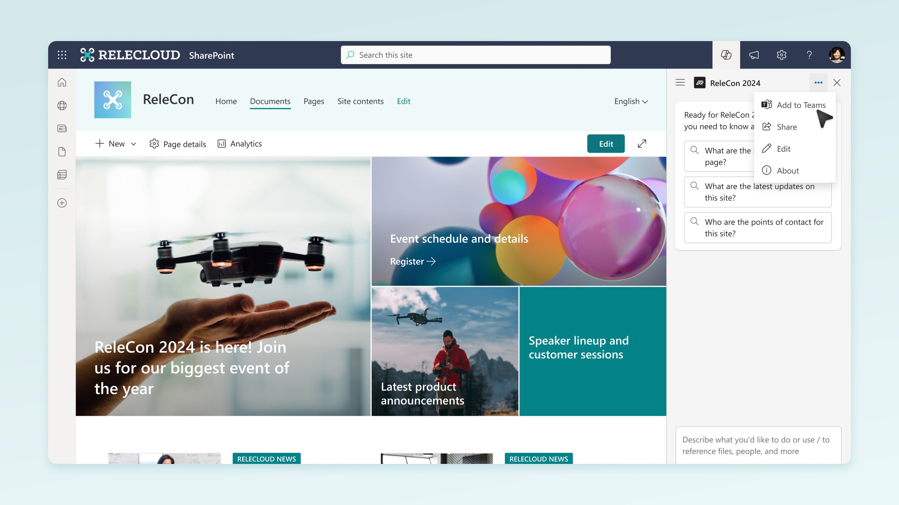

5. After you send the share link in a group chat or meeting within Teams, the system prompts you to add the agent to the conversation. Select **Add to this chat**.

> **Note:** If you don't select **Add to this chat**, the URL remains visible to group chat members, but you can't interact with the agent in the group chat.

6. @mention the agent to make a query, just like you would @mention an individual.

> **Caution:** Only one agent can be added at a time. If you add an agent to a group chat that already has an agent, the former agent is removed.

### Step 2: Remove an agent from Teams

Perform the following steps to remove a SharePoint or Copilot Chat agent from a Teams chat.

1. In Microsoft Teams, review the list of chats on the left rail of the Teams client. Locate the chat that contains the agent you want to remove.
2. Select the **ellipsis** icon (the three dots) that appears next to the selected chat.
3. In the drop-down menu that appears, select **Manage apps**.

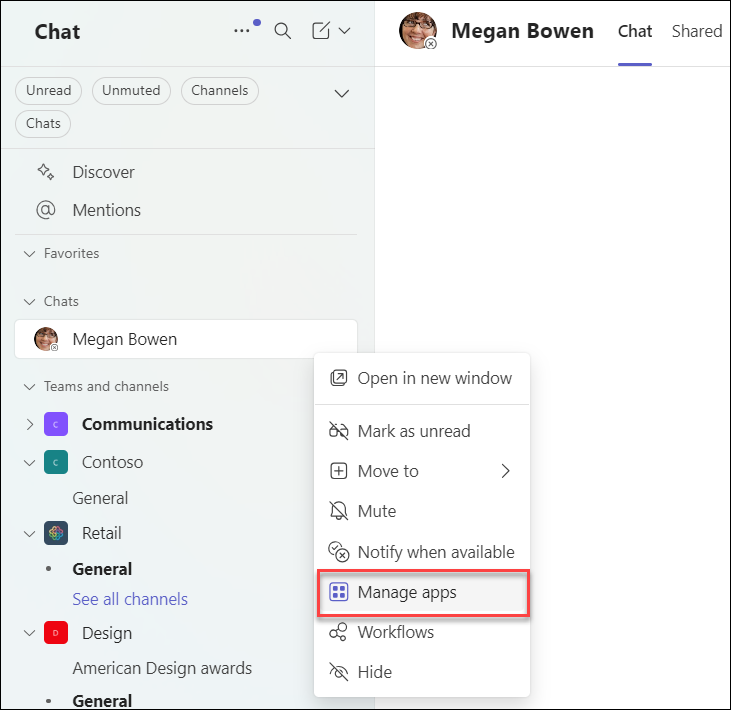

4. Select the **ellipsis** icon (the three dots) next to the agent that you want to remove from the chat. In the drop-down menu that appears, select **Remove**.

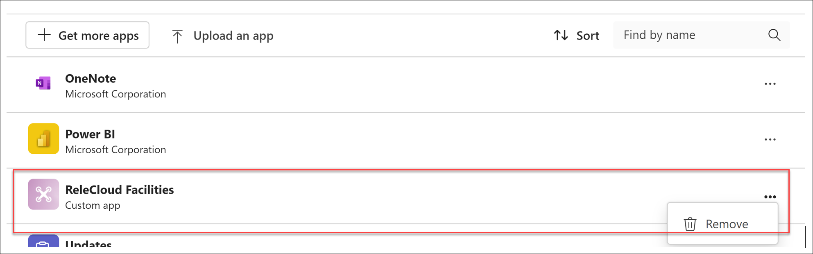

## Exercise 3: Interact with agents in SharePoint and Copilot Chat

In this exercise you use agents in SharePoint and Copilot Chat, pin and unpin agents, refer to specific files in a chat, and manage your chat history.

When you visit a SharePoint site, page, or document library, or when you use Microsoft Copilot Chat, you can interact with agents. You can use them to get information about the site, page, documents, or tasks that you have permissions for. The ready-made agent that comes with the SharePoint site or document library is set up to assist with general tasks and questions across the site. Copilot Chat agents are configured to help with various tasks and workflows within the chat interface.

Your site administrator might also have configured agents that are tailored to specific projects and teams. These agents give more focused assistance based on a defined set of sites, pages, files, or chat contexts that are relevant to your work. Here are three examples of prompts that users might enter in a SharePoint or Copilot Chat agent.

An HR employee wants to know how the company hires new people. They ask the HR agent from the SharePoint agents lab, which answers from the HR documents in the library:

```text
What is the hiring process?
```

A new sales rep at Adatum Corporation wants to use product proposals and performance overviews to understand the company's product lines. Doing so lets the rep communicate the benefits of Adatum's products to potential customers:

```text
Please create a 5-minute elevator pitch about product X that I can present to a client next week.
```

An instructional designer for Fabrikam's professional learning and development division must create an outline for a new training course based on the files about a new product:

```text
Please create a course outline for a one-hour training course designed to teach internal sales professionals about product Y and how to communicate its benefit with potential customers.
```

Keep the following considerations in mind when you interact with agents:

- Agents only respond to your questions using information from sites, pages, files, or chat contexts that you already have access to and that are included as the agent's knowledge sources. Your answer from an agent might sometimes be limited. If you need more access, contact the site administrator.
- When a SharePoint hub site is included as the knowledge source for an agent, the hub's associated sites are automatically included as knowledge sources too. The agent then uses information from both the hub site and its associated sites.
- Agents currently don't use data from SharePoint lists.

### Step 1: Use an agent in SharePoint

1. Sign in to your SharePoint site with your work or school account.
2. On any SharePoint site, page, or document library, select the **Copilot** icon that appears in the upper-right corner of the screen. The agent chat pane opens on the right side of the screen.

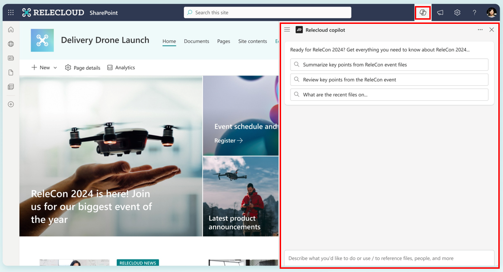

3. The pane opens with the site's main agent, which you set in Exercise 1. To use another SharePoint agent, select its .agent file in the document library.
4. Use the prompt to ask questions. Start by selecting from the **Starter Prompts** or by writing your own. You can ask the agent to summarize documents, give you the point of contact for a project, and tell you the latest updates. Ask follow-up questions if needed.

### Step 2: Use an agent in Copilot Chat

1. Sign in to **Microsoft Copilot** with your work or school account. The **Microsoft Copilot Chat** page appears by default.

Agents now appear as plugins: select **Plugins** in the navigation pane, open the **Chat** tab and then **Added** to see your agents. Pinned agents also appear in the navigation pane. Pinned agents appear first, followed by the most recently used agents.

2. Select the agent you want to use from **Plugins** > **Chat** > **Added**, or from the pinned agents in the navigation pane.

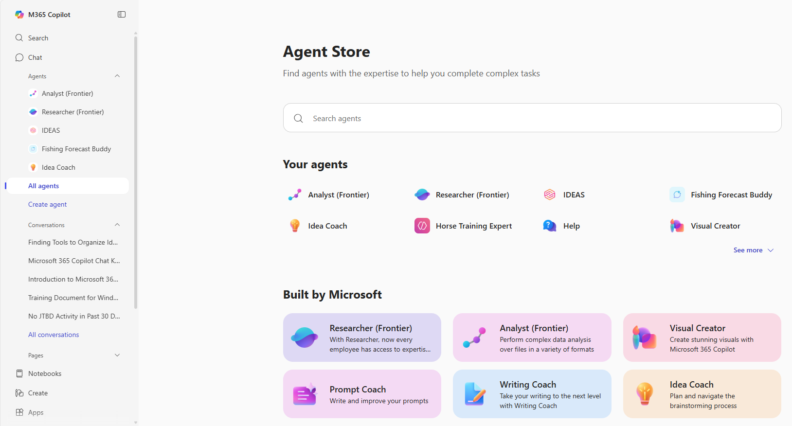

3. When you select an agent, the agent's name appears in the middle of the page, along with any Starter Prompts defined for it. A starter prompt only fills the prompt box, so select **Send** afterwards. Prebuilt agents created by Microsoft include Starter Prompts. Each custom agent that you create in Copilot Chat can have optional Starter Prompts. Begin your chat by selecting a Starter Prompt or writing your own prompt. Ask follow-up questions as needed.

### Step 3: Pin and unpin an agent in Copilot Chat

1. To pin an agent, select **More options** on the agent tile in **Plugins** > **Chat** > **Added**, and select **Pin**. The agent then appears in the navigation pane.

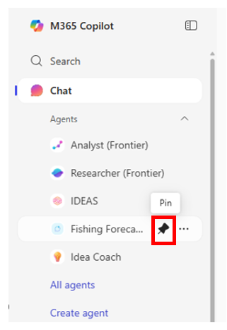

2. To unpin an agent, select **More** on the pinned agent in the navigation pane, and select **Unpin**.

### Step 4: Refer to specific files in your chat

When you chat with agents, you can refer to specific files in two ways.

- Select specific files in a document library and ask questions about them in the agent.

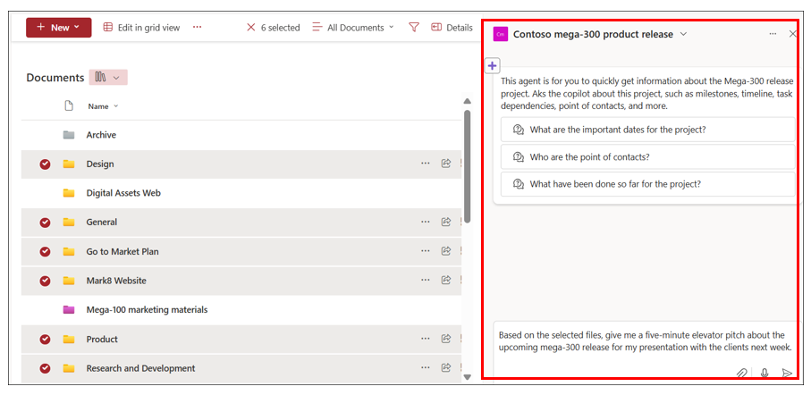

- Select a file by using the **/** selector in the chat.

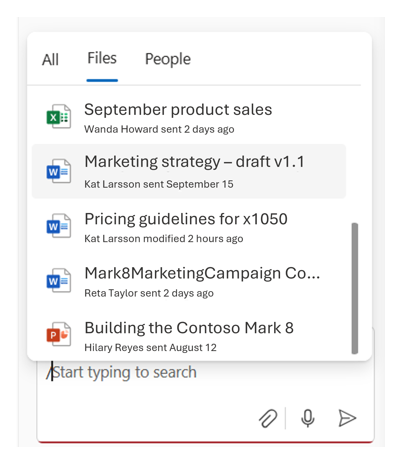

### Step 5: Manage your chat history

Only you can see your chats with agents in SharePoint and Copilot Chat. When you choose a chat history item, the current agent switches to the agent used in that chat. You can manage your chat history with the following tasks:

- Rename a chat history item.
- Delete your chat history from the chat pane.
- Delete the chat history for a specific conversation or for all chats.

### Supported file types

When you chat with an agent in SharePoint or Copilot Chat, you can currently reference the following types of files:

- **Office documents**: DOC, DOCX, PPT, PPTX, XLSX
- **New Microsoft 365 formats**: FLUID, LOOP
- **Universal formats**: PDF, TXT, RTF
- **Web files**: ASPX, HTM, HTML
- **OpenDocument formats**: ODT, ODP
