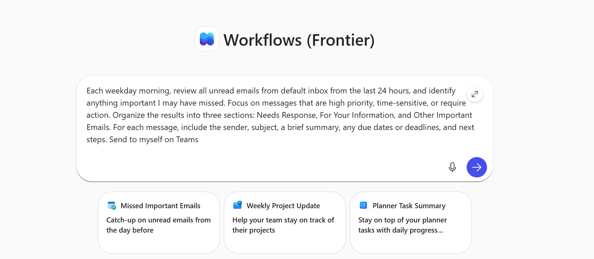
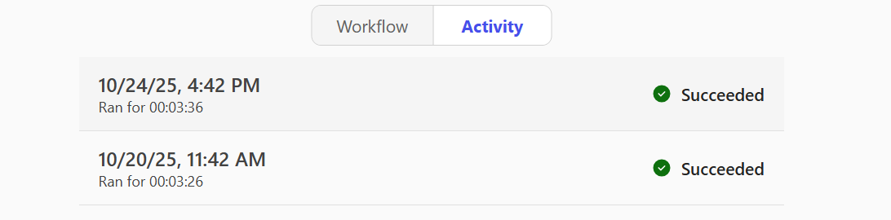

# Lab 06: Get Started with Workflows in Microsoft Copilot

In this lab you learn what Workflows is, how to add the Workflows agent to your Microsoft Copilot, and how to build, test, monitor, and manage a workflow. You also see which Microsoft 365 services Workflows connects to and how an administrator controls access to it.

Workflows is an agent in Microsoft Copilot that helps you automate work across Microsoft 365 using natural language. Instead of manually configuring steps or connectors, you describe what you want, and Workflows generates a working workflow using supported Microsoft 365 services.

> **Note:** Workflows is a Frontier agent, available only to users with a Microsoft Copilot license who have been granted access to the Microsoft Frontier program.

Workflows lets you:

- Automate tasks in apps like Outlook, SharePoint, Teams, and Planner.
- Trigger actions on a schedule, or in response to events.
- Collect and save user input with adaptive cards in Teams.
- Use your Microsoft 365 data, like calendar, tasks, or lists, without writing code.
- Test and manage workflows in a visual designer.

## Exercise 1: Add the Workflows agent to your Copilot

In this exercise you confirm that you have Frontier access and add the Workflows agent from the Agent Store.

To use the Workflows agent, you need to be part of the [Frontier program](https://adoption.microsoft.com/copilot/frontier-program/). Workflows is currently rolling out to [Frontier early access](https://support.microsoft.com/en-us/topic/what-is-frontier-17c671e0-1906-4d9d-892c-68e11fbff4c7) for Microsoft 365 Personal, Family, Premium, and Pro plans in select markets and languages, starting with the United States and English (en-us). Expanded access is coming soon.

> **Note:** Frontier includes early access to experimental features, which means features may change as Microsoft improves them.

### Step 1: Add Workflows Agent (Frontier) to your Copilot

Add the agent from the **Agent Store**. If you have a Microsoft Copilot license, follow these steps:

1. Sign in to [Microsoft Copilot](https://m365.cloud.microsoft/chat/?auth=2).
2. In the left navigation pane, select **Agents**.
3. Find and add **Workflows Agent (Frontier)**. You should see **Workflows** in the left navigation pane under **Agents**.

## Exercise 2: Prepare the Power Platform environment

In this exercise your Power Platform administrator checks the data loss prevention (DLP) policy and enables the features that Workflows needs.

### Step 1: Check the connectors in your DLP policy

To use Workflows, your DLP policy in the Power Platform admin center must include the following connectors: **SharePoint**, **Approvals**, **Teams**, **Planner**, **M365Copilot**, and **Outlook**.

More information: [Data policies](https://learn.microsoft.com/power-platform/admin/wp-data-loss-prevention)

### Step 2: Confirm the AI actions connector

Check the **AI actions** entry in your DLP policy. [AI actions](https://learn.microsoft.com/connectors/aisteps/) is a *connector* in Power Platform.

### Step 3: Enable the AI prompt feature

The [AI prompt](https://learn.microsoft.com/ai-builder/administer#enable-or-disable-ai-prompts-in-power-platform-and-copilot-studio) is a *feature* that needs to be enabled in the Power Platform admin center for the environment. If it is not enabled already, make sure *PredictionSchema* is enabled or activated in your Dataverse org at environment level.

1. Navigate to the environment in the Power Platform admin center.
2. Select **Settings** > **Resources** > **All legacy settings**.
3. In the legacy settings area, choose **Processes**.
4. Switch the view to **All Processes**.
5. Enable **PredictionSchema**.

## Exercise 3: Build a workflow

In this exercise you describe a workflow in plain language and let the Workflows agent generate it.

Describe what you want your workflow to do.

### Step 1: Sign in to Microsoft Copilot

1. Sign in to [Microsoft Copilot](https://m365.cloud.microsoft/chat/?auth=2).

### Step 2: Open the Workflows Agent

1. In the left navigation pane, under **Agents**, select **Workflows Agent (Frontier)**.

### Step 3: Enter your prompt

1. Enter your prompt in the text box. For example:

```text
Each weekday morning, review all unread emails from default inbox from the last 24 hours, and identify anything important I may have missed. Focus on messages that are high priority, time-sensitive, or require action. Organize the results into three sections: Needs Response, For Your Information, and Other Important Emails. For each message, include the sender, subject, a brief summary, any due dates or deadlines, and next steps. Send to myself on Teams
```



A workflow does the following:

- It triggers each weekday morning.
- It reviews unread emails from the last 24 hours in your default inbox.
- It identifies high-priority, time-sensitive, or actionable messages.
- It organizes results into Needs Response, For Your Information, and Other Important Emails.
- It includes sender, subject, summary, deadlines, and next steps for each message.


Workflows connects to Microsoft 365 services based on the names you include in your prompt. Mention the following in your prompt:

- **Your Outlook inbox or mailbox**: Specify where to review unread emails.
- **The Teams chat or channel**: Indicate where the summary should be sent.
- **An AI prompt for Dataverse**: Define how the data should be summarized and organized (for example: "*Group into Needs Response, For Your Information, and Other Important Emails*").

The Workflows agent uses your Microsoft 365 account to connect to these services. If it can't find a match, it may ask you to confirm or provide the Teams channel or SharePoint site.

**Supported connectors and actions.** Workflows supports core Microsoft 365 services commonly used in task automation. The table lists the products, capabilities, or services across Microsoft that Workflows supports through triggers and actions.

A trigger is an event that starts a workflow. For example, you want to get a notification in Microsoft Teams when someone sends you an email. In this case, receiving an email is the trigger that starts this workflow.

More information: [Triggers in flows](https://learn.microsoft.com/power-automate/triggers-introduction)

An action is what you configure the workflow to take based on the event that causes a trigger to start. An action can be, for example, to upload a file in a SharePoint site.

More information: [Actions in flows](https://learn.microsoft.com/power-automate/multi-step-logic-flow)

| Service | Supported triggers/actions |
| --- | --- |
| Built-in | Recurrence, AI actions |
| Microsoft Copilot | Prompt Copilot |
| Outlook | Find a meeting time, Get emails, Get events, Create event, Send an email, Save a Draft email, Reply email, Create contact |
| Teams | Post adaptive card in a chat or a channel, Post message in a chat or channel, Create a chat |
| SharePoint | Add item, List Item, Delete item |
| Planner | List my tasks |
| Approvals | Create approval, Wait for response |
| Office 365 Users | Get profile, Get manager |
| Dataverse (AIB) | AI Prompt |

For advanced workflows or to connect to non-Microsoft services, use [Power Automate](https://learn.microsoft.com/power-automate/) or [List of all connectors published by non-Microsoft partners](https://learn.microsoft.com/connectors/connector-reference/connector-reference-partners-connectors).

## Exercise 4: Test your workflow

In this exercise you simulate the workflow trigger and review the run result.

Once you save your workflow, you are prompted to test it in the chat. Alternatively, select **Test** at the top of the **Workflow** page.

### Step 1: Simulate the trigger

1. To simulate the trigger, select **Test**.

### Step 2: Review the run

1. Review the run history, outputs, and errors.

### Step 3: Re-test if needed

1. If needed, re-test.

## Exercise 5: Monitor your workflow

In this exercise you check how a workflow ran, step by step.

### Step 1: Open the Activity page

1. To see how your workflow ran, select the **Activity** page. A breakdown of each trigger and action displays. Each step shows whether it succeeded or failed.



### Step 2: Open a specific run

1. To get detailed insights into what happened, select a specific run.

## Exercise 6: Manage your workflows

In this exercise you view, turn on or off, and delete the workflows you created.

### Step 1: Use the workflow list

In the workflow list, you can:

- View all workflows you created.
- Turn workflows on or off using the ellipses (...) button. Turning off a workflow pauses its automation.
- Delete workflows permanently. Deleting a workflow removes it entirely and can't be undone.

## Exercise 7: Control Workflows access as an administrator

In this exercise a Microsoft 365 administrator sets who can use the Workflows agent.

Admins control Workflows availability using Microsoft 365 app management settings.

### Step 1: Sign in to the Microsoft 365 admin center

1. Sign in to the Microsoft 365 admin center.

### Step 2: Open the agent settings

1. In the left navigation pane, select **Copilot** > **Settings** > **Agents**.

### Step 3: Set access

1. Set access to **All Users** or **Specific users/groups**, as needed.

Workflows follows the same governance and compliance rules as other Microsoft 365 apps. Learn more in [Manage agents in Microsoft Copilot](https://learn.microsoft.com/microsoft-365/admin/manage/manage-copilot-agents-integrated-apps?view=o365-worldwide).

**Microsoft 365 admin center.** Administrators can manage the Workflows agent in the Microsoft 365 admin center under **Copilot** > **Agents**. Available controls include:

- Enable or disable the agent.
- Assign, block, or remove access.
- Control visibility using "Allow users access to agents".

The Workflows agent respects tenant-level settings configured in the Microsoft 365 admin center and the Power Platform admin center (PPAC). These settings determine:

- Whether the Workflows agent is enabled.
- Whether analytics and telemetry are collected.
- Which Copilot features are available to users.

Feedback collection (thumbs up or down, optional verbatims) is controlled only by Microsoft 365 for the Workflows agent.

**Power Platform admin center.**

1. **Data residency**: All workflows created in the tenant through *Workflows Agents* are located in a special purpose environment in the tenant called [Microsoft Copilot workflows environment](https://learn.microsoft.com/microsoft-365/copilot/workflows-environment-workflows-agents). That environment is in the tenant's geographic location, unless you want to [geo-to-geo migrate](https://learn.microsoft.com/power-platform/admin/geo-to-geo-migrations).
2. **DSR and PPAC inventory**: System admins can follow [Perform data subject requests (DSRs) for Workflows agents](https://learn.microsoft.com/microsoft-365/copilot/perform-data-subject-requests-for-workflows-agents) to export or delete data for *Workflows agents*. They can also view *Workflows Agents* workflows created in the tenant in the *Power Platform admin center Inventory*.
3. **DLP**: By default, the *Microsoft Copilot Workflows* environment allows only the connectors required to ensure full functionality in *Workflows agents*. Your tenant-specific data policies don't affect the Microsoft Copilot Workflows environment.

## Limitations

- Always review and test AI-generated workflows before using them in production.
- You can't share workflows created in Workflows.
- Workflows supports a limited set of Microsoft 365 connectors. Non-Microsoft and custom connectors aren't supported.
- Workflows can't fix errors in existing workflows automatically.
- Workflows relies on natural language input in chat to specify locations like SharePoint sites or Teams channels. It might occasionally identify the wrong site or channel if the names are ambiguous or similar.
- Workflows is available only in English.
