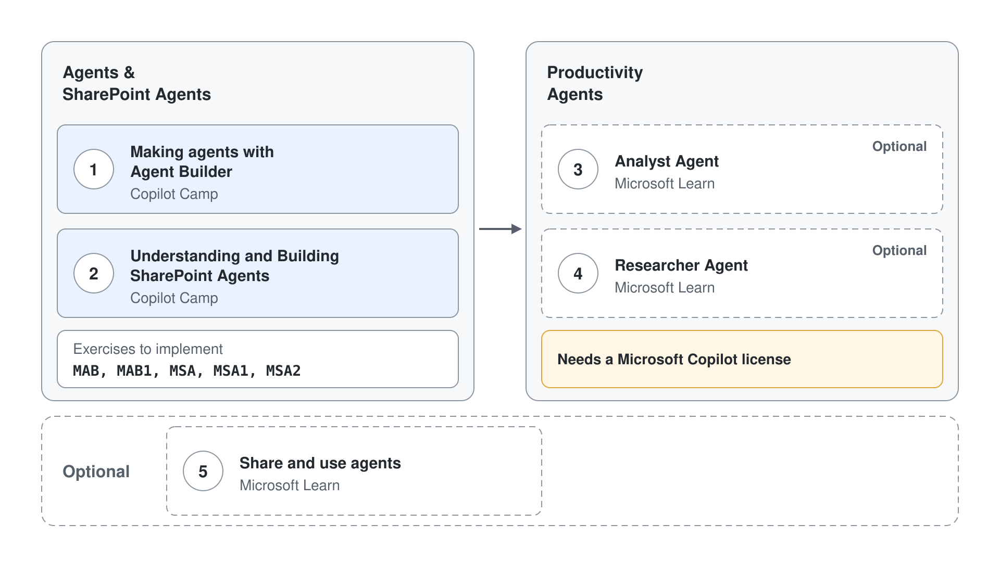
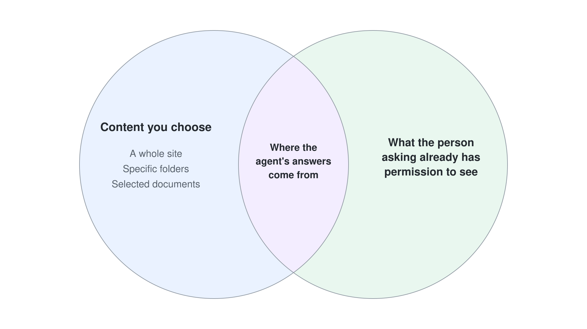

# Introduction to Developing AI Agents and Copilots for Microsoft 365

Hands-on labs for [Module 1](../../demos/01-intro/readme.md). The essential labs follow [Copilot Chat & Productivity Agents](../../demos/01-intro/05-chat-productivity/readme.md): build an agent with Agent Builder, then build and share a SharePoint agent. The optional labs come after them: put Analyst and Researcher to work and use shared agents.

| Title | Minutes |
|-------|---------|
| [Lab 01: Build Your First Agent with Agent Builder](./lab-01-agent-builder.md) | 15, together with Lab 02 |
| [Lab 02: Build and Share a SharePoint Agent](./lab-02-sharepoint-agents.md) | together with Lab 01 |
| [Lab 03: Analyze Data with the Analyst Agent](./lab-03-analyst-agent.md) (optional) | not scheduled |
| [Lab 04: Examine the Researcher Agent](./lab-04-researcher-agent.md) (optional) | not scheduled |
| [Lab 05: Share and Use SharePoint Agents](./lab-05-share-and-use-agents.md) (optional) | not scheduled |
| **Total** | **15** |

## Agents & SharePoint Agents

[Lab 01: Build Your First Agent with Agent Builder](./lab-01-agent-builder.md)

[Lab 02: Build and Share a SharePoint Agent](./lab-02-sharepoint-agents.md)

## Productivity Agents

> Note: Analyst and Researcher need a Microsoft Copilot license.

[Lab 03: Analyze Data with the Analyst Agent](./lab-03-analyst-agent.md) (optional)

[Lab 04: Examine the Researcher Agent](./lab-04-researcher-agent.md) (optional)

## Optional Labs

[Lab 05: Share and Use SharePoint Agents](./lab-05-share-and-use-agents.md) (optional)

## Sources

The lab content is adapted from these originals:

- Lab 01: [Making agents with Agent Builder](https://microsoft.github.io/copilot-camp/pages/make/agent-builder/), Copilot Developer Camp, exercises MAB and MAB1
- Lab 02: [Understanding and Building SharePoint Agents](https://microsoft.github.io/copilot-camp/pages/sharepoint/), Copilot Developer Camp, exercises MSA, MSA1 and MSA2
- Lab 03: [Analyst Agent](https://learn.microsoft.com/en-us/training/modules/explore-prebuilt-microsoft-365-copilot-agents/3-exercise-analyst-agent), Microsoft Learn
- Lab 04: [Researcher Agent](https://learn.microsoft.com/en-us/training/modules/explore-prebuilt-microsoft-365-copilot-agents/4-examine-researcher-agent), Microsoft Learn
- Lab 05: [Share and use agents](https://learn.microsoft.com/en-us/training/modules/use-no-code-agents-sharepoint/), Microsoft Learn
