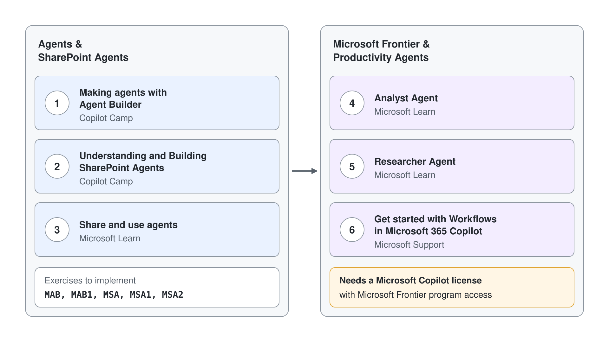

# Introduction to Developing AI Agents and Copilots for Microsoft 365

Hands-on labs for [Module 1](../../demos/01-intro/readme.md). The essential labs follow [Copilot Chat & Productivity Agents](../../demos/01-intro/05-chat-productivity/readme.md): build an agent with Agent Builder, then build and share a SharePoint agent. The optional labs come after them: put Analyst and Researcher to work, use shared agents, and try Workflows.

## Agents & SharePoint Agents

[Lab: Making agents with Agent Builder](https://microsoft.github.io/copilot-camp/pages/make/agent-builder/)

> Note: Implement exercises MAB and MAB1

[Lab: Understanding and Building SharePoint Agents](https://microsoft.github.io/copilot-camp/pages/sharepoint/)

> Note: Implement exercises MSA, MSA1 and MSA2

## Productivity Agents

> Note: Analyst and Researcher need a Microsoft Copilot license.

[Lab: Analyst Agent](https://learn.microsoft.com/en-us/training/modules/explore-prebuilt-microsoft-365-copilot-agents/3-exercise-analyst-agent) (optional)

[Lab: Researcher Agent](https://learn.microsoft.com/en-us/training/modules/explore-prebuilt-microsoft-365-copilot-agents/4-examine-researcher-agent) (optional)

## Optional Labs

[Lab: Share and use agents](https://learn.microsoft.com/en-us/training/modules/use-no-code-agents-sharepoint/) (optional)

> Note: Workflows is a Frontier agent, available only to users with a Microsoft Copilot license who have been granted access to the Microsoft Frontier program.

[Lab: Get started with Workflows in Microsoft 365 Copilot](https://support.microsoft.com/en-us/topic/get-started-with-workflows-in-microsoft-365-copilot-frontier-8c6aba25-db31-443d-8319-bc79747b280a) (optional)
