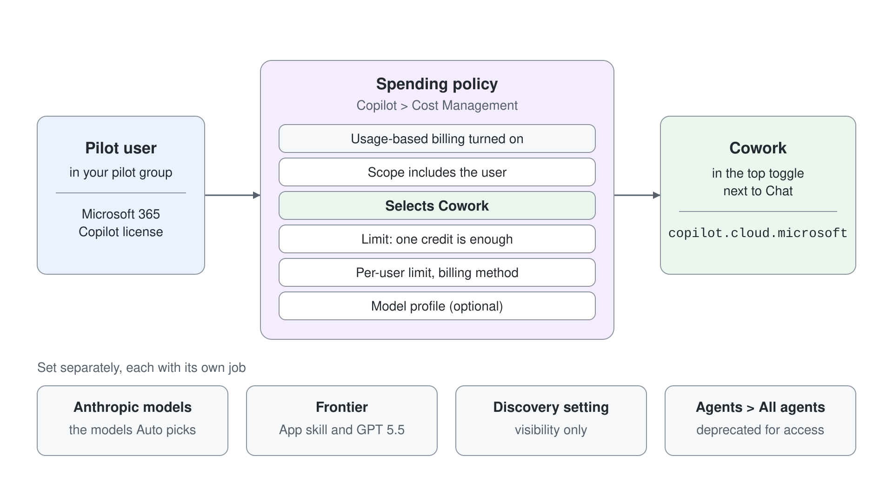
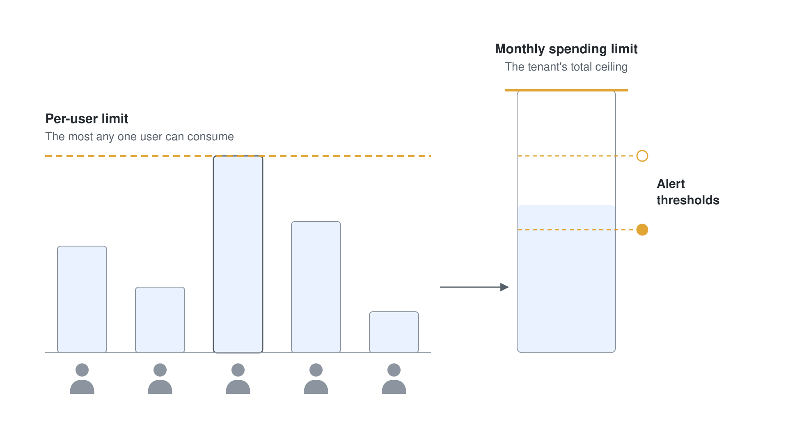
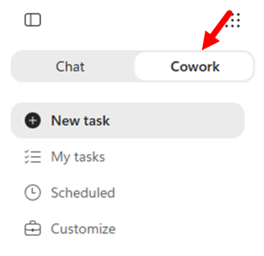
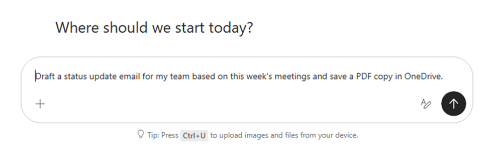
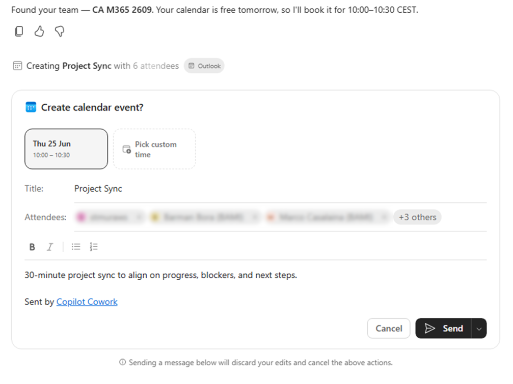

# Lab 01: Copilot Cowork einrichten und erweitern

> **Vorschlag: Führen Sie dieses Lab mit einem günstigeren Model aus.** Wählen Sie im Model Picker von Cowork (**Model and generation settings**) **Sonnet 5.5** ("Efficient for everyday tasks") statt **Auto**, und setzen Sie **Effort level** auf **Light** statt **Medium (default)**. Ein Testlauf des Setup Labs hat mit dieser Einstellung jeden Cowork Task abgeschlossen. Hat Ihr Tenant die Anthropic Models abgeschaltet, wählen Sie stattdessen **GPT 5.5**.

In diesem Lab lernen Sie, was Copilot Cowork ist, wie Sie Ihren Tenant für Cowork vorbereiten und mit welchen Extensibility Optionen Sie Cowork an die Anforderungen Ihrer Organisation anpassen.

Im Kern orchestriert Cowork mehrstufige Arbeit in Microsoft 365, darunter Kommunikation, Kalender, Dokumente, Recherche und Automation. Cowork arbeitet über Work IQ mit Microsoft 365, einem Teil der Microsoft IQ Platform. Anders als eine reine Q&A Experience kommt Cowork vom Intent zur Aktion, während der User die Kontrolle behält.

## Übung 1: Verstehen, was Copilot Cowork ist

In dieser Übung erkunden Sie die zentrale Cowork Experience und verstehen, wie sie sich von einem reinen Chat AI Assistant unterscheidet.

Copilot Cowork ist für die Ausführung gebaut, nicht nur für die Unterhaltung. Statt nur Prompts zu beantworten, interpretiert Cowork ein Ziel, zerlegt es in Tasks, wählt die nötigen Skills und koordiniert Aktionen über Microsoft 365 Workloads wie Outlook, Teams, Word, Excel, PowerPoint und Enterprise Search. Das Betriebsmodell ist zielgesteuerte Orchestration: User geben den Intent vor, Cowork baut einen Plan und führt ihn aus, und User können jeden Schritt prüfen, während die Arbeit läuft.


Der größte Vorteil dieses Modells ist Produktivität, die in der Praxis skaliert. Cowork erledigt mehrstufige Workflows über mehrere Apps hinweg, die sonst Kontextwechsel, manuelles Copy/Paste und wiederholte Abstimmung erfordern. Gleichzeitig behalten Menschen die Kontrolle, weil sensible Aktionen eine Freigabe brauchen. User können mehr operative Arbeit delegieren, ohne Übersicht, Governance oder Vertrauen zu verlieren.

Organisationen brauchen Cowork, weil moderne Arbeit über Tools, Nachrichten, Meetings und Dokumente verstreut ist, während es mehr denn je darauf ankommt, schnell und konsistent auszuführen. Cowork setzt genau hier an und macht aus Intent verlässliche Aktion, innerhalb der bestehenden Grenzen von Security, Identity und Compliance in Microsoft 365. In diesem Lab verstehen Sie zuerst das Fundament, konfigurieren dann die Voraussetzungen im Tenant und erkunden schließlich die Extensibility Optionen.

### Schritt 1: Prüfen, was Cowork kann

Lesen Sie die Fähigkeiten nach, die [Copilot Cowork overview](https://learn.microsoft.com/en-us/microsoft-365/copilot/cowork/) beschreibt. Zum Zeitpunkt der Erstellung gehören vor allem dazu:

- Kommunikationsaufgaben (E-Mails und Teams Nachrichten)
- Meeting- und Kalenderaufgaben (Termine planen, aktualisieren, Konflikte bereinigen)
- Dokument- und Dateiaufgaben (Word, Excel, PowerPoint, PDF)
- Recherche und Enterprise Search über die Daten in Microsoft 365
- Scheduled Prompts für wiederkehrende Automations

Das entspricht der Produktvision aus [Copilot Cowork: A new way of getting work done](https://www.microsoft.com/en-us/microsoft-365/blog/2026/03/09/copilot-cowork-a-new-way-of-getting-work-done/), in der Cowork darauf ausgerichtet ist, vom Intent zur Aktion zu kommen.

Vom Interaktionsmodell her führt Cowork eine Abfolge von Aktionen aus, statt nur eine einzelne Antwort zu liefern. Es kann Nachrichten entwerfen und senden, Dateien erstellen, Meetings organisieren und Kontext aus E-Mails, Chats, Dateien und Meetings zu einem zusammenhängenden Ausführungsplan verbinden.

Einer der größten Vorteile: Die Arbeit reißt nicht ab. Statt manuell zwischen Outlook, Teams, OneDrive, SharePoint und den Office Apps zu springen, delegieren User den gesamten Ablauf an Cowork und überwachen die Checkpoints. Das reduziert Kontextwechsel und hält die Arbeit in Bewegung, während sich User auf wichtige Entscheidungen konzentrieren.

Cowork lässt die Kontrolle außerdem in der Hand des Users. Vor Operationen mit größerer Tragweite hält Cowork an und wartet auf eine Freigabe. Dieses Muster ist für das Vertrauen im Unternehmen entscheidend: User prüfen den Intent, geben Aktionen frei oder lehnen sie ab und bleiben verantwortlich, während sie trotzdem von der Automation profitieren.

Auf Ebene der Organisation hilft Cowork Teams, Intent innerhalb der sicheren Grenze von Microsoft 365 konsistent umzusetzen. Wie die Guidance von Microsoft betont, geht es nicht darum, Menschen zu ersetzen, sondern die Ausführungskapazität mit nachvollziehbarer, Policy-konformer Automation zu verstärken, die sich mit Skills und Plugins erweitern lässt.

## Übung 2: Ihren Tenant für Copilot Cowork vorbereiten

In dieser Übung konfigurieren Sie die zentralen Voraussetzungen im Tenant, damit Sie Cowork sicher aktivieren.



### Schritt 1: Voraussetzungen prüfen

Lesen Sie [Get started with Copilot Cowork](https://learn.microsoft.com/en-us/microsoft-365/copilot/cowork/get-started) und bestätigen Sie die folgenden Voraussetzungen:

- Sie haben einen gültigen Microsoft 365 Tenant, in dem Sie experimentieren und lernen können, zum Beispiel einen Developer Tenant aus dem [Microsoft 365 Developer Program](https://developer.microsoft.com/en-us/microsoft-365/dev-program)
- Sie haben einen Tenant Admin Account, um die nötigen Einstellungen zu verwalten
- Die User haben eine aktive Microsoft 365 Copilot Lizenz
- Cowork ist in Ihrem Tenant verfügbar
- Usage-based Billing ist für Cowork aktiviert
- Eine Spending Policy, die **Cowork** auswählt, deckt Ihre Pilot User ab. Ein Limit von einem Credit genügt für den Zugang. Ein Global oder Billing Administrator erstellt die Policy unter **Copilot** > **Cost management** > **Configuration**; ein AI oder License Administrator kann sie bearbeiten, aber nicht erstellen.
- Unterstützter Zugang über Client oder Browser ist vorhanden (Web, Desktop App, Mobile)
- Optional: Frontier Enrollment, nur nötig für den Skill **App** und das Model **GPT 5.5 (Frontier)**

> **Hinweis: optionale Anthropic Models.** Cowork kann Anthropic Models als optionalen Subprocessor nutzen. Die Einstellung ist für die meisten kommerziellen Tenants standardmäßig aktiv, steht in der EU, der EFTA und im Vereinigten Königreich aber standardmäßig auf **No users**. Anthropic Models sind derzeit von der EU Data Boundary ausgenommen, und das Abschalten blockiert den Zugang nicht, weil **Auto** aus den verbleibenden Models wählt. Nehmen Sie diese Entscheidung vor dem breiten Rollout in Ihre Compliance- und Rechtsprüfung auf; [Choose a model for Copilot Cowork](https://learn.microsoft.com/en-us/microsoft-365/copilot/cowork/cowork-models) listet die unterstützten Models.

### Schritt 2: Copilot Credits und Usage-based Billing konfigurieren

Gehen Sie im Microsoft 365 admin center zu **Copilot** > **Cost management** und wählen Sie beim ersten Mal **Get Started**, um Usage-based Billing zu aktivieren. Konfigurieren Sie dann Ihre Billing-Strategie anhand von [Usage-Based Billing and Cost Management for Copilot Credits](https://learn.microsoft.com/en-us/microsoft-365/copilot/usage-based-billing-overview-copilot-credits).

Legen Sie mindestens Folgendes fest:

- Billing-Methode: Azure Subscription, Prepaid Credits (P3) oder Pay-as-you-go ($0.01 pro Credit)
- Spending Policies und Limits, darunter eine Policy, die unter **Select agents and services** den Eintrag **Cowork** auswählt
- Budgetschutz (Alerts und Limits)



> **Wichtig: zuerst ein Pilot.** Beginnen Sie mit einer kontrollierten Pilotgruppe und strengen Spending Policies. Weiten Sie den Kreis schrittweise aus, nachdem Sie echte Verbrauchstrends und Kostentreiber geprüft haben.

### Schritt 3: Pilot User zuweisen und den Zugang prüfen

Weisen Sie eine Pilotgruppe zu, bitten Sie die Pilot User, Cowork zu öffnen, und prüfen Sie, dass sie:

- Unterhaltungen starten können
- mindestens einen Task ausführen können, der eine Freigabe erfordert
- frühere Arbeit unter **Recent** und geplante Arbeit unter **Automations** sehen

Können User nicht auf Cowork zugreifen, prüfen Sie, ob sie im Geltungsbereich einer Spending Policy liegen, die **Cowork** auswählt, und prüfen Sie dann erneut Lizenzierung, Billing-Konfiguration und die Aktivierung auf Tenant-Ebene.

## Übung 3: Mit Copilot Cowork arbeiten

In dieser Übung arbeiten Sie zum ersten Mal mit Cowork im Produkt, beobachten das Ausführungsmodell in Aktion und prüfen die Freigabekontrollen für sensible Aktionen.



### Schritt 1: Cowork öffnen

Öffnen Sie **Microsoft Copilot** unter [copilot.cloud.microsoft](https://copilot.cloud.microsoft) und wählen Sie **Cowork** im Umschalter oben neben **Chat**.



Der Screenshot stammt aus der Zeit vor der Umbenennung, daher heißt der Eintrag, den er als **Scheduled** zeigt, jetzt **Automations**.

Beachten Sie, dass Cowork auf delegierte Ausführung ausgerichtet ist: Sie beschreiben ein Ergebnis, und Cowork plant und erledigt die Tasks für Sie in Microsoft 365.

In der linken Navigation finden Sie diese zentralen Optionen:

- **Recent**: frühere Tasks finden und vergangene Arbeit schnell wieder öffnen.
- **Automations**: Scheduled Prompts und ereignisgesteuerte Tasks prüfen und verwalten. **Runs** zeigt jeden Lauf, und über **Manage schedules** können Sie die Zeitpläne bearbeiten, pausieren, fortsetzen oder löschen.
- **Plugins**: Plugins verwalten, mit den Tabs **Chat** und **Cowork** und den Ansichten **Added** und **Discover**. Ihre Preferences für jeden Task liegen unter **Settings** > **Personalization** > **Customize Copilot**.

Um einen neuen Task zu starten, tippen Sie in das Chat-Eingabefeld auf der Startseite von Cowork.

### Schritt 2: Das Ausführungsmodell beobachten

Starten Sie auf der Startseite von Cowork einen einfachen Prompt wie:

```text
Draft a status update email for my team based on this week's meetings and save a PDF copy in OneDrive.
```



Beobachten Sie, während Cowork läuft, die schrittweise Ausführung, die geladenen Skills und die Approval Gates vor sensiblen Aktionen wie Senden oder Posten.


Ist die Arbeit erledigt, sehen Sie eine Zusammenfassung aller ausgeführten Tasks und Schritte.


Cowork hat mehrere Tasks ausgeführt: Es hat einen E-Mail-Entwurf erstellt, ein PDF erzeugt und es in Ihrem OneDrive for Business gespeichert. Während Cowork arbeitet, können Sie weitere Nachrichten senden. Diese Nachrichten reihen sich ein und können den Task umlenken.

### Schritt 3: Freigabekontrollen testen

Bitten Sie Cowork, eine sensible Aktion auszuführen, zum Beispiel:

```text
Schedule a 30-minute project sync with my team tomorrow and send a confirmation message in Teams.
```



Prüfen Sie, dass Cowork vor der sensiblen Aktion ausdrücklich um Freigabe bittet: Das Erstellen des Kalendereintrags zeigt eine Karte **Create calendar event?** mit **Cancel** und **Save**. Eine Teams Nachricht in Ihren eigenen Chat wird ohne Freigabekarte gesendet.

## Übung 4: Die Extensibility Optionen von Cowork erkunden

Diese Lab-Reihe konzentriert sich auf das Extensibility-Modell von Cowork. In dieser Übung vergleichen Sie die wichtigsten Extensibility Optionen und sehen sich die bereits verfügbaren Plugins und Skills an.

### Schritt 1: Plugins, Skills und Preferences finden

Cowork hat keine einzelne Seite **Customize** mehr. Die drei Bausteine finden Sie hier:

- **Preferences**: Custom Instructions, die Cowork auf jeden Task anwendet, etwa Tonfall und Formatierung, unter **Settings** > **Personalization** > **Customize Copilot**. Sie können bis zu 20 KB schreiben (etwa 3.000 englische Wörter).
- **Plugins**: Wählen Sie **Plugins** in der linken Navigation und den Tab **Cowork**; **Added** listet die installierten Plugins und **Discover** den Katalog
- **Skills**: Integrierte Skills und Ihre Custom Skills teilen sich dieselbe Liste wie die Plugins, unter **Plugins** > **Cowork** > **Added**; wählen Sie **Manage all** für die vollständige Liste

Behalten Sie vor dem Weitermachen diesen einfachen Vergleich im Kopf:

- **Skills** sind Task-Instructions und Verhaltensmuster, die festlegen, wie Cowork bestimmte Arten von Arbeit ausführt.
- **Plugins** sind Packages, die Skills, Connectors zu externen Systemen oder beides enthalten.
- Wählen Sie **Skills**, wenn Sie Verhalten und Task-Logik formen wollen. Wählen Sie **Plugins**, wenn Sie Tools, Systeme oder spezialisierte, paketierte Funktionalität anbinden wollen.


Cowork bringt bereits eine Reihe integrierter Skills mit, etwa Word, Excel, PowerPoint, PDF, Email, Scheduling, Calendar Management, Meetings, Daily Briefing, Enterprise Search, Deep Research, Communications und Adaptive Cards. Cowork aktiviert diese Skills automatisch anhand des Kontexts der Unterhaltung, und welche verwendet wurden, sehen Sie im Abschnitt **Skills** des Side Panels.

> Mehr über die integrierten Skills lesen Sie in [Cowork skills](https://learn.microsoft.com/en-us/microsoft-365/copilot/cowork/use-cowork#cowork-skills).

Diese Microsoft Plugins sind derzeit in Cowork enthalten:

- **Dynamics 365 Customer Service**
- **Dynamics 365 ERP**
- **Dynamics 365 Sales**
- **Fabric IQ**
- **Business Applications in Work IQ**
- Rollenbasierte Plugins für Legal, Sales, Service und Education

Neben diesen Microsoft Plugins steht im Raster **Discover** unter **Plugins** > **Cowork** ein wachsender Partnerkatalog bereit, mit Partnern wie Salesforce, Zendesk, monday.com, Miro, Moody's und LSEG.

## Zusammenfassung

Sie wissen jetzt, was Copilot Cowork ist, wie es sich von reinen Chat Assistants unterscheidet, welche Voraussetzungen es im Tenant braucht und wo seine beiden Extensibility-Flächen (Skills und Plugins) liegen.

Weiter mit [Ihren ersten Cowork Skill bauen](./lab-02-cowork-skills-de.md).
