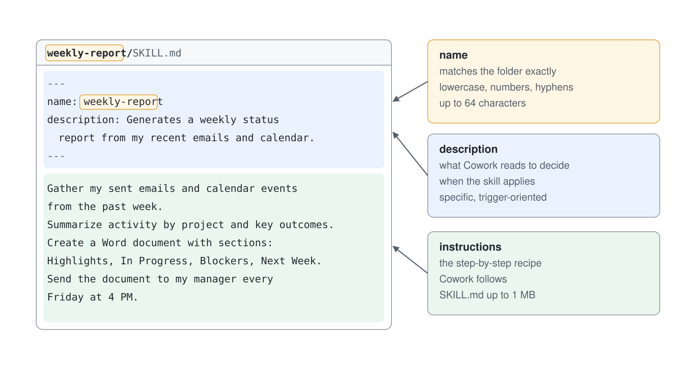
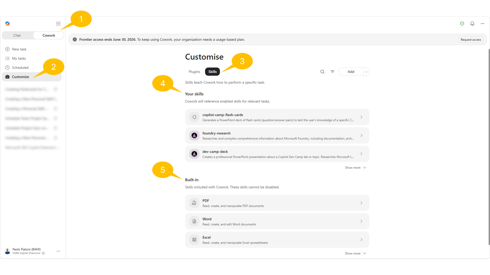
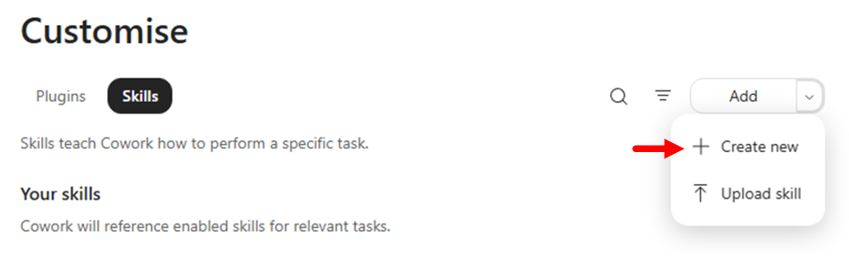
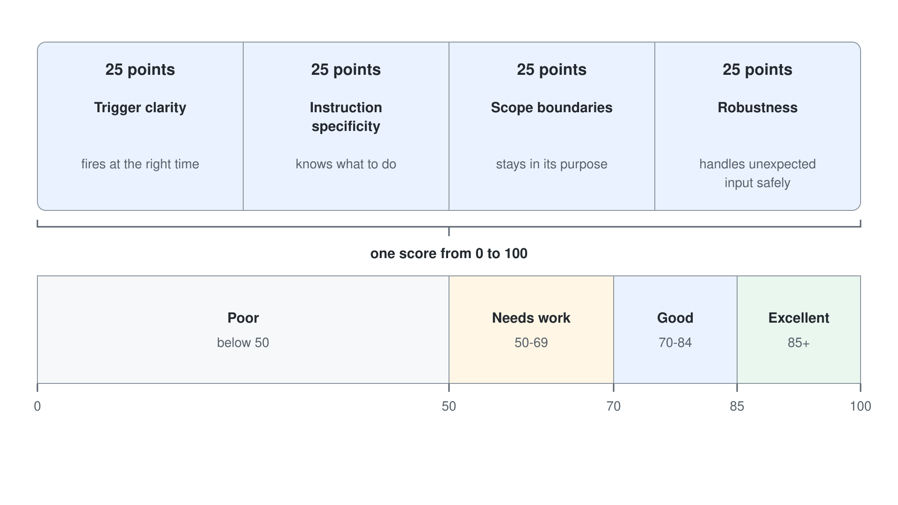
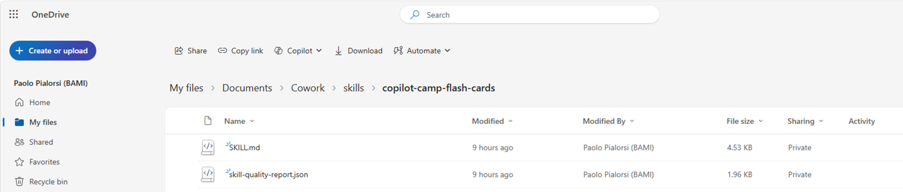
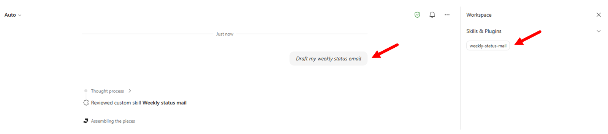

# Lab 02: Ihren ersten Cowork Skill bauen

> **Vorschlag: Führen Sie dieses Lab mit einem günstigeren Model aus.** Wählen Sie im Model Picker von Cowork (**Model and generation settings**) **Sonnet 5.5** ("Efficient for everyday tasks") statt **Auto**, und setzen Sie **Effort level** auf **Light** statt **Medium (default)**. Ein Testlauf des Setup Labs hat mit dieser Einstellung jeden Cowork Task abgeschlossen. Hat Ihr Tenant die Anthropic Models abgeschaltet, wählen Sie stattdessen **GPT 5.5**.

In diesem Lab lernen Sie, wie Sie Custom Agent Skills für Copilot Cowork bauen, wie Sie Skills im Produkt verwalten und wie Sie Ihre eigenen Skills veröffentlichen.

Im Kern ist ein Agent Skill eine strukturierte Instruction-Datei, die Cowork beibringt, wann und wie es einen bestimmten fachlichen Workflow ausführt. Skills sind keine generischen Prompts. Ein Skill enthält Intent-Signale, Hinweise zur Ausführung und Erwartungen an das Ergebnis, damit Cowork für eine Anfrage zuverlässig das richtige Verhalten auswählt und ausführt.



Am Ende dieses Labs können Sie:

- Erklären, was Skills sind und wann sich Custom Skills lohnen
- Integrierte Skills und Custom Skills unter **Plugins** > **Cowork** > **Added** verwalten
- Einen Skill mit dem nativen, geführten Ablauf über **Add** > **Create new** erstellen
- Skills manuell auf einer tieferen Ebene erstellen (zum Beispiel mit VS Code), paketieren und hochladen

## Übung 1: Verstehen, was Agent Skills sind

In dieser Übung bauen Sie ein klares mentales Modell von Skills auf: wo sie in die Orchestration von Cowork passen und wie sie sich von Plugins unterscheiden.

### Schritt 1: Die Rolle von Skills in Cowork kennenlernen

Cowork nutzt Skills als wiederverwendbare Ausführungsmuster. Während eines Tasks kann Cowork je nach Intent der Unterhaltung einen oder mehrere Skills laden und dann einen Workflow Schritt für Schritt ausführen.



In der Praxis sorgen Skills dafür, dass Cowork:

- erkennt, wann ein spezialisierter Workflow nötig ist
- konsistente Instructions statt Ad-hoc-Prompts anwendet
- vorhersehbare Ergebnisse für wiederkehrende Geschäftsaufgaben liefert

Anders als einmalige Prompts sind Skills dauerhafte Assets, die Sie in vielen Unterhaltungen wiederverwenden.

### Schritt 2: Integrierte Skills und Custom Skills vergleichen

Cowork bringt bereits integrierte Skills für häufige Aufgaben mit, etwa Dokumente, Kommunikation, Terminplanung, Enterprise Search und das Bauen einfacher Apps mit **App (Frontier)**. Dieser App Skill braucht ein Frontier Enrollment. Erstellen Sie Custom Skills, wenn:

- Sie organisationsspezifische Prozesslogik brauchen
- Sie konsistente Formatierung oder Governance für die Ergebnisse brauchen
- Cowork einen fachlichen Workflow über klare Formulierungen auslösen soll

Custom Skills ergänzen die integrierten Skills: Statt das gesamte Verhalten von Cowork zu ersetzen, erweitern sie Cowork um Ihren geschäftlichen Kontext.

### Schritt 3: Skills von Plugins unterscheiden

Behalten Sie diese Unterscheidung im Kopf:

- **Skills** legen Verhalten und Workflow-Instructions fest
- **Plugins** verpacken Integrationen, Connectors und optionale Skill Bundles

Wählen Sie einen Skill-first Ansatz, wenn Ihr Hauptziel die geführte Ausführung von Tasks ist. Fügen Sie Plugins und Connectors hinzu, wenn der Workflow auch externe Systeme braucht.


## Übung 2: Skills auf der Seite Plugins verwalten

In dieser Übung sehen Sie, wie Sie verfügbare Skills direkt in Cowork verwalten.

### Schritt 1: Ihre Skills öffnen

Öffnen Sie [Microsoft Copilot](https://copilot.cloud.microsoft), wählen Sie **Plugins** in der linken Navigation und dann den Tab **Cowork**. Skills und Plugins teilen sich eine Liste, **Added (n)**; wählen Sie **Manage all**, um die vollständige Liste zu sehen.



Wählen Sie einen Skill, um seine Detailseite zu öffnen: **Share**, das Menü **...** mit **Download** und **Delete** sowie die Icons zum Bearbeiten und Öffnen neben **Instructions**.

Prüfen Sie für Ihre eigenen Skills, falls vorhanden, ob Sie Verwaltungsoperationen wie diese ausführen können:

- Instructions bearbeiten
- Den Speicherort der Datei in OneDrive öffnen
- Den Skill herunterladen
- Den Skill teilen: Wählen Sie **Share**; der Dialog **Publish "<skill name>"** bietet **Only you** oder **Specific users in your organization**, dann wählen Sie **Publish**
- Den Skill löschen

Starten Sie nach jeder Änderung eine neue Unterhaltung, um das geänderte Verhalten zu testen. Nachdem Sie einen geteilten Skill bearbeitet haben, wählen Sie **Re-share**, um die neueste Version zu senden. Custom Skills werden in Cowork auf Mobilgeräten nicht unterstützt.

## Übung 3: Einen Skill mit dem nativen Add-Skill-Ablauf erstellen

In dieser Übung nutzen Sie die integrierte, geführte Authoring Experience von Cowork unter **Plugins** > **Cowork**.

### Schritt 1: Die geführte Erstellung unter Plugins starten

Wählen Sie unter **Plugins** > **Cowork** den Befehl **Add** > **New skill**.



> **Wichtig:** Einen Custom Skill in Copilot Cowork zu erstellen und zu testen verbraucht Copilot Credits.

Cowork öffnet eine geführte Unterhaltung, um Ihre Skill-Definition zu sammeln. Der Task heißt **Create a Personal Skill in OneDrive**, und das Side Panel zeigt **Plugins** > **Skill Management**, den nativen Skill, der Sie durch das Erstellen eines neuen Skills führt.

Cowork stellt fünf Fragen, jede mit der Option **Skip**: was der Skill tut, wie er heißt, welche Trigger und Ausschlüsse er hat, zu welcher Kategorie er gehört (productivity, communication, analysis, writing, research, automation oder custom) und welche Instructions er hat. Beantworten Sie die erste Frage mit dem Text unten und lassen Sie Cowork den Rest ableiten, oder beantworten Sie jede Frage auf Basis dieses Texts.

Verwenden Sie zum Beispiel den folgenden Text:

```text
Generate a set of flash cards in PowerPoint to test my knowledge about a specific Microsoft Learn article for Grey Logistics training.

Trigger this skill whenever the prompt includes "Create flash cards for a Grey Logistics training article" or something similar, but still referring to "flash cards" and "Grey Logistics".

The result should be a PowerPoint deck with no more than 10 flash cards based on the actual content of the article referenced, as a URL, by the user. If there is no URL of the article, ask the user to provide it.

Name the skill "copilot-flash-cards".
```

Cowork bittet dann darum, die Skill-Datei nach **Your Cowork folder** / **skills** / `copilot-flash-cards` zu kopieren: Wählen Sie auf dieser Karte **Approve**. Danach prüft Cowork den Skill-Namen und die Kapazität Ihres Cowork Profils, generiert den Skill und speichert ihn in Ihrem OneDrive for Business. Fragen Sie im Chat nach dem **Skill Report**, um den Quality Score zu erhalten, zum Beispiel 72/100 mit Bewertungen für Trigger, Instruction, Scope und Robustness.


> Sie können bis zu 50 Custom Skills in Ihrem Profil konfigurieren; deshalb prüft Cowork beim Erstellen eines neuen Skills, ob Sie Ihr Kapazitätslimit erreicht haben.

Sie können Ihren Skill direkt aus Cowork testen und iterativ verfeinern. Geben Sie zum Beispiel den folgenden Prompt ein und prüfen Sie das Ergebnis:

```text
Test it with the following URL: https://learn.microsoft.com/en-us/microsoft-copilot-studio/agent-extend-action-mcp
```

Lesen Sie den **Skill Report**, den Cowork bei jedem Erstellen oder Aktualisieren Ihres Skills zurückgibt. Der Score reicht von 0 bis 100 über **Trigger clarity**, **Instruction specificity**, **Scope boundaries** und **Robustness**, jede Dimension mit 25 Punkten. Die Stufen sind **Excellent** (85+), **Good** (70-84), **Needs work** (50-69) und **Poor** (unter 50). Beheben Sie zuerst die Dimension mit dem niedrigsten Score und testen Sie dann erneut in einer neuen Unterhaltung.



### Schritt 2: Speichern und prüfen, wo der Skill liegt

Wenn Sie mit Ihrem Skill zufrieden sind, schließen Sie die aktuelle Session. Cowork hat den Skill in Ihrem OneDrive for Business in einem Ordner mit folgendem Namen gespeichert:

```text
/Documents/Cowork/Skills/<name-of-the-skill>
```

Durchsuchen Sie Ihr OneDrive for Business und prüfen Sie den Inhalt des neuen Skill-Ordners. Ein Skill, den Sie Cowork im Chat bauen lassen oder selbst schreiben, landet im selben Ordner.





Starten Sie einen neuen Cowork Task und testen Sie einen Prompt, der Ihren neuen Skill auslösen sollte, zum Beispiel:

```text
Generate flash cards for the Grey Logistics training article available at the following URL: https://learn.microsoft.com/en-us/microsoft-365/copilot/cowork/cowork-plugin-development
```

Öffnen Sie im rechten Side Panel **Plugins** und prüfen Sie, dass Ihr Custom Skill unter den Chips erscheint, die während der Ausführung verwendet wurden.

Wird der Skill nicht aktiviert, beschreiben Sie in der Description genauer, wann Cowork ihn verwenden soll, und testen Sie erneut in einer neuen Unterhaltung.

## Übung 4: Skills manuell mit VS Code erstellen

In dieser Übung bauen Sie einen Skill auf einer tieferen Ebene, indem Sie die Datei `SKILL.md` selbst erstellen. Alternativ können Sie einen der vielen bereits im Internet verfügbaren Skills herunterladen und in Cowork hochladen, zum Beispiel von [Skills.sh](https://www.skills.sh/).



### Schritt 1: Den Skill-Ordner anlegen und die Datei SKILL.md schreiben

Legen Sie in Ihrem Dateisystem einen neuen Ordner an, zum Beispiel `weekly-status-mail`, und öffnen Sie ihn mit Visual Studio Code. Fügen Sie über den Datei-Explorer von VS Code eine leere Datei `SKILL.md` zum Ordner hinzu.

Öffnen Sie die Datei in VS Code und fügen Sie YAML Frontmatter mit `name` und `description` hinzu.

Verwenden Sie dieses Basis-Template:

`````yaml
---
name: weekly-status-mail
description: |
  Drafts a concise weekly status-update email to the user's team, covering open
  tasks, upcoming meetings, and action items, with light emoji formatting in the
  body. Use when the user asks to "draft my weekly status email", "write my weekly
  team update", "send my team the weekly status", "create my Monday status mail",
  "weekly status update for the team", or "recap this week for the team".
  Do NOT use for leadership or executive updates and cross-functional stakeholder
  communications — use stakeholder-comms instead. Do NOT use for one-off
  announcements or non-status emails — use the Outlook tools directly.
cowork:
  category: communication
  icon: Mail
---

## Overview

Produces a short, scannable weekly status email addressed to the user's team. It
gathers the user's open tasks, upcoming meetings, and outstanding action items
from Microsoft 365, then composes a friendly email with emoji section headers and
saves it as a **draft for review** — it never sends automatically.

## When to Use

- The user wants their recurring weekly status note to their team.
- The user asks to "recap this week" or "write my Monday update" for the team.
- The user wants open tasks, upcoming meetings, and action items rolled into one email.

## When NOT to Use

- Updates aimed at leadership, executives, or cross-functional stakeholders — use **stakeholder-comms** instead.
- One-off announcements, replies, or any non-status email — use the Outlook tools directly.
- A status *document* or spreadsheet rather than an email — use **docx** or **xlsx**.

## Quick Start

````text
User: "Draft my weekly status email for the team"
1. Resolve the week window (today → next 7 days) and the team recipients.
2. Gather: open tasks, upcoming meetings, action items from M365.
3. Compose the email body with emoji section headers (concise bullets).
4. Save as a draft with CreateDraftMessage and show it for review.
````

## Core Instructions

### Step 1: Resolve recipients and time window
- Determine the week window: today through the next 7 days, in the user's local time zone.
- Resolve "the team" with people tools — `GetDirectReportsDetails` for the user's reports, or a team distribution list the user names. Never guess email addresses.
- If the team cannot be resolved, draft anyway with an empty To line and a clear `[Add team recipients]` note, and flag it for the user.

### Step 2: Gather open tasks
- Use `SearchM365` (sources: email, teams) for open/pending work, and `ListMessages` with `flagged_only=true` for follow-up flags.
- Include only items found in tool results. If none are found, write "Nothing outstanding to report."

### Step 3: Gather upcoming meetings
- Call `ListCalendarView` for the next 7 days; list notable meetings with day and time.
- Respect privacy: render `private`/`confidential` events as "Busy" or a time block — do not echo their subject lines.

### Step 4: Gather action items
- Pull action items from recent meeting recaps and recent email/Teams threads (`SearchM365`, recent `GetMeetingTranscript` when a relevant meeting exists).
- Attribute each item to an owner only when the source states it. Do not invent owners or due dates.

### Step 5: Compose and draft
- Build the body using the Output format below, with emoji section headers.
- Save the draft with `CreateDraftMessage` (To = resolved team, Subject = "Weekly Status — week of {date}").
- Present the draft to the user for review; do not send.

## Output

- **Format:** Email draft. Subject: `Weekly Status — week of {Mon DD}`.
- **Tone:** Warm, professional, concise. **Length:** roughly 120-200 words — scannable bullets, not paragraphs.
- **Body structure** (emoji headers, each section 2-5 bullets; omit a section's bullets and write "Nothing to report" when empty):

````text
👋 Hi team — here's where things stand this week.

📋 Open Tasks
- {task} — {short status}

📅 Upcoming Meetings
- {Day, time} — {meeting}

✅ Action Items
- {action} — {owner, if known}

Thanks!
{User first name}
````

## Guardrails

- **Draft only — never auto-send.** Always use `CreateDraftMessage` and present the draft for the user to review and send themselves.
- **Ground every item in retrieved data.** If a search returns nothing for a section, say "Nothing to report" — never fabricate tasks, meetings, owners, or dates.
- **Resolve recipients via people tools**; never construct or guess email addresses. Confirm the team list with the user before they send.
- **Respect calendar privacy** — show private/confidential events as a time block, not their subject.
- **Keep it concise.** If a section has many items, surface the top few and note the rest exist rather than dumping everything.
- Use a light touch with emojis — section headers and the greeting, not every bullet.
`````

Den vollständigen Quelltext des Skills können Sie als [weekly-status-mail/SKILL.md](./lab-02-cowork-skills/weekly-status-mail/SKILL.md) herunterladen.

Wichtige Prüfungen:

- Halten Sie `name` in kebab-case
- Stellen Sie sicher, dass `name` zur Identität des Skill-Ordners passt
- Nennen Sie in der Description die Trigger-Szenarien explizit

### Schritt 2: Den Skill in Cowork hochladen

Öffnen Sie in Cowork **Plugins** > **Cowork**, wählen Sie **Add** > **Upload** und laden Sie Ihr Package im Dialog **Upload a skill or plugin** hoch. Laden Sie eine `.md` Datei hoch (eine einzelne `SKILL.md`, bis 1 MB) oder ein `.zip` oder `.skill` Archiv mit `SKILL.md` im Root (bis 10 MB komprimiert, 50 MB unkomprimiert, 100 Dateien). Um den Ordner aus Schritt 1 zu paketieren, zippen Sie die Dateien darin, nicht den Ordner selbst.

Prüfen Sie nach dem Upload, dass die enthaltenen Skills in **Your skills** erscheinen. Gibt es bereits einen Skill mit demselben Namen, behält Cowork beide und nummeriert den neuen. Laden Sie nur Skills aus Quellen hoch, denen Sie vertrauen.

Schlägt die Validierung fehl, prüfen Sie die häufigen Ursachen:

- `SKILL.md` fehlt
- Ungültiges YAML Frontmatter
- `name` passt nicht zur Identität des Ordners
- Ungültige Benennung in kebab-case

### Schritt 3: Die Nutzung end-to-end testen

Starten Sie eine neue Unterhaltung und führen Sie einen Prompt aus, der Ihren hochgeladenen Skill aktivieren sollte, zum Beispiel:

```text
Draft my weekly status email
```

Prüfen Sie die Aktivierung im Side Panel und bestätigen Sie, dass die Ergebnisse dem erwarteten Workflow und Format folgen.

> **Hinweis: Namenskonflikte.** Hat Ihr Tenant bereits einen ähnlichen Skill, zum Beispiel einen Skill `weekly-status-report` aus einem Plugin, führt ein allgemeiner Prompt diesen Skill statt Ihres Skills aus. Nennen Sie Ihren Skill im Prompt, damit sicher Ihr Skill läuft:

```text
Use the weekly-status-mail skill to draft my weekly status email
```



## Zusammenfassung

Sie haben einen Cowork Skill zweimal erstellt: einmal über den geführten Ablauf **Add** > **Create new** und einmal, indem Sie `SKILL.md` von Hand geschrieben und hochgeladen haben. Außerdem wissen Sie, wo Cowork Ihre Skills speichert und wie Sie die Aktivierung prüfen.

Weiter mit [Ihr erstes Cowork Plugin bauen](./lab-03-cowork-plugins-de.md).
