# Lab 02: Build Your First Cowork Skill

> **Proposal: run this lab on a cheaper model.** In the Cowork model picker (**Model and generation settings**), choose **Sonnet 5.5** ("Efficient for everyday tasks") instead of **Auto**, and set **Effort level** to **Light** instead of **Medium (default)**. A test run of the setup lab finished every Cowork task at that setting. If your tenant has turned off Anthropic models, choose **GPT 5.5** instead.

In this lab you learn how to build custom Agent Skills for Copilot Cowork, how to manage skills in the product, and how to publish your own skills.

At a high level, an Agent Skill is a structured instruction file that teaches Cowork when and how to execute a specific domain workflow. Skills are not generic prompts. They include intent signals, execution guidance, and output expectations so Cowork can reliably select and run the right behavior for a given request.

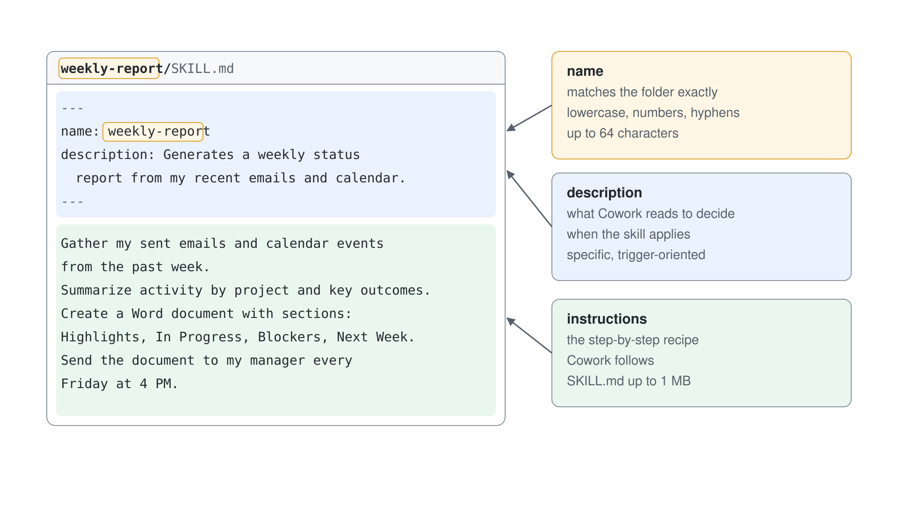

By the end of this lab you will:

- Understand what skills are and when to create custom skills
- Manage built-in and custom skills from **Plugins** > **Cowork** > **Added**
- Create a skill using the native guided flow from **Add** > **Create new**
- Create skills manually at a lower level (for example with VS Code), package them, and upload them

## Exercise 1: Understand what Agent Skills are

In this exercise you build a clear mental model of skills, where they fit in Cowork orchestration, and how they differ from plugins.

### Step 1: Review the role of skills in Cowork

Cowork uses skills as reusable execution patterns. During a task, Cowork can load one or more skills based on conversation intent and then run a step-by-step workflow.


From a practical perspective, skills help Cowork:

- Recognize when a specialized workflow is needed
- Apply consistent instructions instead of ad-hoc prompting
- Produce predictable outputs for recurring business tasks

Unlike one-off prompts, skills are durable assets you reuse across many conversations.

### Step 2: Compare built-in skills and custom skills

Cowork already includes built-in skills for common tasks like documents, communication, scheduling, enterprise search, and building lightweight apps with **App (Frontier)**. That app skill needs Frontier enrollment. Create custom skills when:

- You need organization-specific process logic
- You need consistent formatting or governance for outputs
- You want Cowork to trigger a domain workflow from clear phrases

Custom skills complement built-in skills. They do not replace all of Cowork behavior, they extend Cowork with your business context.

### Step 3: Distinguish skills from plugins

Keep this distinction in mind:

- **Skills** define behavior and workflow instructions
- **Plugins** package integrations, connectors, and optional skill bundles

Choose a skill-first approach when your main goal is guided task execution. Add plugins and connectors when the workflow also needs external systems.

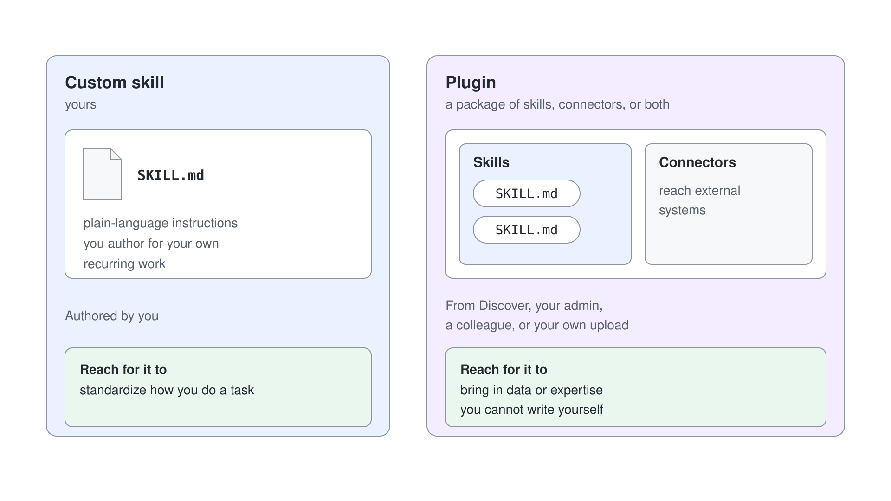

## Exercise 2: Manage skills in the Plugins page

In this exercise you explore how to manage available skills directly in Cowork.

### Step 1: Open your skills

Open [Microsoft Copilot](https://copilot.cloud.microsoft), select **Plugins** in the left navigation, and select the **Cowork** tab. Skills and plugins share one list, **Added (n)**; select **Manage all** to see the full list.

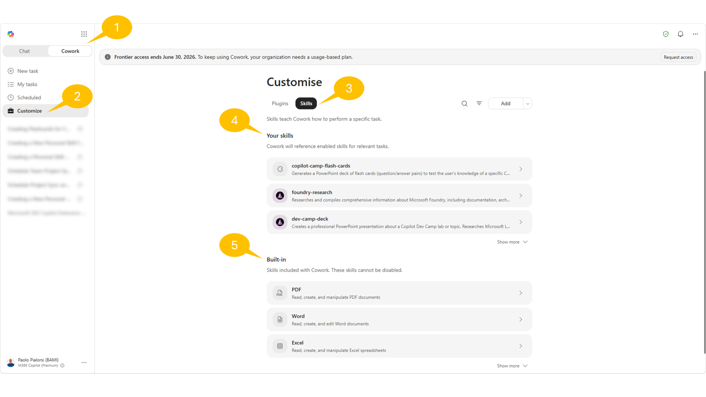

Select a skill to open its details page: **Share**, the **...** menu with **Download** and **Delete**, and the edit and open icons next to **Instructions**.

For your own skills, if any, validate that you can perform management operations such as:

- Edit instructions
- Open the file location in OneDrive
- Download the skill
- Share the skill: select **Share**; the dialog **Publish "<skill name>"** offers **Only you** or **Specific users in your organization**, then select **Publish**
- Delete the skill

After any edit, start a new conversation to test the behavior change. After you edit a shared skill, select **Re-share** to send the latest version. Custom skills aren't supported in Cowork on mobile.

## Exercise 3: Create a skill with the native Add skill flow

In this exercise you use Cowork's built-in guided authoring experience from **Plugins** > **Cowork**.

### Step 1: Start guided creation from Plugins

In **Plugins** > **Cowork**, select **Add** > **New skill**.

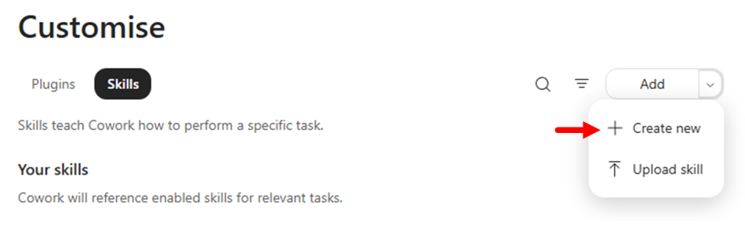

> **Important:** authoring and testing a custom skill in Copilot Cowork consumes Copilot Credits.

Cowork opens a guided conversation to collect your skill definition. The task is titled **Create a Personal Skill in OneDrive**, and the side panel shows **Plugins** > **Skill Management**, the native skill that guides you through the creation of a new skill.

Cowork asks five questions, each with a **Skip** option: what the skill does, its name, its triggers and exclusions, its category (productivity, communication, analysis, writing, research, automation or custom), and its instructions. Answer the first question with the text below and let Cowork derive the rest, or answer each question from it.

For example, use the following text:

```text
Generate a set of flash cards in PowerPoint to test my knowledge about a specific Microsoft Learn article for Grey Logistics training.

Trigger this skill whenever the prompt includes "Create flash cards for a Grey Logistics training article" or something similar, but still referring to "flash cards" and "Grey Logistics".

The result should be a PowerPoint deck with no more than 10 flash cards based on the actual content of the article referenced, as a URL, by the user. If there is no URL of the article, ask the user to provide it.

Name the skill "copilot-flash-cards".
```

Cowork then asks to copy the skill file into **Your Cowork folder** / **skills** / `copilot-flash-cards`: select **Approve** on that card. It checks the skill name, checks the capacity of your Cowork profile, generates the skill, and stores it in your OneDrive for Business. Ask in the chat for the **Skill Report** to get its quality score, for example 72/100 with Trigger, Instruction, Scope and Robustness ratings.


> You can have up to 50 custom skills configured in your profile, so when you create a new skill Cowork checks whether you are at your capacity limit.

You can test your skill directly from Cowork and iterate to fine-tune it. For example, provide the following prompt and check the result:

```text
Test it with the following URL: https://learn.microsoft.com/en-us/microsoft-copilot-studio/agent-extend-action-mcp
```

Read the **Skill Report** that Cowork returns each time it creates or updates your skill. The score runs from 0 to 100 across **Trigger clarity**, **Instruction specificity**, **Scope boundaries**, and **Robustness**, each worth 25 points. The bands are **Excellent** (85+), **Good** (70-84), **Needs work** (50-69), and **Poor** (below 50). Fix the lowest-scoring dimension first, then test again in a new conversation.

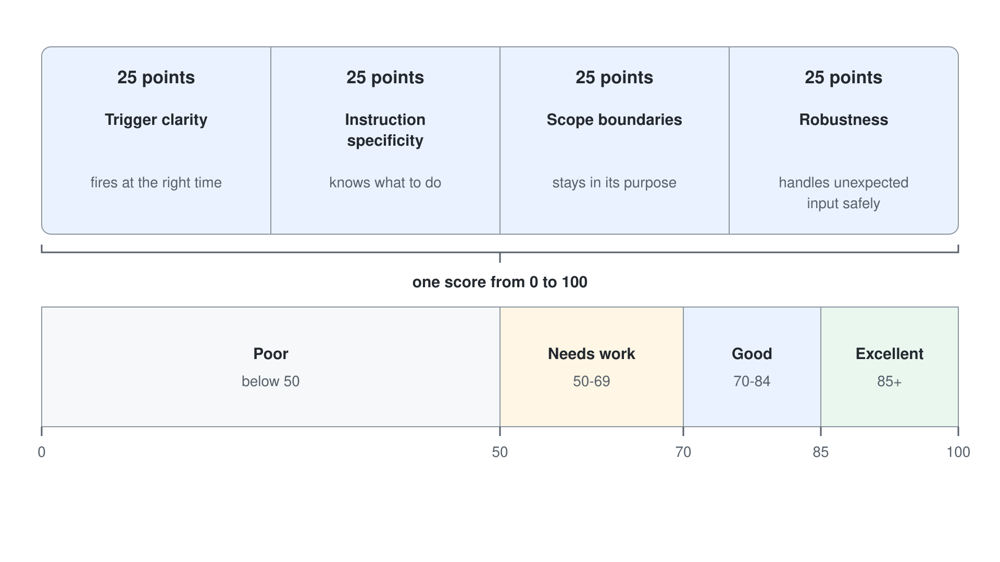

### Step 2: Save and verify where the skill is stored

Once you are happy with your skill, close the current session. Cowork stored the skill in your OneDrive for Business in a folder with the following name:

```text
/Documents/Cowork/Skills/<name-of-the-skill>
```

Browse your OneDrive for Business and check the content of the new skill folder. A skill you ask Cowork to build in chat, or write yourself, is saved in the same folder.


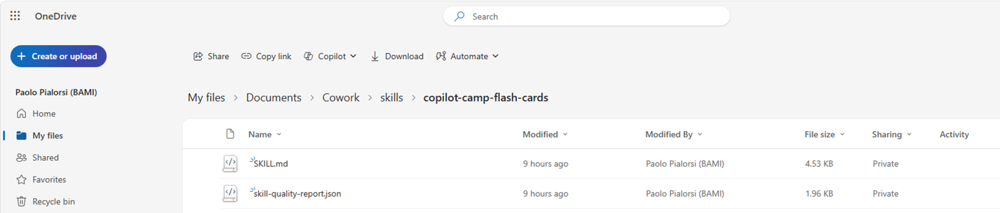

Start a new Cowork task and test a prompt that should trigger your new skill, for example:

```text
Generate flash cards for the Grey Logistics training article available at the following URL: https://learn.microsoft.com/en-us/microsoft-365/copilot/cowork/cowork-plugin-development
```

In the right side panel, open **Plugins** and verify that your custom skill appears among the chips used during execution.

If the skill does not activate, refine the description to be more specific about when Cowork should use it, then test again in a new conversation.

## Exercise 4: Create skills manually with VS Code

In this exercise you build a skill at a lower level by creating the `SKILL.md` file yourself. Alternatively you can download one of the many skills already available on the internet and upload it to Cowork, for example from [Skills.sh](https://www.skills.sh/).


### Step 1: Create the skill folder and author the SKILL.md file

Create a new folder on your file system, for example `weekly-status-mail`, and open it with Visual Studio Code. Add an empty `SKILL.md` file to the folder using the VS Code file explorer.

Open the file in VS Code and add YAML frontmatter with `name` and `description`.

Use this baseline template:

`````yaml
---
name: weekly-status-mail
description: |
  Drafts a concise weekly status-update email to the user's team, covering open
  tasks, upcoming meetings, and action items, with light emoji formatting in the
  body. Use when the user asks to "draft my weekly status email", "write my weekly
  team update", "send my team the weekly status", "create my Monday status mail",
  "weekly status update for the team", or "recap this week for the team".
  Do NOT use for leadership or executive updates and cross-functional stakeholder
  communications — use stakeholder-comms instead. Do NOT use for one-off
  announcements or non-status emails — use the Outlook tools directly.
cowork:
  category: communication
  icon: Mail
---

## Overview

Produces a short, scannable weekly status email addressed to the user's team. It
gathers the user's open tasks, upcoming meetings, and outstanding action items
from Microsoft 365, then composes a friendly email with emoji section headers and
saves it as a **draft for review** — it never sends automatically.

## When to Use

- The user wants their recurring weekly status note to their team.
- The user asks to "recap this week" or "write my Monday update" for the team.
- The user wants open tasks, upcoming meetings, and action items rolled into one email.

## When NOT to Use

- Updates aimed at leadership, executives, or cross-functional stakeholders — use **stakeholder-comms** instead.
- One-off announcements, replies, or any non-status email — use the Outlook tools directly.
- A status *document* or spreadsheet rather than an email — use **docx** or **xlsx**.

## Quick Start

````text
User: "Draft my weekly status email for the team"
1. Resolve the week window (today → next 7 days) and the team recipients.
2. Gather: open tasks, upcoming meetings, action items from M365.
3. Compose the email body with emoji section headers (concise bullets).
4. Save as a draft with CreateDraftMessage and show it for review.
````

## Core Instructions

### Step 1: Resolve recipients and time window
- Determine the week window: today through the next 7 days, in the user's local time zone.
- Resolve "the team" with people tools — `GetDirectReportsDetails` for the user's reports, or a team distribution list the user names. Never guess email addresses.
- If the team cannot be resolved, draft anyway with an empty To line and a clear `[Add team recipients]` note, and flag it for the user.

### Step 2: Gather open tasks
- Use `SearchM365` (sources: email, teams) for open/pending work, and `ListMessages` with `flagged_only=true` for follow-up flags.
- Include only items found in tool results. If none are found, write "Nothing outstanding to report."

### Step 3: Gather upcoming meetings
- Call `ListCalendarView` for the next 7 days; list notable meetings with day and time.
- Respect privacy: render `private`/`confidential` events as "Busy" or a time block — do not echo their subject lines.

### Step 4: Gather action items
- Pull action items from recent meeting recaps and recent email/Teams threads (`SearchM365`, recent `GetMeetingTranscript` when a relevant meeting exists).
- Attribute each item to an owner only when the source states it. Do not invent owners or due dates.

### Step 5: Compose and draft
- Build the body using the Output format below, with emoji section headers.
- Save the draft with `CreateDraftMessage` (To = resolved team, Subject = "Weekly Status — week of {date}").
- Present the draft to the user for review; do not send.

## Output

- **Format:** Email draft. Subject: `Weekly Status — week of {Mon DD}`.
- **Tone:** Warm, professional, concise. **Length:** roughly 120-200 words — scannable bullets, not paragraphs.
- **Body structure** (emoji headers, each section 2-5 bullets; omit a section's bullets and write "Nothing to report" when empty):

````text
👋 Hi team — here's where things stand this week.

📋 Open Tasks
- {task} — {short status}

📅 Upcoming Meetings
- {Day, time} — {meeting}

✅ Action Items
- {action} — {owner, if known}

Thanks!
{User first name}
````

## Guardrails

- **Draft only — never auto-send.** Always use `CreateDraftMessage` and present the draft for the user to review and send themselves.
- **Ground every item in retrieved data.** If a search returns nothing for a section, say "Nothing to report" — never fabricate tasks, meetings, owners, or dates.
- **Resolve recipients via people tools**; never construct or guess email addresses. Confirm the team list with the user before they send.
- **Respect calendar privacy** — show private/confidential events as a time block, not their subject.
- **Keep it concise.** If a section has many items, surface the top few and note the rest exist rather than dumping everything.
- Use a light touch with emojis — section headers and the greeting, not every bullet.
`````

You can download the whole source of the skill from [weekly-status-mail/SKILL.md](./lab-02-cowork-skills/weekly-status-mail/SKILL.md).

Important checks:

- Keep `name` in kebab-case
- Ensure `name` aligns with the skill folder identity
- Keep the description explicit about trigger scenarios

### Step 2: Upload the skill in Cowork

In Cowork, open **Plugins** > **Cowork**, select **Add** > **Upload**, and upload your package in the dialog **Upload a skill or plugin**. Upload a `.md` file (a single `SKILL.md`, up to 1 MB), or a `.zip` or `.skill` archive with `SKILL.md` at its root (up to 10 MB compressed, 50 MB uncompressed, 100 files). To package the folder from Step 1, zip the files inside it, not the folder itself.

After upload, verify that the included skills appear in **Your skills**. If a skill with the same name already exists, Cowork keeps both and numbers the new one. Only upload skills from sources you trust.

If validation fails, check the common issues:

- Missing `SKILL.md`
- Invalid YAML frontmatter
- `name` mismatch with folder identity
- Invalid kebab-case naming

### Step 3: Test end-to-end usage

Start a new conversation and run a prompt that should activate your uploaded skill, for example:

```text
Draft my weekly status email
```

Verify activation from the side panel and confirm that outputs follow the expected workflow and format.

> **Note: name clashes.** If your tenant already has a similar skill, for example a `weekly-status-report` skill from a plugin, a generic prompt runs that skill instead of yours. Name your skill in the prompt to be sure it runs:

```text
Use the weekly-status-mail skill to draft my weekly status email
```

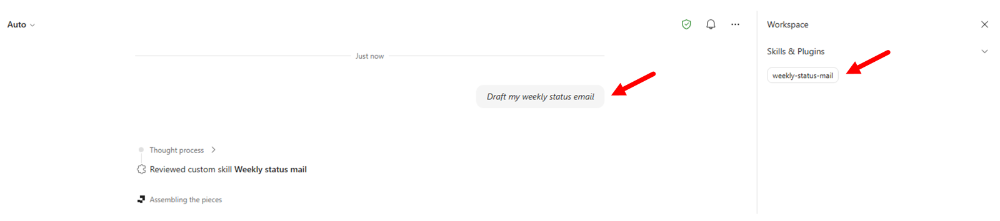

## Summary

You created a Cowork skill twice: once through the guided **Add** > **Create new** flow, and once by hand-authoring `SKILL.md` and uploading it. You also know where Cowork stores your skills and how to verify activation.

Continue with [Lab 03: Organize Work with Cowork Projects](./lab-03-cowork-projects.md).
