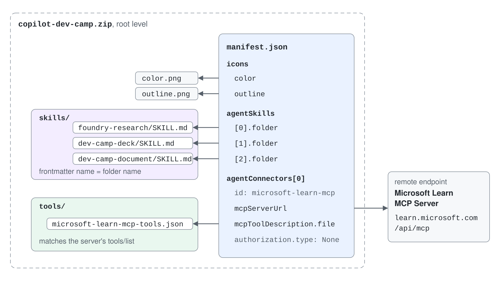
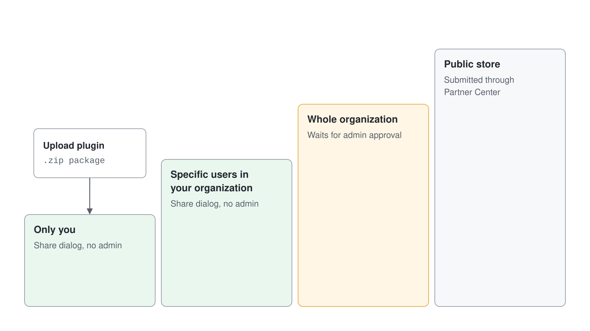

# Lab 03: Build Your First Cowork Plugin

In this lab you learn how Copilot Cowork plugins extend Cowork with packaged skills and connectors, and how to build and deploy your own plugin.

At a high level, a Cowork plugin is a Microsoft 365 app package (`.zip`) that can include:

- A mandatory manifest (`manifest.json`) that describes how Cowork should load and use the assets of the plugin
- Zero or more custom skills (`SKILL.md` files)
- Optional connectors to remote MCP servers

By the end of this lab you will:

- Understand what Cowork plugins are and where they fit in the Cowork experience
- Explore available Microsoft and partner plugins and how users and admins manage them
- Build a custom plugin package with multiple skills and an MCP connector
- Automate packaging with `package.json` scripts
- Deploy the plugin from the Microsoft 365 Admin Center

## Exercise 1: Understand the plugin model in Copilot Cowork

In this exercise you build a practical mental model of plugins and how they combine reusable skills with optional connectors.

### Step 1: Review what a Cowork plugin contains

A Cowork plugin is distributed as a Microsoft 365 app package and can include:

- **Skills**: instruction-driven workflows that tell Cowork how to execute domain tasks
- **Connectors**: remote MCP endpoints that expose tools and data

This gives you a flexible packaging model:

- Skills-only plugin (workflow guidance without external systems)
- Connector-only plugin (external tools used by built-in skills)
- Combined plugin (custom skills orchestrating external tools)


This plugin model is aligned with the Microsoft 365 app ecosystem and follows the same enterprise governance patterns used for Teams apps and agents.

### Step 2: Compare plugin categories and understand management boundaries

In Copilot Cowork, the plugin catalog can include the following. Browse it in **Discover** on **Customize** > **Plugins**:

- **Microsoft plugins** (for example Dynamics 365 and Fabric IQ scenarios)
- **Partner plugins** from third-party publishers
- **Custom plugins** built by your organization

Use this model when choosing your strategy:

- Start with Microsoft or partner plugins when they already cover your use case
- Build a custom plugin when you need company-specific process logic, vocabulary, or integrations

Keep this distinction in mind:

- **Users** add allowed plugins from **Discover**, turn them on or off per conversation in **Sources & Skills**, and can't remove admin-deployed plugins
- **Admins** control availability, deployment scope, and governance from the Microsoft 365 Admin Center

If a plugin requires connector authentication, each user still completes their own one-time sign-in and consent flow.

## Exercise 2: Inspect plugin structure and design decisions

In this exercise you analyze the architecture of a real plugin, available in the [CopilotDevCamp-for-cowork repository](https://github.com/PaoloPia/CopilotDevCamp-for-cowork), and understand why packaging multiple skills with connectors is valuable.

### Step 1: Review a production-style plugin layout

Use this folder model as your baseline for any plugin:

```text
plugin-root-folder/
├── manifest.json
├── color.png
├── outline.png
└── skills/
    ├── skill-01/
    │   ├── references/
    │   │   ├── reference-file-01.md
    │   │   └── reference-file-02.md
    │   ├── scripts/
    │   │   └── script-file-01.py
    │   └── SKILL.md
    ├── skill-02/
    │   └── SKILL.md
    └── skill-NN/
        └── SKILL.md
```

The plugin you build in this lab processes the content of the Copilot Dev Camp labs and creates PowerPoint presentations or Word documents based on a specific lab. It also relies on the Microsoft Learn MCP server (`https://learn.microsoft.com/api/mcp`) to provide technical details about Microsoft Foundry.

The plugin is made of the following skills:

- **foundry-research**: researches and compiles comprehensive information about Microsoft Foundry, including documentation, architecture, models, and deployment options. Used when the user asks to "research Microsoft Foundry", "learn about Foundry", "Foundry documentation", "Foundry architecture", "Foundry models", "how to deploy with Foundry", "Foundry features", or "Foundry capabilities".
- **dev-camp-deck**: creates a professional PowerPoint presentation about a Copilot Dev Camp lab or topic. Researches Microsoft Learn documentation, organizes content into a slide structure, and generates a polished deck with speaker notes. Used when the user asks to "create a presentation on", "make a deck about", "build a slideshow for", "present on Dev Camp topic", or "generate slides about" any Copilot Dev Camp lab or Microsoft technology topic.
- **dev-camp-document**: authors a professional Word document about a Copilot Dev Camp lab or Microsoft technology topic. Researches Microsoft Learn documentation, organizes content into a document structure, and generates a polished one-pager or detailed guide with formatting and citations. Used when the user asks to "write a document about", "create a guide for", "author a one-pager on", "write a technical brief on", or "create documentation for" any Copilot Dev Camp lab or Microsoft technology topic.



The plugin folder structure is the following:

```text
CopilotDevCamp-for-cowork/
├── manifest.json
├── color.png
├── outline.png
├── package.json
└── skills/
    ├── foundry-research/
    │   └── SKILL.md
    ├── dev-camp-deck/
    │   └── SKILL.md
    └── dev-camp-document/
        └── SKILL.md
```

This structure keeps the plugin composable and maintainable: each skill has a focused purpose, while the manifest and scripts provide shared packaging and deployment metadata.

### Step 2: Understand the value of multiple skills and connectors

Bundling multiple related skills in one plugin gives you:

- **Modularity**: separate workflows for research, slide creation, and document authoring
- **Reusability**: one plugin package serves many user intents in the same domain
- **Consistency**: shared naming, metadata, and publishing lifecycle
- **Scalability**: skills can be enriched over time with `references/` and `scripts/` companion files

For larger skills, keep the main `SKILL.md` focused on activation and workflow, and move deep knowledge to companion files (for example `references/*.md` and `scripts/*`) to keep prompts efficient and maintainable.

Connectors let skills call tools from remote MCP servers at runtime. This is how your plugin moves from static instructions to live, data-aware execution.

Common authorization types include:

- `None`: anonymous or public endpoint access
- `OAuthPluginVault`: OAuth 2.0 with secure credential storage reference
- `ApiKeyPluginVault`: API key flow with secure reference storage. API key authentication isn't available in Cowork yet.

Choose the model based on security and data sensitivity. For production, authenticated connectors are the common pattern.

## Exercise 3: Build the custom plugin package

In this exercise you create a plugin similar to the Copilot Dev Camp sample, with three skills and one connector. Create a new folder on your file system named `CopilotDevCamp-for-cowork` and open it with Visual Studio Code or any other code editor.

### Step 1: Create the manifest with skills and connector

Create a `manifest.json` file in your plugin root. Use a schema compatible with Cowork plugin packaging and include the `agentSkills` and `agentConnectors` sections.

Use the following model:

```json
{
  "$schema": "https://developer.microsoft.com/json-schemas/teams/v1.28/MicrosoftTeams.schema.json",
  "manifestVersion": "1.28",
  "version": "1.5.0",
  "id": "a1b2c3d4-e5f6-7890-abcd-ef1234567890",
  "developer": {
    "name": "Paolo Pialorsi",
    "websiteUrl": "https://github.com/PaoloPia",
    "privacyUrl": "https://github.com/PaoloPia",
    "termsOfUseUrl": "https://github.com/PaoloPia"
  },
  "name": {
    "short": "Copilot Dev Camp",
    "full": "Copilot Dev Camp for Cowork - Copilot Dev Camp and Microsoft Foundry Content Creation & Research"
  },
  "description": {
    "short": "Copilot Dev Camp and Microsoft Foundry presentations and documentation",
    "full": "Comprehensive Cowork plugin for Copilot Dev Camp with skills to research Microsoft Foundry documentation, create professional PowerPoint presentations on Dev Camp topics, and author Word documents with technical guides and one-pagers. Powered by the Microsoft Learn MCP Server."
  },
  "icons": {
    "color": "color.png",
    "outline": "outline.png"
  },
  "accentColor": "#000000",
  "agentSkills": [
    { "folder": "./skills/foundry-research" },
    { "folder": "./skills/dev-camp-deck" },
    { "folder": "./skills/dev-camp-document" }
  ],
  "agentConnectors": [
    {
      "id": "microsoft-learn-mcp",
      "displayName": "Microsoft Learn MCP Server",
      "description": "Access to Microsoft's official documentation for research and content generation. Provides search and fetch capabilities for Microsoft Learn articles and code samples.",
      "toolSource": {
        "remoteMcpServer": {
          "mcpServerUrl": "https://learn.microsoft.com/api/mcp",
          "mcpToolDescription": {
            "file": "./tools/microsoft-learn-mcp-tools.json"
          },
          "authorization": {
            "type": "None"
          }
        }
      }
    }
  ]
}
```

The `agentSkills` section defines the skills associated with your custom plugin. The `agentConnectors` section defines the MCP servers, including their authorization model, consumed by the custom plugin.

The `mcpToolDescription` object points to `tools/microsoft-learn-mcp-tools.json`. The v1.28 schema requires it on a `remoteMcpServer`, so the file must be in the ZIP even though Cowork discovers the tools from the server at runtime. Its content must match the server's own `tools/list` response, so generate it from the server instead of writing it by hand:

```bash
mkdir -p tools
curl -s -X POST https://learn.microsoft.com/api/mcp \
  -H "Content-Type: application/json" \
  -H "Accept: application/json, text/event-stream" \
  -d '{"jsonrpc":"2.0","id":1,"method":"tools/list","params":{}}' \
  | sed -n 's/^data: //p' \
  | node -e "let s='';process.stdin.on('data',d=>s+=d).on('end',()=>process.stdout.write(JSON.stringify(JSON.parse(s).result,null,2)))" \
  > tools/microsoft-learn-mcp-tools.json
```

The file holds a `tools` array with the three tools the server exposes: `microsoft_docs_search`, `microsoft_code_sample_search`, and `microsoft_docs_fetch`.

Important validation checks:

- Each `agentSkills[].folder` must exist in the package
- Each skill folder must contain `SKILL.md`
- The file named by `mcpToolDescription` exists in the `tools/` folder
- Skill frontmatter `name` must be kebab-case and match its folder name
- Connector `id` values must be unique



You also need the `color.png` and `outline.png` icons for the application package. Download them from the following URLs:

- [color.png](https://github.com/microsoft/copilot-camp/tree/main/src/cowork/CopilotDevCamp-for-cowork/color.png)
- [outline.png](https://github.com/microsoft/copilot-camp/tree/main/src/cowork/CopilotDevCamp-for-cowork/outline.png)

Feel free to replace the content of the `developer` section of the manifest with your own data.

### Step 2: Create the three skill folders and SKILL.md files

Create these skill folders under `skills/`:

- `foundry-research`
- `dev-camp-deck`
- `dev-camp-document`

In each `SKILL.md`:

- Add valid YAML frontmatter with `name` and `description`
- Keep the description explicit with trigger phrases ("Use when user asks to ...")
- Define a clear workflow and output format
- Reference tools explicitly when a connector is required

You can copy the content of the three skills from the following URLs:

- [foundry-research](https://github.com/microsoft/copilot-camp/tree/main/src/cowork/CopilotDevCamp-for-cowork/skills/foundry-research/SKILL.md)
- [dev-camp-deck](https://github.com/microsoft/copilot-camp/tree/main/src/cowork/CopilotDevCamp-for-cowork/skills/dev-camp-deck/SKILL.md)
- [dev-camp-document](https://github.com/microsoft/copilot-camp/tree/main/src/cowork/CopilotDevCamp-for-cowork/skills/dev-camp-document/SKILL.md)

This design gives Cowork stronger activation accuracy and more consistent outcomes.

### Step 3: Add optional companion references and scripts

For complex skills, keep `SKILL.md` concise and add supporting files such as:

- `references/*.md` for domain details and standards
- `scripts/*` for repeatable utilities

Then reference those files in the skill body so Cowork can load them when needed. This pattern improves maintainability and makes it easier to evolve the plugin without rewriting every skill.

## Exercise 4: Automate packaging and validate the plugin

In this exercise you add packaging automation and produce your plugin `.zip`.

### Step 1: Add packaging scripts in package.json

Add a `package.json` file in the plugin root folder and define scripts like the following:

```json
{
  "name": "copilot-dev-camp-cowork-plugin",
  "version": "1.0.0",
  "description": "Copilot Dev Camp plugin for Cowork - Research Microsoft Foundry, create presentations and documentation",
  "main": "manifest.json",
  "scripts": {
    "package": "PowerShell -Command \"Compress-Archive -Path manifest.json, color.png, outline.png, tools, skills -DestinationPath copilot-dev-camp.zip -Force; Write-Host 'Plugin packaged: copilot-dev-camp.zip'\"",
    "package:unix": "zip -r copilot-dev-camp.zip manifest.json color.png outline.png tools/ skills/"
  },
  "license": "MIT"
}
```

This gives you consistent, repeatable packaging across environments.

### Step 2: Package your plugin

Run the packaging command from your plugin root. On Windows:

```powershell
npm run package
```

On macOS or Linux:

```bash
npm run package:unix
```

Expected result: a `.zip` package containing `manifest.json`, the icons, the `tools/` folder, and the full `skills/` folder at root level.

If needed, inspect the ZIP content before upload to avoid structure-related validation failures.

### Step 3: Validate common packaging issues

Before deployment, verify that:

- `SKILL.md` exists in each referenced folder
- YAML frontmatter is valid
- `name` values match the skill folder names
- The connector URL is HTTPS and the auth config is coherent
- Icon file names and dimensions are correct (`color.png`, `outline.png`)
- The `tools/` file named by `mcpToolDescription` is inside the ZIP

Fix issues now to avoid failed uploads in admin workflows.

The preview `wiqd plugin validate --mode deep` command packages the plugin and runs the same checks locally, including the ASKILL-P001 to ASKILL-P008 codes for folders, `SKILL.md` frontmatter and `name` rules. Keep the npm scripts above as your packaging path and use the `wiqd` check as a second pass before upload.

## Exercise 5: Vibe-code the whole plugin with GitHub Copilot (optional)

In this exercise you use GitHub Copilot to scaffold and complete the plugin with a single high-quality prompt. This is an alternative to Exercise 3 and Exercise 4.

### Step 1: Use a full vibe-coding prompt in GitHub Copilot

If you prefer a fast, prompt-driven flow, ask GitHub Copilot (Agent mode in Visual Studio Code) to scaffold the full plugin structure, generate the skills, prepare packaging scripts, and draft deployment documentation.

Use the following prompt as-is with GitHub Copilot:

```text
You are GitHub Copilot acting as a senior Microsoft 365 + Copilot Cowork plugin engineer.

Goal: Build a **new Copilot Cowork plugin** in this repository, following the same project structure and engineering style as:
- https://github.com/PaoloPia/CopilotDevCamp-for-cowork

and grounded in official guidance from:
- https://learn.microsoft.com/en-us/microsoft-365/copilot/cowork/cowork-plugin-development

### Mandatory requirements

1. Implement plugin capabilities
- Add a skill with name `foundry-research` with support for **Microsoft Foundry** content (both documentation and samples) using this MCP server:
    - https://learn.microsoft.com/api/mcp
- Add a skill with name `dev-camp-deck` to create a **PowerPoint presentation** about one Copilot Dev Camp lab/topic.
- Add a skill with name `dev-camp-document` to author a **Word document** about one Copilot Dev Camp lab/topic.
- Use Copilot Dev Camp content as source context:
    - https://microsoft.github.io/copilot-camp/
- Register the MCP server https://learn.microsoft.com/api/mcp in the manifest, with anonymous access

2. Keep repository conventions
- Reuse the same folder organization patterns, naming style, and manifest conventions used by this repo.
- Do not break existing files unless replacement is necessary.
- Prefer additive changes and keep the plugin maintainable.

3. Update docs and ignores
- Update `README.md` with:
    - Plugin overview and feature list
    - Skills documentation and examples
    - Packaging process
    - Deployment process for Cowork
    - Any prerequisites and environment variables
- Update `.gitignore` as needed for generated artifacts and packaging outputs.

4. Packaging automation
- Create or update `package.json` scripts so packaging can be run with a single command.
- The packaging process must generate a `.zip` file suitable for upload in Cowork.
- Include scripts for clean/build/package where appropriate.

5. Icons generation
- Generate plugin icons required by the plugin structure:
    - `color.png`
    - `outline.png`
- Visual requirements:
    - Subject: a **book inside/with a camp tent** motif
    - Tent color: **purple**
    - Book color: **white**
    - Background: **black**
- Ensure dimensions and style are compliant with Cowork plugin requirements.

### Implementation instructions

- First inspect current workspace files to align with existing conventions.
- If the repo already contains reusable scripts/utilities (for example icon generation), reuse them.
- Create or update the plugin manifest and any skill metadata files needed for Cowork.
- For the Foundry feature:
    - Implement a skill/integration that can retrieve or reference both docs and samples via the MCP endpoint.
    - Add clear prompt instructions and usage examples.
- For the PowerPoint and Word skills:
    - Create dedicated skill folders/files with clear instructions, expected inputs, and generated outputs.
    - Ensure prompts are practical for Copilot users and tied to Copilot Dev Camp topics.

### README packaging + deployment documentation (must include)

Add a concise section with:
- Prerequisites
- Install dependencies
- Build/package commands
- Output zip path
- How to upload/install in Copilot Cowork
- How to validate skills after deployment

### Quality bar

- Keep changes production-quality and self-consistent.
- Validate JSON/manifest files.
- Ensure all referenced files exist.
- Ensure scripts run on Windows PowerShell and common cross-platform shells when feasible.

### Deliverables checklist (must complete all)

- Updated manifest and skill definitions
- Foundry MCP support (docs + samples)
- PowerPoint skill
- Word skill
- Updated `README.md`
- Updated `.gitignore`
- Working `package.json` packaging scripts
- Generated `color.png` and `outline.png`
- A final short summary listing all changed files and exact package command(s)

### Execution mode

Proceed autonomously: inspect, implement, run packaging command, verify outputs, then summarize.
If a required file is missing, create it following this repo's conventions.
If assumptions are required, choose sensible defaults and document them in README.
```

After generation, review `manifest.json`, validate each `SKILL.md` frontmatter, and run packaging to produce the final plugin ZIP before upload.

## Exercise 6: Deploy and test from the Microsoft 365 Admin Center

In this exercise you upload your plugin package and validate end-to-end behavior in Cowork.

Before you involve an admin, test the package yourself. Open **Customize** > **Plugins** > **Upload plugin**, select your `.zip`, and choose **Only you** in the **Share** dialog; no admin is needed. Sharing with **Specific users in your organization** also needs no admin, but publishing to the whole organization waits for admin approval. The admin upload in Step 1 is what lists the plugin in **Discover**, and custom plugins don't run in Cowork on mobile.



### Step 1: Upload the plugin in the Microsoft 365 Admin Center

Use the following path:

1. Open the **Microsoft 365 Admin Center**
2. Go to **Agents** > **Tools**
3. On the **Registry** tab, select **Upload**
4. Upload your plugin `.zip` package
5. Review the components the package contains (the three skills and the MCP connector), then select **Next**
6. In **Scope users**, choose **All users** or **Specific users or groups**, then select **Install**

The **Registry** tab lists your plugin under the **Plugins** tile once the upload finishes. To block it later, open it from the same list.

Remember that users enable or disable active plugins per session, while admin deployment controls tenant availability and lifecycle.

### Step 2: Enable and verify plugin behavior in Cowork

Open Copilot Cowork and verify that:

- The plugin appears in **Discover** under **Customize** > **Plugins**
- The plugin can be added from its detail page and turned on in **Sources & Skills**
- The three skills activate based on relevant prompts
- The connector is discoverable and, when applicable, prompts for authentication (in this sample the MCP server is publicly available with anonymous access)

Run scenario-based tests such as:

```text
Research Microsoft Foundry deployment options
```

or:

```text
Create a presentation about Copilot Dev Camp lab: https://microsoft.github.io/copilot-camp/pages/extend-m365-copilot/08-mcp-server/
```

or:

```text
Write a one-pager about Copilot Dev Camp lab: https://microsoft.github.io/copilot-camp/pages/extend-m365-copilot/11-mcp-app/
```

> **Important:** testing the custom skills of this plugin in Copilot Cowork consumes Copilot Credits.

## Summary

You packaged a Cowork plugin that bundles three skills and one MCP connector, automated its packaging, and deployed it through the Microsoft 365 Admin Center. With that, you completed the Copilot Cowork lab pathway.
