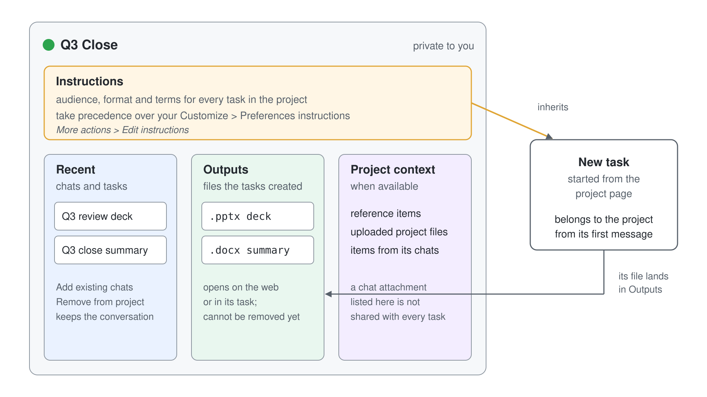

# Lab 03: Organize Work with Cowork Projects

> **Proposal: run this lab on a cheaper model.** In the Cowork model picker (**Model and generation settings**), choose **Sonnet 5.5** ("Efficient for everyday tasks") instead of **Auto**, and set **Effort level** to **Light** instead of **Medium (default)**. If your tenant has turned off Anthropic models, choose **GPT 5.5** instead.

In this lab you run a piece of work that spans several Cowork tasks as one project. You are the operations lead at Grey Logistics, and the new Vienna Hub warehouse opens on 07 Dec 2026. Every status brief and decision memo for the launch goes to the same leadership board, uses the same terms and follows the same one-page format, so you set that up once in a project instead of repeating it in every prompt.

The lab stands on its own: it needs a Cowork-ready account and the two files in the [lab-03-cowork-projects](./lab-03-cowork-projects/) folder, nothing from the other labs.



By the end of this lab you will:

- Create a project and give it instructions that every task inside it follows
- Start tasks from the project page and find their files under **Outputs**
- Bring an existing chat into the project and take a task out again
- See that the project's instructions stop at the project's edge
- Rename, archive and restore the project

## Prerequisites

- A Microsoft 365 account with a Microsoft 365 Copilot license and access to Cowork (a Copilot Credits spending policy that selects **Cowork** covers you)
- The lab files, downloaded to your computer:

| File | What it holds |
| --- | --- |
| [vienna-hub-launch-plan.xlsx](./lab-03-cowork-projects/vienna-hub-launch-plan.xlsx) | Sheet **Milestones**: seven launch milestones with owner, due date, status and notes. Sheet **Budget**: six line items, planned and actual to date in EUR thousands |
| [carrier-notes.docx](./lab-03-cowork-projects/carrier-notes.docx) | Procurement's notes on the three carriers, the open risks and the decision the board has to make |

> Each task in this lab consumes Copilot Credits. The lab runs five short tasks.

## Exercise 1: Create the Vienna Hub Launch project

A project groups the tasks of one piece of work. Create it before the first task, so every task of the launch belongs to it from its first message.

### Step 1: Open Cowork

Open [Microsoft 365 Copilot Cowork](https://copilot.cloud.microsoft/cowork). Make sure the **Cowork** tab is selected: projects live in Cowork, not in Chat.

**Expected result:** The Cowork start page is open, and the left navigation shows a **Projects** heading.

### Step 2: Create the project

1. In the left navigation, find the **Projects** heading and select **+** next to it. If you have no projects yet, you can also select **Add project**.
2. Enter the project name `Vienna Hub Launch`.
3. Choose a color for the project.
4. Select **Create**.

**Expected result:** Cowork opens the new project. Its page shows a chat input and the sections **Recent**, **Outputs** and **Project context**, all still empty, and **Vienna Hub Launch** is listed under **Projects** in the left navigation.

## Exercise 2: Give the project its instructions

Project instructions hold what every task of this piece of work must respect: the audience, the terms, the format. They apply to every task inside the project and take precedence over your personal Cowork instructions.

### Step 1: Set the instructions

1. On the project page, open the project's **More actions** menu (**...**) and select **Edit instructions**.
2. Paste the following text:

```text
This project is the Grey Logistics Vienna Hub launch. Every document goes to the Grey Logistics leadership board.
Call the site "Vienna Hub", never "Vienna warehouse" or "the new site".
Report money in EUR thousands and dates as DD Mon YYYY, for example 07 Dec 2026.
Keep every document to one page, lead with the decision the board has to make, and end with a section titled "Open risks".
```

3. Select **Save**. If the editor reports that the instructions exceed the limit, shorten them and save again.

**Expected result:** The editor closes without an error. Opening **More actions** > **Edit instructions** again shows the four lines you saved.

## Exercise 3: Run the first task from the project

A task you start on the project page belongs to the project and carries its instructions and the context available to it.

### Step 1: Ask for the launch status brief

1. On the **Vienna Hub Launch** project page, select **+** in the chat input, choose **Upload images and files**, and pick `vienna-hub-launch-plan.xlsx`.
2. Send this prompt:

```text
Read vienna-hub-launch-plan.xlsx and write the weekly launch status brief as a Word document named vienna-hub-status-brief.docx. Cover every milestone that is at risk with its owner and due date, and compare planned and actual spend for each budget line.
```

**Expected result:** Cowork reads both sheets and creates `vienna-hub-status-brief.docx`. The prompt does not mention the board, the naming or the format, yet the brief follows the project instructions: it opens with the decision the board has to make, calls the site "Vienna Hub", gives money in EUR thousands (for example the warehouse management system line at 291 against 260 planned), writes dates such as 20 Nov 2026, fits one page and ends with **Open risks**.

### Step 2: Find the task and its file in the project

1. Return to the project page by selecting **Vienna Hub Launch** under **Projects** in the left navigation.
2. Look at **Recent** and **Outputs**.

**Expected result:** **Recent** lists the status brief task. **Outputs** lists `vienna-hub-status-brief.docx`; selecting it opens the document on the web or in the task that created it.

## Exercise 4: Grow the project

A project collects more than one task. Add a second task from the project page, then bring in a chat that started outside the project.

### Step 1: Write the carrier decision memo

1. On the project page, start a new request: select **+** > **Upload images and files** and pick `carrier-notes.docx`.
2. Send this prompt:

```text
Read carrier-notes.docx and write a decision memo for the Pannonia Express question as a Word document named vienna-hub-carrier-decision.docx. Set out both options, the cost of each and what happens on opening day if no decision is made by the deadline.
```

**Expected result:** `vienna-hub-carrier-decision.docx` opens with the decision: approve the Pannonia Express rate, 9 percent above budget, or switch the eastern runs to the AlpenLink Transport fallback with 30 percent more capacity, with the 20 Nov 2026 deadline. It again follows the project instructions without being told: one page, "Vienna Hub", an **Open risks** section that names the scanner firmware and the A4 winter restrictions. Back on the project page, **Recent** lists two tasks and **Outputs** lists both files.

### Step 2: Start a chat outside the project

1. Select **New task** in the left navigation, outside the project, so the task belongs to no project.
2. Send this prompt:

```text
List five questions a logistics operations lead should ask a regional freight carrier before signing a one-year contract.
```

**Expected result:** Cowork answers with five questions in a new task. The task shows in your task list, but not inside **Vienna Hub Launch**.

### Step 3: Add the chat to the project

1. Open the **Vienna Hub Launch** project.
2. Select **Add existing chats** (**+** beside the task list; in some experiences the link reads **add from existing**).
3. Find the carrier questions chat, using **Search chats and tasks** if needed, select it and select **Add**.

**Expected result:** The carrier questions chat appears in the project's task list beside the two earlier tasks. A chat that already belongs to another project would not be selectable in the picker.

### Step 4: Take the chat out again

1. In **Recent** or the task list, open the **More actions** menu of the carrier questions chat.
2. Select **Remove from project**.

**Expected result:** The chat leaves the project's task list. Its conversation is not deleted: you can still open it from your task list outside the project.

## Exercise 5: See where the instructions stop

Project instructions belong to the project. The same request outside the project gets only your personal instructions.

### Step 1: Run the status brief outside the project

1. Select **New task** in the left navigation, outside the project.
2. Select **+** > **Upload images and files** and pick `vienna-hub-launch-plan.xlsx`.
3. Send the same prompt as in Exercise 3:

```text
Read vienna-hub-launch-plan.xlsx and write the weekly launch status brief as a Word document named vienna-hub-status-brief.docx. Cover every milestone that is at risk with its owner and due date, and compare planned and actual spend for each budget line.
```

**Expected result:** Cowork writes a brief from the same data, but nothing tells it about the board, the one-page limit or the **Open risks** section, so it follows its own defaults. Put the two documents side by side: the one from the project leads with the board decision and ends with **Open risks**; this one does not unless Cowork happens to choose that layout. The new file does not appear under **Outputs** of **Vienna Hub Launch**.

## Exercise 6: Tidy up the project

### Step 1: Rename the project and change its color

1. Open the project, open **More actions** and select **Edit project**.
2. Change the name to `Vienna Hub Launch 2026`, pick another color and select **Save**.

**Expected result:** The new name and color show under **Projects** in the left navigation. The instructions are unchanged: **Edit project** changes how the project looks, **Edit instructions** changes how Cowork works on it.

### Step 2: Archive and restore the project

1. Open **More actions** and select **Archive**, then confirm with **Archive**.
2. Open the projects page with **Back to Projects** (or **View all projects**) and select the **Archived** tab.
3. Open **Vienna Hub Launch 2026**, open **More actions** and select **Restore**.

**Expected result:** After **Archive**, the project disappears from the left navigation and is listed under **Archived**. After **Restore**, it is back under **Active** and in the navigation, with its tasks and both files in **Outputs**.

## Summary

You ran a launch that spans several tasks as one Cowork project. The project's instructions set the audience, the terms and the format once, and every task started from the project page followed them, while the same request outside the project did not. **Outputs** collected the files of every task, an outside chat joined and left the project without losing its conversation, and archiving kept the finished work out of the way without deleting it.

Read more in [Organizing Work with Projects](../../demos/02-cowork/04-projects/readme.md) and in [Use projects in Copilot Cowork](https://learn.microsoft.com/en-us/copilot/cowork/cowork-projects).

Continue with [Lab 04: Build Your First Cowork Plugin](./lab-04-cowork-plugins.md).
