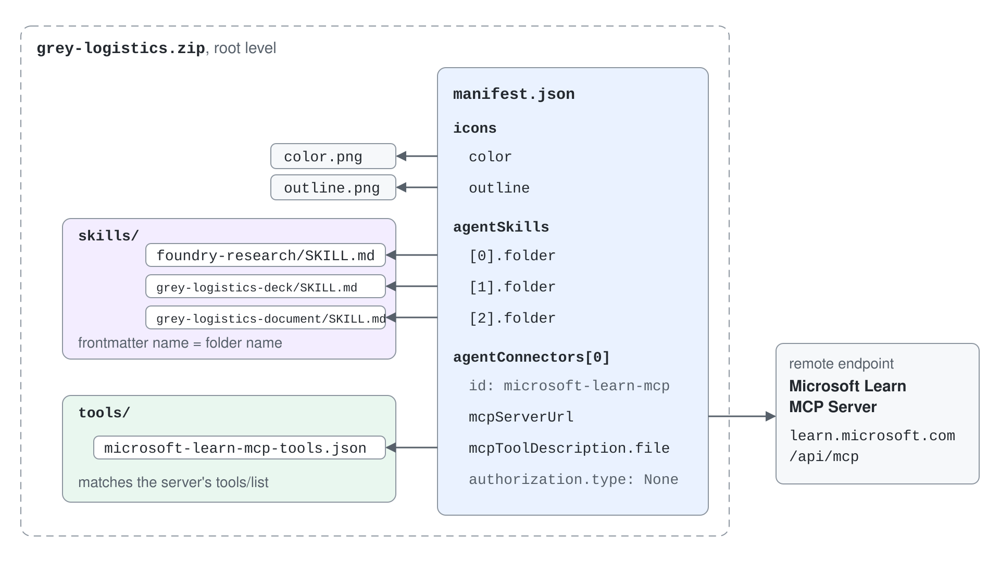
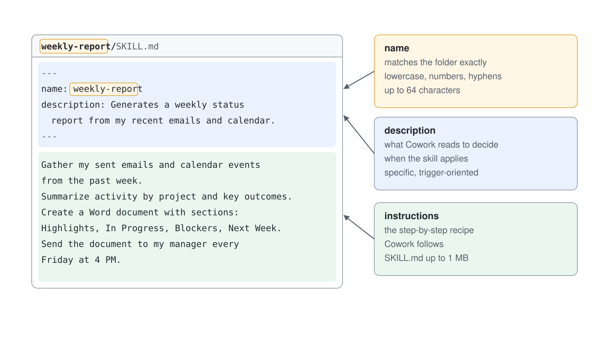

# Lab 03: Ihr erstes Cowork Plugin bauen

> **Vorschlag: Führen Sie dieses Lab mit einem günstigeren Model aus.** Wählen Sie im Model Picker von Cowork (**Model and generation settings**) **Sonnet 5.5** ("Efficient for everyday tasks") statt **Auto**, und setzen Sie **Effort level** auf **Light** statt **Medium (default)**. Ein Testlauf des Setup Labs hat mit dieser Einstellung jeden Cowork Task abgeschlossen. Hat Ihr Tenant die Anthropic Models abgeschaltet, wählen Sie stattdessen **GPT 5.5**.

In diesem Lab lernen Sie, wie Copilot Cowork Plugins Cowork mit paketierten Skills und Connectors erweitern und wie Sie Ihr eigenes Plugin bauen und deployen.

Im Kern ist ein Cowork Plugin ein Microsoft 365 App Package (`.zip`), das Folgendes enthalten kann:

- Ein verpflichtendes Manifest (`manifest.json`), das beschreibt, wie Cowork die Assets des Plugins laden und nutzen soll
- Null oder mehr Custom Skills (`SKILL.md` Dateien)
- Optionale Connectors zu Remote MCP Servern

Am Ende dieses Labs können Sie:

- Erklären, was Cowork Plugins sind und wo sie in die Cowork Experience passen
- Verfügbare Plugins von Microsoft und Partnern erkunden und verstehen, wie User und Admins sie verwalten
- Ein Custom Plugin Package mit mehreren Skills und einem MCP Connector bauen
- Das Packaging mit `package.json` Scripts automatisieren
- Das Plugin aus dem Microsoft 365 Admin Center deployen
- Ein Claude Plugin mit `wiqd` importieren, zur Freigabe durch einen Admin veröffentlichen und zurück ins Claude Format exportieren

## Übung 1: Das Plugin-Modell in Copilot Cowork verstehen

In dieser Übung bauen Sie ein praktisches mentales Modell von Plugins auf und sehen, wie sie wiederverwendbare Skills mit optionalen Connectors kombinieren.

### Schritt 1: Prüfen, was ein Cowork Plugin enthält

Ein Cowork Plugin wird als Microsoft 365 App Package verteilt und kann Folgendes enthalten:

- **Skills**: Workflows auf Basis von Instructions, die Cowork sagen, wie es fachliche Aufgaben ausführt
- **Connectors**: Remote MCP Endpoints, die Tools und Daten bereitstellen

Damit haben Sie ein flexibles Packaging-Modell:

- Plugin nur mit Skills (Workflow-Anleitung ohne externe Systeme)
- Plugin nur mit Connector (externe Tools, die integrierte Skills nutzen)
- Kombiniertes Plugin (Custom Skills, die externe Tools orchestrieren)


Dieses Plugin-Modell ist auf das Microsoft 365 App Ökosystem abgestimmt und folgt denselben Governance-Mustern für Unternehmen wie Teams Apps und Agents.

### Schritt 2: Plugin-Kategorien vergleichen und die Grenzen der Verwaltung verstehen

In Copilot Cowork kann der Plugin-Katalog Folgendes enthalten. Durchsuchen Sie ihn unter **Discover** auf **Plugins** > **Cowork**:

- **Microsoft Plugins** (zum Beispiel Szenarien mit Dynamics 365 und Fabric IQ)
- **Partner Plugins** von Drittanbietern
- **Custom Plugins**, die Ihre Organisation baut

Nutzen Sie dieses Modell, wenn Sie Ihre Strategie wählen:

- Beginnen Sie mit Plugins von Microsoft oder Partnern, wenn diese Ihren Use Case bereits abdecken
- Bauen Sie ein Custom Plugin, wenn Sie unternehmensspezifische Prozesslogik, Vokabular oder Integrationen brauchen

Behalten Sie diese Unterscheidung im Kopf:

- **User** fügen erlaubte Plugins aus **Discover** hinzu, schalten sie pro Unterhaltung in **Sources & Skills** ein oder aus und können von Admins deployte Plugins nicht entfernen
- **Admins** steuern Verfügbarkeit, Deployment Scope und Governance aus dem Microsoft 365 Admin Center



Verlangt ein Plugin Authentication für einen Connector, durchläuft trotzdem jeder User einmalig seinen eigenen Sign-in und Consent Flow.

## Übung 2: Struktur und Designentscheidungen eines Plugins untersuchen

In dieser Übung analysieren Sie die Architektur des Grey Logistics Beispiel-Plugins in [lab-03-grey-logistics-plugin](./lab-04-grey-logistics-plugin) und verstehen, warum es sich lohnt, mehrere Skills mit Connectors zu verpacken.

### Schritt 1: Ein Plugin-Layout im Production-Stil ansehen

Verwenden Sie dieses Ordnermodell als Basis für jedes Plugin:

```text
plugin-root-folder/
├── manifest.json
├── color.png
├── outline.png
└── skills/
    ├── skill-01/
    │   ├── references/
    │   │   ├── reference-file-01.md
    │   │   └── reference-file-02.md
    │   ├── scripts/
    │   │   └── script-file-01.py
    │   └── SKILL.md
    ├── skill-02/
    │   └── SKILL.md
    └── skill-NN/
        └── SKILL.md
```

Das Plugin, das Sie in diesem Lab bauen, macht aus Artikeln auf Microsoft Learn PowerPoint Präsentationen oder Word Dokumente für Grey Logistics. Außerdem nutzt es den Microsoft Learn MCP Server (`https://learn.microsoft.com/api/mcp`), um technische Details zu Microsoft Foundry zu liefern.

Das Plugin besteht aus den folgenden Skills:

- **foundry-research**: recherchiert und bündelt umfassende Informationen zu Microsoft Foundry, darunter Dokumentation, Architektur, Models und Deployment-Optionen. Der Skill greift, wenn der User nach "research Microsoft Foundry", "learn about Foundry", "Foundry documentation", "Foundry architecture", "Foundry models", "how to deploy with Foundry", "Foundry features" oder "Foundry capabilities" fragt.
- **grey-logistics-deck**: erstellt für Grey Logistics eine professionelle PowerPoint Präsentation zu einem Artikel auf Microsoft Learn oder einem Thema. Der Skill recherchiert die Dokumentation auf Microsoft Learn, ordnet die Inhalte in eine Folienstruktur und erzeugt ein ausgearbeitetes Deck mit Speaker Notes. Er greift, wenn der User mit "create a presentation on", "make a deck about", "build a slideshow for", "present on a Grey Logistics topic" oder "generate slides about" nach einem Artikel auf Microsoft Learn oder einem Thema zu Microsoft Technologien fragt.
- **grey-logistics-document**: schreibt für Grey Logistics ein professionelles Word Dokument zu einem Artikel auf Microsoft Learn oder einem Thema zu Microsoft Technologien. Der Skill recherchiert die Dokumentation auf Microsoft Learn, ordnet die Inhalte in eine Dokumentstruktur und erzeugt einen ausgearbeiteten One-Pager oder einen ausführlichen Guide mit Formatierung und Quellenangaben. Er greift, wenn der User mit "write a document about", "create a guide for", "author a one-pager on", "write a technical brief on" oder "create documentation for" nach einem Artikel auf Microsoft Learn oder einem Thema zu Microsoft Technologien fragt.



Die Ordnerstruktur des Plugins sieht so aus:

```text
GreyLogistics-for-cowork/
├── manifest.json
├── color.png
├── outline.png
├── package.json
└── skills/
    ├── foundry-research/
    │   └── SKILL.md
    ├── grey-logistics-deck/
    │   └── SKILL.md
    └── grey-logistics-document/
        └── SKILL.md
```

Diese Struktur hält das Plugin zusammensetzbar und wartbar: Jeder Skill hat einen klaren Zweck, während Manifest und Scripts gemeinsame Metadaten für Packaging und Deployment liefern.

### Schritt 2: Den Wert mehrerer Skills und Connectors verstehen

Mehrere zusammengehörige Skills in einem Plugin zu bündeln bringt Ihnen:

- **Modularität**: getrennte Workflows für Recherche, Folien und Dokumente
- **Wiederverwendbarkeit**: ein Plugin Package bedient viele User Intents in derselben Domäne
- **Konsistenz**: gemeinsame Benennung, Metadaten und ein gemeinsamer Publishing Lifecycle
- **Skalierbarkeit**: Skills lassen sich mit der Zeit um Begleitdateien in `references/` und `scripts/` anreichern

Halten Sie bei größeren Skills die zentrale `SKILL.md` auf Aktivierung und Workflow fokussiert, und verlagern Sie tiefes Wissen in Begleitdateien (zum Beispiel `references/*.md` und `scripts/*`), damit die Prompts effizient und wartbar bleiben.

Connectors lassen Skills zur Runtime Tools von Remote MCP Servern aufrufen. So kommt Ihr Plugin von statischen Instructions zu einer Ausführung, die mit Live-Daten arbeitet.

Häufige Authorization Types sind:

- `None`: anonymer oder öffentlicher Zugriff auf den Endpoint
- `OAuthPluginVault`: OAuth 2.0 mit einer Referenz auf sicher gespeicherte Credentials
- `ApiKeyPluginVault`: API Key Flow mit sicher gespeicherter Referenz. API Key Authentication ist in Cowork noch nicht verfügbar.

Wählen Sie das Modell nach Security und Sensibilität der Daten. In Production sind authentifizierte Connectors das übliche Muster.

## Übung 3: Das Custom Plugin Package bauen

In dieser Übung erstellen Sie ein Plugin ähnlich dem Grey Logistics Beispiel, mit drei Skills und einem Connector. Legen Sie in Ihrem Dateisystem einen neuen Ordner namens `GreyLogistics-for-cowork` an und öffnen Sie ihn mit Visual Studio Code oder einem anderen Code-Editor.

### Schritt 1: Das Manifest mit Skills und Connector erstellen

Erstellen Sie im Root Ihres Plugins eine Datei `manifest.json`. Verwenden Sie ein Schema, das mit dem Packaging von Cowork Plugins kompatibel ist, und nehmen Sie die Abschnitte `agentSkills` und `agentConnectors` auf.

Verwenden Sie das folgende Modell:

```json
{
  "$schema": "https://developer.microsoft.com/json-schemas/teams/v1.28/MicrosoftTeams.schema.json",
  "manifestVersion": "1.28",
  "version": "1.5.0",
  "id": "a1b2c3d4-e5f6-7890-abcd-ef1234567890",
  "developer": {
    "name": "Grey Logistics",
    "websiteUrl": "https://github.com/alexander-kastil/copilot-studio-agents",
    "privacyUrl": "https://github.com/alexander-kastil/copilot-studio-agents",
    "termsOfUseUrl": "https://github.com/alexander-kastil/copilot-studio-agents"
  },
  "name": {
    "short": "Grey Logistics",
    "full": "Grey Logistics for Cowork - Microsoft Foundry Content Creation & Research"
  },
  "description": {
    "short": "Grey Logistics presentations and documentation on Microsoft technology",
    "full": "Comprehensive Cowork plugin for Grey Logistics with skills to research Microsoft Foundry documentation, create professional PowerPoint presentations on Microsoft technology topics, and author Word documents with technical guides and one-pagers. Powered by the Microsoft Learn MCP Server."
  },
  "icons": {
    "color": "color.png",
    "outline": "outline.png"
  },
  "accentColor": "#000000",
  "agentSkills": [
    { "folder": "./skills/foundry-research" },
    { "folder": "./skills/grey-logistics-deck" },
    { "folder": "./skills/grey-logistics-document" }
  ],
  "agentConnectors": [
    {
      "id": "microsoft-learn-mcp",
      "displayName": "Microsoft Learn MCP Server",
      "description": "Access to Microsoft's official documentation for research and content generation. Provides search and fetch capabilities for Microsoft Learn articles and code samples.",
      "toolSource": {
        "remoteMcpServer": {
          "mcpServerUrl": "https://learn.microsoft.com/api/mcp",
          "mcpToolDescription": {
            "file": "tools/microsoft-learn-mcp-tools.json"
          },
          "authorization": {
            "type": "None"
          }
        }
      }
    }
  ]
}
```

Der Abschnitt `agentSkills` definiert die Skills, die zu Ihrem Custom Plugin gehören. Der Abschnitt `agentConnectors` definiert die MCP Server, die das Custom Plugin nutzt, einschließlich ihres Authorization-Modells.

Das Objekt `mcpToolDescription` zeigt auf `tools/microsoft-learn-mcp-tools.json`. Das v1.28 Schema verlangt es bei einem `remoteMcpServer`, deshalb muss die Datei im ZIP liegen, obwohl Cowork die Tools zur Runtime vom Server entdeckt. Der Inhalt der Datei muss der `tools/list` Response des Servers selbst entsprechen, deshalb erzeugen Sie die Datei aus dem Server, statt sie von Hand zu schreiben:

```bash
mkdir -p tools
curl -s -X POST https://learn.microsoft.com/api/mcp \
  -H "Content-Type: application/json" \
  -H "Accept: application/json, text/event-stream" \
  -d '{"jsonrpc":"2.0","id":1,"method":"tools/list","params":{}}' \
  | sed -n 's/^data: //p' \
  | node -e "let s='';process.stdin.on('data',d=>s+=d).on('end',()=>process.stdout.write(JSON.stringify(JSON.parse(s).result,null,2)))" \
  > tools/microsoft-learn-mcp-tools.json
```

Die Datei enthält ein Array `tools` mit den drei Tools, die der Server bereitstellt: `microsoft_docs_search`, `microsoft_code_sample_search` und `microsoft_docs_fetch`.

Wichtige Prüfungen bei der Validierung:

- Jeder `agentSkills[].folder` muss im Package existieren
- Jeder Skill-Ordner muss `SKILL.md` enthalten
- Die in `mcpToolDescription` genannte Datei liegt im Ordner `tools/`, und der Pfad in `toolSource` hat kein führendes `./` (`tools/microsoft-learn-mcp-tools.json`); mit `./` scheitert der Upload in Cowork mit `InvalidAgentConnector: ... not found in the app package`
- Der `name` im Skill Frontmatter muss kebab-case sein und dem Ordnernamen entsprechen
- Die Werte von Connector `id` müssen eindeutig sein



Sie brauchen außerdem die Icons `color.png` und `outline.png` für das Application Package. Laden Sie sie von den folgenden URLs herunter:

- [color.png](./lab-04-grey-logistics-plugin/color.png)
- [outline.png](./lab-04-grey-logistics-plugin/outline.png)

Ersetzen Sie den Inhalt des Abschnitts `developer` im Manifest gern durch Ihre eigenen Daten.

### Schritt 2: Die drei Skill-Ordner und SKILL.md Dateien erstellen

Erstellen Sie diese Skill-Ordner unter `skills/`:

- `foundry-research`
- `grey-logistics-deck`
- `grey-logistics-document`

In jeder `SKILL.md`:

- Fügen Sie gültiges YAML Frontmatter mit `name` und `description` hinzu
- Halten Sie die Description explizit, mit Trigger-Formulierungen ("Use when user asks to ...")
- Definieren Sie einen klaren Workflow und ein klares Ausgabeformat
- Verweisen Sie explizit auf Tools, wenn ein Connector nötig ist



Den Inhalt der drei Skills können Sie von den folgenden URLs kopieren:

- [foundry-research](./lab-04-grey-logistics-plugin/skills/foundry-research/SKILL.md)
- [grey-logistics-deck](./lab-04-grey-logistics-plugin/skills/grey-logistics-deck/SKILL.md)
- [grey-logistics-document](./lab-04-grey-logistics-plugin/skills/grey-logistics-document/SKILL.md)

Mit diesem Design aktiviert Cowork die Skills treffsicherer und liefert konsistentere Ergebnisse.

### Schritt 3: Optionale Begleitdateien mit References und Scripts hinzufügen

Halten Sie bei komplexen Skills die `SKILL.md` knapp und fügen Sie unterstützende Dateien hinzu, etwa:

- `references/*.md` für fachliche Details und Standards
- `scripts/*` für wiederholbare Utilities

Verweisen Sie dann im Body des Skills auf diese Dateien, damit Cowork sie bei Bedarf laden kann. Dieses Muster verbessert die Wartbarkeit und macht es leichter, das Plugin weiterzuentwickeln, ohne jeden Skill neu zu schreiben.

## Übung 4: Das Packaging automatisieren und das Plugin validieren

In dieser Übung automatisieren Sie das Packaging und erzeugen das `.zip` Ihres Plugins.

### Schritt 1: Packaging Scripts in package.json hinzufügen

Fügen Sie im Root-Ordner des Plugins eine Datei `package.json` hinzu und definieren Sie Scripts wie die folgenden:

```json
{
  "name": "grey-logistics-cowork-plugin",
  "version": "1.0.0",
  "description": "Grey Logistics plugin for Cowork - Research Microsoft Foundry, create presentations and documentation",
  "main": "manifest.json",
  "scripts": {
    "package": "PowerShell -Command \"Compress-Archive -Path manifest.json, color.png, outline.png, tools, skills -DestinationPath grey-logistics.zip -Force; Write-Host 'Plugin packaged: grey-logistics.zip'\"",
    "package:unix": "zip -r grey-logistics.zip manifest.json color.png outline.png tools/ skills/"
  },
  "license": "MIT"
}
```

So paketieren Sie in jeder Umgebung konsistent und wiederholbar.

### Schritt 2: Ihr Plugin paketieren

Führen Sie den Packaging-Befehl im Root Ihres Plugins aus. Unter Windows:

```powershell
npm run package
```

Unter macOS oder Linux:

```bash
npm run package:unix
```

Erwartetes Ergebnis: ein `.zip` Package, das `manifest.json`, die Icons, den Ordner `tools/` und den vollständigen Ordner `skills/` auf oberster Ebene enthält.

Prüfen Sie bei Bedarf den Inhalt des ZIP vor dem Upload, damit die Validierung nicht an der Struktur scheitert.

### Schritt 3: Häufige Packaging-Probleme prüfen

Prüfen Sie vor dem Deployment, dass:

- `SKILL.md` in jedem referenzierten Ordner existiert
- das YAML Frontmatter gültig ist
- die Werte von `name` den Namen der Skill-Ordner entsprechen
- die Connector URL HTTPS nutzt und die Auth-Konfiguration stimmig ist
- Namen und Abmessungen der Icon-Dateien korrekt sind (`color.png`, `outline.png`)
- die in `mcpToolDescription` genannte Datei aus `tools/` im ZIP liegt

Beheben Sie Probleme jetzt, damit Uploads in Admin-Workflows nicht scheitern.

Der Preview-Befehl `wiqd plugin validate --mode deep` paketiert das Plugin und führt dieselben Prüfungen lokal aus, einschließlich der Codes ASKILL-P001 bis ASKILL-P008 für Ordner, `SKILL.md` Frontmatter und die Regeln für `name`. Behalten Sie die npm Scripts oben als Ihren Packaging-Weg und nutzen Sie die Prüfung mit `wiqd` als zweiten Durchgang vor dem Upload. Diese Prüfung funktioniert nur in einem `wiqd` Projekt, etwa dem Ergebnis des Imports in Übung 7: In diesem von Hand gebauten Ordner stoppt sie mit `Not a plugin project. Run 'wiqd plugin create' first`.

## Übung 5: Das ganze Plugin mit GitHub Copilot vibe-coden (optional)

In dieser Übung nutzen Sie GitHub Copilot, um das Plugin mit einem einzigen, hochwertigen Prompt zu scaffolden und fertigzustellen. Das ist eine Alternative zu Übung 3 und Übung 4.

### Schritt 1: Einen vollständigen Vibe-Coding Prompt in GitHub Copilot verwenden

Wenn Sie einen schnellen, Prompt-getriebenen Ablauf bevorzugen, bitten Sie GitHub Copilot (Agent Mode in Visual Studio Code), die vollständige Plugin-Struktur zu scaffolden, die Skills zu generieren, die Packaging Scripts vorzubereiten und eine Dokumentation für das Deployment zu entwerfen.

Verwenden Sie den folgenden Prompt unverändert mit GitHub Copilot:

```text
You are GitHub Copilot acting as a senior Microsoft 365 + Copilot Cowork plugin engineer.

Goal: Build a **new Copilot Cowork plugin** in this repository, following the same project structure and engineering style as:
- https://github.com/alexander-kastil/copilot-studio-agents/tree/master/labs/02-cowork/lab-03-grey-logistics-plugin

and grounded in official guidance from:
- https://learn.microsoft.com/en-us/microsoft-365/copilot/cowork/cowork-plugin-development

### Mandatory requirements

1. Implement plugin capabilities
- Add a skill with name `foundry-research` with support for **Microsoft Foundry** content (both documentation and samples) using this MCP server:
    - https://learn.microsoft.com/api/mcp
- Add a skill with name `grey-logistics-deck` to create a **PowerPoint presentation** about one Microsoft Learn article or topic for Grey Logistics.
- Add a skill with name `grey-logistics-document` to author a **Word document** about one Microsoft Learn article or topic for Grey Logistics.
- Use Microsoft Learn content as source context:
    - https://learn.microsoft.com/
- Register the MCP server https://learn.microsoft.com/api/mcp in the manifest, with anonymous access

2. Keep repository conventions
- Reuse the same folder organization patterns, naming style, and manifest conventions used by this repo.
- Do not break existing files unless replacement is necessary.
- Prefer additive changes and keep the plugin maintainable.

3. Update docs and ignores
- Update `README.md` with:
    - Plugin overview and feature list
    - Skills documentation and examples
    - Packaging process
    - Deployment process for Cowork
    - Any prerequisites and environment variables
- Update `.gitignore` as needed for generated artifacts and packaging outputs.

4. Packaging automation
- Create or update `package.json` scripts so packaging can be run with a single command.
- The packaging process must generate a `.zip` file suitable for upload in Cowork.
- Include scripts for clean/build/package where appropriate.

5. Icons generation
- Generate plugin icons required by the plugin structure:
    - `color.png`
    - `outline.png`
- Visual requirements:
    - Subject: a **parcel box** motif
    - Box color: **white**
    - Background: **grey**
- Ensure dimensions and style are compliant with Cowork plugin requirements.

### Implementation instructions

- First inspect current workspace files to align with existing conventions.
- If the repo already contains reusable scripts/utilities (for example icon generation), reuse them.
- Create or update the plugin manifest and any skill metadata files needed for Cowork.
- For the Foundry feature:
    - Implement a skill/integration that can retrieve or reference both docs and samples via the MCP endpoint.
    - Add clear prompt instructions and usage examples.
- For the PowerPoint and Word skills:
    - Create dedicated skill folders/files with clear instructions, expected inputs, and generated outputs.
    - Ensure prompts are practical for Copilot users and tied to Grey Logistics topics.

### README packaging + deployment documentation (must include)

Add a concise section with:
- Prerequisites
- Install dependencies
- Build/package commands
- Output zip path
- How to upload/install in Copilot Cowork
- How to validate skills after deployment

### Quality bar

- Keep changes production-quality and self-consistent.
- Validate JSON/manifest files.
- Ensure all referenced files exist.
- Ensure scripts run on Windows PowerShell and common cross-platform shells when feasible.

### Deliverables checklist (must complete all)

- Updated manifest and skill definitions
- Foundry MCP support (docs + samples)
- PowerPoint skill
- Word skill
- Updated `README.md`
- Updated `.gitignore`
- Working `package.json` packaging scripts
- Generated `color.png` and `outline.png`
- A final short summary listing all changed files and exact package command(s)

### Execution mode

Proceed autonomously: inspect, implement, run packaging command, verify outputs, then summarize.
If a required file is missing, create it following this repo's conventions.
If assumptions are required, choose sensible defaults and document them in README.
```

Prüfen Sie nach der Generierung `manifest.json`, validieren Sie das Frontmatter jeder `SKILL.md` und führen Sie das Packaging aus, um vor dem Upload das finale Plugin ZIP zu erzeugen.

## Übung 6: Aus dem Microsoft 365 Admin Center deployen und testen

In dieser Übung laden Sie Ihr Plugin Package hoch und prüfen das Verhalten in Cowork end-to-end.

Bevor Sie einen Admin einbeziehen, testen Sie das Package selbst. Öffnen Sie **Plugins**, wählen Sie den Tab **Cowork**, wählen Sie **Add** > **Upload** und wählen Sie Ihre `.zip` im Dialog **Upload a skill or plugin**. Wählen Sie im Dialog **Publish "<package name>"** die Option **Only you** und dann **Publish**; ein Admin ist nicht nötig.

Auch das Teilen mit **Specific users in your organization** braucht keinen Admin, die Veröffentlichung für die gesamte Organisation wartet dagegen auf die Freigabe durch einen Admin. Erst der Admin-Upload in Schritt 1 listet das Plugin in **Discover**, und Custom Plugins laufen in Cowork nicht auf Mobilgeräten.


### Schritt 1: Das Plugin im Microsoft 365 Admin Center hochladen

Gehen Sie so vor:

1. Öffnen Sie das **Microsoft 365 Admin Center**
2. Gehen Sie zu **Agents** > **Tools**
3. Wählen Sie im Tab **Registry** den Befehl **Upload**
4. Laden Sie Ihr Plugin `.zip` Package hoch
5. Prüfen Sie **Name** und **Description**, die die Upload-Seite zeigt, und wählen Sie dann **Next**
6. Setzen Sie auf **Users** sowohl **Publish** als auch **Install (optional)**: Beide stehen standardmäßig auf **All users**, ändern Sie sie für einen Test also auf **Specific users or groups** und wählen Sie dann **Next**
7. Wählen Sie auf **Review & finish** den Befehl **Upload**

Der Tab **Registry** listet Ihr Plugin unter der Kachel **Plugins**, sobald der Upload abgeschlossen ist. Um es später zu blockieren, öffnen Sie es aus derselben Liste.

Denken Sie daran: User aktivieren oder deaktivieren aktive Plugins pro Session, während das Deployment durch einen Admin die Verfügbarkeit im Tenant und den Lifecycle steuert.

### Schritt 2: Das Verhalten des Plugins in Cowork aktivieren und prüfen

Öffnen Sie Copilot Cowork und prüfen Sie, dass:

- das Plugin unter **Plugins** > **Cowork** > **Added** erscheint (eine Suche in **Discover** listet es nicht)
- sich das Plugin auf seiner Detailseite hinzufügen und in **Sources & Skills** einschalten lässt
- die drei Skills bei passenden Prompts aktiviert werden
- der Connector auffindbar ist und, wo zutreffend, zur Authentication auffordert (in diesem Beispiel ist der MCP Server öffentlich mit anonymem Zugriff verfügbar)

Führen Sie szenariobasierte Tests aus wie:

```text
Research Microsoft Foundry deployment options
```

oder:

```text
Create a presentation for Grey Logistics about this Microsoft Learn article: https://learn.microsoft.com/en-us/microsoft-copilot-studio/agent-extend-action-mcp
```

oder:

```text
Write a one-pager for Grey Logistics about this Microsoft Learn article: https://learn.microsoft.com/en-us/microsoft-365/copilot/cowork/cowork-plugin-development
```

> **Wichtig:** Die Custom Skills dieses Plugins in Copilot Cowork zu testen verbraucht Copilot Credits.

## Übung 7: Einmal schreiben, in Claude und Copilot ausführen

In dieser Übung bringen Sie ein Plugin vom Claude Format ins Copilot Format und wieder zurück. Sie importieren ein Claude Plugin mit dem Kommandozeilen-Tool `wiqd`, veröffentlichen es zur Freigabe durch einen Admin, nutzen es in Cowork und exportieren es zurück ins Claude Format. Der Begleitordner [lab-03-cowork-plugins](./lab-04-cowork-plugins) enthält das Claude Plugin: ein Manifest `.claude-plugin/plugin.json` und den Skill `foundry-research` aus Übung 3. Der Skill hat keinen Connector, deshalb überträgt der Round Trip nur Skills.

WIQD ist ein Preview-Tool, und seine Befehle `wiqd plugin` sind Alpha und können sich ändern. Führen Sie `wiqd --help` aus, wenn ein Befehl von dem hier gezeigten abweicht. Die erwarteten Ergebnisse in dieser Übung stammen aus einem Lauf in einem Kurs-Tenant am 2026-10-21 mit WIQD 0.19.0.

### Voraussetzungen für diese Übung

- PowerShell 7 (`pwsh`). Der WIQD Installer läuft nicht in Windows PowerShell 5.1.
- Node.js 24.15 oder höher. Der Installer installiert es, wenn es fehlt.
- Die URLs für Datenschutz, Nutzungsbedingungen und Website, die Ihre Organisation veröffentlicht, für den ersten Import.
- Administratorzugriff auf das Microsoft 365 admin center für den Freigabeschritt, oder eine Kollegin oder ein Kollege mit diesem Zugriff.
- Eine Spending Policy für Copilot Credits mit verbleibenden Credits, für den Cowork Schritt. Cowork Tasks verbrauchen Copilot Credits.

### Schritt 1: WIQD installieren und die Installation prüfen

Installieren Sie WIQD aus PowerShell 7:

```powershell
iex "& { $(irm 'https://aka.ms/wiqd/install.ps1') }"
```

In einem interaktiven PowerShell 7 Fenster fragt der Installer `Your choice [default: a]`, um die WIQD Lizenz zu akzeptieren. Drücken Sie Enter, um sie zu akzeptieren. Bei einem nicht interaktiven Lauf stoppt der Installer mit `EULA acceptance required but installer is running non-interactively`, führen Sie ihn also in einem interaktiven Fenster aus.

Öffnen Sie ein neues Terminal, damit `wiqd` in Ihrem PATH liegt. Prüfen Sie dann Version, Umgebung und Lizenz:

```powershell
wiqd --version
wiqd doctor
wiqd eula status
```

Erwartetes Ergebnis: `wiqd --version` gibt eine Versionsnummer aus, und `wiqd doctor` meldet den Zustand der Installation, Node.js eingeschlossen. Beheben Sie jeden gemeldeten Fehler, bevor Sie weitermachen. `wiqd eula status` listet `wiqd: EULA accepted`.

### Schritt 2: Das Claude Plugin importieren

Importieren Sie den Begleitordner. Ersetzen Sie `<source>` durch den Pfad zu `labs/02-cowork/lab-03-cowork-plugins` in Ihrem Klon dieses Repositorys. Ersetzen Sie die drei URLs durch die Seiten Ihrer Organisation für Website, Datenschutz und Nutzungsbedingungen:

```powershell
wiqd plugin import --path <source> --privacy-url <privacy-url> --terms-url <terms-url> --website-url <website-url>
```

Die Begleitdatei `plugin.json` hat kein Feld `homepage` oder `author`, deshalb ist `--website-url` Pflicht. Ohne diese Option stoppt der Import mit `developer.websiteUrl could not be resolved`.

Erwartetes Ergebnis: `✔ Plugin imported` und ein neuer Projektordner namens `grey-logistics-foundry-research` in dem Ordner, in dem Sie den Befehl ausgeführt haben. Der Import meldet den Namen `Grey Logistics Foundry Research` und die Capability `agentSkills`. Öffnen Sie den Projektordner. Die restlichen Schritte laufen darin.

### Schritt 3: Validieren und anmelden

Führen Sie zuerst die Offline-Prüfungen aus:

```powershell
wiqd plugin validate
```

Melden Sie sich dann an. Dieser Befehl öffnet eine Anmeldung im Browser, führen Sie ihn also selbst in Ihrem eigenen Terminal aus. Melden Sie sich mit dem Account an, der die Admin-Rolle für Schritt 6 hat:

```powershell
wiqd auth login --interactive
wiqd auth status
```

Erwartetes Ergebnis: Die Offline-Validierung besteht mit dem Hinweis, dass das Plugin keinen Declarative Agent zum Prüfen hat. `wiqd auth status` zeigt `✔ Microsoft 365 (wiqd core): signed in`, gefolgt von Ihrem User Principal Name.

### Schritt 4: Provisionieren, paketieren und Deep Validation ausführen

Das Provisioning muss vor Packaging, Sharing und Deep Validation laufen. Nennen Sie bei jedem Befehl die Environment `dev`, denn die Standard-Environment ist `local`:

```powershell
wiqd plugin provision --env dev
wiqd plugin package --env dev
wiqd plugin validate --mode deep --env dev
```

Erwartetes Ergebnis: Das Provisioning dauert etwa 25 Sekunden und gibt `✔ Re-provisioned plugin to dev`, eine Title ID, die mit `T_` beginnt, und einen Link zum Öffnen des Plugins in Microsoft 365 Copilot Chat aus. Das Plugin erscheint bereits unter **Agents** > **Tools** > **Registry** mit dem Typ Plugin, dem Status Available, dem Publisher Unknown und der Source Catalog.

Das Packaging gibt `✔ Plugin packaged` aus und schreibt `appPackage\build\appPackage.dev.zip`, etwa 1,6 KB groß.

Die Deep Validation führt etwa 55 Prüfungen aus. Am Ende steht `✔ Deep validation passed`, mit 0 Fehlern und 1 Warnung: `Full description should not repeat the same lines in short description.` Die Warnung blockiert das Package nicht. Lassen Sie sie stehen, oder formulieren Sie die vollständige Beschreibung des Plugins so um, dass sie die kurze Beschreibung nicht wiederholt.

### Schritt 5: Im Katalog der Organisation veröffentlichen

Reichen Sie das Plugin bei der Development-Environment des Katalogs Ihrer Organisation ein:

```powershell
wiqd plugin publish --env dev
```

Erwartetes Ergebnis: WIQD gibt `Submitting plugin to org admin catalog (dev)...` aus. Ist die Einreichung erfolgreich, können User im Tenant das Plugin erst finden, wenn ein Administrator es freigibt; machen Sie also mit Schritt 6 weiter.

Der Publish-Schritt kann mit `Publishing is not permitted for this account. Ask your tenant admin for app publishing access.` abgelehnt werden. Der Kurs-Tenant hat ihn sogar für einen Administrator-Account abgelehnt, und WIQD sagt nicht, warum. Nutzen Sie in diesem Fall stattdessen den Upload-Weg in Schritt 6.

### Schritt 6: Die Anfrage als Admin freigeben

Verwenden Sie den Weg, der zum Ergebnis von Schritt 5 passt.

Hat Schritt 5 das Plugin eingereicht, öffnet ein Administrator das Microsoft 365 admin center, geht zu **Agents** > **Tools** > **Requests (preview)** und gibt die Plugin-Anfrage dort frei.

Erwartetes Ergebnis: Die Anfrage steht nicht mehr auf ausstehend, und User im Tenant können das Plugin finden.

Wurde Schritt 5 abgelehnt, laden Sie das Package aus dem Admin Center hoch:

1. Gehen Sie zu **Agents** > **Tools** > **Registry** und wählen Sie **Upload** (der Accessible Name der Schaltfläche ist **Upload a tool**).
2. Wählen Sie im Upload-Schritt **Choose file** und wählen Sie `appPackage\build\appPackage.dev.zip`. Erwartetes Ergebnis: Die Seite zeigt **Upload complete** mit Namen und Beschreibung des Plugins.
3. Setzen Sie im Schritt für die User **Publish** auf **Specific users and groups** und fügen Sie einen Test User hinzu, damit nur dieser User das Plugin sieht. Setzen Sie **Install** auf **No users**, damit das Plugin bei niemandem standardmäßig installiert wird.
4. Wählen Sie im Schritt **Review & finish** den Befehl **Upload**. Der Upload dauert etwa 30 Sekunden. Erwartetes Ergebnis: Die Anzahl in der Registry steigt um eins.

### Schritt 7: Das Plugin in Cowork und Word nutzen

Melden Sie sich bei Cowork als der Test User aus Schritt 6 an. Wählen Sie **Plugins** in der linken Navigation und den Tab **Cowork**. Wählen Sie unter **Added** in **Get started** den Eintrag **Grey Logistics Foundry Research** und dann **Install**. Zeigt Ihr Tenant statt **Customize** eine Schaltfläche **Plugins**, wählen Sie stattdessen diese Schaltfläche.

Erwartetes Ergebnis: Die Detailseite zeigt den Skill `foundry-research` mit seiner Beschreibung, die Version 1.0.0 und die rechtlichen Links **Privacy policy** und **Terms of service**. Als Publisher steht dort **Unknown**, weil das Begleit-Manifest kein Feld `author` hat und WIQD keinen Namen anzeigen kann.

Führen Sie dann diesen Prompt in einem neuen Task aus:

```text
Research Microsoft Foundry deployment options
```

Dieser Task verbraucht Copilot Credits. Hat die Spending Policy keine Credits mehr, stoppt Cowork den Task mit `You've reached the monthly credit limit`, und der Skill kann nicht aktiviert werden.

Erwartetes Ergebnis: Der Skill `foundry-research` des Plugins erscheint im Panel **Sources & Skills** des Tasks und wird durch den Prompt aktiviert.

Öffnen Sie in Word das Menü **Plugins**, sobald der Plugins Rollout Ihren Tenant erreicht, und suchen Sie das Plugin dort. Bis dahin nutzen Sie für diesen Schritt Cowork.

### Schritt 8: Ins Claude Format exportieren und das Ergebnis prüfen

Exportieren Sie das Projekt ins Claude Format:

```powershell
wiqd plugin export --format claude-plugin
```

Erwartetes Ergebnis: `wiqd` schreibt ein unkomprimiertes Verzeichnis unter `export/claude-plugin` im Projektordner, mit `plugin.json` im Root, neben `color.png`, `outline.png` und `skills/foundry-research/SKILL.md`.

Öffnen Sie `export/claude-plugin/plugin.json` und vergleichen Sie die Datei mit der Begleitdatei `.claude-plugin/plugin.json`. Die Felder `name`, `version` und `description` bleiben gleich. `wiqd` fügt ein `$schema`, einen `author` und eine `homepage` hinzu, dazu einen Block `extensions` mit Feldern für Teams Apps. Der `author` Name ist `Unknown`, dieselbe Lücke, die Sie in Schritt 7 beim Publisher gesehen haben.

## Zusammenfassung

Sie haben ein Cowork Plugin paketiert, das drei Skills und einen MCP Connector bündelt, das Packaging automatisiert und das Plugin über das Microsoft 365 Admin Center deployt. In Übung 7 haben Sie ein Claude Plugin mit WIQD hin und zurück übertragen: Sie haben es importiert, zur Freigabe durch einen Admin veröffentlicht, in Cowork und Word genutzt und zurück ins Claude Format exportiert. Damit haben Sie den Lab-Pfad zu Copilot Cowork abgeschlossen.
