# Steps to use dev tunnel



To use dev tunnel for this Azure Function app you need to:

- Install dev tunnel on your environment: https://learn.microsoft.com/en-us/azure/developer/dev-tunnels/get-started?tabs=macos
- Login with dev tunnel, executing the following command:

```console
devtunnel user login
```

- Host your dev tunnel, executing the following commands:

```console
devtunnel create hr-service -a --host-header unchanged
devtunnel port create hr-service -p 7071
devtunnel host hr-service
```
