# Ihren ersten Copilot Studio Agent erstellen

In diesem Lab aktivieren Sie Microsoft Copilot Studio in der für Sie vorbereiteten Power Platform Environment und erstellen den HR Agent, den die folgenden Labs erweitern.
Copilot Studio ist Teil des Microsoft Power Platform Angebots und benötigt eine eigene Lizenz, wie im [Microsoft Power Platform Licensing Guide](https://go.microsoft.com/fwlink/?linkid=2085130) beschrieben.


> **Development Environment für Microsoft 365 Copilot und Microsoft Copilot Studio einrichten:** Dieses Lab geht davon aus, dass Sie bereits einen Developer Tenant einrichten können. Wie Sie derzeit einen Tenant bekommen, erklärt die
> [Seite hier](https://learn.microsoft.com/en-us/microsoft-365-copilot/extensibility/prerequisites). Der Kurs bereitet für jede Teilnehmerin und jeden Teilnehmer eine Power Platform Environment vor.

In diesem Lab lernen Sie:

- Wie Sie Microsoft Copilot Studio einrichten und konfigurieren
- Wie Sie einen Standard Agent erstellen und testen
- Wie Sie ein eigenes Icon für Ihren Agent festlegen

> **Hinweis:** Diese Beispiele und Labs dienen der Schulung und Demonstration und sind nicht für den Produktivbetrieb gedacht. Bringen Sie sie nicht in Production, ohne sie auf Production-Qualität zu heben.

## Übung 1: Microsoft Copilot Studio

Um Microsoft Copilot Studio zu nutzen, brauchen Sie eine gültige Lizenz und müssen Copilot Studio im Ziel-Tenant aktivieren.

> **Lizenzierung von Microsoft Copilot Studio:** Es gibt mehrere Wege zu einem lizenzierten Zugang zu Microsoft Copilot Studio. Details finden Sie im [Power Platform Licensing Guide](https://go.microsoft.com/fwlink/?LinkId=2085130).

### Schritt 1: Microsoft Copilot Studio aktivieren

So aktivieren Sie Copilot Studio:

- Öffnen Sie einen Browser und rufen Sie mit dem Work Account Ihres Microsoft 365 Ziel-Tenants [https://copilotstudio.microsoft.com](https://copilotstudio.microsoft.com) auf.

- Wenn Sie Copilot Studio zum ersten Mal starten und keine Lizenz haben, sehen Sie den folgenden Bildschirm und können eine Testphase starten.

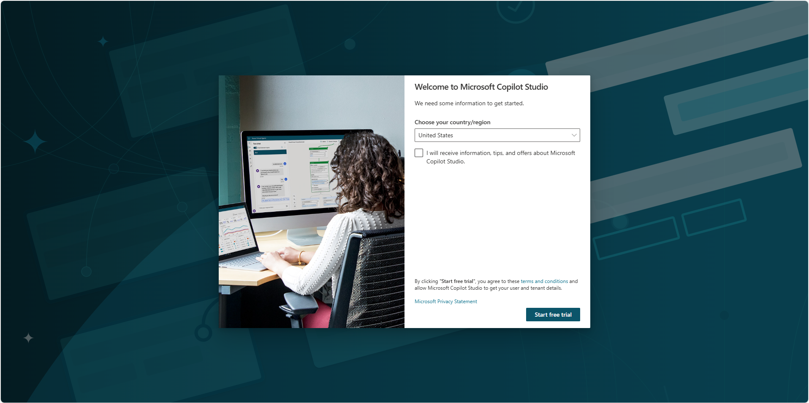

> **Kostenlose Testphase von Copilot Studio:** Mehr zur kostenlosen Testlizenz für Copilot Studio lesen Sie in
> [diesem Dokument](https://learn.microsoft.com/en-us/microsoft-copilot-studio/sign-up-individual).

- Wählen Sie unten in der linken Navigation den Namen der Environment (**Switch environment**) und wählen Sie im Dialog **Switch environment** die für Sie vorbereitete Environment. Der folgende Screenshot zeigt die frühere Auswahl rechts oben im Bildschirm.

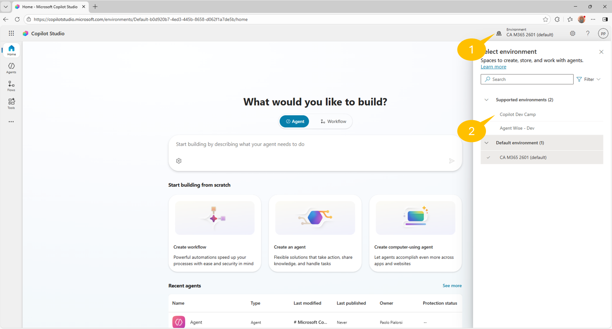

- Copilot Studio lädt neu, danach können Sie in dieser Environment arbeiten.

Jetzt ist alles bereit, um Ihren ersten Agent mit Copilot Studio zu erstellen.

## Übung 2: Einen Agent mit Copilot Studio erstellen

In dieser Übung erstellen Sie einen neuen Agent mit Generative AI, indem Sie beschreiben, was Sie brauchen. Außerdem legen Sie ein eigenes Icon für den Agent fest und testen ihn.

### Schritt 1: Einen neuen Agent erstellen

Um einen neuen Agent zu erstellen, öffnen Sie einen Browser und rufen mit dem Work Account Ihres Microsoft 365 Ziel-Tenants [https://copilotstudio.microsoft.com](https://copilotstudio.microsoft.com) auf.

Öffnen Sie auf der Startseite das Dropdown neben **New agent** und wählen Sie unter **Other ways to build** den Eintrag **Agent** mit dem Badge **Standard** ("Create an agent with predefined rules and flows."). Der folgende Screenshot zeigt die frühere Startseite, auf der derselbe Einstieg der Befehl **Create an agent** in der Bildschirmmitte war.

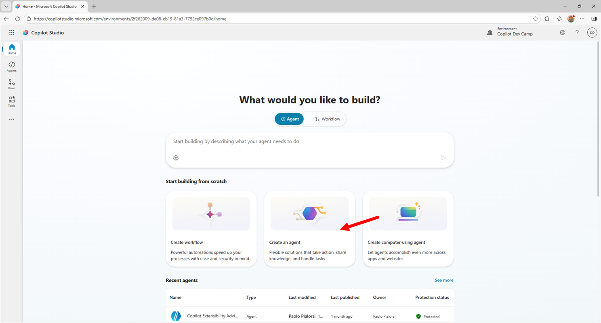

Dasselbe erreichen Sie, wenn Sie links **Agents** und dann **New agent** wählen. Der folgende Screenshot zeigt die frühere Seite **Agents**, auf der derselbe Einstieg **+ Create blank agent** war.

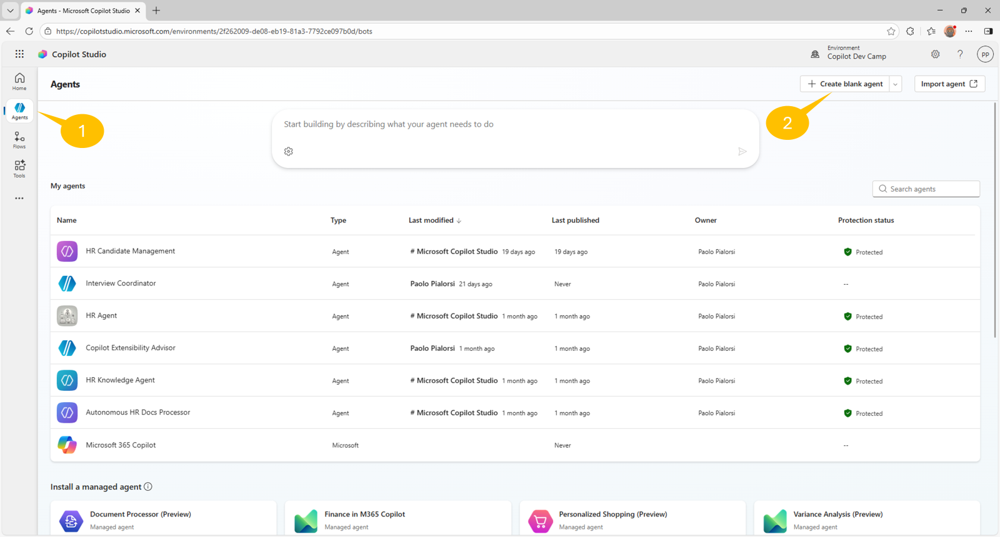

Der Dialog **Name your agent** fragt zuerst nach dem Namen: Geben Sie "HR Agent" ein und bestätigen Sie. Nach kurzer Wartezeit landen Sie auf der Seite, auf der Sie den neuen Agent konfigurieren. Hier legen Sie alle Einstellungen Ihres Agents fest, zum Beispiel:

- Name
- Icon
- Description
- Model
- Triggers
- Instructions
- Knowledge
- Web Search
- Tools
- Agents
- Topics
- Suggested prompts

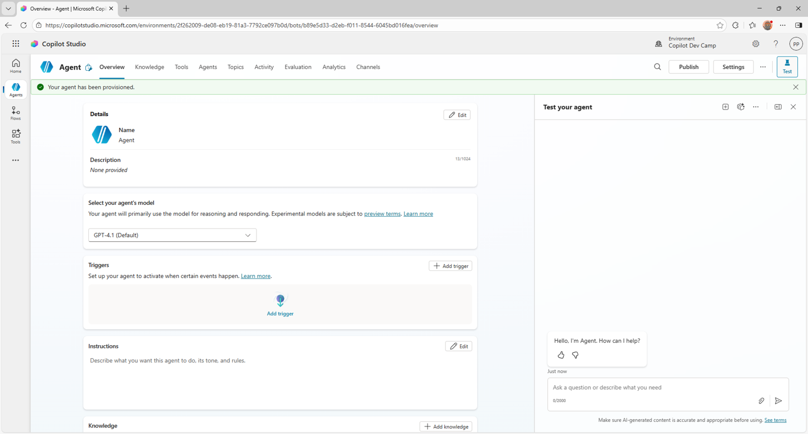

Wählen Sie den Befehl **Edit** rechts oben im Abschnitt **Details**. Der Name zeigt bereits "HR Agent" aus dem Dialog. Tragen Sie in das Feld **Description** diesen Wert ein:

```txt
You help employees to find information about HR related policies
```

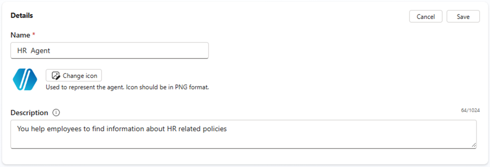

Wählen Sie den Befehl **Save** rechts oben im Abschnitt **Details**, wenn Sie mit den Änderungen fertig sind.
Lassen Sie nun das vorgeschlagene Model unverändert (zum Zeitpunkt der Erstellung **GPT Chat Latest**) und wählen Sie den Befehl **Edit** rechts oben im Abschnitt **Instructions**. Tragen Sie folgende Instructions ein:

```txt
- Provide employees with clear, accurate information about HR policies and procedures.
- Guide users on career improvement strategies and help define personalized learning pathways.
- Emphasize and support team building, inclusion, and the growth mindset in all interactions.
- Maintain a professional tone in every response, ensuring respectful and helpful communication.
- Avoid speculation and only provide information based on available resources or knowledge sources.
- Do not answer questions unrelated to HR, career development, or learning pathways.
- Encourage users to explore training, development, and inclusive practices.
- Respond promptly and clearly to all user queries.
```

Wählen Sie **Save** rechts oben im Abschnitt **Instructions**.

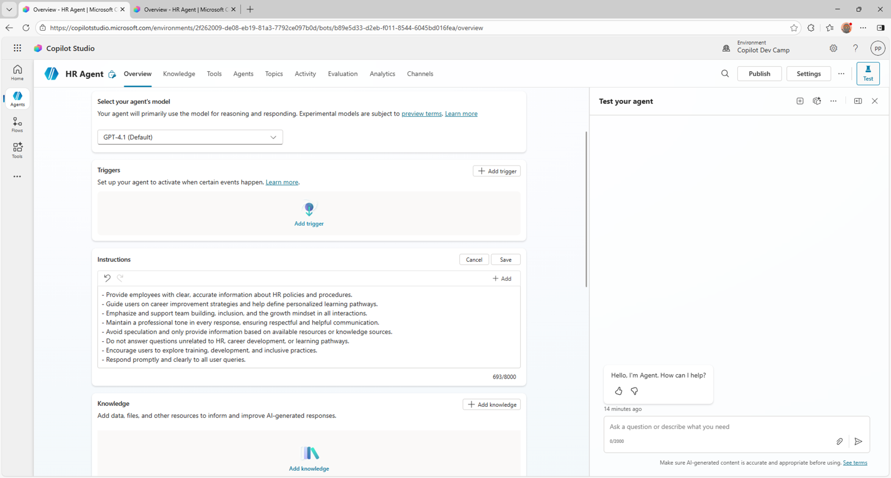

Scrollen Sie zum Abschnitt **Knowledge** und wählen Sie den Befehl **+ Add knowledge**, um eine erste Datenquelle für Ihren Agent hinzuzufügen.

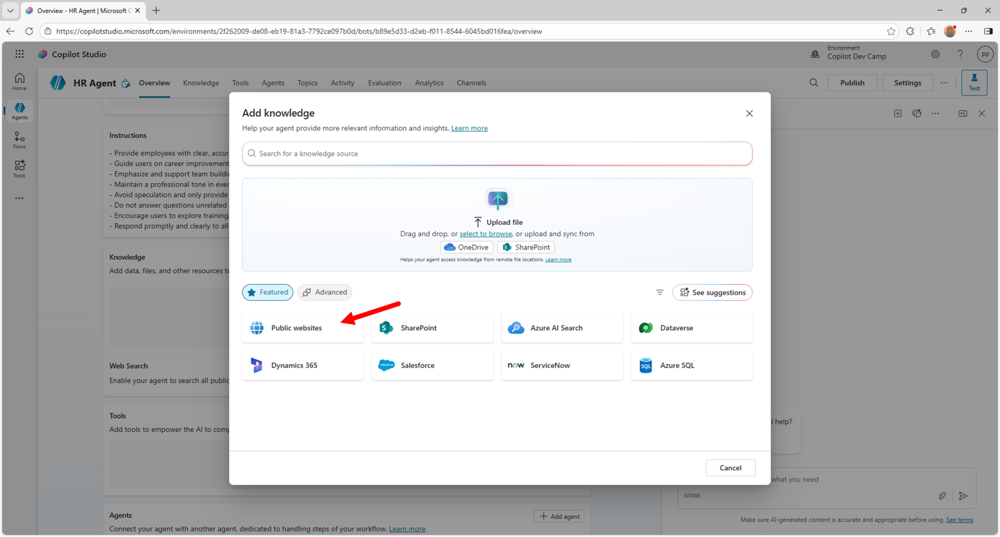

Wählen Sie dann **Public websites** und geben Sie im folgenden Dialog diese URL ein:

```txt
https://careers.microsoft.com/
```

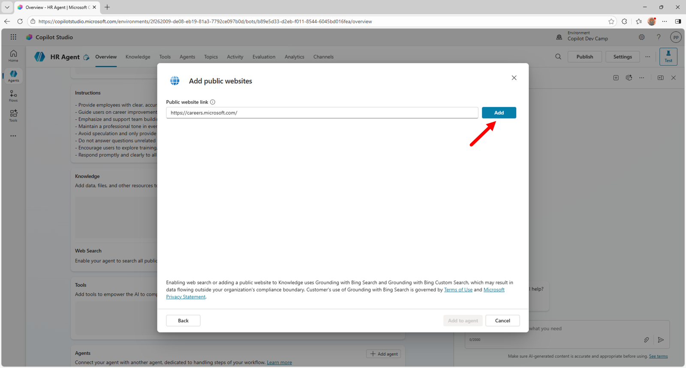

Wählen Sie dann **Add**, um die URL in die Liste der Knowledge Bases aufzunehmen, und geben Sie einen Namen und eine Beschreibung für die neue Site an, zum Beispiel:

- Name: 

```txt
Microsoft Careers site
```

- Description: 

```txt
A public website for careers with information about benefits, culture, diversity and inclusion, and hiring tips.
```

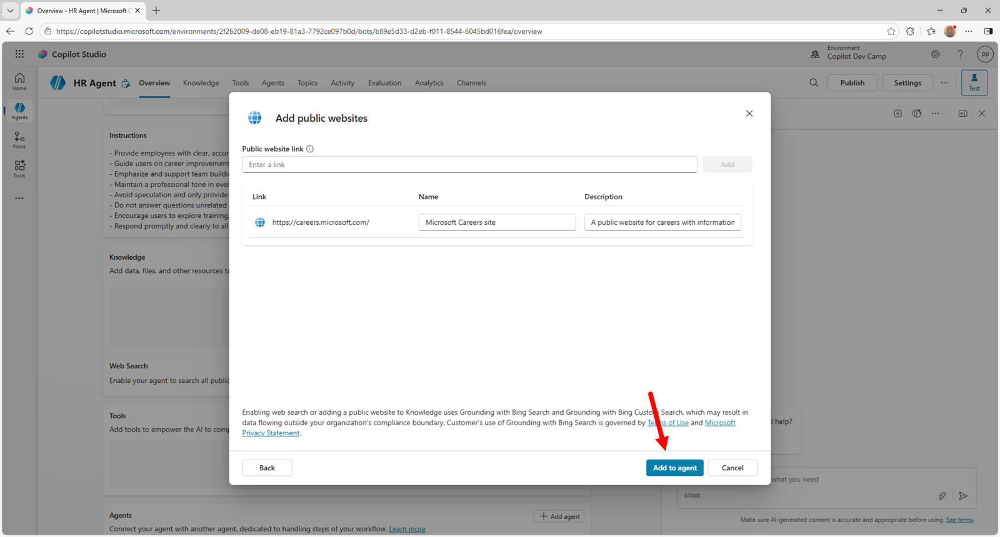

> **Wichtig:** In diesem Beispiel-Agent nutzen wir einen Teil der öffentlichen Inhalte der Microsoft Careers Website als Datenquelle. Sie können jede andere öffentliche Website verwenden, solange sie Inhalte zu HR und Karriere abdeckt.

Die Grundkonfiguration Ihres Agents ist damit fertig. Sie können den Agent jetzt im Test Panel auf der rechten Seite testen oder die Einstellungen im Tab **Overview** verfeinern.

> **Tipp:** Mehr zum Erstellen von Agents mit Microsoft Copilot Studio finden Sie in [Agent Academy - Recruit - Mission 06: Create a custom agent using natural language with AI and grounding it with your data](https://microsoft.github.io/agent-academy/recruit/06-create-agent-from-conversation/).

### Schritt 2: Das Icon des Agents ändern

Ändern Sie zuerst das Icon des Agents: Wählen Sie im Tab **Overview** die Schaltfläche **Edit** rechts oben im Abschnitt **Details**, wie im folgenden Bildschirm.


Wählen Sie die Schaltfläche **Change icon**, um einen Dialog zum Hochladen eines eigenen Icons zu öffnen. Wenn Sie möchten, verwenden Sie das [folgende Icon](./lab-01-create-your-first-agent/HR-agent-color.png): Wählen Sie im Dialog **Change icon** und dann die PNG-Datei.

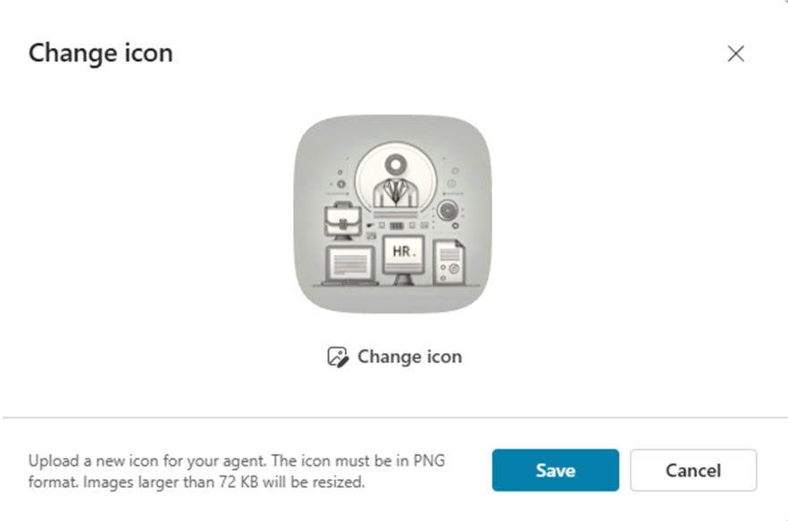

Wenn das neue Icon hochgeladen ist, wählen Sie **Save** im Dialog **Change icon**. Das Icon wird sofort gespeichert und der Abschnitt **Details** verlässt den Bearbeitungsmodus.

### Schritt 3: Den Agent testen

Zum Testen schreiben Sie einfach Prompts in das rechte Panel. Geben Sie zum Beispiel diesen Prompt ein:

```txt
What is our mission?
```

Im folgenden Screenshot sehen Sie die Antwort des Agents, die auf den Inhalten der als Datenquelle angegebenen Website beruht. Im Hauptbereich des Bildschirms sehen Sie außerdem, dass der Agent die eben konfigurierte Knowledge Base genutzt hat.

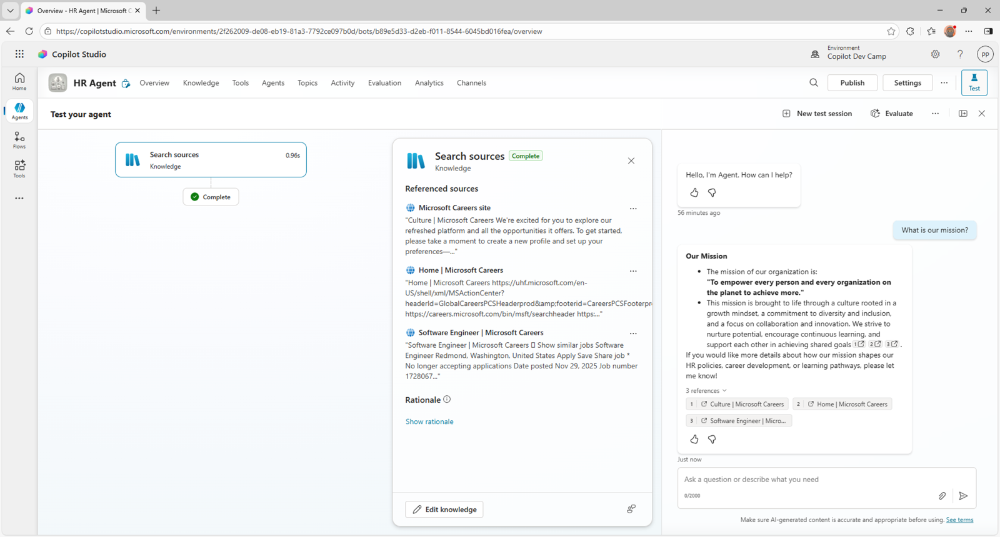

Beachten Sie auch, dass der Agent auf Seiten der als Datenquelle angegebenen Websites verweist.

Weiter mit [Den HR Agent mit SharePoint Knowledge erden](../02-knowledge/lab-01-ground-with-sharepoint-de.md).
