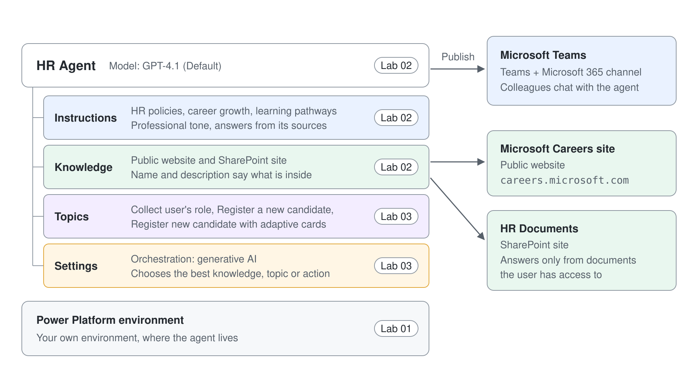
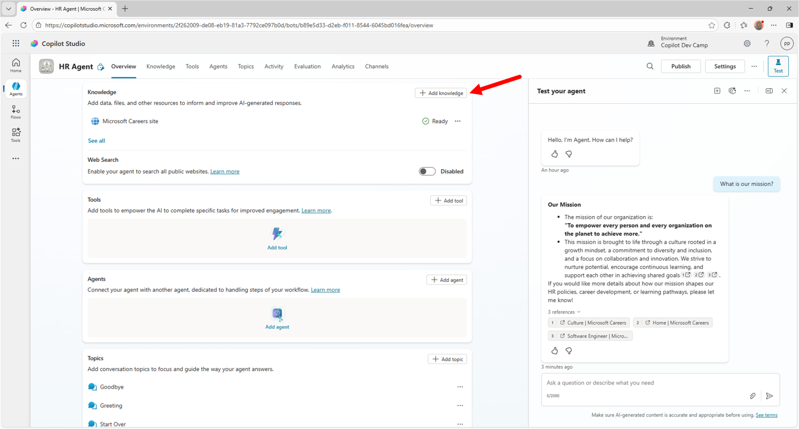
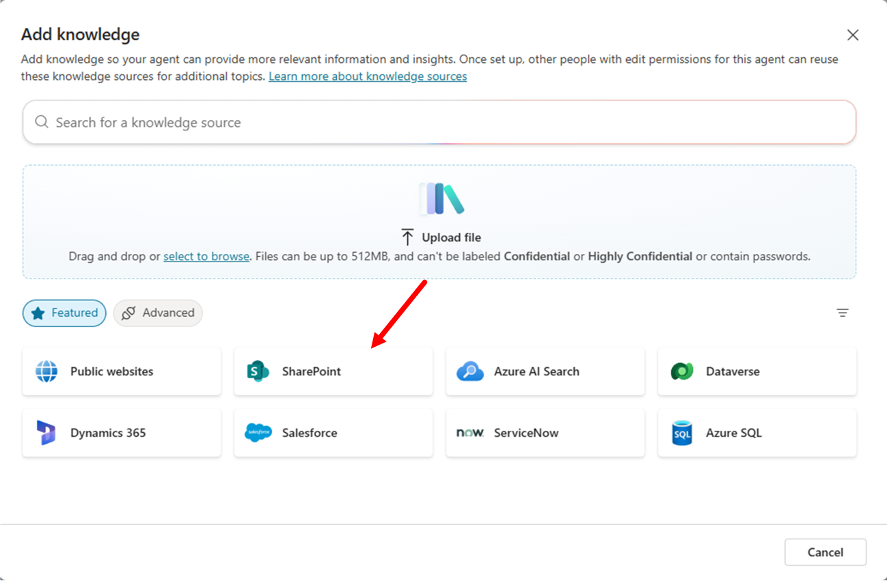
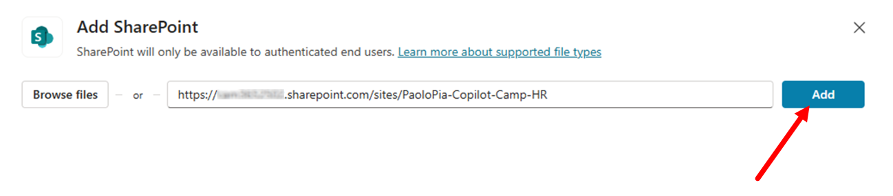
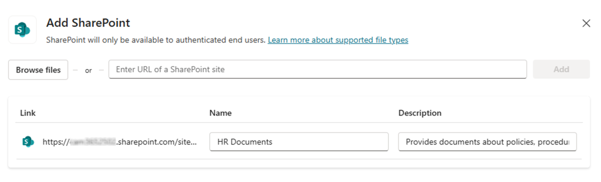
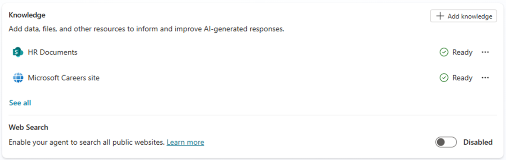
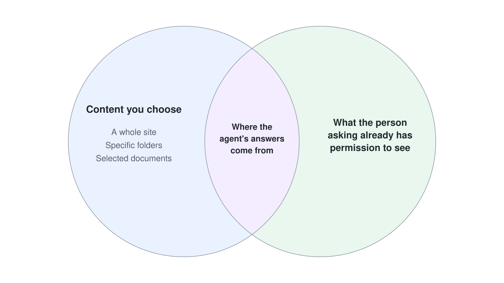
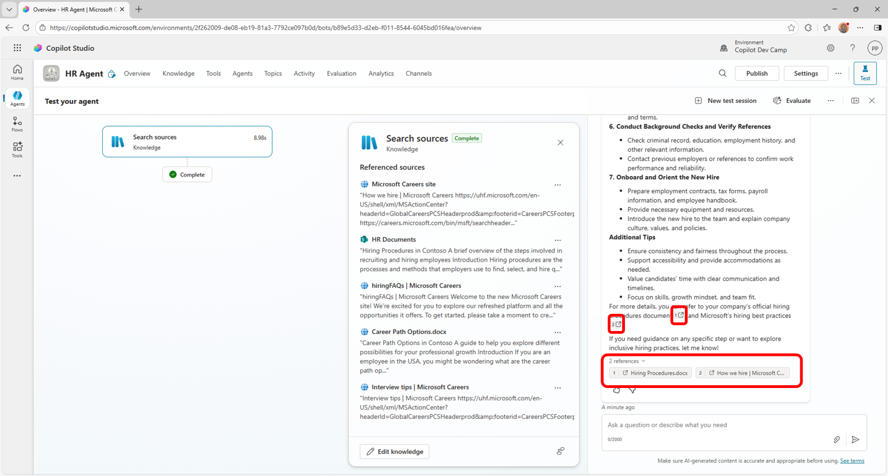
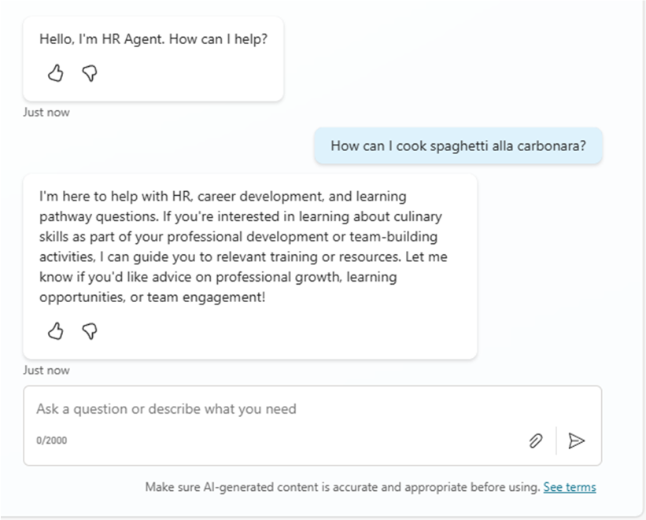

# Den HR Agent mit SharePoint Knowledge erden

In diesem Lab erweitern Sie den HR Agent aus [Ihren ersten Copilot Studio Agent erstellen](../01-standard-agents/lab-01-create-your-first-agent-de.md) um eine SharePoint Knowledge Base. Der Agent antwortet danach aus Ihren HR-Dokumenten und aus öffentlichen Webinhalten.



In diesem Lab lernen Sie:

- Wie Sie Knowledge Sources für Ihren Agent konfigurieren
- Wie der Agent innerhalb seiner Instructions und seines Knowledge bleibt


> **Hinweis:** Diese Beispiele und Labs dienen der Schulung und Demonstration und sind nicht für den Produktivbetrieb gedacht. Bringen Sie sie nicht in Production, ohne sie auf Production-Qualität zu heben.

## Übung 1: Die Knowledge Base erweitern

In dieser Übung fügen Sie Ihrem Agent Dokumente (Word und PDF) aus Microsoft SharePoint Online als zusätzliche Knowledge Base hinzu. 

### Schritt 1: SharePoint Online Dokumente als Knowledge Base hinzufügen

Laden Sie über diesen [Link](https://download-directory.github.io/?url=https://github.com/microsoft/copilot-camp/tree/main/src/make/copilot-studio/HR-documents&filename=hr-documents) eine ZIP-Datei mit einigen Dateien (Word, PowerPoint, PDF) herunter.

Entpacken Sie die Dateien und laden Sie sie in die Bibliothek **Documents** einer SharePoint Teams Site im selben Tenant hoch, in dem Sie Ihren Agent mit Copilot Studio bauen. Microsoft 365 Copilot hat diese Dokumente erzeugt, damit der Agent eine zusätzliche Knowledge Base hat.

Kopieren Sie die absolute URL der Site, zum Beispiel: `https://xyz.sharepoint.com/sites/greylogistics`



Scrollen Sie im Tab **Overview** des zuvor gebauten Agents zum Abschnitt **Knowledge**. Dort sehen Sie die Website aus dem vorigen Lab. Wählen Sie **+ Add knowledge**, um die SharePoint Site und ihre Dokumente als weitere Knowledge Source hinzuzufügen.



Im folgenden Dialog fügen Sie weitere Knowledge Sources hinzu, etwa:

- Files: Dateien manuell hochladen, die Teil der Knowledge Base werden
- Public websites: weitere Websites hinzufügen
- SharePoint: Sites oder Bibliotheken in SharePoint Online konfigurieren
- Azure AI Search: Indexes von Azure AI Search nutzen
- Dataverse: Tabellen in Dataverse hinzufügen
- und weitere ...

Wählen Sie **SharePoint**, geben Sie im folgenden Dialog die URL der Site an, auf die Sie die Dateien hochgeladen haben, und wählen Sie **Add**. Mit dem Befehl **Browse items** direkt neben dem URL-Textfeld können Sie auch nach der gewünschten Dokumentbibliothek suchen.



Für eine SharePoint-Datenquelle geben Sie außerdem **Name** und **Description** an: Nach **Add** erscheinen beide als bearbeitbare Felder in der Tabellenzeile unter der URL. Ein aussagekräftiger Name und eine aussagekräftige Beschreibung sind entscheidend. Copilot Studio versteht damit besser, was in der Datenquelle steckt, und wählt später, wenn Sie in den nächsten Labs Generative Orchestration aktivieren, die richtige Datenquelle für die Antwort auf die Prompts der User. Ersetzen Sie in der Tabellenzeile unter der URL Name und Description durch diese Werte:

- Name: 

```txt
HR Documents
```

- Description: 

```txt
Provides documents about policies, procedures, and rules related to the HR department.
```



Wählen Sie unten im Bildschirm die Schaltfläche **Add to agent** und warten Sie, bis Copilot Studio die neue Knowledge Base verarbeitet hat.

Sobald die Knowledge Base aktualisiert ist, sehen Sie im Tab **Overview** sowohl die öffentliche Website als auch die SharePoint Online Site.



> **Tipp:** Neu hochgeladene Dateien brauchen einige Minuten, bis sie indiziert sind. Zitiert die Antwort kein SharePoint-Dokument, warten Sie und fragen Sie in einer neuen Test Session erneut.

> **Wichtig:** Ist eine SharePoint Online Site die Knowledge Base eines Agents in Copilot Studio, bekommen User nur Antworten und Inhalte aus Dokumenten, auf die sie Zugriff haben. Security und Access Control stellt die Security-Infrastruktur von Microsoft 365 sicher, und Copilot Studio Agents greifen im Namen des aktuellen Users auf Dokumente zu.



### Schritt 2: Den aktualisierten Agent testen

Testen Sie den Agent jetzt erneut im rechten Panel. Geben Sie zum Beispiel diesen Prompt ein:

```txt
How can we hire new people in our company?
```

Der Agent antwortet mit Informationen zum Einstellungsprozess und verweist auf die Dokumente aus der SharePoint Online Knowledge Base sowie auf die öffentliche Website aus der Knowledge Base.



Probieren Sie der Vollständigkeit halber noch diesen Prompt:

```txt
How can I cook spaghetti alla carbonara?
```

Obwohl Spaghetti alla Carbonara immer eine gute Wahl sind 🍝, lehnt der Agent die Antwort ab. Standardmäßig hält sich der Agent an die Instructions und Knowledge Sources, die Sie konfiguriert haben. Er ist ein spezialisierter Agent, ganz auf HR-Inhalte ausgerichtet.



Weiter mit [Topics, Entities und Variables definieren](../03-topics/lab-01-build-topics-de.md).
