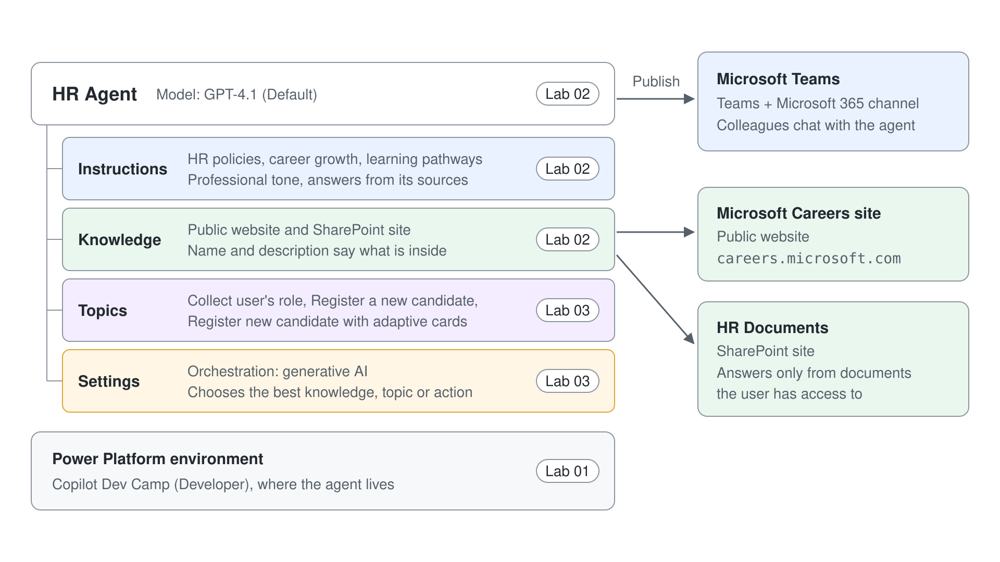
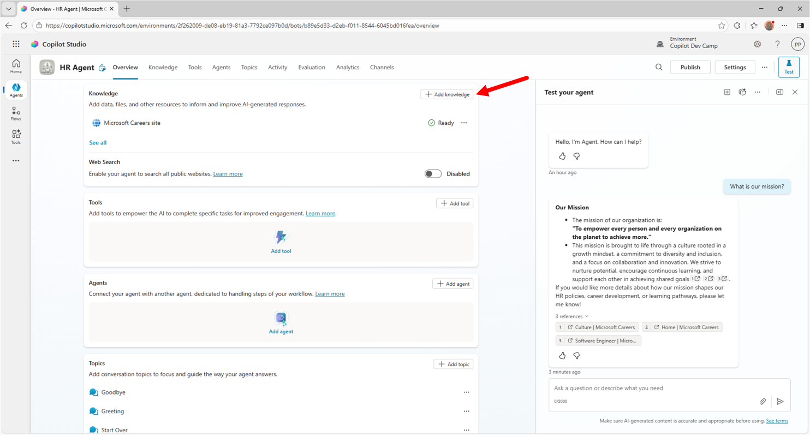
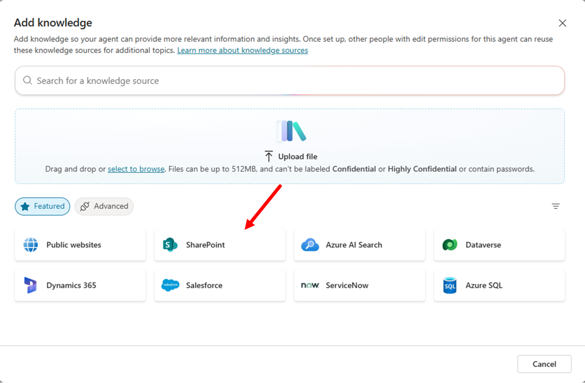
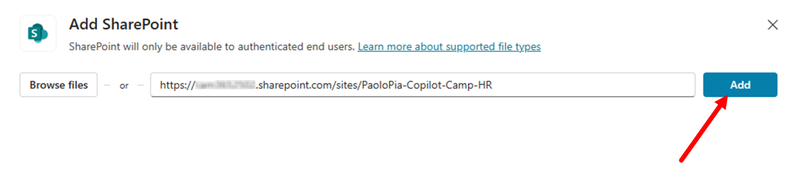
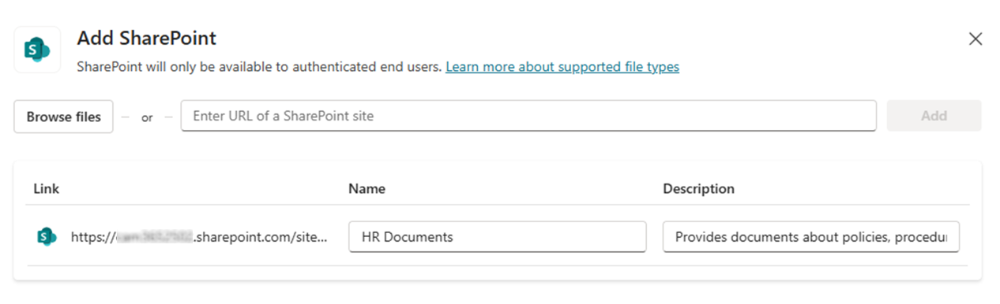
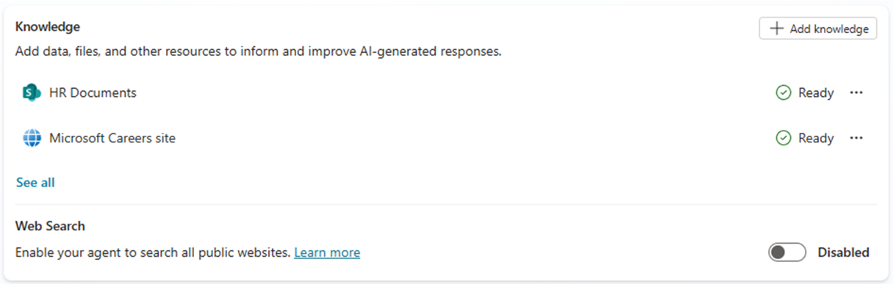
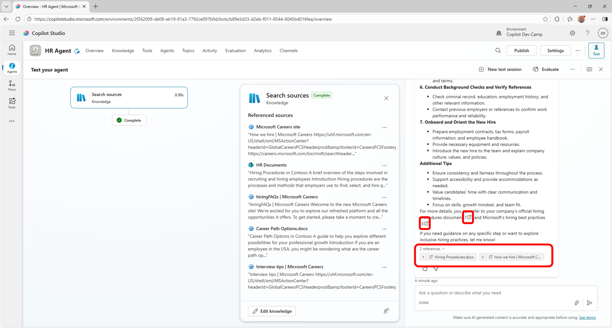
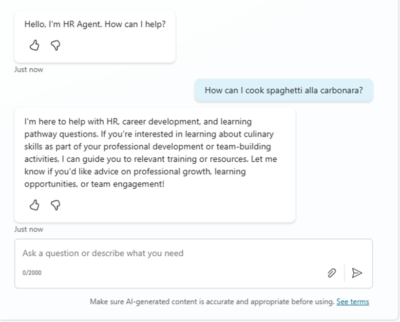

# Ground the HR Agent with SharePoint Knowledge

In this lab, you extend the HR agent from [Create Your First Copilot Studio Agent](../01-standard-agents/lab-01-create-your-first-agent.md) with a SharePoint knowledge base. The agent then answers from your HR documents as well as from public web content.



In this lab you will learn:

- How to configure knowledge sources for your agent
- How the agent stays inside its instructions and knowledge


> **Disclaimer:** These samples and labs are intended for instructive and demonstration purposes and are not intended for use in production. Do not put them into production without upgrading them to production quality.

## Exercise 1 : Extending the knowledge base

In this exercise you are going to add some documents (Word and PDF) stored in Microsoft SharePoint Online as additional knowledge base to your agent. 

### Step 1: Adding SharePoint Online knowledge base documents

Download this zip file consisting of few files (Word, PowerPoint, PDF) by selecting this [link](https://download-directory.github.io/?url=https://github.com/microsoft/copilot-camp/tree/main/src/make/copilot-studio/HR-documents&filename=hr-documents).

Extract the files from the zip and upload them to the **Documents** library of a SharePoint Teams site in the same tenant where you are making your agent with Copilot Studio. These documents were generated by Microsoft 365 Copilot for the sake of having some additional knowledge base to feed the agent.

Copy the absolute url of the site. For example: `https://xyz.sharepoint.com/sites/greylogistics`



From the **Overview** tab of the agent that you made before, scroll to the **Knowledge** section. You will find the website that you configured in Step 1 of Exercise 1. Select **+ Add knowledge** to add the SharePoint site and its documents as an additional knowledge source.



From the dialog window that pops up you can add additional knowledge sources like:

- Files: to manually upload files that will become part of the knowledge base
- Public websites: to add additional websites
- SharePoint: to configure sites or libraries in SharePoint Online
- Azure AI Search: to consume indexes of Azure AI Search
- Dataverse: to add tables in Dataverse
- and more ...

Select **SharePoint** and, in the dialog popping up, provide the URL of the site where you uploaded the files and select **Add**. You can also browse for the document library you are looking for, selecting the **Browse items** command just beside the URL textbox.



When you configure a SharePoint data source, you also need to specify a **Name** and a **Description**. It is fundamental to provide a meaningful name and description. In fact, Copilot Studio will be able to better understand what's inside the data source and, when in the upcoming labs you will enable generative orchestration, it will be possible to identify the right data source to use when answering to users' prompts via generative AI. For this exercise you can use the following values:

- Name: 

```txt
HR Documents
```

- Description: 

```txt
Provides documents about policies, procedures, and rules related to the HR department.
```



Select the **Add to agent** button in the lower part of the screen and wait for Copilot Studio to process the new knowledge base that you just added.

When the knowledge base will be updated, in the **Overview** tab you will see both the public website and the SharePoint Online site.



> **Important:** When configuring SharePoint Online sites as the knowledge base for an agent in Copilot Studio, users will only be able to get answers and content from documents that they have access to. The security and the access control are guaranteed by the Microsoft 365 security infrastructure and Copilot Studio agents access documents on behalf of the current user.


### Step 2: Testing the updated agent

Now you can test again the agent, using the right side panel. For example, let's provide the following prompt:

```txt
How can we hire new people in our company?
```

The agent will reply back with information about the hiring procedures and providing references to the documents stored in the SharePoint Online knowledge base that you provided, as well as to the public web site that you referenced in the knowledge base.



Now, for the sake of completeness, try to provide the following prompt to the agent:

```txt
How can I cook spaghetti alla carbonara?
```

You will notice that, despite spaghetti alla carbonara is always a good choice 🍝, the agent will not give you back an answer. In fact, by default the agent will stick with the instructions and knowledge sources that you configured for it. It is a specialized agent, fully focused on HR-related content.



Continue with [Define Topics, Entities, and Variables](../03-topics/lab-01-build-topics.md).
