# Topics, Entities und Variables definieren

In diesem Lab lernen Sie, eigene Topics in Microsoft Copilot Studio zu erstellen. Topics sind zentrale Bausteine eines Agents. Mit Topics bieten Sie Ihren End Usern eine Conversational Experience, als Single-Turn oder als Multi-Turn Unterhaltung. Topics legen über klar abgegrenzte Interaktionspfade fest, wie sich die Unterhaltung zwischen User und Agent entwickeln kann.

Topics erstellen Sie mit einem grafischen Designer oder indem Sie den Intent in natürlicher Sprache beschreiben. Ein fertiges Topic können Sie außerdem in einem Low-Level Code Editor bearbeiten, wenn Sie Details feinjustieren müssen.

Es gibt zwei Arten von Topics:

- System Topics: Microsoft Copilot Studio definiert sie automatisch. Diese Topics lassen sich deaktivieren, aber nicht löschen.
- Custom Topics: Agent Authors erstellen sie, um eigene Interaktionspfade bereitzustellen.

> **Weitere Informationen zu Topics:** Mehr zu Topics in Agents, die Sie mit Microsoft Copilot Studio erstellen, lesen Sie im [folgenden Artikel](https://learn.microsoft.com/en-us/microsoft-copilot-studio/guidance/topics-overview). Die System Topics behandelt der Artikel [Use system topics](https://learn.microsoft.com/en-us/microsoft-copilot-studio/authoring-system-topics).

In diesem Lab lernen Sie:

- Wie Sie Orchestration auf Basis von Generative AI nutzen
- Wie Sie ein Single-Turn Topic erstellen
- Wie Sie ein Multi-Turn Topic erstellen

## Den HR Agent einrichten

Dieses Lab startet mit dem HR Agent, seinen Instructions und der Microsoft Careers Site als Knowledge. Wenn Sie ihn in [Ihren ersten Copilot Studio Agent erstellen](../01-standard-agents/lab-01-create-your-first-agent-de.md) oder [Den HR Agent mit SharePoint Knowledge erden](../02-knowledge/lab-01-ground-with-sharepoint-de.md) gebaut haben, öffnen Sie ihn unter **Agents** und machen mit Übung 1 weiter. Andernfalls erstellen Sie ihn jetzt:

1. Rufen Sie [Copilot Studio](https://copilotstudio.microsoft.com) auf, wählen Sie auf **Home** den Befehl **Other ways to build** und dann unter **Build with standard orchestration** den Eintrag **Agent** mit dem Badge **Standard**.
2. Geben Sie im Dialog **Name your agent** den Namen `HR Agent` ein und wählen Sie **Create**.
3. Warten Sie, bis der Agent eingerichtet ist (die Befehle **Edit** bleiben etwa eine Minute deaktiviert). Wählen Sie dann im Tab **Overview** im Abschnitt **Details** den Befehl **Edit**, fügen Sie den folgenden Text in **Description** ein und wählen Sie **Save**.

```txt
You help employees to find information about HR related policies
```

4. Wählen Sie im Abschnitt **Instructions** den Befehl **Edit**, fügen Sie die folgenden Instructions ein und wählen Sie **Save**.

```txt
- Provide employees with clear, accurate information about HR policies and procedures.
- Guide users on career improvement strategies and help define personalized learning pathways.
- Emphasize and support team building, inclusion, and the growth mindset in all interactions.
- Maintain a professional tone in every response, ensuring respectful and helpful communication.
- Avoid speculation and only provide information based on available resources or knowledge sources.
- Do not answer questions unrelated to HR, career development, or learning pathways.
- Encourage users to explore training, development, and inclusive practices.
- Respond promptly and clearly to all user queries.
```

5. Wählen Sie im Abschnitt **Knowledge** den Befehl **+ Add knowledge** > **Public websites**, geben Sie `https://careers.microsoft.com/` ein und wählen Sie **Add**. Nennen Sie die Site `Microsoft Careers site`, fügen Sie die folgende Beschreibung ein und wählen Sie **Add to agent**.

```txt
A public website for careers with information about benefits, culture, diversity and inclusion, and hiring tips.
```

Erwartet: Der Tab **Overview** des HR Agent zeigt die Description, die Instructions und unter **Knowledge** die **Microsoft Careers site**.

## Übung 1: Orchestration auf Basis von Generative AI

In dieser ersten Übung aktivieren Sie für den HR Agent die Orchestration auf Basis von Generative AI, zum Zeitpunkt der Erstellung dieses Labs ein neues Feature in Preview.

### Schritt 1: Generative AI Orchestration verstehen

Ein wichtiges Feature eines mit Copilot Studio erstellten Agents ist Generative Orchestration. Mit Generative Orchestration wählt Ihr Agent die passende Knowledge Base, die passenden Topics und Actions, um mit dem User zu interagieren und seine Anfragen zu beantworten oder auf Event Triggers zu reagieren. 

Heute nutzen Copilot Studio Agents standardmäßig Generative AI Orchestration: Copilot Studio erkennt den Intent des Users aus seinem Prompt in natürlicher Sprache und bestimmt das passende Element, das es triggert. Wenn Sie möchten, stellen Sie den Agent auf Classic Orchestration zurück. Dann antwortet der Agent, indem er das Topic triggert, dessen Trigger Phrases am besten zur Anfrage des Users passen.


In Copilot Studio können Sie außerdem **Deep reasoning** (ein Preview Feature) aktivieren, um Advanced Reasoning für AI Actions einzuschalten.

Um Orchestration und Deep Reasoning zu konfigurieren, öffnen Sie einen Browser und rufen mit dem Work Account Ihres Microsoft 365 Ziel-Tenants [https://copilotstudio.microsoft.com](https://copilotstudio.microsoft.com) auf, um mit Microsoft Copilot Studio zu arbeiten.

Öffnen Sie die Liste der 1️⃣ **Agents** und 2️⃣ bearbeiten Sie den HR Agent.

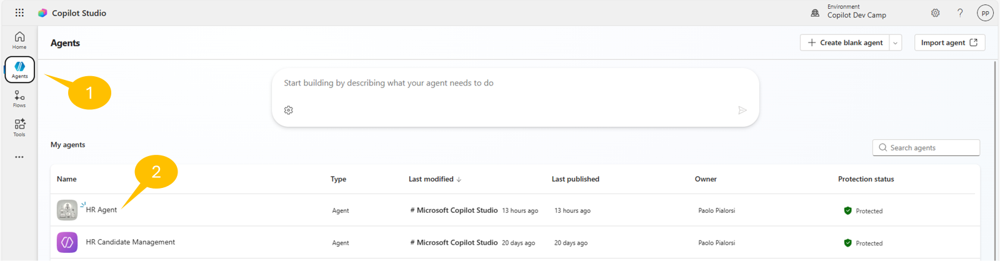

Wählen Sie den Befehl **Settings** rechts oben im Bildschirm, wie im folgenden Screenshot.

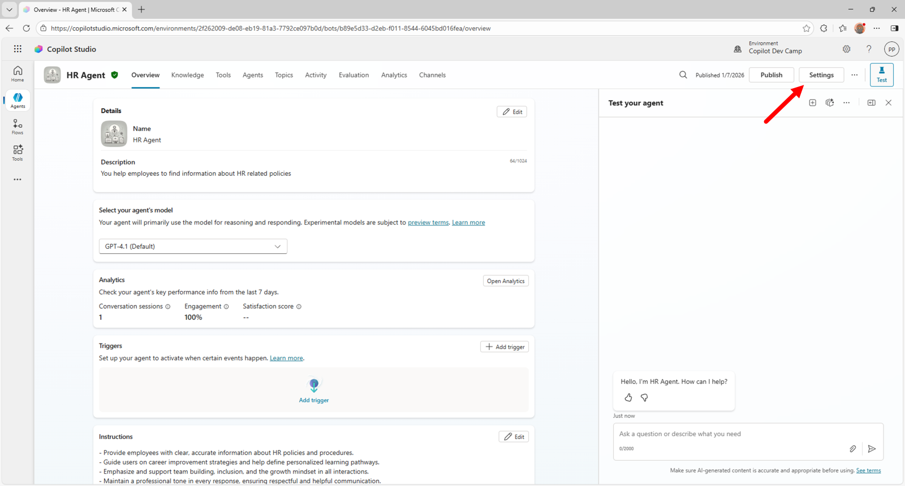

Settings öffnet die Seite **Generative AI** mit der Frage **Use generative AI orchestration for your agent's responses?**: **Yes** behält die Generative AI Orchestration, die ein neuer Agent bereits nutzt, und **No** schaltet auf Classic Orchestration um. Auf derselben Seite können Sie **Deep reasoning** aktivieren. Wenn Sie eine Einstellung ändern, wählen Sie unten auf der Seite **Save** und publishen den Agent, um die Änderungen zu bestätigen.

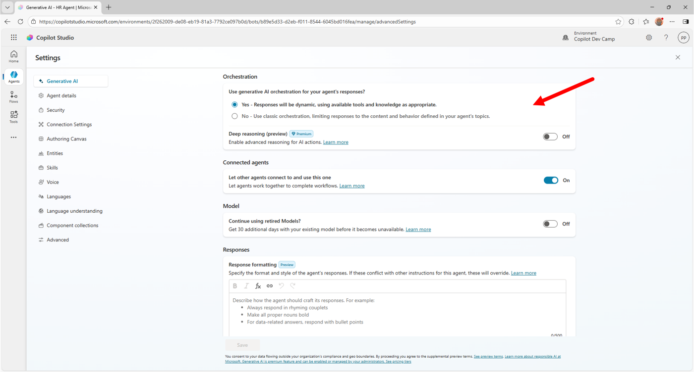

In diesem Lab bleiben Sie bei **generative AI orchestration**, um die Stärken von Generative AI zu genießen, und müssen **Deep reasoning** nicht aktivieren.

## Übung 2: Ein Single-Turn Topic erstellen

In dieser Übung erstellen Sie ein neues Topic, das einen Input vom User erfasst und auf Basis dieses Inputs Feedback gibt. Konkret erfasst das Topic die Rolle des aktuellen Users und gibt passend zu dieser Rolle Hinweise, wofür der User den Agent nutzen kann.

### Schritt 1: Ein neues Single-Turn Topic erstellen

Um ein neues Topic zu erstellen, wählen Sie oben im Bildschirm den Tab 1️⃣ **Topics**, dann 2️⃣ **+ Add a topic** und anschließend 3️⃣ **From blank**, um ein neues Custom Topic anzulegen.

> **Topics mit Copilot erstellen:** Sie können ein neues Topic auch einfach in natürlicher Sprache beschreiben, und Copilot entwirft das Topic dann für Sie.

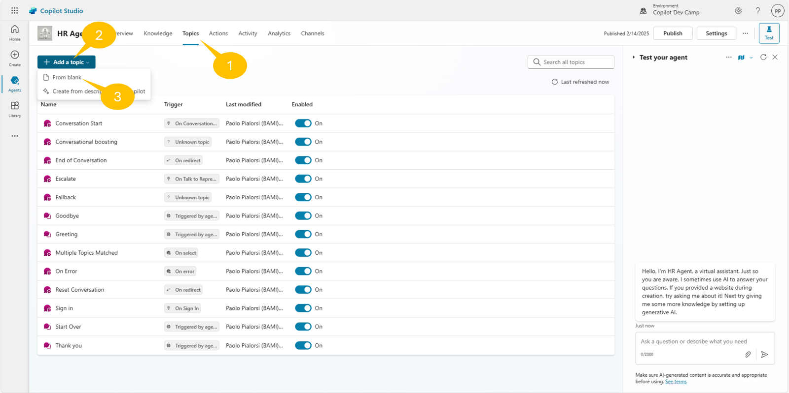

Copilot Studio öffnet den grafischen Designer für das neue Topic. Der allererste Baustein des Topics ist die Action **Trigger**, die beschreibt, was das Topic tut. Ist Generative Orchestration aktiviert, finden Sie in der Action ein Textfeld, in dem Sie den Zweck des Topics in natürlicher Sprache festlegen. Für dieses Lab können Sie folgenden Inhalt verwenden:

```txt
This topic can handle queries like these: collect user's role and provide feedback, 
give me a feedback based on my role, what's your feedback for my role?
```

Wenn Sie Classic Orchestration nutzen, geben Sie statt eines einzelnen beschreibenden Texts 5 bis 10 Trigger Phrases oder Sätze an.

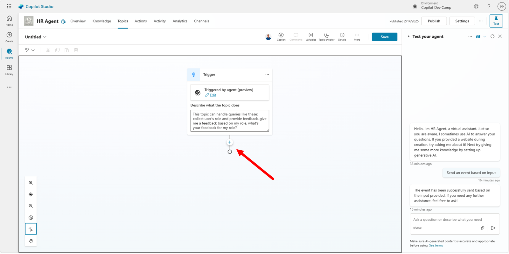

### Schritt 2: Den Input des Users erfassen

Wählen Sie die Schaltfläche **+** in der Mitte des Bildschirms, um dem aktuellen Topic neue Actions oder Schritte hinzuzufügen. Sobald Sie **+** wählen, erscheint eine Liste aller verfügbaren Actions. Die wichtigsten Optionen sind:

- Send a message: sendet dem User eine Nachricht. Die Nachricht kann Text, ein Bild, ein Video, eine Adaptive Card usw. sein.
- Ask a question: fragt den User nach einem Input. Der Input kann Text, ein Bild, ein Video, ein Attachment, eine Adaptive Card usw. sein.
- Ask with adaptive card: erfasst Inhalte vom User über eine Adaptive Card.
- Add a condition: fügt dem Topic Branches hinzu, die auf einem Vergleich von Variables und/oder konstanten Werten beruhen.
- Variable management: verwaltet Variables, deren Scope auf Topic-Ebene, global, System oder Environment liegen kann.
- Topic management: steuert den Lifecycle des aktuellen Topics.
- Add a tool: nutzt externe Tools wie Power Automate Flows, Custom Connectors, MCP Tools usw.
- Add an agent: fügt in einem Multi-Agent Szenario einen Agent hinzu.
- Advanced: bietet erweiterte Capabilities, etwa eine externe HTTP REST API aufrufen, Generative Answers nutzen, Events oder Activities senden usw.

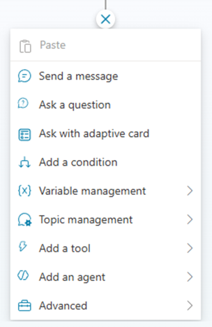

Um den Input des Users zu erfassen, fügen Sie eine Action **Ask a question** hinzu. Da Sie den User nach seiner oder ihrer Rolle fragen möchten, verwenden Sie folgenden Wert als Fragetext.

```txt
What is your role?
```

Beachten Sie, dass Copilot Studio dem erfassten Input standardmäßig den Data Type `Multiple choice options` zuweist, wie im Konfigurationsfeld **Identify** hervorgehoben.
Wählen Sie den Befehl **New option** direkt unter dem Konfigurationsfeld **Identify** und fügen Sie nacheinander die folgenden drei Werte hinzu:

- Candidate
- Employee
- HR staff member

Die Action speichert den vom User gewählten Wert automatisch in einer Variable auf Topic-Ebene. Über die drei Punkte rechts oben in der Action und den Befehl **Properties** passen Sie die Action an, oder Sie wählen die Variable im unteren Teil der Action, um ihren Namen und weitere Einstellungen zu ändern.

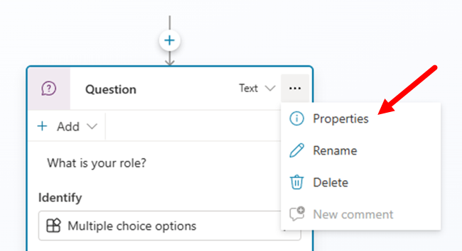

Benennen Sie die Variable zum Beispiel in `UserRole` um. So sieht die Action aus, wenn sie vollständig konfiguriert ist.

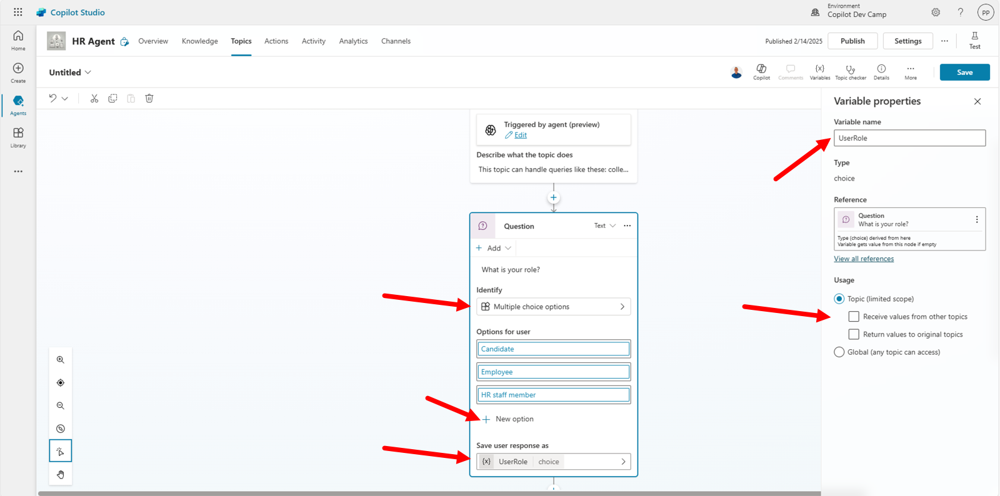

### Schritt 3: Dem User Feedback geben

Unter dem Node **Ask a question** hat Copilot Studio bereits einen **Condition** Branch pro Option auf der Variable **UserRole** angelegt (die Condition Cards zeigen sie als **UserRole choice**): `UserRole is equal to Candidate`, `UserRole is equal to Employee` und `UserRole is equal to HR staff member`. Ein vierter Branch, **All other conditions**, führt zum Topic **Fallback**. Prüfen Sie, dass jede Condition ihre Option als Wert zeigt.

In jedem Branch können Sie eigene Logik hinterlegen, um dem User ein passendes Feedback zu geben. Wählen Sie dazu den Befehl **+** unter jedem **Condition** Branch und fügen Sie eine Action vom Typ **Send a message** hinzu. Bei Bedarf fügen Sie jedem Branch auch mehrere Actions hinzu.

Für die drei Branches können Sie zum Beispiel folgende Feedback-Nachrichten verwenden:

- Candidate

```txt
You are a new candidate, as such you can submit your resume for evaluation.
```

- Employee

```txt
As an employee, you can ask me about how to improve your career or about 
how to learn more about your growth mindset.
```

- HR staff member

```txt
As an HR staff member, you can manage the list of candidates and all the hiring procedures.
```

Für den Branch `All other conditions` fügen Sie **Go to another topic** aus der Gruppe **Topic management** hinzu und wählen im Panel **Select a topic** das System Topic **Fallback**.

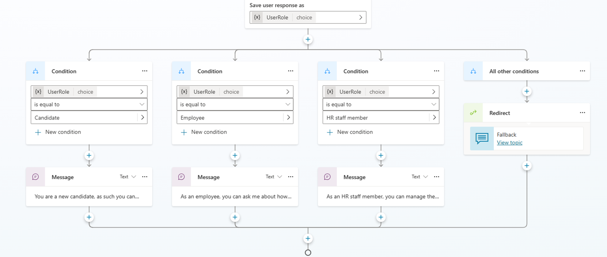

Die sehr einfache Logik des Topics ist damit fertig.

### Schritt 4: Das aktuelle Topic beenden

Um den Flow des Custom Topics sauber abzuschließen, fügen Sie eine neue Action vom Typ **End current topic** hinzu, die in der Gruppe **Topic management** verfügbar ist. Diese letzte Action teilt Copilot Studio mit, dass die Unterhaltung Ihres Topics abgeschlossen ist.

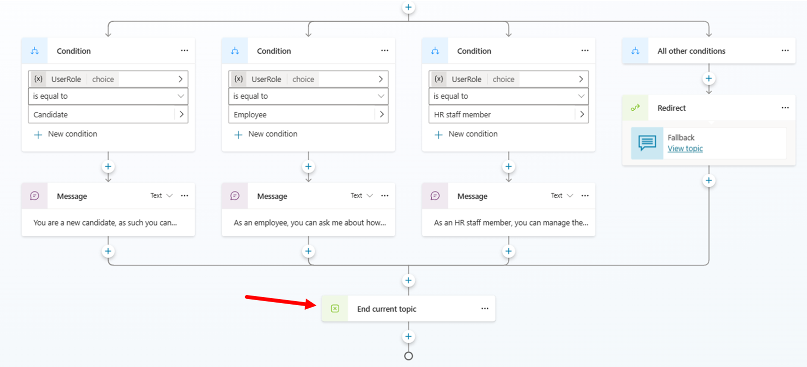

### Schritt 5: Das aktuelle Topic testen

Jetzt können Sie das Topic speichern und testen. Geben Sie im Feld **Topic name** im Header des Designers einen Namen für das Topic ein und wählen Sie dann die Schaltfläche **Save** rechts oben im Designer. Ein Banner **Topic Saved!** bestätigt das Speichern.

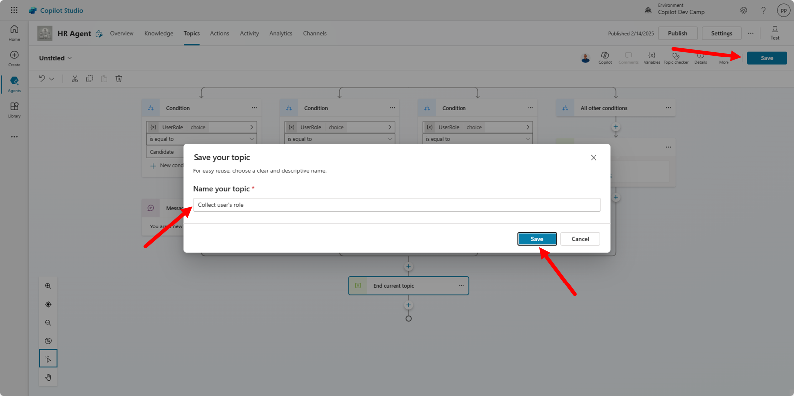

Nennen Sie das Topic zum Beispiel `Collect user's role`. Öffnen Sie dann das Test Panel mit dem Befehl **Test** rechts oben im Designer. Geben Sie folgenden Prompt ein:

```txt
Collect user's role and provide feedback
```

Eine lockerere Formulierung wie "What's your feedback for my role?" kann der Agent statt mit diesem Topic aus den Knowledge Sources beantworten.

Der Agent fordert Sie auf, eine Rolle zu wählen, und je nach Auswahl erhalten Sie ein spezifisches Feedback, wie im folgenden Screenshot.

> **Hinweis:** Im Test Panel kann der Agent das Topic direkt nach dem Feedback erneut starten und noch einmal "What is your role?" fragen. Starten Sie dann eine neue Test Session, um weiterzumachen.

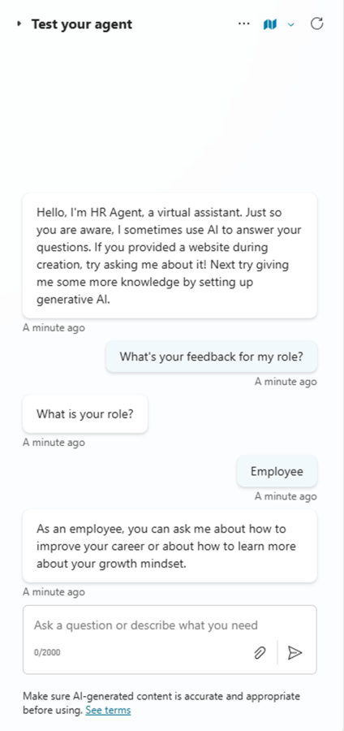

Übung 2 ist damit abgeschlossen, gut gemacht! Weiter geht es mit Übung 3, in der Sie ein Multi-Turn Topic erstellen.

## Übung 3: Ein Multi-Turn Topic erstellen

Für einfache Interaktionen erstellen Sie Single-Turn Unterhaltungen mit nur einer Frage und einer Antwort. Umfangreichere Topics brauchen aber eine Multi-Turn Unterhaltung mit mehreren Wechseln zwischen User und Agent. In dieser Übung erstellen Sie ein Multi-Turn Topic, das Daten zu einer möglichen Kandidatin oder einem möglichen Kandidaten für eine neue Rolle erfasst.


### Schritt 1: Ein neues Multi-Turn Topic erstellen

Angenommen, Sie möchten ein Topic erstellen, das folgende Informationen zu einer neuen Kandidatin oder einem neuen Kandidaten erfasst:

- Vorname
- Nachname
- E-Mail
- Aktuelle Rolle

Um diese Informationen zu erfassen, erstellen Sie ein neues Topic nach der Anleitung in Übung 2, Schritt 1.
Die **Trigger** Beschreibung des Topics könnte lauten:

```txt
This topic helps to collect information about a new candidate to process. Trigger sentences can be: 
register a new candidate, create a new candidate, add a new candidate.
```

Für jedes dieser Felder fragen Sie den User dann mit einer Action vom Typ **Ask a question**. In dieser Übung unterscheidet sich der Wert der Antwort aber je nach abgefragtem Feld. Zum Beispiel sind Vorname, Nachname und aktuelle Rolle einfache Textfelder, während das E-Mail-Feld eine gültige E-Mail-Adresse enthalten muss.

Für Vorname, Nachname und aktuelle Rolle wählen Sie also die Property **Identify** der Action **Ask a question** und als Entity Type **User's entire response**. Damit übernimmt die Action den Text des Users als erfassten Wert, und Copilot Studio setzt den Typ der Variable automatisch auf `string`. Geben Sie jeder Variable, die einen Wert des Users enthält, einen aussagekräftigen Namen, zum Beispiel `FirstName`, `LastName`, `Email` und `CurrentRole`. Die Fragen können lauten:

```txt
What is the candidate's first name?
What is the candidate's last name?
What is the candidate's e-mail?
What is the candidate's current role?
```

Im folgenden Screenshot sehen Sie, wie Sie die Action für den Vornamen definieren. Für Nachname und aktuelle Rolle gehen Sie genauso vor.

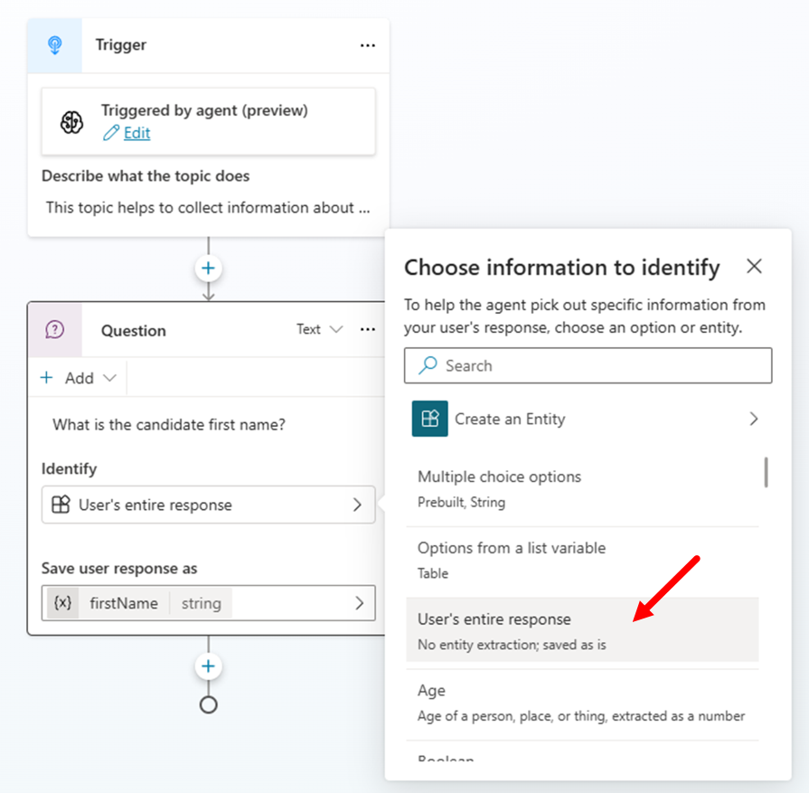

Für das E-Mail-Feld wählen Sie **Email** als Entity für die Property **Identify**. Copilot Studio prüft den Input des Users dann automatisch gegen die Regeln für gültige E-Mail-Adressen. Die zugrunde liegende Variable bleibt ein `string`.

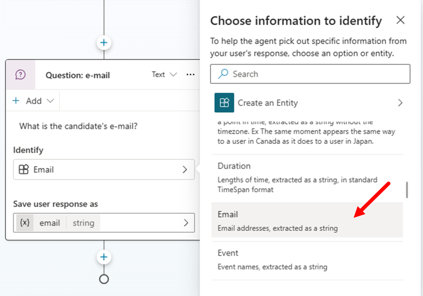

Damit erfassen Sie alle Informationen zur Kandidatin oder zum Kandidaten und können dem User Feedback geben.

### Schritt 2: Dem User eine Rückmeldung geben

Auf Basis des erfassten Inputs senden Sie dem User jetzt eine Nachricht, die die erfassten Daten bestätigt. Fügen Sie eine neue Action vom Typ **Send a message** hinzu und bauen Sie den Inhalt der Nachricht aus den Variables, in denen die erfassten Inputs gespeichert sind.
Um Variables in die Nachricht einzufügen, wählen Sie in der Toolbar der Action **Send a message** den Befehl **{x}** und dann die gewünschte Variable.

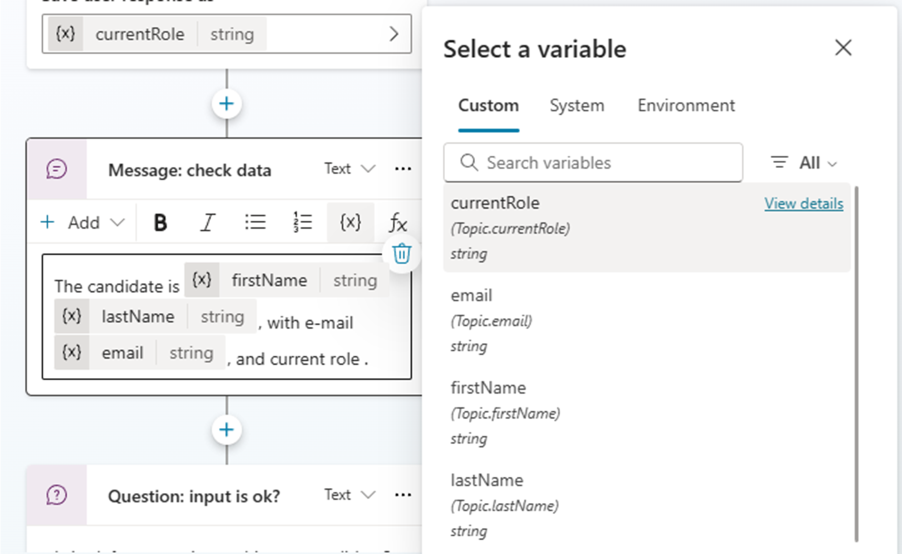

Sie können Variables des aktuellen Topics, System Variables oder Environment Variables einfügen.
Zum Beispiel:

```txt
Candidate: {FirstName} {LastName}, e-mail {Email}, current role {CurrentRole}.
```

Wenn Sie die Recap-Nachricht mit allen Variables konfiguriert haben, sollte sie wie im folgenden Screenshot aussehen.

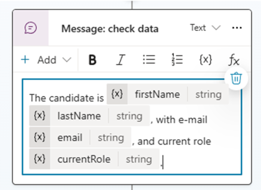

Um eine abschließende Bestätigung des Users einzuholen, fügen Sie eine Action vom Typ **Ask a question** ein und geben folgende Nachricht an:

```txt
Is it ok for you to insert this new candidate?
```

Konfigurieren Sie die Action so, dass sie die Antworten `Yes` und `No` unterstützt. Wie in Übung 2, Schritt 3 konfigurieren Sie jetzt die Branches für die einzelnen Ergebnisse. Der Einfachheit halber genügen zwei Actions **Send a message**, eine pro Branch, mit einem Daumen-hoch- oder Daumen-runter-Emoji als Inhalt der Nachricht, je nach Antwort des Users. Fügen Sie zum Schluss eine Action vom Typ **End current topic** hinzu, um das Topic abzuschließen.

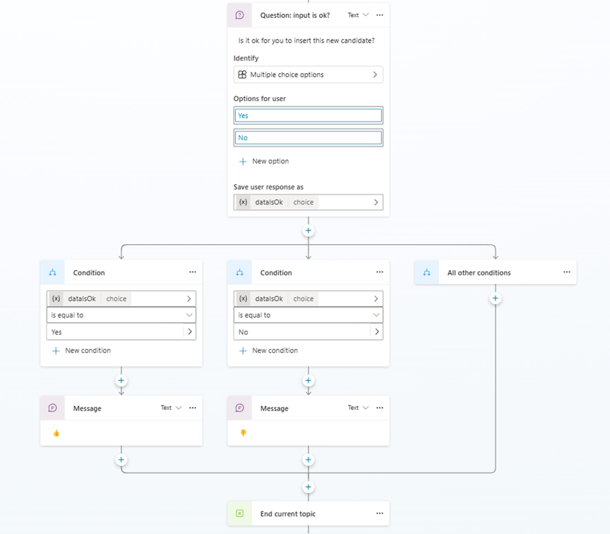

Jetzt können Sie das Topic speichern, ihm einen Namen wie zum Beispiel `Register a new candidate` geben und es in der integrierten Testumgebung testen.
Der folgende Screenshot zeigt die Interaktion mit dem Multi-Turn Topic. Außerdem sehen Sie: Ist der Wert für das E-Mail-Feld ungültig, fordert Copilot Studio den User automatisch erneut zu einem gültigen Wert auf. Wie in Übung 2 kann der Agent nach dem 👍 erneut nach dem Vornamen fragen; starten Sie dann eine neue Test Session, um weiterzumachen.

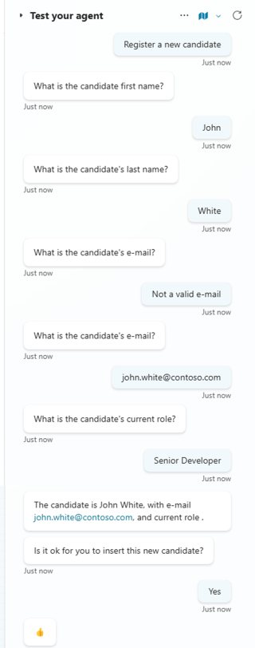

> **Tipp:** Mehr zum Erstellen von Agents mit Microsoft Copilot Studio finden Sie in [Agent Academy - Recruit - Mission 07: Add new topic with trigger and nodes](https://microsoft.github.io/agent-academy/recruit/07-add-new-topic-with-trigger/).

Weiter mit [Input mit Adaptive Cards erfassen](../05-adaptive-cards/lab-01-collect-input-with-adaptive-cards-de.md).
