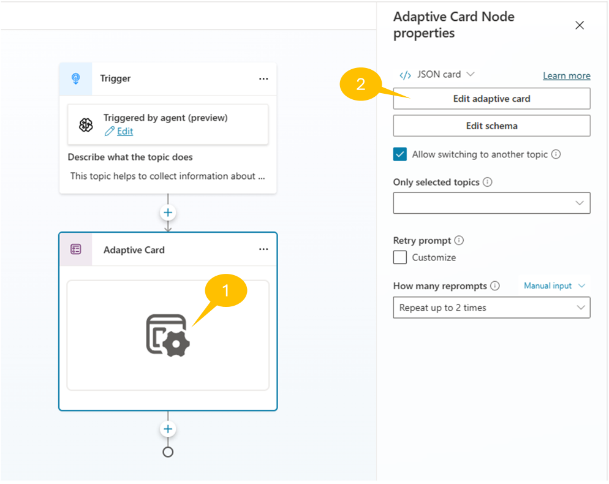
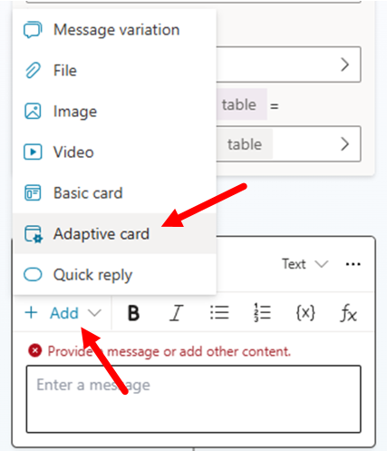
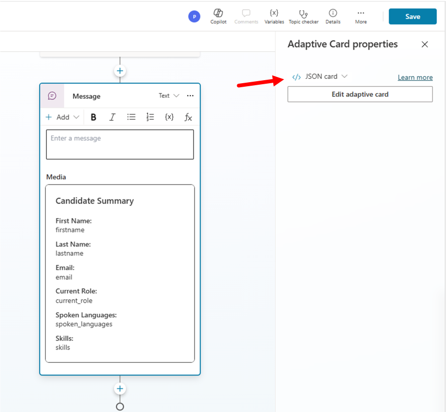
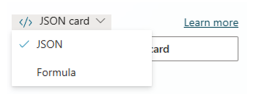
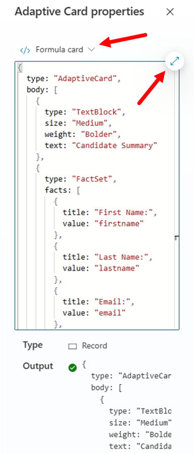
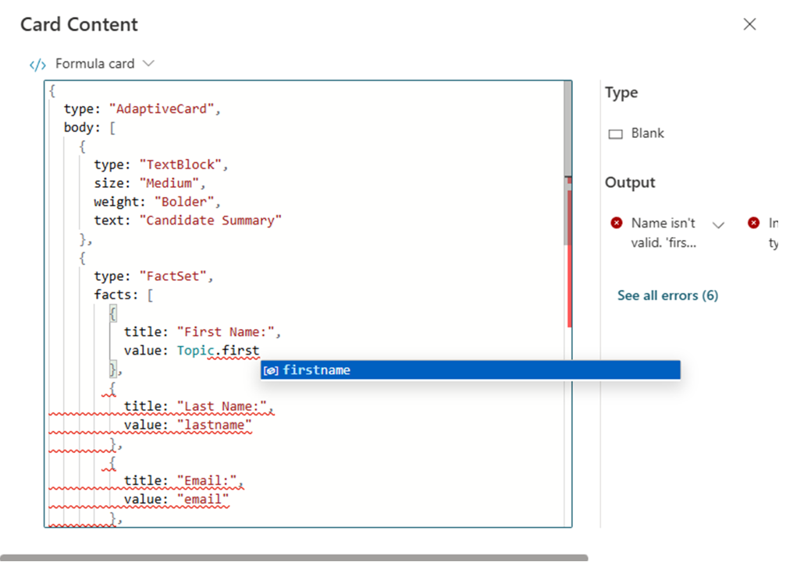
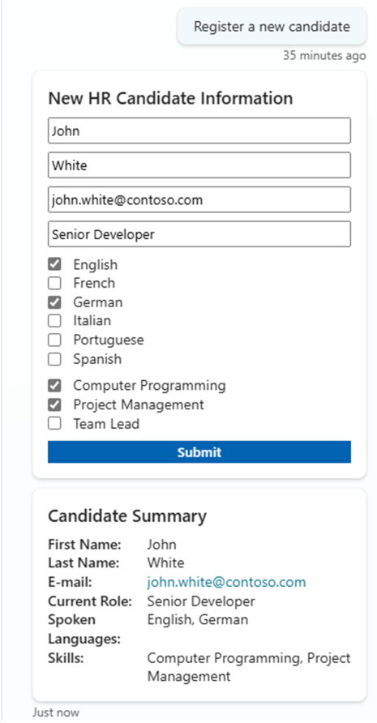

# Input mit Adaptive Cards erfassen

In diesem Lab erweitern Sie den HR Agent aus [Topics, Entities und Variables definieren](../03-topics/lab-01-build-topics-de.md) um ein Topic, das die Daten einer neuen Kandidatin oder eines neuen Kandidaten über eine Adaptive Card erfasst und mit einer Formula Card bestätigt.

## Den HR Agent einrichten

Dieses Lab startet mit dem HR Agent, seinen Instructions und der Microsoft Careers Site als Knowledge. Wenn Sie ihn in den vorigen Basics Labs gebaut haben, zum Beispiel in [Topics, Entities und Variables definieren](../03-topics/lab-01-build-topics-de.md), öffnen Sie ihn unter **Agents** und machen mit Übung 1 weiter. Andernfalls erstellen Sie ihn jetzt:

1. Rufen Sie [Copilot Studio](https://copilotstudio.microsoft.com) auf, wählen Sie auf **Home** den Befehl **Other ways to build** und dann unter **Build with standard orchestration** den Eintrag **Agent** mit dem Badge **Standard**.
2. Geben Sie im Dialog **Name your agent** den Namen `HR Agent` ein und wählen Sie **Create**.
3. Warten Sie, bis der Agent eingerichtet ist (die Befehle **Edit** bleiben etwa eine Minute deaktiviert). Wählen Sie dann im Tab **Overview** im Abschnitt **Details** den Befehl **Edit**, fügen Sie den folgenden Text in **Description** ein und wählen Sie **Save**.

```txt
You help employees to find information about HR related policies
```

4. Wählen Sie im Abschnitt **Instructions** den Befehl **Edit**, fügen Sie die folgenden Instructions ein und wählen Sie **Save**.

```txt
- Provide employees with clear, accurate information about HR policies and procedures.
- Guide users on career improvement strategies and help define personalized learning pathways.
- Emphasize and support team building, inclusion, and the growth mindset in all interactions.
- Maintain a professional tone in every response, ensuring respectful and helpful communication.
- Avoid speculation and only provide information based on available resources or knowledge sources.
- Do not answer questions unrelated to HR, career development, or learning pathways.
- Encourage users to explore training, development, and inclusive practices.
- Respond promptly and clearly to all user queries.
```

5. Wählen Sie im Abschnitt **Knowledge** den Befehl **+ Add knowledge** > **Public websites**, geben Sie `https://careers.microsoft.com/` ein und wählen Sie **Add**. Nennen Sie die Site `Microsoft Careers site`, fügen Sie die folgende Beschreibung ein und wählen Sie **Add to agent**.

```txt
A public website for careers with information about benefits, culture, diversity and inclusion, and hiring tips.
```

Erwartet: Der Tab **Overview** des HR Agent zeigt die Description, die Instructions und unter **Knowledge** die **Microsoft Careers site**.

## Übung 1: Adaptive Cards nutzen

Mehrere Actions **Ask a question** hintereinander sind sicher eine Möglichkeit, Inputs zu erfassen. Wenn Sie aber viele Daten erfassen müssen oder dem User eine ansprechende Interaktion bieten möchten, sollten Sie eine Adaptive Card in Betracht ziehen.

<details open>
<summary>Was sind Adaptive Cards?</summary>

Adaptive Cards sind plattformunabhängige UI Snippets in JSON, die Apps und Services untereinander austauschen. Sobald eine App das JSON erhält, wird daraus eine native UI, die sich automatisch an ihre Umgebung anpasst. So entwerfen und integrieren Sie schlanke UI über alle wichtigen Plattformen und Frameworks hinweg.
</details>



### Schritt 1: Input mit Adaptive Cards erfassen

Angenommen, Sie möchten ein weiteres Topic erstellen, das folgende Informationen zu einer neuen Kandidatin oder einem neuen Kandidaten erfasst:

- Vorname
- Nachname
- E-Mail
- Aktuelle Rolle
- Gesprochene Sprachen
- Skills

Gesprochene Sprachen und Skills sind dabei Multi-Select Listen mit Werten.

Öffnen Sie also den Tab **Topics**. Wenn Ihr Agent das Multi-Turn Topic `Register a new candidate` aus dem Topics Lab hat, schalten Sie unter **Custom** dessen **Enabled** aus, damit sich die Trigger Conditions nicht überschneiden. Erstellen Sie dann mit **Add a topic** > **From blank** ein neues Topic und geben Sie den Trigger-Text in das Feld **Describe what the topic does** ein:

```txt
This topic helps to collect information about a new candidate to process. Trigger sentences can be: 
register a new candidate, create a new candidate, add a new candidate.
```

Fügen Sie jetzt eine neue Action vom Typ **Ask with adaptive card** hinzu, 1️⃣ wählen Sie den Body der neuen Action und 2️⃣ dann die Schaltfläche **Edit adaptive card**. Geben Sie dann folgendes JSON in den **Card payload editor** des **Adaptive card designer** der Action ein.



```json
{
    "type": "AdaptiveCard",
    "body": [
        {
            "type": "TextBlock",
            "size": "Medium",
            "weight": "Bolder",
            "text": "New HR Candidate Information"
        },
        {
            "type": "Input.Text",
            "id": "firstname",
            "placeholder": "First Name"
        },
        {
            "type": "Input.Text",
            "id": "lastname",
            "placeholder": "Last Name"
        },
        {
            "type": "Input.Text",
            "id": "email",
            "placeholder": "Email"
        },
        {
            "type": "Input.Text",
            "id": "current_role",
            "placeholder": "Current Role"
        },
        {
            "type": "Input.ChoiceSet",
            "id": "spoken_languages",
            "placeholder": "Spoken Languages",
            "isMultiSelect": true,
            "choices": [
                {
                    "title": "English",
                    "value": "English"
                },
                {
                    "title": "French",
                    "value": "French"
                },
                {
                    "title": "German",
                    "value": "German"
                },
                {
                    "title": "Italian",
                    "value": "Italian"
                },
                {
                    "title": "Portuguese",
                    "value": "Portuguese"
                },
                {
                    "title": "Spanish",
                    "value": "Spanish"
                }
            ]
        },
        {
            "type": "Input.ChoiceSet",
            "id": "skills",
            "placeholder": "Skills",
            "isMultiSelect": true,
            "choices": [
                {
                    "title": "Computer Programming",
                    "value": "Computer Programming"
                },
                {
                    "title": "Project Management",
                    "value": "Project Management"
                },
                {
                    "title": "Team Lead",
                    "value": "Team Lead"
                }
            ]
        }
    ],
    "actions": [
        {
            "type": "Action.Submit",
            "title": "Submit"
        }
    ],
    "$schema": "http://adaptivecards.io/schemas/adaptive-card.json",
    "version": "1.5"
}
```

Wählen Sie im Header des Dialogs **Adaptive card designer** zuerst **Save** und dann **Close**: **Save** allein lässt den Dialog offen. Nutzen Sie das **Save** des Dialogs, nicht das **Save** des Topics hinter dem Dialog, das das Topic ohne die Card speichert.

Sobald Sie das JSON der Adaptive Card aktualisiert haben, rendert Copilot Studio eine Preview der Card in der UI des Topic Designers, wie im folgenden Screenshot. Copilot Studio legt außerdem automatisch Variables auf Topic-Ebene an, die die Werte des Users erfassen: **Outputs (7)**, die sechs Card Inputs plus `actionSubmitId`. `spoken_languages` und `skills` sind vom Typ `table`, die anderen vier vom Typ `string`.


### Schritt 2: Feedback mit Adaptive Cards geben

Eine Adaptive Card können Sie auch nutzen, um dem User Feedback mit einer Zusammenfassung der erfassten Daten zu geben. Wählen Sie den Befehl **+** und fügen Sie eine neue Action vom Typ **Send a message** hinzu. Wählen Sie dann links oben in der neuen Action **+ Add** und anschließend **Adaptive card**, um die Nachricht auf den Typ Adaptive Card umzustellen.



Ein Seitenpanel erscheint, in dem Sie den Befehl **Edit adaptive card** wählen und den Inhalt der Adaptive Card definieren. Kopieren Sie folgendes JSON in den **Card payload editor** des **Adaptive card designer**.

```JSON
{
  "type": "AdaptiveCard",
  "body":
    [
      {
        "type": "TextBlock",
        "size": "Medium",
        "weight": "Bolder",
        "text": "Candidate Summary"
      },
      {
        "type": "FactSet",
        "facts":
          [
            { "title": "First Name:", "value": "firstname" },
            { "title": "Last Name:", "value": "lastname" },
            { "title": "Email:", "value": "email" },
            { "title": "Current Role:", "value": "current_role" },
            { "title": "Spoken Languages:", "value": "spoken_languages" },
            { "title": "Skills:", "value": "skills" }
          ]
      }
    ],
  "$schema": "http://adaptivecards.io/schemas/adaptive-card.json",
  "version": "1.3"
}
```

Fügen Sie das JSON in den **Card payload editor** des **Adaptive card designer** ein und wählen Sie dann im Header des Dialogs **Save** und **Close**. Die Action **Send a message** zeigt danach eine Preview der Adaptive Card. Wie Sie sehen, rendert die Adaptive Card für alle Variables statische Werte (firstname, lastname usw.).



Öffnen Sie jetzt das Dropdown **Format**, das **JSON card** anzeigt, und wählen Sie **Formula** (danach steht dort **Formula card**), um die statischen Werte durch die tatsächlichen Variables des aktuellen Topics zu ersetzen.



Wählen Sie **Expand code editor**, um den Dialog **Card Content** zu öffnen. Dort ersetzen Sie die statischen Werte durch Formeln, die auf die tatsächlichen Werte der Topic Variables verweisen.



Ein Dialog öffnet sich mit einem erweiterten Editor, dessen IntelliSense Ihnen hilft, Variables und PowerFx Functions zu referenzieren, wie im folgenden Screenshot.



Ersetzen Sie nacheinander alle statischen Werte durch die tatsächlichen Variables. Gesprochene Sprachen und Skills sind Listen von Werten (Variables vom Typ `Table`), deshalb verwenden Sie zum Rendern ihres Werts die PowerFx Function `Concat` und anschließend die PowerFx Function `Text`, die das Ergebnis in einen String umwandelt. Hier sehen Sie das JSON der Adaptive Card, wenn alle Formeln eingetragen sind.

```JSON
{
  type: "AdaptiveCard",
  body: [
    {
      type: "TextBlock",
      size: "Medium",
      weight: "Bolder",
      text: "Candidate Summary"
    },
    {
      type: "FactSet",
      facts: [
        {
          title: "First Name:",
          value: Topic.firstname
        },
        {
          title: "Last Name:",
          value: Topic.lastname
        },
        {
          title: "E-mail:",
          value: Topic.email
        },
        {
          title: "Current Role:",
          value: Topic.current_role
        },
        {
          title: "Spoken Languages:",
          value: Text(Concat(Topic.spoken_languages, Value, ", "))
        },
        {
          title: "Skills:",
          value: Text(Concat(Topic.skills, Value, ", "))
        }
      ]
    }
  ],
  '$schema': "http://adaptivecards.io/schemas/adaptive-card.json",
  version: "1.3"
}
```

> **Weitere Informationen zu PowerFx Functions:** Mehr zu den PowerFx Functions lesen Sie im Artikel [Create expressions using Power Fx](https://learn.microsoft.com/en-us/microsoft-copilot-studio/advanced-power-fx)

### Schritt 3: Das aktuelle Topic testen

Wählen Sie jetzt **+** unter dem letzten Node und dann **Topic management** > **End current topic**. Wählen Sie **Save**, geben Sie dem Topic einen Namen wie zum Beispiel `Register new candidate with adaptive cards`, falls Copilot Studio danach fragt, und testen Sie es im Test Panel rechts im Agent Designer. Im folgenden Screenshot sehen Sie, wie das Topic mit einem User interagiert.



Ihr Topic ist jetzt fertig und voll funktionsfähig. In den kommenden Labs lernen Sie, wie Sie tatsächlich einen neuen Datensatz für eine Kandidatin oder einen Kandidaten anlegen und die Daten in einem externen HR Service speichern.

> **Tipp:** Mehr zum Einsatz von Adaptive Cards in Agents mit Microsoft Copilot Studio finden Sie in [Agent Academy - Recruit - Mission 08: Enhance user interactions in Topics with Adaptive Cards](https://microsoft.github.io/agent-academy/recruit/08-add-adaptive-card/).

Ihr Agent unterstützt jetzt mehrere Gesprächspfade über verschiedene Topics. In den nächsten Labs lernen Sie, mit Custom Actions zu arbeiten.

Weiter mit [Den HR Agent in Teams und Microsoft 365 Copilot publishen](../06-publishing/lab-01-publish-to-teams-and-copilot-de.md).
