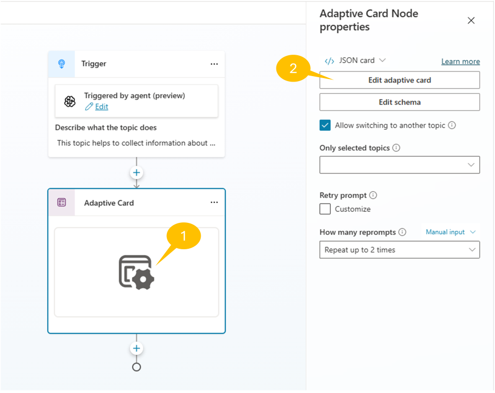
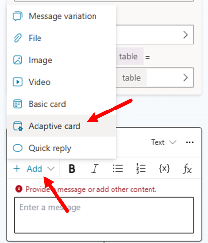
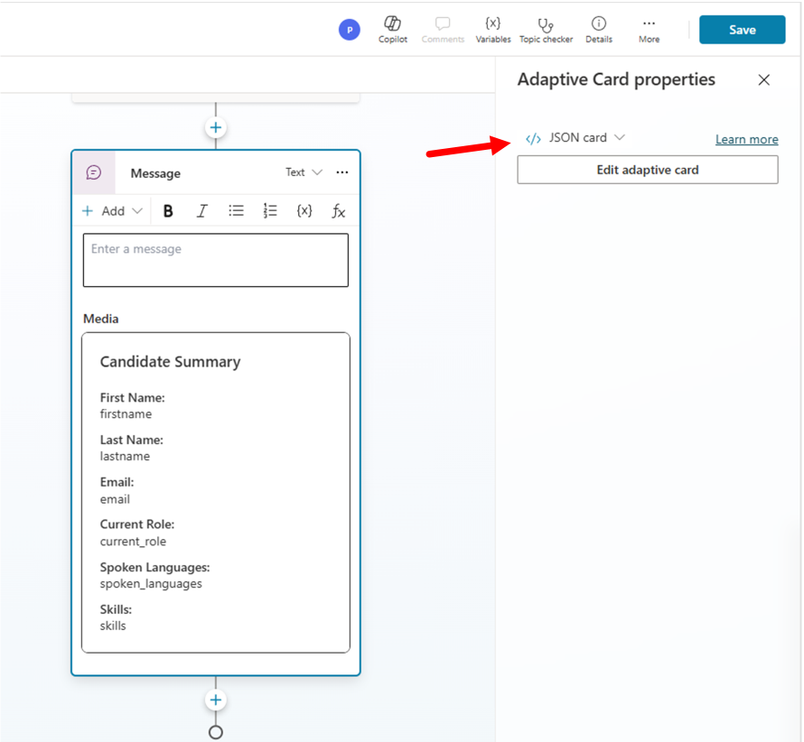
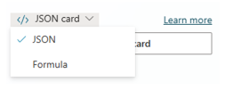
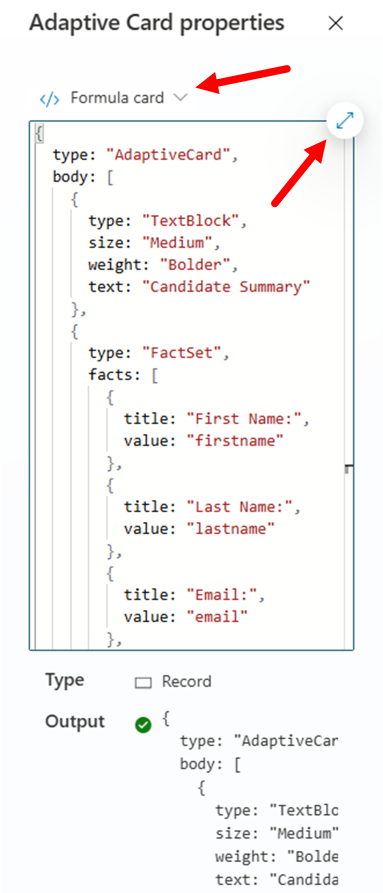
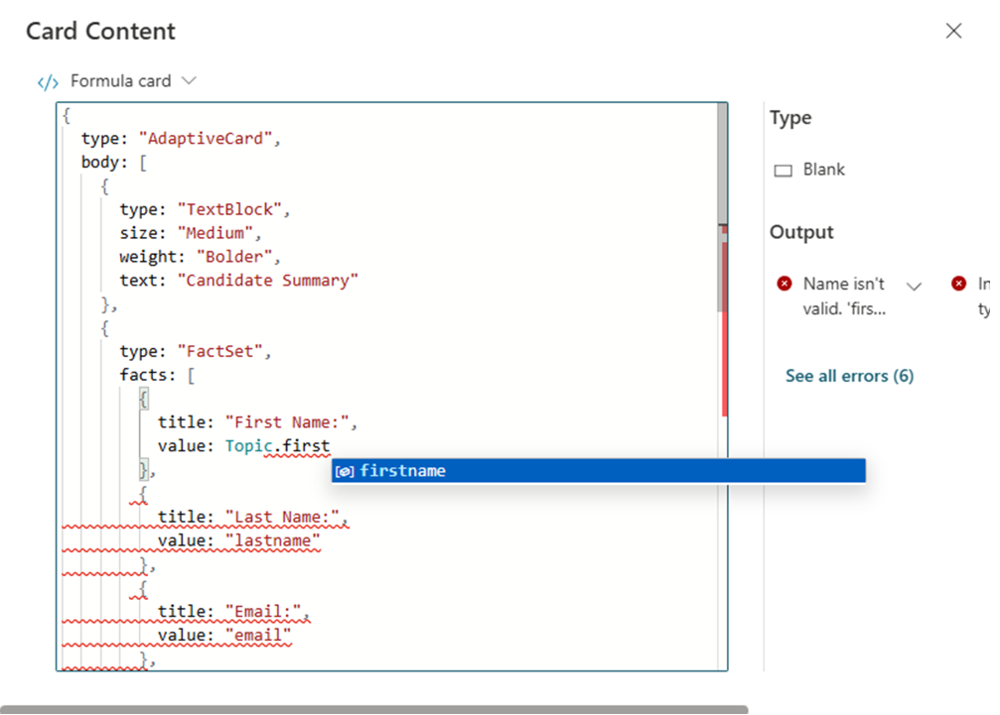
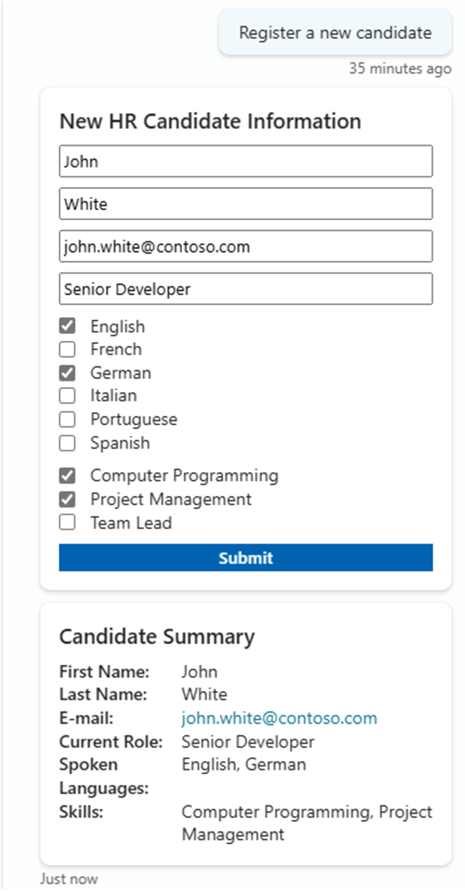

# Collect Input with Adaptive Cards

In this lab, you extend the HR agent from [Define Topics, Entities, and Variables](../03-topics/lab-01-build-topics.md) with a topic that collects a new candidate's data through an Adaptive Card and confirms it with a formula card.

> **Note:** This lab builds on the previous one. Continue working on the same agent.

## Exercise 1 : Using Adaptive Cards

Collecting inputs using multiple instances of **Ask a question** actions is definitely one option that you have. However, when you need to collect a lot of data or when you want to have a nice looking interaction with the user you can consider using an Adaptive Card.

<details open>
<summary>What are Adaptive Cards?</summary>

Adaptive Cards are platform-independent UI snippets authored in JSON that can be exchanged between apps and services. Once delivered to an app, the JSON transforms into native UI that automatically adapts to its environment. This enables the design and integration of lightweight UI across major platforms and frameworks.
</details>



### Step 1: Collecting input with Adaptive Cards

Imagine that you want to create yet another topic to collect the following information about a new candidate:

- First name
- Last name
- E-mail
- Current role
- Spoken languages
- Skills

Specifically, spoken languages and skills are multi-select lists of values.

So open the **Topics** tab, and disable the topic that you created in Exercise 3 to avoid any overlapping of trigger conditions. Then, create a new topic following the instructions provided in Exercise 2 Step 1. The **Trigger** description for the topic could be:

```txt
This topic helps to collect information about a new candidate to process. Trigger sentences can be: 
register a new candidate, create a new candidate, add a new candidate.
```

Now add a new action of type **Ask with adaptive card**, 1️⃣ select the body of the new action and 2️⃣ then select the button **Edit adaptive card**. Then type the following JSON into the **Card payload editor** of the **Adaptive card designer** of the action.



```json
{
    "type": "AdaptiveCard",
    "body": [
        {
            "type": "TextBlock",
            "size": "Medium",
            "weight": "Bolder",
            "text": "New HR Candidate Information"
        },
        {
            "type": "Input.Text",
            "id": "firstname",
            "placeholder": "First Name"
        },
        {
            "type": "Input.Text",
            "id": "lastname",
            "placeholder": "Last Name"
        },
        {
            "type": "Input.Text",
            "id": "email",
            "placeholder": "Email"
        },
        {
            "type": "Input.Text",
            "id": "current_role",
            "placeholder": "Current Role"
        },
        {
            "type": "Input.ChoiceSet",
            "id": "spoken_languages",
            "placeholder": "Spoken Languages",
            "isMultiSelect": true,
            "choices": [
                {
                    "title": "English",
                    "value": "English"
                },
                {
                    "title": "French",
                    "value": "French"
                },
                {
                    "title": "German",
                    "value": "German"
                },
                {
                    "title": "Italian",
                    "value": "Italian"
                },
                {
                    "title": "Portuguese",
                    "value": "Portuguese"
                },
                {
                    "title": "Spanish",
                    "value": "Spanish"
                }
            ]
        },
        {
            "type": "Input.ChoiceSet",
            "id": "skills",
            "placeholder": "Skills",
            "isMultiSelect": true,
            "choices": [
                {
                    "title": "Computer Programming",
                    "value": "Computer Programming"
                },
                {
                    "title": "Project Management",
                    "value": "Project Management"
                },
                {
                    "title": "Team Lead",
                    "value": "Team Lead"
                }
            ]
        }
    ],
    "actions": [
        {
            "type": "Action.Submit",
            "title": "Submit"
        }
    ],
    "$schema": "http://adaptivecards.io/schemas/adaptive-card.json",
    "version": "1.5"
}
```

Once you updated the JSON of the adaptive card, Copilot Studio renders the preview of the card in the UI of the topic designer, as you can see in the following screenshot. Copilot Studio also automatically defines a set of topic-level variables to collect the values provided by the user.


### Step 2: Providing feedback with Adaptive Cards

You can now use an adaptive card also to provide feedback to the user, showing a recap of the collected data. Select the **+** command to add a new action of type **Send a message**. Then select **+ Add** in the upper left corner of the new action and select **Adaptive card** to switch to a message of type adaptive card.



A side panel shows up allowing you to select the **Edit adaptive card** command and to define the content of the adaptive card. Copy and paste the following JSON into the **Card payload editor** of the **Adaptive card designer**.

```JSON
{
  "type": "AdaptiveCard",
  "body":
    [
      {
        "type": "TextBlock",
        "size": "Medium",
        "weight": "Bolder",
        "text": "Candidate Summary"
      },
      {
        "type": "FactSet",
        "facts":
          [
            { "title": "First Name:", "value": "firstname" },
            { "title": "Last Name:", "value": "lastname" },
            { "title": "Email:", "value": "email" },
            { "title": "Current Role:", "value": "current_role" },
            { "title": "Spoken Languages:", "value": "spoken_languages" },
            { "title": "Skills:", "value": "skills" }
          ]
      }
    ],
  "$schema": "http://adaptivecards.io/schemas/adaptive-card.json",
  "version": "1.3"
}
```

It is very important that, when pasting the JSON of the adaptive card, you have the **Edit JSON** option selected (which is by the way the default one) at the top of the text area. That means that you are editing the actual JSON of the adaptive card. As soon as you will move the focus out of the text area where you pasted the JSON, the **Send a message** action will start previewing the adaptive card. As you can see the adaptive card is rendering static values for all the variables (firstname, lastname, etc.).



Now, select the drop down with **JSON Card** and switch to **Formula Card** in order to replace the static values with the actual variables defined in the current Topic.



Select the button to expand the editor and you can start replacing the static values with formulas that will refer to the actual value of the topic-level variables.



You will see a dialog popping up and providing an advanced editor with intellisense helping you to reference variables and PowerFx functions, like illustrated in the following screenshot.



One by one, you can replace all the static values with the actual variables. In particular, the spoken languages and the skills are list of values (variables of type `Table`) so, in order to render their value, you need to rely on the PowerFx `Concat` function and then on the PowerFx `Text` function to convert the result into an actual string. Here you can find the content of the adaptive card JSON when all the formulas are in place.

```JSON
{
  type: "AdaptiveCard",
  body: [
    {
      type: "TextBlock",
      size: "Medium",
      weight: "Bolder",
      text: "Candidate Summary"
    },
    {
      type: "FactSet",
      facts: [
        {
          title: "First Name:",
          value: Topic.firstname
        },
        {
          title: "Last Name:",
          value: Topic.lastname
        },
        {
          title: "E-mail:",
          value: Topic.email
        },
        {
          title: "Current Role:",
          value: Topic.current_role
        },
        {
          title: "Spoken Languages:",
          value: Text(Concat(Topic.spoken_languages, Value, ", "))
        },
        {
          title: "Skills:",
          value: Text(Concat(Topic.skills, Value, ", "))
        }
      ]
    }
  ],
  '$schema': "http://adaptivecards.io/schemas/adaptive-card.json",
  version: "1.3"
}
```

> **Additional information about PowerFx functions:** You can find additional information about the PowerFx functions reading the article [Create expressions using Power Fx](https://learn.microsoft.com/en-us/microsoft-copilot-studio/advanced-power-fx)

### Step 3: Testing the current topic

Now add an **End current topic** action at the end of the topic, save it, give it a name like for example `Register new candidate with adaptive cards`, and test it in the test panel on the right side of the agent designer. In the following screenshot you can see how the topic interacts with a user.



Now your topic is ready and fully functional. In the upcoming labs you will learn how to create a new candidate record for real, storing data in an external HR service.

> **Tip:** To learn more about using Adaptive Cards in agents with Microsoft Copilot Studio, you can refer to [Agent Academy - Recruit - Mission 08: Enhance user interactions in Topics with Adaptive Cards](https://microsoft.github.io/agent-academy/recruit/08-add-adaptive-card/).

Now your agent supports multiple conversation paths through different topics. In the next labs you will learn how to work with custom Actions.

Continue with [Publish the HR Agent to Teams and Microsoft 365 Copilot](../06-publishing/lab-01-publish-to-teams-and-copilot.md).
