# Den HR Agent in Teams und Microsoft 365 Copilot publishen

In diesem Lab publishen Sie den HR Agent aus den vorigen Labs in Microsoft Teams und bauen dann einen Declarative Agent für Microsoft 365 Copilot Chat mit eigenem Knowledge und einem Tool.

> **Hinweis:** Dieses Lab baut auf [Input mit Adaptive Cards erfassen](../05-adaptive-cards/lab-01-collect-input-with-adaptive-cards-de.md) auf. Arbeiten Sie am selben Agent weiter.

## Übung 1: Den Agent in Microsoft Teams publishen

In dieser Übung publishen Sie den HR Agent in Microsoft Teams.


### Schritt 1: Den Agent in Microsoft Teams publishen

Um einen mit Copilot Studio erstellten Agent zu publishen, wählen Sie die Schaltfläche **Publish** rechts oben im Agent Editor.

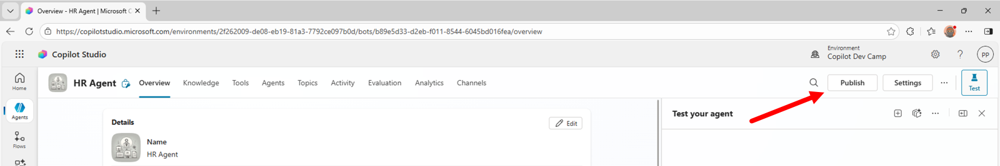

Der Befehl fragt nach einer Bestätigung. Beim Bestätigen können Sie außerdem **Force newest version** wählen, damit User in Teams Ihre neuesten Updates sofort erhalten.

Hat der Agent Tools, die Ihre Credentials nutzen, warnt der Dialog außerdem "Your agent runs tools that use the author's credentials". Nach der Bestätigung dauert das Publishing eine Weile, und währenddessen sehen Sie die Meldung "Publishing ...". Ein Publish registriert den Agent in der Power Platform Ziel-Environment, macht ihn aber noch auf keiner Zielplattform verfügbar.

Um den Agent tatsächlich auf einer bestimmten Zielplattform (Channel) verfügbar zu machen, 1️⃣ öffnen Sie **Channels** im Agent Editor (der Eintrag kann im Menü **+5** am Ende der Tab-Leiste liegen) und wählen dann einen oder mehrere Channels, in denen der Agent verfügbar sein soll. Um den Agent zum Beispiel als Bot in Microsoft Teams zu publishen, 2️⃣ wählen Sie die Kachel **Microsoft 365 and Microsoft Teams**.

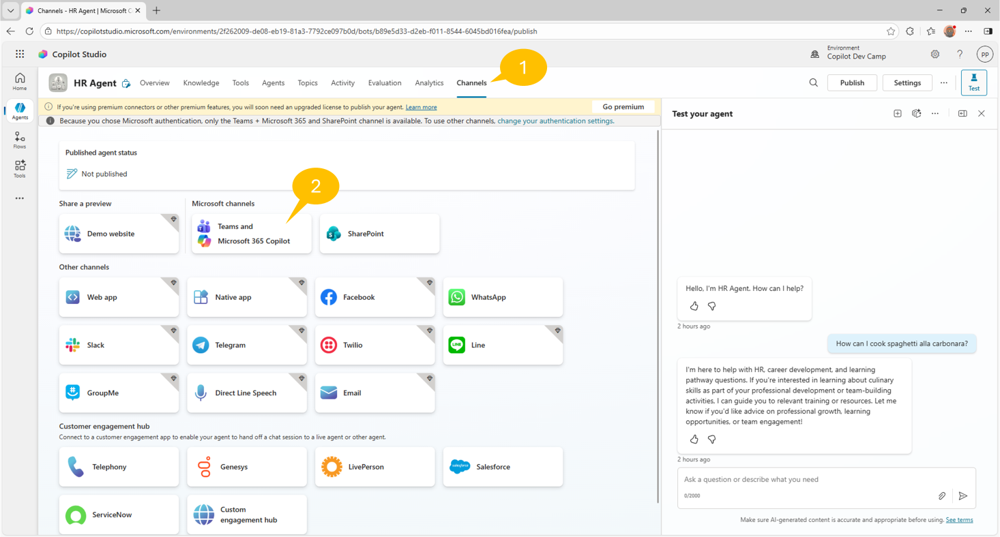

Wenn Sie einen Agent erstellen und mit den Standardeinstellungen publishen, ist er für Microsoft Authentication konfiguriert. Der Agent nutzt dann in Teams, Power Apps oder Microsoft 365 Copilot die Authentication über Microsoft Entra ID.
Mit den Standardeinstellungen für Authentication können Sie den Agent nur in den Channels **Microsoft Teams and Microsoft 365 Copilot** und **SharePoint** publishen, wie die Warnmeldung oben im Tab **Channels** im vorigen Screenshot zeigt.


> **Authentication Model von Copilot Studio:** Mehr zur Authentication von Agents in Copilot Studio lesen Sie im Dokument [Configure user authentication in Copilot Studio](https://learn.microsoft.com/en-us/microsoft-copilot-studio/configuration-end-user-authentication).

> **Premium-Lizenz für Microsoft Copilot Studio:** Im Screenshot oben sehen Sie außerdem eine Infoleiste zum Lizenzmodell und zum möglichen Bedarf einer Premium-Lizenz. Wenn Sie Copilot Studio mit Premium Features wie Premium Connectors nutzen, müssen Sie Ihre Lizenz entsprechend upgraden. Zum Glück können Sie zum Lernen und Testen mit Microsoft Copilot Studio eine 60-tägige kostenlose Testphase mit der Premium-Lizenz aktivieren.

Wenn Sie den Channel **Microsoft 365 and Microsoft Teams** wählen, erscheint ein Seitenpanel mit der standardmäßig aktivierten Checkbox **Make agent available in Microsoft 365 Copilot** und der Schaltfläche **Add channel**.

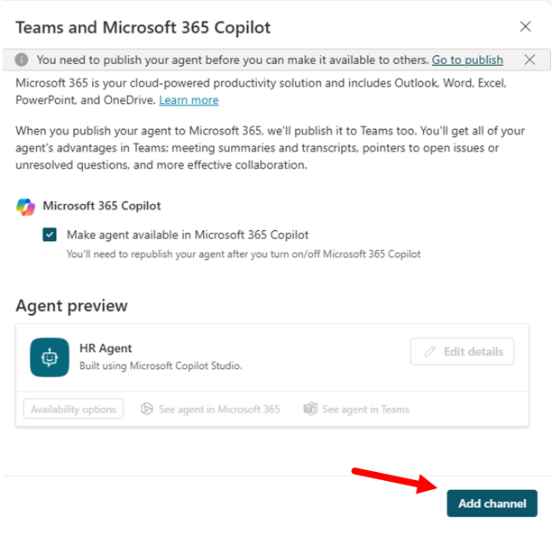

Sobald der Agent im Channel Microsoft Teams aktiviert ist, aktualisiert sich das Seitenpanel und zeigt eine Bestätigung sowie einige Befehle, um die Details des Agents zu bearbeiten und den Agent im Microsoft Teams Client zu öffnen. Außerdem gibt es eine Schaltfläche **Availability options**, die die verschiedenen Wege zeigt, den Agent in Microsoft Teams zu nutzen.

Wenn Sie den Channel für Microsoft 365 Copilot registriert haben, können Sie auch den Link **See agent in Microsoft 365** wählen, um den Agent direkt in der User Experience von Microsoft 365 Copilot Chat zu öffnen.

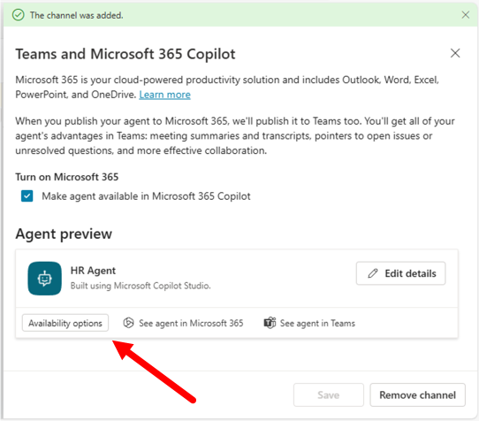

Mit der Schaltfläche **Availability options** können Sie:

- Einen Link kopieren, um den Agent in Microsoft Teams zu nutzen
- Eine ZIP-Datei mit einem Paket herunterladen, das Sie in den Teams App Store hochladen können
- Den Agent im Teams App Store verfügbar machen und festlegen, ob er für die ganze Organisation oder nur für ausgewählte User verfügbar ist


Das Publishing des Agents in Microsoft Teams ist damit abgeschlossen.

> **Tipp:** Mehr zum Publishen von Microsoft Copilot Studio Agents finden Sie in [Agent Academy - Recruit - Mission 11: Publish Your Agent](https://microsoft.github.io/agent-academy/recruit/11-publish-your-agent/).

### Schritt 2: Den Agent in Microsoft Teams testen

Jetzt können Sie den Agent in Microsoft Teams testen. Wählen Sie im Panel **Availability options** die Schaltfläche **Copy link**, um einen Link zum Agent zu kopieren. Öffnen Sie dann einen neuen Browser-Tab, fügen Sie den kopierten Link ein und drücken Sie ENTER, um die URL aufzurufen. Bietet Teams zuerst die Desktop-App an, wählen Sie **Use the web app instead**.

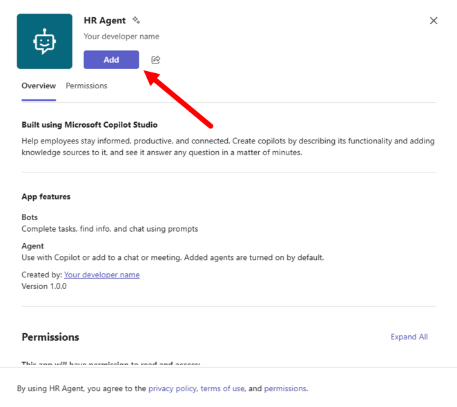

Zunächst zeigt der Microsoft Teams Client eine neue App, die Ihren Agent repräsentiert. Wählen Sie die Schaltfläche **Add**, um die App Ihrem Client hinzuzufügen, und dann im folgenden Dialog **Open**; **Open with Copilot** öffnet den Agent stattdessen in Microsoft 365 Copilot Chat.

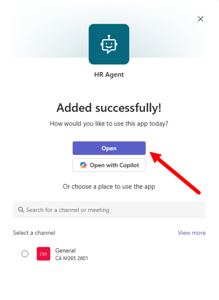

Nach kurzer Zeit zeigt der Microsoft Teams Client einen Chat mit einem Bot, der tatsächlich Ihr Agent ist. Geben Sie einen Prompt ein, zum Beispiel den, den Sie schon verwendet haben:

```txt
How can we hire new people in our company?
```

Warten Sie auf die Antwort: Der Agent antwortet mit Inhalten aus dem HR-Kontext und mit Verweisen auf die Dokumente in seiner Knowledge Base.

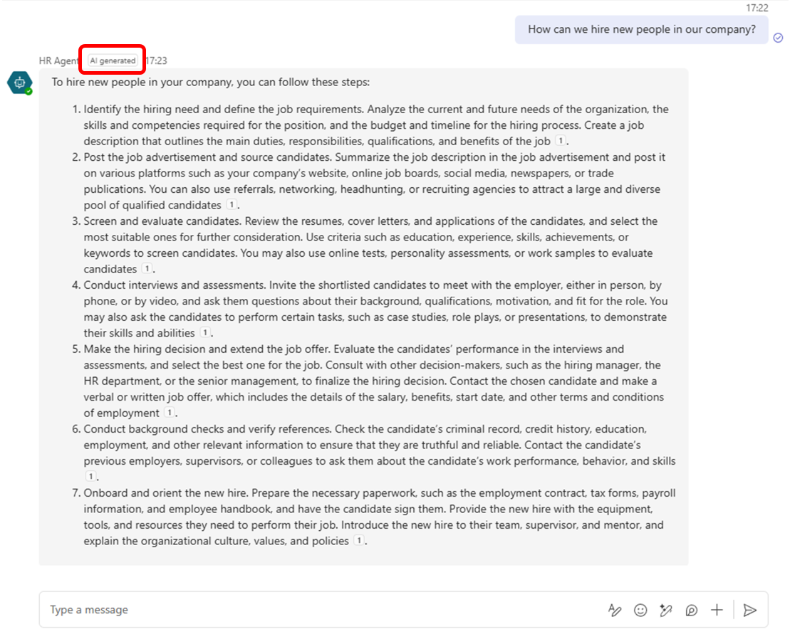

Beachten Sie auch das Label **AI agent** neben dem Namen des Absenders: Es zeigt dem User, dass sie oder er mit einem AI Agent spricht.

Ihr Agent ist jetzt voll funktionsfähig und bereit für den Einsatz in Microsoft Teams. In den nächsten Labs passen Sie sein Verhalten an und feinjustieren es.

## Microsoft 365 Copilot Chat mit einem Agent erweitern

In den nächsten Übungen erweitern Sie Microsoft 365 Copilot Chat mit einem zweiten Agent, den Sie in Microsoft Copilot Studio erstellen. Bisher haben Sie gesehen, wie Sie Agents in Copilot Studio erstellen und in Microsoft Teams nutzen. Sie haben auch gesehen, dass mit Microsoft Copilot Studio erstellte Agents über den Channel **Microsoft 365 and Microsoft Teams** sowohl Microsoft Teams als auch Microsoft 365 Copilot Chat bedienen können. Jetzt bauen Sie einen Agent für Microsoft 365 Copilot Chat.

In diesen Übungen lernen Sie:

- Wie Sie einen Agent für Microsoft 365 Copilot Chat erstellen
- Wie Sie ein eigenes Icon für Ihren Agent festlegen
- Wie Sie den Agent in Microsoft 365 Copilot Chat publishen
- Wie Sie ein Tool für Microsoft 365 Copilot Chat erstellen


## Übung 2: Einen Agent für Microsoft 365 Copilot Chat erstellen

In dieser Übung erstellen Sie einen Agent mit Microsoft Copilot Studio und hosten ihn in Microsoft 365 Copilot Chat.

### Schritt 1: Einen Agent für Copilot Chat erstellen

Wählen Sie auf der Seite **Home** von Copilot Studio unter **Other ways to build** den Eintrag **Agent (Standard)**. Der Dialog **Name your agent** fragt nur nach dem Namen: Geben Sie `Agentic HR` ein und wählen Sie **Create**.

Wählen Sie auf der Seite **Overview** im Abschnitt **Instructions** den Befehl **Edit** und fügen Sie die folgenden Instructions ein, die Zweck, Ziele und Ton des Agents kombinieren:

```text
You are an agent helping employees to find information about HR policies and procedures, about how to improve their career, and about how to define learning pathways.
Emphasize everything that helps team building, inclusion, and the growth mindset.
It should have a professional tone.
```

Wählen Sie **Save**. Die Seite **Overview** zeigt die Abschnitte, die Sie in den nächsten Schritten konfigurieren: **Details**, **Instructions**, **Knowledge** und **Tools**. Rechts im Bildschirm können Sie den Agent im Panel **Test** jederzeit ausprobieren.

### Schritt 2: Den Agent in Microsoft 365 Copilot Chat publishen


Jetzt können Sie den Agent in Microsoft 365 Copilot Chat publishen und testen. 1️⃣ Wählen Sie **Publish** rechts oben auf der Seite und dann **Publish** im Dialog. 2️⃣ Öffnen Sie **Channels**, wählen Sie **Microsoft 365 and Microsoft Teams**, lassen Sie **Make agent available in Microsoft 365 Copilot** aktiviert und wählen Sie **Add channel**. 3️⃣ Wählen Sie **Edit details**, um die Details der App auszufüllen.

Die Details der App sind:

- Icon: **Change icon** und **Change color**. Mit dem vorgeschlagenen Icon könnte die Hintergrundfarbe #B9BAB5 sein.
- Short description: Kurzbeschreibung des Agents (bis zu 80 Zeichen).
- Long description: ausführliche Beschreibung des Agents (bis zu 3400 Zeichen).
- **Show an agent disclaimer in M365 Copilot**: ein Toggle, der im Copilot Chat einen Disclaimer anzeigt.

Das Panel hat keine Felder für Entwicklername, Website, Datenschutzerklärung oder Nutzungsbedingungen, daher zeigt Copilot Chat den Agent als erstellt von "Your developer name". Speichern Sie die Details. Das erste Publishing dauert 30 bis 60 Sekunden, und das Panel **Availability options** fasst zusammen, wie User den Agent erreichen.


Konkret können Sie wählen:

- **Copy link**, um eine URL mit einem direkten Link zur App des neuen Agents zu kopieren.
- **Show to my teammates and shared users**, um den Agent mit ausgewählten Gruppen oder Personen in Ihrer Organisation zu teilen.
- **Show to everyone in my org**, um den Agent mit der ganzen Organisation zu teilen.
- **Download .zip file**, um ein ZIP-Paket der App herunterzuladen, das Sie dann in den Microsoft 365 Store hochladen.

> **Show to everyone in my org:** Wenn Sie den Agent der ganzen Organisation zeigen, stellen Sie sicher, dass er Release-reif ist und den Standards, Regeln und Policies des Unternehmens entspricht. Stimmen Sie sich mit Ihren Teammitgliedern ab. Nach dem Einreichen kann niemand sonst den Agent erneut einreichen, bis ein Admin ihn genehmigt oder ablehnt. Weitere Details zum Publishen einer App für die ganze Organisation lesen Sie in [Show to the organization](https://learn.microsoft.com/en-us/microsoft-copilot-studio/publication-add-bot-to-microsoft-teams#show-to-the-organization).

Wählen Sie **Copy link**, öffnen Sie einen neuen Browser-Tab und fügen Sie die URL mit dem direkten Link zum Agent ein.
Teams öffnet die App (wählen Sie **Use the web app instead**, falls Teams zuerst die Desktop-App anbietet). Wählen Sie **Add** und dann **Open with Copilot**, um den Agent in Microsoft 365 Copilot Chat zu öffnen.

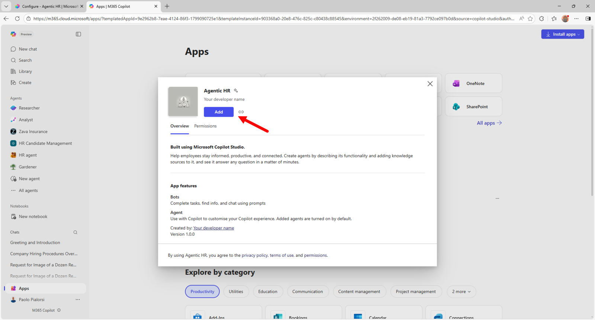

Sobald Sie den Agent zu Microsoft 365 Copilot Chat hinzugefügt haben, finden Sie ihn in der Liste der Agents rechts im Copilot Chat, wie im folgenden Screenshot.

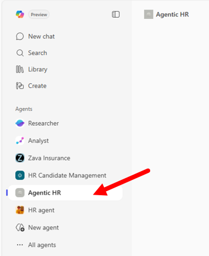

Wählen Sie den Agent und beginnen Sie die Interaktion. Geben Sie zum Beispiel folgenden Prompt ein:

```txt
How can we hire new people in our company?
```

Der Agent antwortet aus seinen Instructions und seinem allgemeinen Wissen: Er hat keine eigene Knowledge Source, daher enthält die Antwort keine Verweise auf Ihre Dokumente.

## Übung 3: Dem Agent ein Tool hinzufügen

In dieser Übung fügen Sie dem Agent aus der vorigen Übung ein Custom Tool hinzu. Wenn Sie in Microsoft Copilot Studio Agents für Microsoft 365 Copilot Chat (Declarative Agents) erstellen, können Sie verschiedene Arten von Tools hinzufügen, darunter:

- Prompt: nutzt ein AI Tool, das auf einem Prompt in natürlicher Sprache basiert.
- Connector: nutzt einen vorgefertigten Power Platform Connector, etwa Excel Online (Business).
- Custom connector: nutzt einen Power Platform Custom Connector.
- REST API: nutzt eine externe REST API. Weitere Details finden Sie [hier](https://learn.microsoft.com/en-us/microsoft-copilot-studio/agent-extend-action-rest-api).

> **Tools für Agents:** Mehr zum Hinzufügen von Tools zu Agents in Copilot Studio lesen Sie im Artikel [Add tools to custom agents](https://learn.microsoft.com/en-us/microsoft-copilot-studio/advanced-plugin-actions).

In diesem Lab fügen Sie ein Tool vom Typ `Connector` hinzu, den vorgefertigten Connector Excel Online (Business), um eine Liste von Kandidatinnen und Kandidaten aus einer Excel-Datei in SharePoint Online abzurufen.

### Schritt 1: Einem Agent für Microsoft 365 Copilot ein Tool hinzufügen

Um ein neues Tool hinzuzufügen, wählen Sie den Befehl **Add tool** im Abschnitt **Tools** des Konfigurationspanels des Agents.

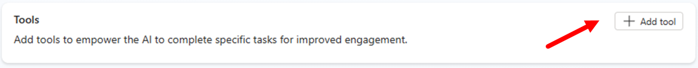

Ein Dialogfenster öffnet sich, in dem Sie wählen, welche Art von Tool Sie erstellen. Standardmäßig gibt es einige **Featured** Tools, etwa für Inhalte in Excel Online oder andere gängige Services. Sie können auch ein neues Tool von Grund auf erstellen: Wählen Sie den Befehl **+ New tool** und eine der Optionen aus den vorigen Absätzen.

Finden Sie die gewünschte Option nicht in der Liste der Featured Items, wechseln Sie einfach zur Gruppe **All** und suchen Sie per Text danach.

Um diesen Schritt abzuschließen, wählen Sie das Featured Tool **Excel** und dann **List rows present in a table**. Haben Sie noch keine Excel Connection, wählen Sie **Connection**, dann **Create new connection** und folgen dem Ablauf.

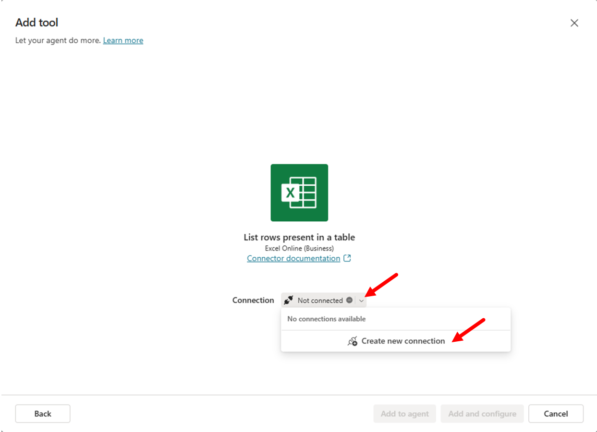

Sie müssen sich mit Ihrem Account anmelden und den Zugriff auf Excel Online (Business) erlauben. Sobald die Connection konfiguriert ist, sehen Sie einen Dialog mit dem Befehl **Add and configure** für das Tool.

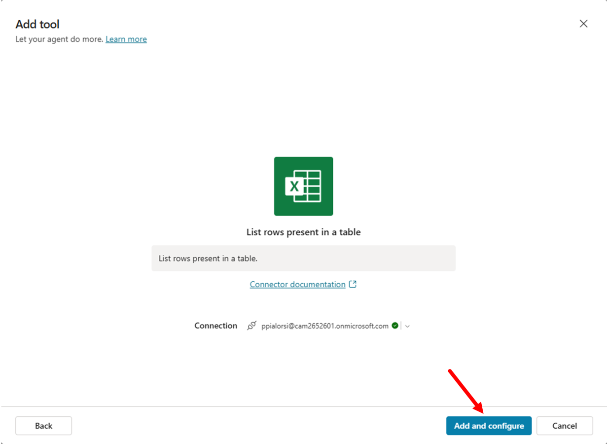

Nach dem Hinzufügen sehen Sie die Liste der Tools in Copilot Studio. Klicken Sie auf das eben erstellte Tool, um seine Settings zu bearbeiten. Im Konfigurationspanel geben Sie an:

- Name: einen Anzeigenamen für das Tool.
- Description: eine Beschreibung in natürlicher Sprache, mit der Generative Orchestration entscheidet, wann Ihr Tool zum Einsatz kommt. 
- Inputs and outputs: definiert die Input- und Output-Argumente der Action, falls vorhanden.
- Additional details: legt fest, wie die Action Request und Response gegenüber dem User behandelt.
- Completion: legt fest, was der Agent tut, wenn er das Tool fertig genutzt hat.

Bevor Sie das Tool konfigurieren, bereiten Sie die Excel-Datei mit der Liste der Kandidatinnen und Kandidaten vor.
Laden Sie über diesen [Link](https://github.com/microsoft/copilot-camp/blob/main/src/make/copilot-studio/Candidates/Sample-list-of-candidates.xlsx?raw=true) eine Beispiel-Excel-Datei herunter.

Laden Sie die Datei in die Bibliothek **Documents** einer SharePoint Teams Site im selben Tenant hoch, in dem Sie Ihren Agent mit Copilot Studio bauen. Microsoft 365 Copilot hat das Dokument erzeugt, damit es eine fiktive Liste von Kandidatinnen und Kandidaten gibt.

- Kopieren Sie die absolute URL der Site, zum Beispiel: `https://xyz.sharepoint.com/sites/greylogistics/`.
- Kopieren Sie den Namen der Dokumentbibliothek, zum Beispiel: `Documents`
- Kopieren Sie auch den Namen der Datei, zum Beispiel: `Sample-list-of-candidates.xlsx`

Wechseln Sie jetzt zurück zu Microsoft Copilot Studio und schließen Sie die Konfiguration des Tools ab.
Aktualisieren Sie im Dialog zum Bearbeiten des Tools **Name** und **Description**, damit beide aussagekräftiger sind. Verwenden Sie folgende Settings:

- Name: 

```txt
List HR candidates
```

- Description: 

```txt
List candidates for an HR role
```

Wählen Sie jetzt den Abschnitt **Inputs** und konfigurieren Sie die Input-Argumente. Prüfen Sie die Property **Fill using** jedes Input-Arguments: **Location**, **Document Library** und **File** stehen eventuell bereits auf `Custom value`, während **Table** standardmäßig auf `Dynamically fill with AI` steht, das den Wert aus der Antwort des Users extrahiert.

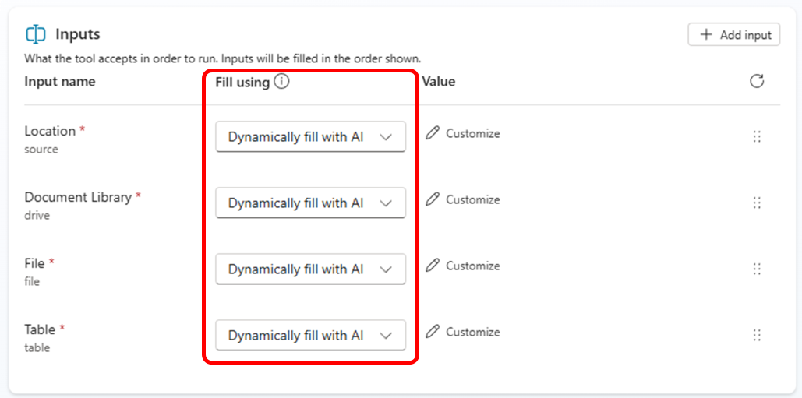

Für jedes Input-Argument konfigurieren Sie einen expliziten Wert. Wählen Sie das Feld **Fill using** des Input-Arguments **Location**, stellen Sie den Wert auf `Custom value` und wählen Sie dann im Dropdown die Site Collection, in der Sie die Excel-Datei mit der Liste der Kandidatinnen und Kandidaten gespeichert haben.

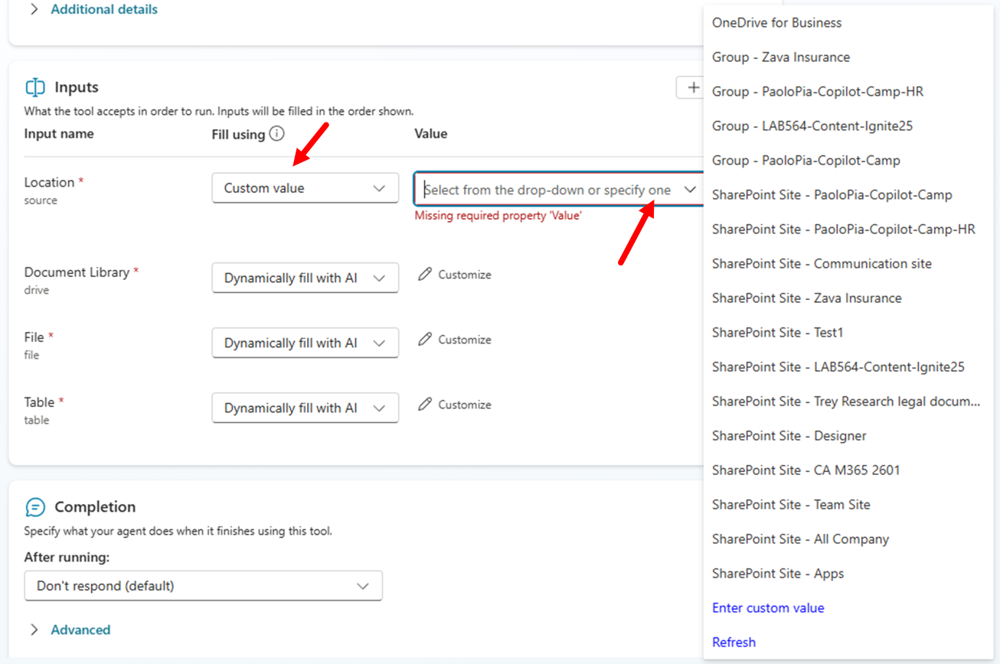

Stellen Sie jetzt das Input-Argument **Document Library** auf `Custom value` und wählen Sie die Bibliothek, in der Sie die Excel-Datei gespeichert haben. Stellen Sie das Input-Argument **File** auf `Custom value` und suchen Sie die Excel-Datei. Stellen Sie zum Schluss **Table** auf `Custom value` und wählen Sie die Tabelle mit dem Namen `Candidates_Table`. Wenn Sie mit den Settings fertig sind, sollten die Input-Argumente wie im folgenden Screenshot aussehen.

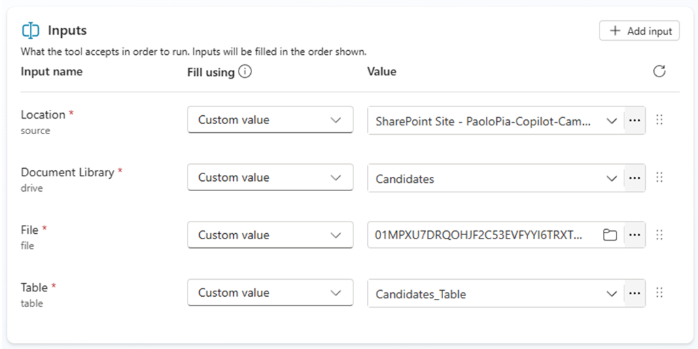

Wählen Sie jetzt die Schaltfläche **Save** rechts oben im Bildschirm, um das aktualisierte Tool zu speichern.

### Schritt 2: Das neue Tool testen

Jetzt können Sie den aktualisierten Agent publishen und im integrierten Test Panel oder in Microsoft Teams ausprobieren.

Wählen Sie erneut die Schaltfläche **Publish**, um das Publishing des Agents zu aktualisieren. Warten Sie, bis das Publishing abgeschlossen ist, und öffnen Sie dann erneut den direkten Link zur App des Agents. Zeigt die App den Befehl **Update now** statt **Add**, wählen Sie ihn und warten Sie; zeigt sie nur **Open**, ist das Update bereits übernommen. Wechseln Sie danach zu Microsoft 365 Copilot Chat, aktualisieren Sie die Seite und beginnen Sie die Interaktion mit dem aktualisierten Agent.

Das eben erstellte Tool rufen Sie ganz einfach auf, indem Sie dem Agent einen Prompt wie den folgenden geben:

```txt
Show me the list of candidates for HR with role "HR Director" or "HR Manager"
```


Microsoft 365 Copilot Chat fragt mit einer Card **Connect to continue** für **List rows present in a table** nach Ihrer Erlaubnis, eine externe API (Excel Online) zu nutzen. Wählen Sie **Allow**.

Da der Power Platform Connector eine gültige Connection braucht, fordert der Agent den User eventuell auf, sich mit **Sign in to Agentic HR** anzumelden, bevor er die externe Datenquelle nutzen kann; existiert die Connection bereits, erscheint kein Sign-in.
Sobald Sie mit dem externen Connector verbunden sind, antwortet der Agent mit der Liste der Kandidatinnen und Kandidaten aus der Excel-Datei, die zu den Kriterien in Ihrem Prompt passen.

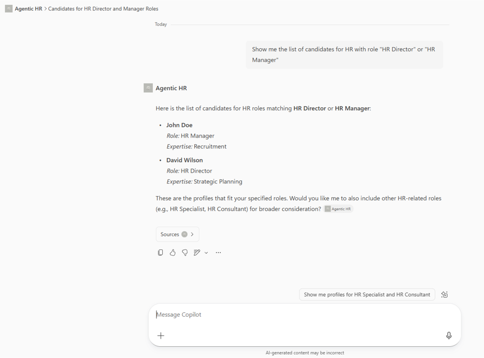

Gut gemacht! Sie haben aus einem Copilot Studio Agent für Microsoft 365 Copilot einen externen Connector genutzt!

> **Tipp:** Mehr zum Erstellen von Declarative Agents für Microsoft 365 Copilot mit Microsoft Copilot Studio finden Sie in [Agent Academy - Recruit - Mission 03: Deploy a Declarative Agent for Microsoft 365 Copilot](https://microsoft.github.io/agent-academy/recruit/03-create-a-declarative-agent-for-M365Copilot/).

Weiter mit [Tools mit Power Platform Connectors definieren](../../04-cs-tools/03-connectors/lab-01-connector-and-flow-tools-de.md).
