# Publish the HR Agent to Teams and Microsoft 365 Copilot

In this lab, you publish the HR agent to Microsoft Teams, then build a declarative agent for Microsoft 365 Copilot Chat with its own knowledge and a tool.

## Set up the HR Agent

This lab starts from the HR Agent with its instructions and the Microsoft Careers site as knowledge. If you built it in the earlier Basics labs, for example [Collect Input with Adaptive Cards](../05-adaptive-cards/lab-01-collect-input-with-adaptive-cards.md), open it from **Agents** and continue with Exercise 1. Otherwise create it now:

1. Go to [Copilot Studio](https://copilotstudio.microsoft.com), on **Home** select **Other ways to build**, then, under **Build with standard orchestration**, select **Agent** with the **Standard** badge.
2. In the **Name your agent** dialog, enter `HR Agent` and select **Create**.
3. Wait until the agent has finished setting up (the **Edit** commands stay disabled for about a minute). On the **Overview** tab, select **Edit** in the **Details** section, paste the following text into **Description** and select **Save**.

```txt
You help employees to find information about HR related policies
```

4. Select **Edit** in the **Instructions** section, paste the following instructions and select **Save**.

```txt
- Provide employees with clear, accurate information about HR policies and procedures.
- Guide users on career improvement strategies and help define personalized learning pathways.
- Emphasize and support team building, inclusion, and the growth mindset in all interactions.
- Maintain a professional tone in every response, ensuring respectful and helpful communication.
- Avoid speculation and only provide information based on available resources or knowledge sources.
- Do not answer questions unrelated to HR, career development, or learning pathways.
- Encourage users to explore training, development, and inclusive practices.
- Respond promptly and clearly to all user queries.
```

5. In the **Knowledge** section, select **+ Add knowledge** > **Public websites**, enter `https://careers.microsoft.com/` and select **Add**. Name the site `Microsoft Careers site`, paste the following description and select **Add to agent**.

```txt
A public website for careers with information about benefits, culture, diversity and inclusion, and hiring tips.
```

Expected: the **Overview** tab of HR Agent shows the description, the instructions and **Microsoft Careers site** under **Knowledge**.

## Exercise 1 : Publishing the agent in Microsoft Teams

In this exercise you are going to publish the HR agent in Microsoft Teams.


### Step 1: Publishing the agent in Microsoft Teams

To publish an agent made with Copilot Studio you need to select the **Publish** button in the upper right corner of the agent editor.

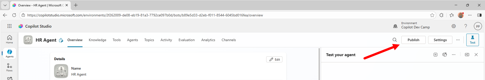

Selecting the command will prompt you for confirmation. While confirming the publishing, you can also choose if you want to **Force newest version**, which ensures users in Teams receive your latest updates right away.

If the agent has tools that use your credentials, the dialog also warns "Your agent runs tools that use the author's credentials". Once confirmed, the publishing process takes a while and in the meantime you see a "Publishing ..." message. Publishing an agent registers it in the target Power Platform environment, but does not make it available in any target platform.

In order to make the agent actually available in a specific target platform (channel), you need to 1️⃣ open **Channels** in the agent editor (it can sit under the **+5** menu at the end of the tab bar) and then you can choose one or more target channels to make the agent available for. For example, to publish the agent in Microsoft Teams, as a bot, you need to 2️⃣ select the **Microsoft 365 and Microsoft Teams** tile.

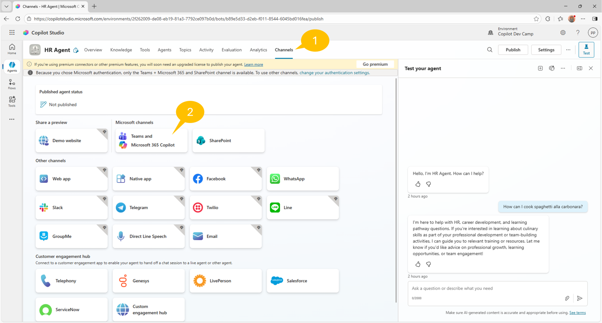

By default, when you make and agent and publish it with default settings, the agent will be configured for Microsoft authentication, which means that the agent will rely on Microsoft Entra ID authentication in Teams, Power Apps, or Microsoft 365 Copilot.
With the default authentication settings, the agent can only be published in **Microsoft Teams and Microsoft 365 Copilot** and **SharePoint** channels, as you can notice from the warning message displayed at the top of the **Channels** tab in the previous screenshot. 


> **Copilot Studio Authentication model:** You can learn more about authentication of agents in Copilot Studio reading the document [Configure user authentication in Copilot Studio](https://learn.microsoft.com/en-us/microsoft-copilot-studio/configuration-end-user-authentication).

> **Premium license for Microsoft Copilot Studio:** In the screenshot above, there is also an information bar about the licensing model and the potential requirement of a Premium license. In fact, when you use Copilot Studio  and you rely on premium features like premium connectors, you need to upgrade your license accordingly. Luckily, if you are just learning and testing with Microsoft Copilot Studio, you can activate a 60-days free trial period with the Premium license.

When you select the **Microsoft 365 and Microsoft Teams** channel, a side panel shows up with the checkbox **Make agent available in Microsoft 365 Copilot**, selected by default, and the **Add channel** button.

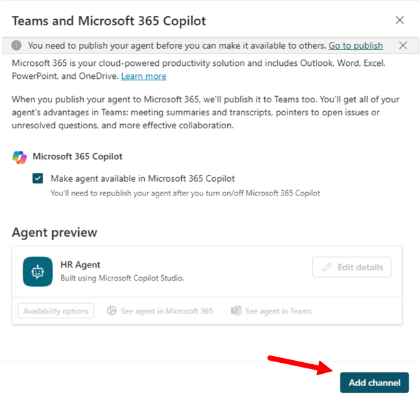

Once the agent is enabled on the Microsoft Teams channel, the side panel updates and shows a confirmation message, as well as few commands to edit the agent details and to open the agent in the Microsoft Teams client. There will also be a button **Availability options** that you can select to see the various options you have to access the agent in Microsoft Teams.

If you registered the channel to support Microsoft 365 Copilot, you can also select the link **See agent in Microsoft 365** to access the agent directly in the Microsoft 365 Copilot chat user experience.

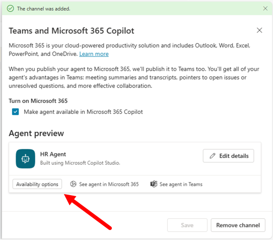

Selecting the **Availability options** button you can:

- Copy a link to use the agent in Microsoft Teams
- Download a ZIP file with a package that you can upload to the Teams app store
- Make the agent available in the Teams app store, choosing if it will be available to the whole organization or just to selected users


Publishing of the agent in Microsoft Temas is now completed.

> **Tip:** To learn more about publishing Microsoft Copilot Studio agents, you can refer to [Agent Academy - Recruit - Mission 11: Publish Your Agent](https://microsoft.github.io/agent-academy/recruit/11-publish-your-agent/).

### Step 2: Testing the agent in Microsoft Teams

You are now ready to test the agent in Microsoft Teams. In the **Availability options** panel select the **Copy link** button to copy a link to the agent. Then open a new browser tab and paste the just copied link, then press ENTER to browse to that URL. If Teams first offers the desktop app, select **Use the web app instead**.

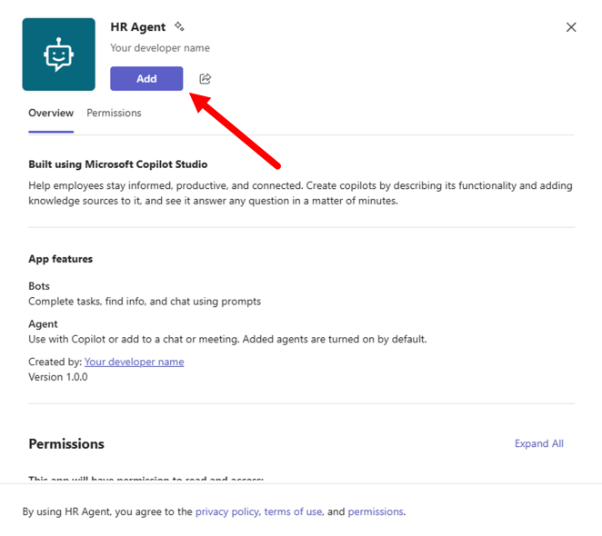

Initially you will see the Microsoft Teams client showing a new app that represents your agent. Select the **Add** button to add the app to your client and then select **Open** in the following dialog; **Open with Copilot** opens the agent in Microsoft 365 Copilot Chat instead.

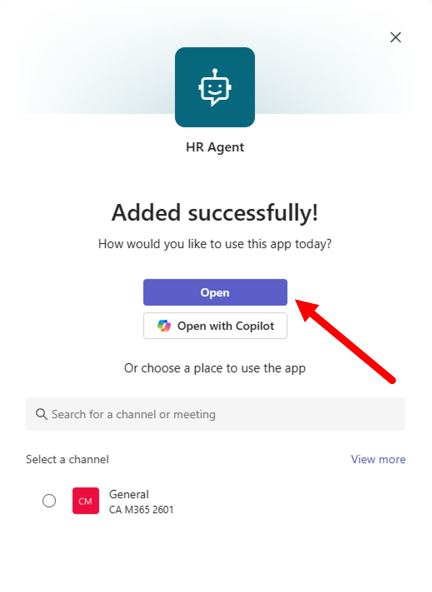

After a while, the Microsoft Teams client will show a chat with a bot, which is actually your agent. Provide a prompt, for example:

```txt
How can we hire new people in our company?
```

Wait for the answer and you will see that the agent will reply back to you with content in the context of HR and with references to the documents that are part of its knowledge base.

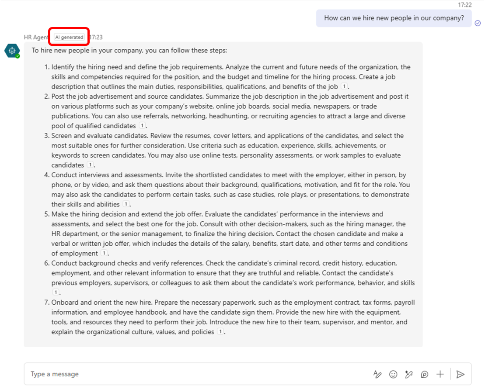

Notice also the **AI agent** label beside the sender name, which makes the user aware that she/he is talking to an AI agent.

Now your agent is fully functional and ready to be used in Microsoft Teams. In the next labs you will be able to customize and fine tune its behavior.

## Extend Microsoft 365 Copilot Chat with an Agent

In the next exercises, you are going to extend Microsoft 365 Copilot Chat with a second agent made in Microsoft Copilot Studio. So far you have seen how to create agents in Copilot Studio and how to consume them in Microsoft Teams. You have also seen that agents created in Microsoft Copilot Studio can target both Microsoft Teams and Microsoft 365 Copilot Chat through the **Microsoft 365 and Microsoft Teams** channel. Now you build an agent for Microsoft 365 Copilot Chat.

In these exercises you will learn:

- How to create an agent for Microsoft 365 Copilot Chat
- How to configure a custom icon for your agent
- How to publish the agent in Microsoft 365 Copilot Chat
- How to create a tool for Microsoft 365 Copilot Chat


## Exercise 2 : Creating an agent for Microsoft 365 Copilot Chat

In this exercise you are going to create an agent with Microsoft Copilot Studio and host it in Microsoft 365 Copilot Chat.

### Step 1: Creating an agent for Copilot Chat

On the **Home** page of Copilot Studio, under **Other ways to build**, select **Agent (Standard)**. The dialog **Name your agent** asks for the name (its **Agent settings** section is optional): enter `Agentic HR` and select **Create**.

On the **Overview** page, select **Edit** in **Instructions** and paste the following instructions, which combine the purpose, the goals and the tone of the agent:

```text
You are an agent helping employees to find information about HR policies and procedures, about how to improve their career, and about how to define learning pathways.
Emphasize everything that helps team building, inclusion, and the growth mindset.
It should have a professional tone.
```

Select **Save**. The **Overview** page shows the sections you configure in the next steps: **Details**, **Instructions**, **Knowledge** and **Tools**. On the right side of the screen, the **Test** pane lets you try the agent at any time.

### Step 2: Publishing the agent in Microsoft 365 Copilot Chat


Now you can publish and test the agent in Microsoft 365 Copilot Chat. 1️⃣ Select **Publish** in the upper right corner of the page, then **Publish** in the dialog. 2️⃣ Open **Channels**, select **Microsoft 365 and Microsoft Teams**, keep **Make agent available in Microsoft 365 Copilot** selected, and select **Add channel**. 3️⃣ Select **Edit details** to fill in the details of the app.

The details of the app are:

- Icon: **Change icon** and **Change color**; any background color works.
- Short description: short description of the agent (up to 80 characters).
- Long description: long description of the agent (up to 3400 characters).
- **Show an agent disclaimer in M365 Copilot**: a toggle that shows a disclaimer in Copilot Chat.

The panel has no fields for the developer name, website, privacy statement or terms of use, so Copilot Chat shows the agent as created by "Your developer name". Save the details. Initial publishing takes 30 to 60 seconds, and the **Availability options** panel recaps how users reach the agent.


Specifically, you can select:

- **Copy link** to copy a URL with a direct link to the app registered for the new agent.
- **Show to my teammates and shared users** to share the agent with selected groups or individuals in your organization.
- **Show to everyone in my org** to share the agent with the whole organization.
- **Download .zip file** to download a zip package of the app that you can then upload to the Microsoft 365 store.

> **Show to everyone in my org:** When you choose to show the agent to the whole organization, ensure your agent is ready for release and in compliance with company standards, rules, and policies. Coordinate with your teammates. Once the agent is submitted, it can't be resubmitted by others until an admin approves or rejects it. You can find additional details about publishing an app to the whole organization reading [Show to the organization](https://learn.microsoft.com/en-us/microsoft-copilot-studio/publication-add-bot-to-microsoft-teams#show-to-the-organization).

Select **Copy link**, open a new browser tab, and paste the URL with the direct link to the agent.
Teams opens the app (select **Use the web app instead** if it offers the desktop app first). Select **Add**, then **Open with Copilot** to open the agent in Microsoft 365 Copilot Chat.

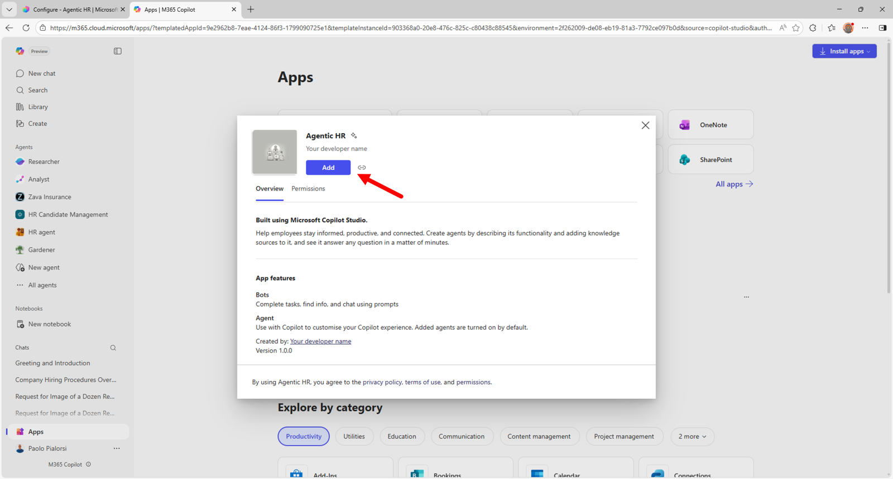

**Open with Copilot** opens the agent directly in Microsoft 365 Copilot Chat, like illustrated in the following screenshot.

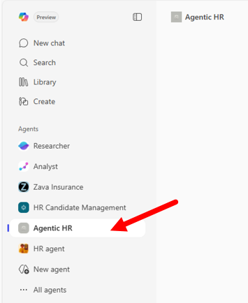

Start interacting with the agent. For example, you can provide the following prompt:

```txt
How can we hire new people in our company?
```

The agent answers from its instructions and general knowledge: it has no knowledge source of its own, so the answer carries no references to your documents. With **Web Search** on, the default for a new agent, it can still cite public web pages.

## Exercise 3 : Adding a tool to the agent

In this excercise you are going to add a custom tool to the agent that you made in the previous exercise. In Microsoft Copilot Studio, when making agents for Microsoft 365 Copilot Chat (Declarative Agents), you can add several types of tools, among them:

- Prompt: allows consuming an AI tool built using a prompt written in natural language.
- Connector: allows consuming a prebuilt Power Platform connector, such as Excel Online (Business).
- Custom connector: allows consuming a Power Platform custom connector.
- REST API: allows consuming an external REST API. You can find additional details [here](https://learn.microsoft.com/en-us/microsoft-copilot-studio/agent-extend-action-rest-api).

> **Tools for agents:** You can find additional information about adding tools to agents in Copilot Studio reading the article [Add tools to custom agents](https://learn.microsoft.com/en-us/microsoft-copilot-studio/advanced-plugin-actions).

In this lab you are going to add a tool of type `Connector`, the prebuilt Excel Online (Business) connector, in order to retrieve a list of candidates from an Excel spreadsheet stored in SharePoint Online.

### Step 1: Adding a tool to an agent for Microsoft 365 Copilot

To add a new tool, select the **Add tool** command in the **Tools** section of the agent's configuration panel.

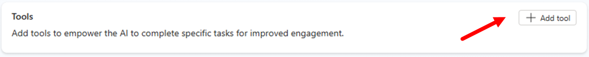

A dialog window pops up allowing you to choose what kind of tool to add. **Add new** tiles create a new tool from scratch with the options highlighted in the previous paragraphs, and chips such as **Popular**, **Connector** and **Prompt** filter the existing ones.

If you don't find the option you are looking for, simply search by text in the search box of the dialog.

To complete the current step, choose the tool **Excel** and then select **List rows present in a table**. If **Connection** reads **Not connected**, select **Create new connection**; in the **Connect to Excel Online (Business)** dialog the display name is optional, then pick your account.

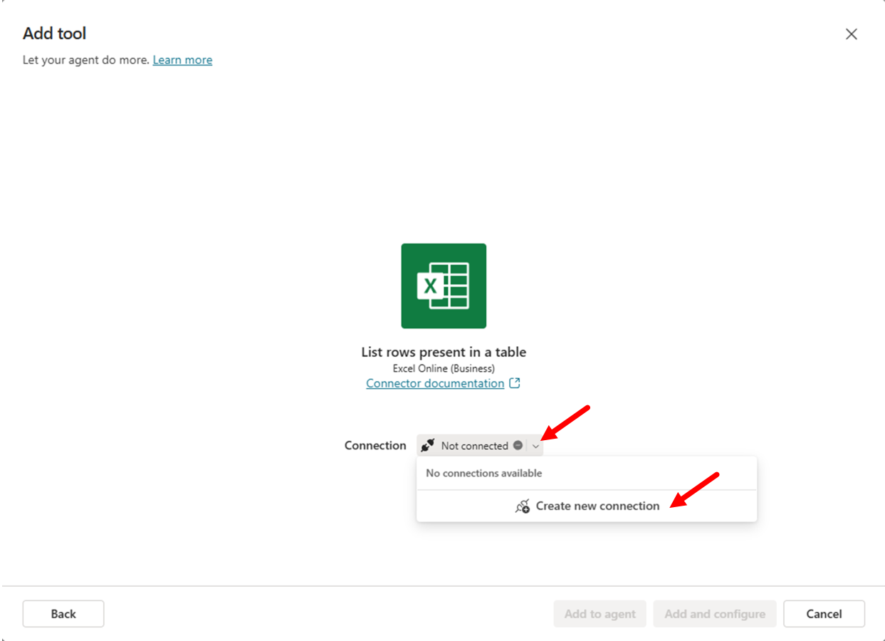

You will need to login with your account and to allow access to Excel Online (Business). Once the connection is configured, you will see a dialog with a command to **Add and configure** the tool.

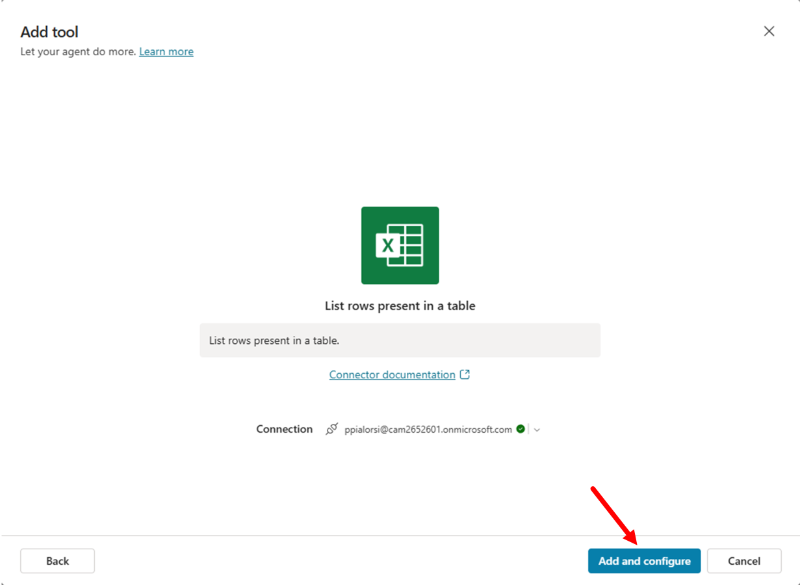

After adding the tool, you will get the list of tools in Copilot Studio. Click on the tool that you just created to edit its settings. In the configuration panel you need to provide:

- Name: a display name for the tool.
- Description: a description in natural language that will be used by generative orchestration to determine when to use your tool. 
- Inputs: to define the input arguments for the action, if any.
- Completion: defines how the action handles the request and response to the user.
- Completion: to specify what the agent does when it finishes using the tool.

Before configuring the tool, you need to prepare the Excel spreadsheet with the list of candidates.
Download a sample Excel file by selecting this [link](https://github.com/alexander-kastil/copilot-studio-agents/blob/master/src/assets/candidates/Sample-list-of-candidates.xlsx?raw=true).

Upload the file to the **Documents** library of a SharePoint Teams site in the same tenant where you are making your agent with Copilot Studio. The document was generated by Microsoft 365 Copilot for the sake of having a hypothetical list of candidates.

- Copy the absolute url of the site. For example: `https://xyz.sharepoint.com/sites/greylogistics/`.
- Copy the name of the document library. For example: `Documents`
- Copy also the name of the file. For example: `Sample-list-of-candidates.xlsx`

Now go back to Microsoft Copilot Studio and finalize the tool configuration.
In the dialog for editing the tool, update the **Name** and **Description** to give it more descriptive and informative settings. Use the following settings:

- Name: 

```txt
List HR candidates
```

- Description: 

```txt
List candidates for an HR role
```

Now, select the **Inputs** section and start configuring the input arguments. Check the **Fill using** property of each input argument: **Location**, **Document Library** and **File** may already default to `Custom value`, while **Table** defaults to `Dynamically fill with AI`, which extracts the value from the user's response.

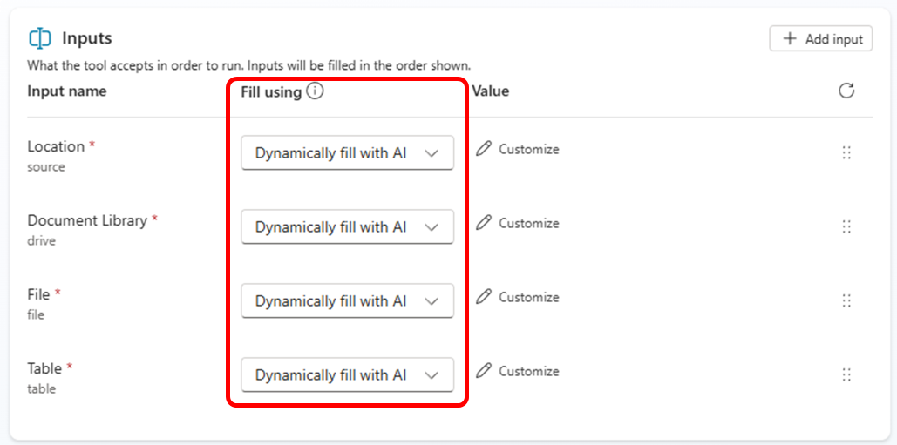

For each input argument, you will configure an explicit value. Select the **Fill using** field of the **Location** input argument, switch its value to `Custom value`, then using the dropdown list select the site collection where you stored the Excel spreadsheet with the list of candidates.

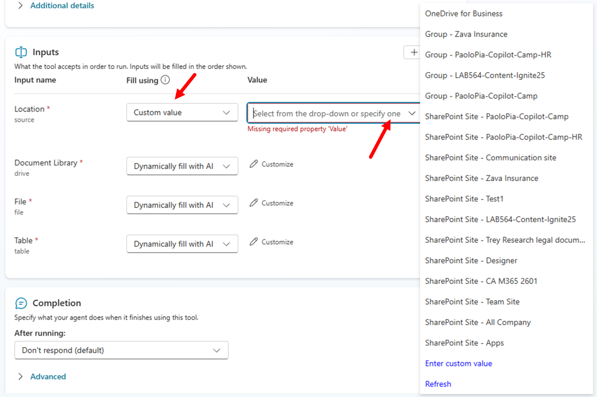

Now configure the **Document Library** input argument to `Custom value` and select the library where you stored the Excel file. Configure the **File** input argument to `Custom value` and browse for the Excel file. Lastly, configure **Table** to `Custom value` and select the table with name `Candidates_Table`. Once you are done with the settings, the input arguments should look like in the following screenshot.

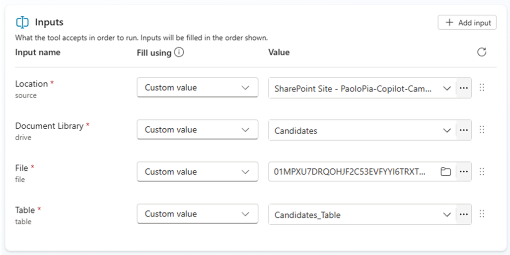

Now select the **Save** button in the upper right corner of the screen to save the updated tool.

### Step 2: Testing the new tool

You are now ready to publish the updated agent and to play with it in the integrated test panel or in Microsoft Teams.

Select the **Publish** button again, to update the publishing of the agent. Wait for the publishing to complete and then open again the direct link to the agent's app. If the app shows an **Update now** command instead of **Add**, select it and wait; if it shows only **Open**, the update is already in place. Once ready, go to Microsoft 365 Copilot Chat, refresh the page and start interacting with the updated agent.

It is really easy to invoke the just created tool simply providing to the agent a prompt like the following one:

```txt
Show me the list of candidates for HR with role "HR Director" or "HR Manager"
```


Microsoft 365 Copilot Chat asks your permission to consume an external API (Excel Online) with a **Connect to continue** card for **List rows present in a table**. Select **Allow**.

Since the Power Platform connector requires a valid connection in place, the agent might prompt the user to **Sign in to Agentic HR** before being able to consume the external data source; when the connection already exists, no sign-in appears.
Once you are connected to the external connector, the agent will reply back providing the list of candidates retrieved from the Excel spreadsheet and matching the criteria that you provided in the prompt.

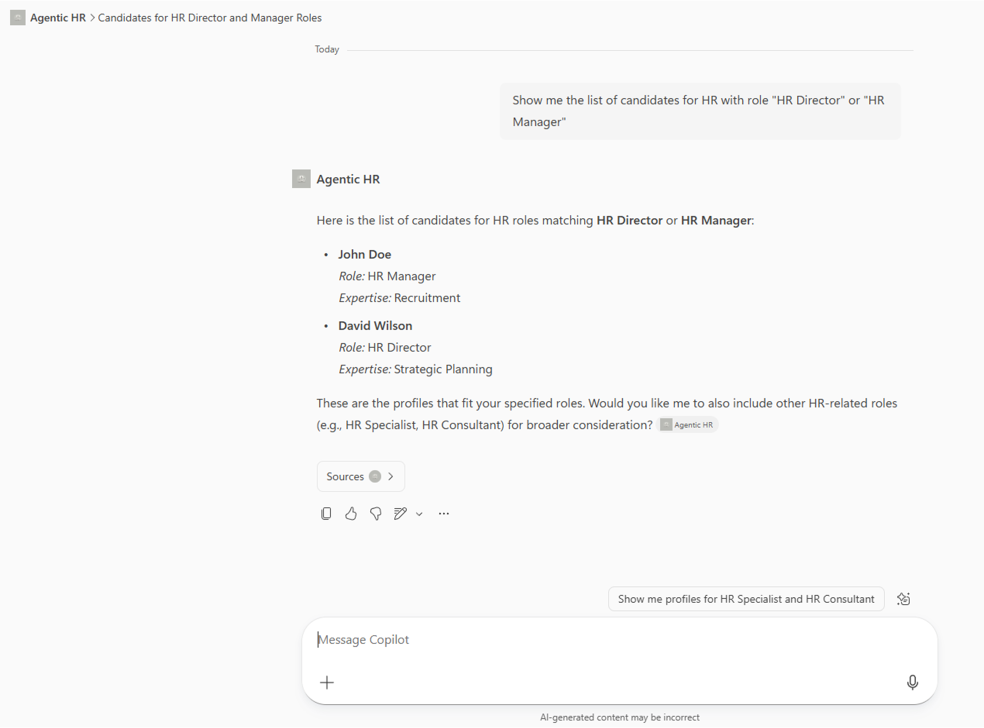

Well done! You were able to consume an external connector from a Copilot Studio agent made for Microsoft 365 Copilot!

> **Tip:** To learn more about creating Declarative Agents for Microsoft 365 Copilot with Microsoft Copilot Studio, you can refer to [Agent Academy - Recruit - Mission 03: Deploy a Declarative Agent for Microsoft 365 Copilot](https://microsoft.github.io/agent-academy/recruit/03-create-a-declarative-agent-for-M365Copilot/).

Continue with [Define Tools with Power Platform Connectors](../../04-cs-tools/03-connectors/lab-01-connector-and-flow-tools.md).
