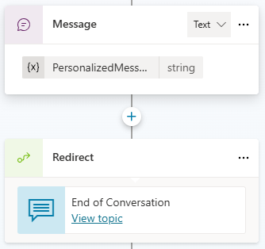
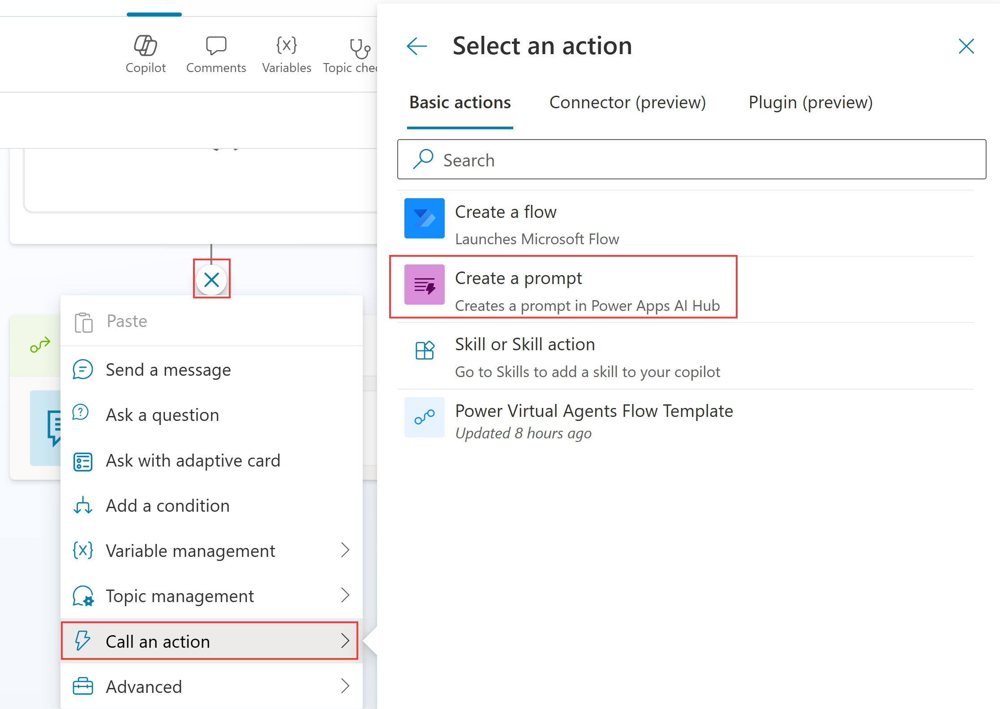
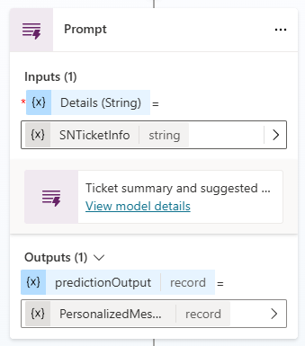
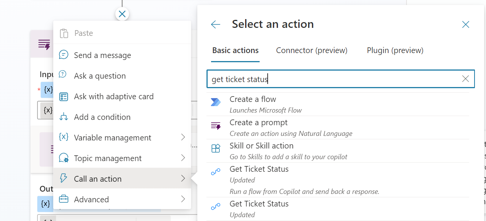
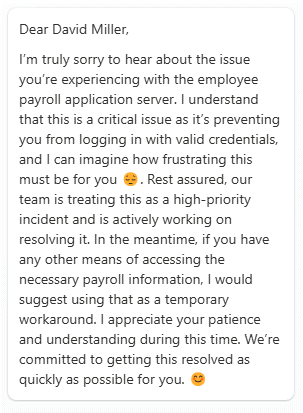

# Prompts aus einem Copilot Studio Agent aufrufen

## Voraussetzungen

Die Labs sind so gebaut, dass Sie sie allein mit einer Testversion von Microsoft Copilot Studio absolvieren. Die meisten Labs starten Sie, ohne das vorige Modul abgeschlossen zu haben, einige Übungen verweisen aber auf frühere Labs. Um alle Features und Funktionen des Produkts zu erleben, erfüllen Sie am besten alle folgenden Voraussetzungen, bevor Sie mit diesem Lab beginnen.

Für dieses Lab brauchen Sie:

- Einen Computer mit Internetzugang.
- Zugang zum bereitgestellten Microsoft Tenant (manche Unternehmen erlauben Usern nur die Verbindung zum eigenen Firmen-Tenant) oder Ihren eigenen Enterprise Tenant mit einer Copilot Studio User License (oder Testversion).
- Einen Agent, den Sie bearbeiten dürfen, zum Beispiel den HR Agent. Wenn Sie keinen haben, erstellen Sie einen: Wählen Sie auf **Home** den Befehl **Other ways to build**, dann den Eintrag **Agent** mit dem Badge **Standard**, und nennen Sie ihn `HR Agent`. Aufgabe 1 fügt ihm das Topic **Check Ticket Status** mit Beispiel-Ticketdaten hinzu, eine ServiceNow-Instanz brauchen Sie also nicht.
- Authentication auf "Authenticate with Microsoft" gesetzt (unter Settings, Security, Authentication).

## AI Builder Prompts

Stellen Sie sich einen Prompt als Aufgabe oder Ziel vor, das Sie dem Large Language Model (LLM) geben. Mit dem Prompt Builder erstellen, testen und speichern Sie eigene Prompts und liefern über Input-Variablen zur Laufzeit dynamische Kontextdaten. Diese Prompts teilen Sie mit anderen und nutzen sie in Power Automate, Power Apps oder Copilot Studio. Sie könnten zum Beispiel einen Prompt bauen, der Action Items aus den E-Mails Ihres Unternehmens herausfiltert, und ihn in einem Power Automate Flow für eine Automation der E-Mail-Verarbeitung nutzen.

Mit dem Prompt Builder entwerfen Maker in natürlicher Sprache eigene Prompts, die genau auf ihre Business-Anforderungen passen. Diese Prompts setzen Sie für viele Aufgaben oder Business-Szenarien ein, etwa um Inhalte zusammenzufassen, Daten zu kategorisieren, Entities zu extrahieren, Sprachen zu übersetzen, Sentiment zu bewerten oder eine Antwort auf eine Beschwerde zu formulieren.

Prompts lassen sich in Flows einbinden, um intelligente Automation ohne manuelle Eingriffe zu bauen. Maker bauen außerdem fortgeschrittene Generative AI Fähigkeiten für ihre Anwendungen, indem sie diese als Prompts in natürlicher Sprache beschreiben. Mit diesen Prompts erweitern Sie einen eigenen Copilot, vereinfachen Ihre täglichen Business-Abläufe und steigern die Effizienz."

Mit Custom Prompts weisen Maker das GPT Model an, sich auf eine bestimmte Weise zu verhalten oder eine bestimmte Aufgabe zu erledigen. Mit einem sorgfältig formulierten Prompt erzeugen Sie Antworten, die zu Ihren Business-Anforderungen passen. So wird das GPT Model zu einem flexiblen Tool für ganz unterschiedliche Aufgaben.

### Aufgabe 1: Das Topic Check Ticket Status erstellen

Das Topic ersetzt eine ServiceNow-Abfrage: Es speichert ein Beispiel-Ticket als JSON-Text in der Variable `SNTicketInfo` und zeigt das Ticket in einer Adaptive Card.

1. Öffnen Sie Ihren Agent, gehen Sie zu **Topics** und wählen Sie **+ Add a topic** > **From blank**.
2. Wählen Sie den Topic-Namen oben im Canvas und benennen Sie ihn um in:

```text
Check Ticket Status
```

3. Geben Sie im Feld **Describe what the topic does** des Triggers ein:

```text
Shows the status of the user's support ticket when they ask about their ticket.
```

4. Wählen Sie **Add node** (+) > **Variable management** > **Set a variable value**. Wählen Sie unter **Set variable** den Eintrag **Create a new variable** und benennen Sie die Variable unter **Variable properties** in `SNTicketInfo` um.
5. Wählen Sie bei **To value** das Symbol **>**, öffnen Sie den Tab **Formula**, fügen Sie die folgende Formel ein und wählen Sie **Insert**. `JSON` macht aus dem Record Text, damit ist `SNTicketInfo` ein String, den ein Prompt Input annimmt.

```powerfx
JSON({
  number: "INC0010042",
  short_description: "VPN connection drops every hour",
  state: "In Progress",
  priority: "2 - High",
  assigned_to: "Maria Keller",
  opened_by: "Alex Berger",
  opened_at: "2026-10-28 09:14:00",
  comments: "We have reproduced the issue and are testing a new VPN client build."
})
```

6. Wählen Sie **Add node** (+) > **Send a message**. Wählen Sie oben links in der Message **+ Add** und dann **Adaptive card**.
7. Wählen Sie im Seitenpanel **Edit adaptive card**, fügen Sie das folgende JSON in den **Card payload editor** ein und wählen Sie **Save** und dann **Close**.

```json
{
  "type": "AdaptiveCard",
  "$schema": "http://adaptivecards.io/schemas/adaptive-card.json",
  "version": "1.5",
  "body": [
    {
      "type": "TextBlock",
      "text": "Ticket INC0010042",
      "weight": "Bolder",
      "size": "Medium"
    },
    {
      "type": "TextBlock",
      "text": "VPN connection drops every hour",
      "wrap": true
    },
    {
      "type": "FactSet",
      "facts": [
        { "title": "State", "value": "In Progress" },
        { "title": "Priority", "value": "2 - High" },
        { "title": "Assigned to", "value": "Maria Keller" },
        { "title": "Opened by", "value": "Alex Berger" },
        { "title": "Opened at", "value": "2026-10-28 09:14:00" }
      ]
    }
  ]
}
```

8. Speichern Sie das Topic.

### Aufgabe 2: Einen Prompt zum Zusammenfassen von Text erstellen


1. Öffnen Sie **Topics** und dann **Check Ticket Status**.
2. Fügen Sie nach der letzten Message mit einer Adaptive Card über die Schaltfläche (+) einen weiteren Node hinzu. Wählen Sie **Add a tool** und im Panel **Add a tool** den Eintrag **New prompt**.



3. Das Feld **Prompt name** im Titel des Dialogs ist mit "Custom prompt" und einem Datum vorausgefüllt. Leeren Sie es und geben Sie ein:

```text
Ticket customer communication
```

4. Wählen Sie **Add content** > **Text**, um einen Input hinzuzufügen, und benennen Sie **Text input** in den folgenden Namen um. **Add content** fügt den Input sofort in die Instructions ein.

```text
Ticket Details
```

5. Fügen Sie die Prompt Instructions in die Instructions ein. Tippen Sie unter dem Abschnitt `## Ticket details` **/** oder nutzen Sie **Add content** und wählen Sie den vorhandenen Input **Ticket Details**.

```text
Write a short, friendly message to the customer about the status of their support ticket. Mention the ticket number, the current state, who is working on it and the latest comment.

## Ticket details
```
6. Öffnen Sie das Dropdown **Model** im Header **Instructions** und wählen Sie **GPT-4.1**. Die Liste bietet GPT-4o nicht mehr an.
7. Testen Sie Ihren Prompt: Fügen Sie das Beispiel-JSON-Payload in die Input-Beispieldaten ein und wählen Sie **Test prompt**.

```json
{
  "number": "INC0010042",
  "short_description": "VPN connection drops every hour",
  "state": "In Progress",
  "priority": "2 - High",
  "assigned_to": "Maria Keller",
  "opened_by": "Alex Berger",
  "opened_at": "2026-10-28 09:14:00",
  "comments": "We have reproduced the issue and are testing a new VPN client build."
}
```



8. Speichern Sie den Prompt. Copilot Studio fügt ihn beim Speichern Ihrem Topic hinzu. Ist das nicht der Fall, wählen Sie das Symbol (+), **Add a tool** und Ihren neu erstellten Prompt.



9. Wählen Sie die Variable `SNTicketInfo` für den Input **Ticket Details**.
10. Wählen Sie im Prompt Node unter **Outputs** die Variable für **predictionOutput** > **Create a new variable** und benennen Sie sie unter **Variable properties** in `PersonalizedMessage` um. Der Output ist ein Record, deshalb nutzt der nächste Schritt `.text`.


11. Wählen Sie **Add node** (+) > **Send a message** und dann **Insert variable** > `PersonalizedMessage.text`.



12. Speichern Sie das Topic, öffnen Sie den Test Pane und fragen Sie:

```text
What is the status of my ticket?
```

Erwartet: Der Agent antwortet mit einer persönlichen Nachricht zum Ticket, zum Beispiel "Hello Alex, Your support ticket INC0010042 ..." mit Maria Keller als der Person, die daran arbeitet.



## Zusammenfassung

Danke, dass Sie das Lab ‘Use generative AI orchestration to interact with your connectors abgeschlossen haben. Sie haben erfolgreich:

einen Custom Prompt in Copilot Studio erstellt

Inputs übergeben und den Output als generierte Antwort für den End User genutzt

## Nutzungsbedingungen

Indem Sie dieses Dokument ganz oder teilweise nutzen, stimmen Sie den folgenden Bedingungen zu:

### Hinweis

Die in diesem Dokument geäußerten Informationen und Ansichten, einschließlich (ohne Einschränkung) URLs und anderer Verweise auf Internet-Websites, können sich ohne Ankündigung ändern. Die hier gezeigten Beispiele dienen, sofern vorhanden, nur der Veranschaulichung und sind fiktiv. Eine echte Verbindung oder Zugehörigkeit ist weder beabsichtigt noch daraus abzuleiten. Dieses Dokument gewährt Ihnen keine Rechte am geistigen Eigentum eines Microsoft-Produkts.

### Nutzungseinschränkungen

Das Kopieren oder Vervielfältigen dieses Dokuments, ganz oder teilweise, auf einen anderen Server oder an einen anderen Ort zur weiteren Vervielfältigung oder Weitergabe ist ausdrücklich untersagt. Microsoft stellt Ihnen dieses Dokument bereit, um Ihre Anregungen, Kommentare, Beiträge, Ideen oder Ihr Know-how in jeder Form ("Feedback") zu erhalten und Ihnen eine Lernerfahrung zu bieten. Sie dürfen dieses Dokument nur nutzen, um seinen Inhalt zu bewerten und Microsoft Feedback zu geben, und für keinen anderen Zweck. Sie dürfen dieses Dokument oder Teile davon nicht ändern, kopieren, verbreiten, übermitteln, anzeigen, aufführen, vervielfältigen, veröffentlichen, lizenzieren, als Grundlage abgeleiteter Werke nutzen, übertragen oder verkaufen; Sie dürfen es nur für interne Referenzzwecke kopieren und nutzen.

### Feedback

Wenn Sie Microsoft Feedback zu diesem Dokument oder seinem Gegenstand geben (einschließlich, ohne Einschränkung, Technologien, Features, Funktionen und/oder Konzepte), räumen Sie Microsoft kostenlos das Recht ein, das Feedback auf jede Weise und für jeden Zweck zu nutzen, zu teilen und kommerziell zu verwerten. Sie räumen außerdem Dritten kostenlos das Recht ein, Microsoft-Produkte oder -Services, die das Feedback enthalten, zu nutzen oder mit ihnen zu interagieren. Sie sichern zu und gewährleisten, dass Ihnen dieses Feedback gehört oder Sie anderweitig darüber verfügen und dass es keinen Rechten Dritter unterliegt.
