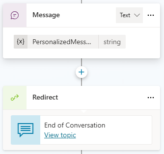
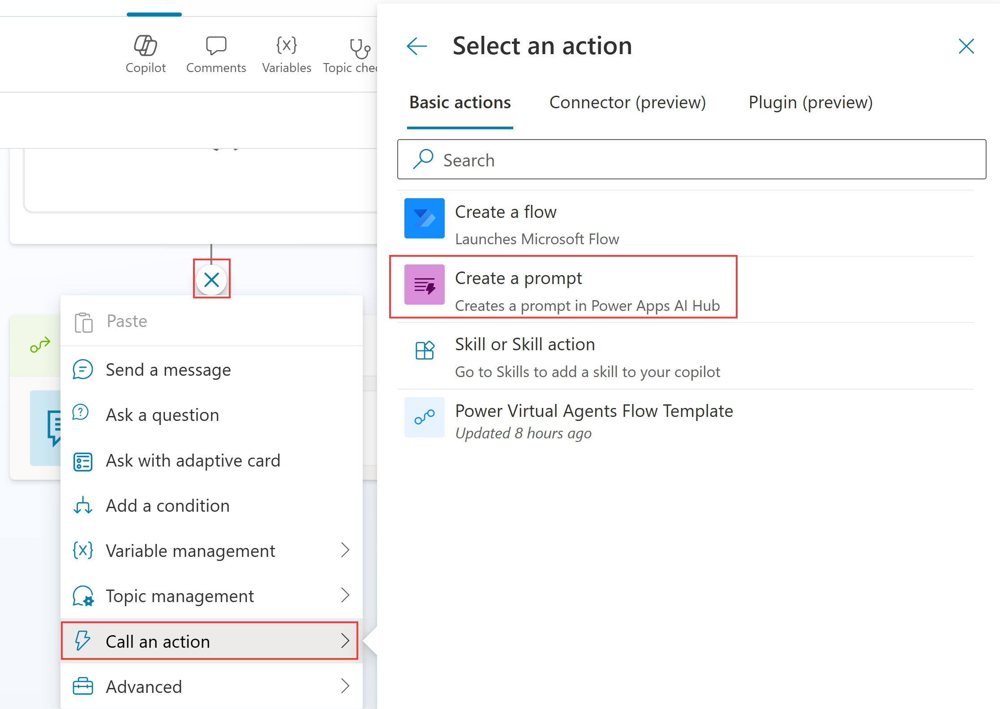
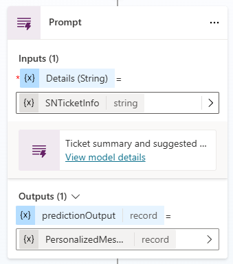
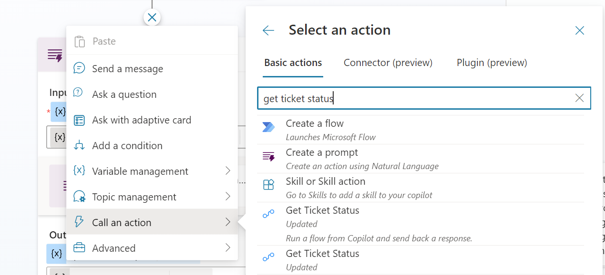
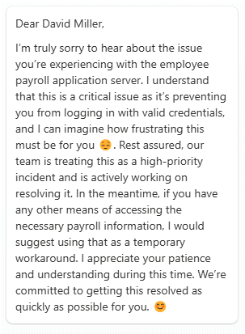

# Invoke Prompts from a Copilot Studio Agent

## Prerequisites

Labs have been designed to be completed with only a Microsoft Copilot Studio trial. You can start most labs without having to complete the previous module but note that some exercises may reference previous labs. To fully experience the features and functionality of the product, it is recommended that you make sure to have completed all pre-requisites below before starting this lab.

For this lab you need:

- A computer with internet access.
- Access to the provided Microsoft tenant (some companies enforce users to only connect to their company tenant) or your own enterprise tenant with a Copilot Studio User License (or trial).
- An agent you can edit, for example the HR agent from the earlier labs. Task 1 adds the topic **Check Ticket Status** to it with sample ticket data, so no ServiceNow instance is needed.
- Authentication set to "Authenticate with Microsoft" (in Settings, Security, Authentication).

## AI Builder prompts

Think of a prompt as a task or a goal you give to the large language model (LLM). With prompt builder, you can build, test, and save your custom prompts. You can also use input variables to provide dynamic context data at runtime. You can share these prompts with others and use them in Power Automate, Power Apps, or Copilot Studio. For instance, you could make a prompt to pick out action items from your company emails and use it in a Power Automate flow to build an email processing automation.

Prompt builder enables makers to devise custom prompts that cater to their specific business needs using natural language. These prompts can be employed for many tasks or business scenarios, such as summarizing content, categorizing data, extracting entities, translating languages, assessing sentiment, or formulating a response to a complaint.

Prompts can be integrated into flows to build intelligent hands-off automation. Makers can also build advanced generative AI capabilities for their applications by describing them as natural language prompts. These prompts can be used to extend a custom Copilot, thereby streamlining your daily business operations and boosting efficiency."

Custom prompts give makers the freedom to instruct the GPT model to behave in a certain way or to perform a specific task. By carefully crafting a prompt, you can generate responses that suit your specific business needs. This transforms the GPT model into a flexible tool to accomplish various tasks.

### Task 1: Create the Check Ticket Status topic

The topic stands in for a ServiceNow lookup: it stores a sample ticket as JSON text in the variable `SNTicketInfo` and shows the ticket in an Adaptive Card.

1. Open your agent, go to **Topics**, and select **+ Add a topic** > **From blank**.
2. Select the topic name at the top of the canvas and rename it to:

```text
Check Ticket Status
```

3. In the **Describe what the topic does** box of the trigger, enter:

```text
Shows the status of the user's support ticket when they ask about their ticket.
```

4. Select **Add node** (+) > **Variable management** > **Set a variable value**. Under **Set variable**, select **Create a new variable**, then rename it to `SNTicketInfo` in **Variable properties**.
5. In **To value**, select **>**, open the **Formula** tab, paste the formula below, and select **Insert**. `JSON` turns the record into text, so `SNTicketInfo` is a string that a prompt input accepts.

```powerfx
JSON({
  number: "INC0010042",
  short_description: "VPN connection drops every hour",
  state: "In Progress",
  priority: "2 - High",
  assigned_to: "Maria Keller",
  opened_by: "Alex Berger",
  opened_at: "2026-10-28 09:14:00",
  comments: "We have reproduced the issue and are testing a new VPN client build."
})
```

6. Select **Add node** (+) > **Send a message**. Select **+ Add** in the upper left corner of the message and select **Adaptive card**.
7. In the side panel, select **Edit adaptive card**, paste the JSON below into the **Card payload editor**, then select **Save** and **Close**.

```json
{
  "type": "AdaptiveCard",
  "$schema": "http://adaptivecards.io/schemas/adaptive-card.json",
  "version": "1.5",
  "body": [
    {
      "type": "TextBlock",
      "text": "Ticket INC0010042",
      "weight": "Bolder",
      "size": "Medium"
    },
    {
      "type": "TextBlock",
      "text": "VPN connection drops every hour",
      "wrap": true
    },
    {
      "type": "FactSet",
      "facts": [
        { "title": "State", "value": "In Progress" },
        { "title": "Priority", "value": "2 - High" },
        { "title": "Assigned to", "value": "Maria Keller" },
        { "title": "Opened by", "value": "Alex Berger" },
        { "title": "Opened at", "value": "2026-10-28 09:14:00" }
      ]
    }
  ]
}
```

8. Save the topic.

### Task 2: Create a prompt to summarize text


1. Go to **Topics**, and open **Check Ticket Status**.
2. After the last message that contains an Adaptive Card, add another node with the (+) button. Choose **Add a tool**, and in the **Add a tool** panel select **New prompt**.



3. The **Prompt name** field in the dialog title is prefilled with "Custom prompt" and a date. Clear it and enter:

```text
Ticket customer communication
```

4. Select **Add content** > **Text** to add an input, and rename **Text input** to the name below. **Add content** inserts the input into the instructions straight away.

```text
Ticket Details
```

5. In the instructions, paste the prompt instructions. Under the `## Ticket details` section, type **/** or use **Add content** and pick the existing **Ticket Details** input.

```text
Write a short, friendly message to the customer about the status of their support ticket. Mention the ticket number, the current state, who is working on it and the latest comment.

## Ticket details
```
6. Open the **Model** dropdown in the **Instructions** header and choose **GPT-4.1**. The list no longer offers GPT-4o.
7. Test your prompt by pasting the sample JSON payload in the input sample data and selecting **Test prompt**.

```json
{
  "number": "INC0010042",
  "short_description": "VPN connection drops every hour",
  "state": "In Progress",
  "priority": "2 - High",
  "assigned_to": "Maria Keller",
  "opened_by": "Alex Berger",
  "opened_at": "2026-10-28 09:14:00",
  "comments": "We have reproduced the issue and are testing a new VPN client build."
}
```



8. Save the prompt. It is added to your topic once you save it. If this is not the case, select the (+) icon, **Add a tool**, and select your newly created prompt.



9. Select the `SNTicketInfo` variable for the **Ticket Details** input.
10. In the Prompt node, under **Outputs**, select the variable for **predictionOutput** > **Create a new variable**, then rename it to `PersonalizedMessage` in **Variable properties**. The output is a record, which is why the next step uses `.text`.


11. Select **Add node** (+) > **Send a message**, then **Insert variable** > `PersonalizedMessage.text`.



12. Save the topic, open the test pane, and ask:

```text
What is the status of my ticket?
```

Expected: the agent answers with a personalized message about the ticket, for example "Hello Alex, Your support ticket INC0010042 ..." with Maria Keller as the person working on it.



## Summary

Thank you for completing the lab ‘Use generative AI orchestration to interact with your connectors. You have successfully:

Created a custom prompt from Copilot Studio

Passed inputs and used output as a generated answer for the end-user

## Terms of Use

By using this document, in whole or in part, you agree to the following terms:

### Notice

Information and views expressed in this document, including (without limitation) URL and other Internet Web site references, may change without notice. Examples depicted herein, if any, are provided for illustration only and are fictitious. No real association or connection is intended or should be inferred. This document does not provide you with any legal rights to any intellectual property in any Microsoft product.

### Use Limitations

Copying or reproduction, in whole or in part, of this document to any other server or location for further reproduction or redistribution is expressly prohibited. Microsoft provides you with this document for purposes of obtaining your suggestions, comments, input, ideas, or know-how, in any form, ("Feedback") and to provide you with a learning experience. You may use this document only to evaluate its content and provide feedback to Microsoft. You may not use this document for any other purpose. You may not modify, copy, distribute, transmit, display, perform, reproduce, publish, license, create derivative works from, transfer, or sell this document or any portion thereof. You may copy and use this document for your internal, reference purposes only.

### Feedback

If you give Microsoft any Feedback about this document or the subject matter herein (including, without limitation, any technology, features, functionality, and/or concepts), you give to Microsoft, without charge, the right to use, share, and freely commercialize Feedback in any way and for any purpose. You also give third parties, without charge, the right to use, or interface with, any Microsoft products or services that include the Feedback. You represent and warrant that you own or otherwise control all rights to such Feedback and that no such Feedback is subject to any third-party rights.
