# Tools mit Power Platform Connectors definieren

In diesem Lab lernen Sie, wie Sie Tools in Microsoft Copilot Studio erstellen. Tools sind ein weiterer zentraler Baustein eines Agents. Mit Tools erweitern Sie die Fähigkeiten Ihres Agents um externe Power Platform Connectors (native oder custom), externe REST APIs, Power Automate Flows, MCP (Model Context Protocol) Server usw.


> **Hinweis:** Dieses Lab baut auf dem vorigen auf, [Topics, Entities und Variables definieren](../../03-cs-basics/03-topics/lab-01-build-topics-de.md). Sie arbeiten am selben Agent weiter und erweitern ihn um neue Fähigkeiten.

Tools erstellen Sie mit einem grafischen Designer. Sobald ein neues Tool existiert, bearbeiten Sie seine Definition bei Bedarf auch in einem Low-Level Code Editor, wenn Sie Details feinjustieren müssen.

In diesem Lab lernen Sie:

- Wie Sie ein Tool erstellen, das einen Power Platform Connector aufruft
- Wie Sie ein Tool erstellen, das einen Power Automate Flow aufruft
- Wie Sie Tools aus Topics aufrufen

## Übung 1: Tools in Microsoft Copilot Studio erstellen

In dieser Übung erweitern Sie den Agent aus [Topics, Entities und Variables definieren](../../03-cs-basics/03-topics/lab-01-build-topics-de.md): Er liest über Excel Online eine fiktive Liste von Kandidatinnen und Kandidaten aus einer Excel-Tabelle, die in einer SharePoint Online Dokumentbibliothek liegt. Danach fügen Sie ein Tool hinzu, das einen Power Automate Flow aufruft und neue Kandidatinnen und Kandidaten in dieselbe Tabelle einträgt.


### Schritt 1: Einen Power Platform Connector nutzen

Um ein neues Tool zu erstellen, wählen Sie oben im Bildschirm den Tab 1️⃣ **Tools** und dann 2️⃣ **+ Add a tool**.

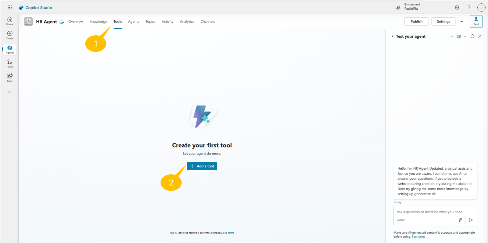

Ein Dialog mit dem Titel **Add tool** öffnet sich, in dem Sie die Art des Tools wählen. Standardmäßig zeigt der Tab **Popular** Tools, etwa für Inhalte in Excel Online oder andere gängige Services. 

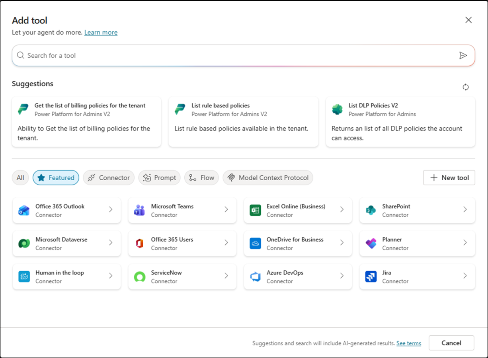

Ein neues Tool erstellen Sie auch von Grund auf, über die Kacheln **Add new** (**Computer use**, **Workflows**, **Prompt**, **MCP**) oder über **See more** mit diesen Optionen:

- Prompt: nutzt ein AI Tool, das auf einem in natürlicher Sprache geschriebenen Prompt beruht.
- Agent flow: nutzt einen Power Automate Flow (siehe [Schritt 3](#schritt-3-einen-agent-flow-nutzen)).
- Computer use: Ihr Agent bedient Web- und Desktop-Apps direkt.
- Custom connector: nutzt einen Power Platform Custom Connector.
- REST API: nutzt eine externe REST API. Weitere Details finden Sie [hier](https://learn.microsoft.com/en-us/microsoft-copilot-studio/agent-extend-action-rest-api).
- Model Context Protocol: nutzt Tools eines externen Model Context Protocol (MCP) Servers.

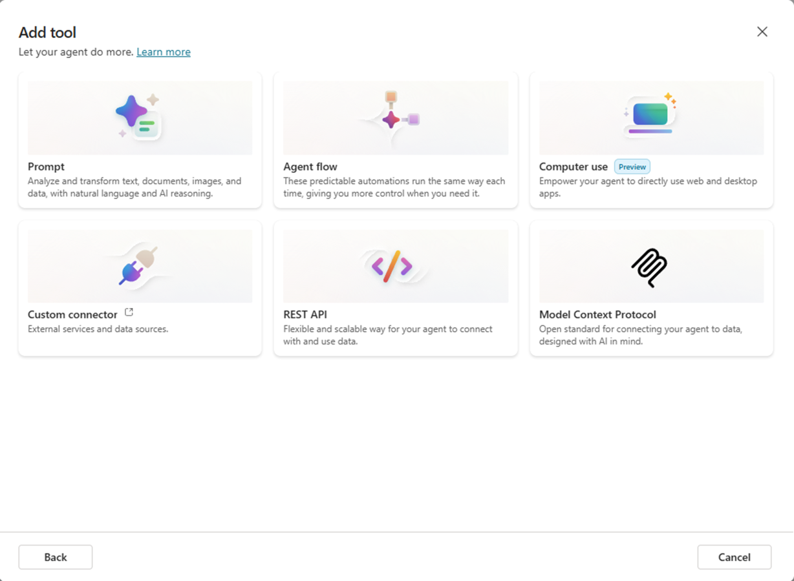

Finden Sie die gesuchte Option nicht in der Liste der beliebten Einträge, wechseln Sie einfach zur Gruppe **All** und suchen Sie per Text danach.

Um diesen Schritt abzuschließen, wählen Sie das Tool **Excel Online (Business)** und dann **List rows present in a table**. Zuerst verbinden Sie sich mit dem externen Connector: Wählen Sie **Connection** und dann **Create new connection**. Ein Dialog **Connect to Excel Online (Business)** fragt nach einem optionalen **Display name**, danach öffnet sich eine Kontoauswahl.

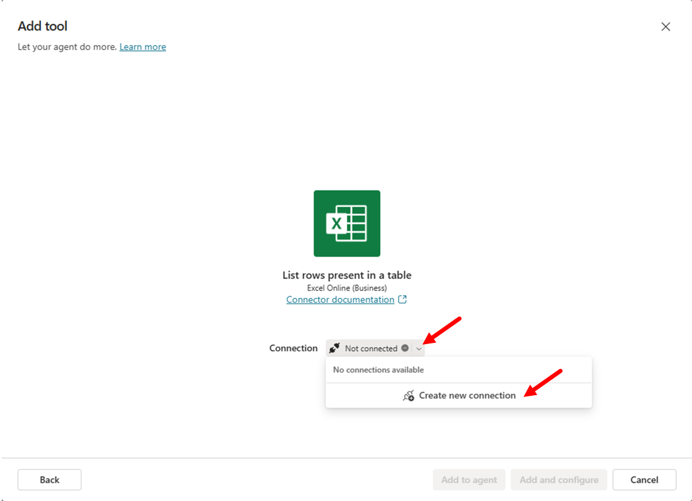

Melden Sie sich mit Ihrem Konto an und erlauben Sie den Zugriff auf Excel Online (Business). Sobald die Connection konfiguriert ist, wählen Sie **Add and configure**, um das Tool hinzuzufügen und seine Einstellungen zu öffnen.

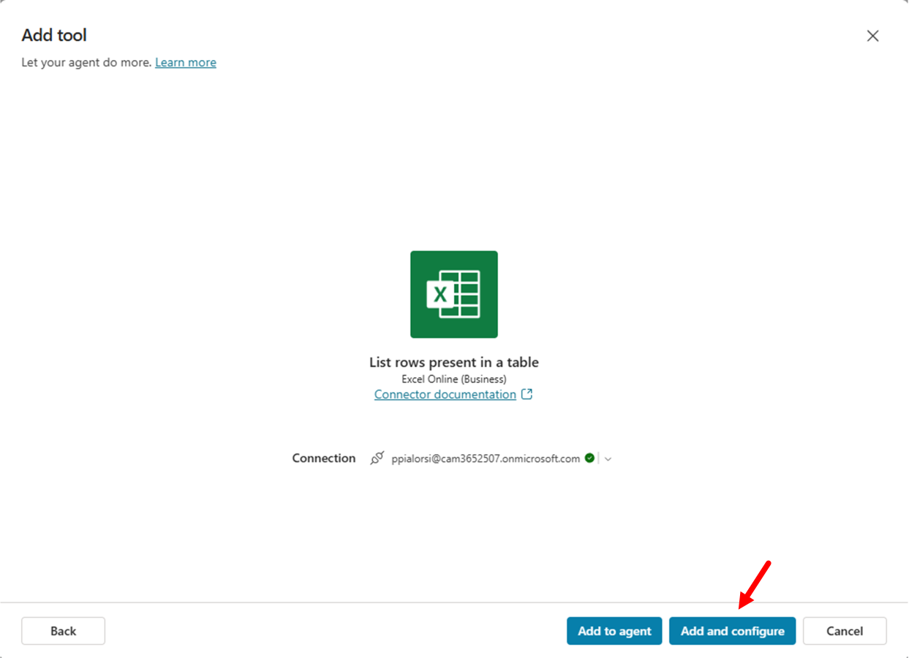

Danach öffnet sich eine Seite, auf der Sie das Tool konfigurieren. Dort geben Sie an:

- Name: ein beschreibender Name für das Tool.
- Description: eine Beschreibung in natürlicher Sprache, anhand derer Generative Orchestration entscheidet, wann sie Ihr Tool nutzt. 
- Inputs: die Input-Argumente des Tools, falls es welche gibt.
- Completion: legt fest, wie das Tool Request und Response an den User behandelt.

Bevor Sie das Tool konfigurieren, bereiten Sie die Excel-Tabelle mit der Liste der Kandidatinnen und Kandidaten vor.
Laden Sie über diesen [Link](https://github.com/microsoft/copilot-camp/blob/main/src/make/copilot-studio/Candidates/Sample-list-of-candidates.xlsx?raw=true) eine Excel-Beispieldatei herunter.

Laden Sie die heruntergeladene Datei selbst in die Bibliothek **Documents** einer SharePoint Teams Site im selben Tenant hoch, in dem Sie Ihren Agent mit Copilot Studio bauen. Microsoft 365 Copilot hat das Dokument erzeugt, damit eine fiktive Liste von Kandidatinnen und Kandidaten vorliegt.

- Kopieren Sie die absolute URL der Site, zum Beispiel: `https://xyz.sharepoint.com/sites/greylogistics/`.
- Kopieren Sie den Namen der Dokumentbibliothek, zum Beispiel: `Shared documents`
- Kopieren Sie auch den Namen der Datei, zum Beispiel: `Sample-list-of-candidates.xlsx`

Kehren Sie jetzt zu Microsoft Copilot Studio zurück und schließen Sie die Konfiguration des Tools ab.

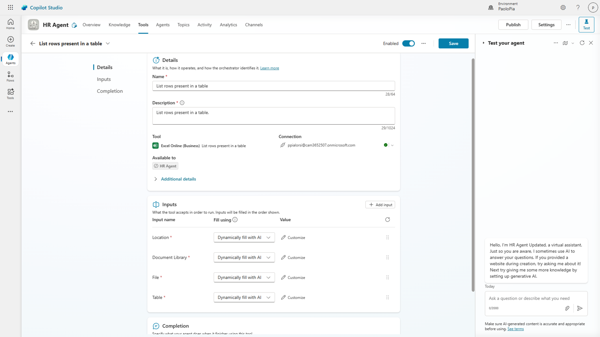

Verwenden Sie diese Einstellungen:

- Name: List HR candidates
- Description: List candidates for an HR role

Wählen Sie dann den Tab **Inputs** und konfigurieren Sie die Input-Argumente.
Standardmäßig sind alle Pflicht-Argumente so konfiguriert, dass ihr Wert `Dynamically fill with AI` ist, wie Sie an der Eigenschaft **Fill as** jedes Input-Arguments sehen.

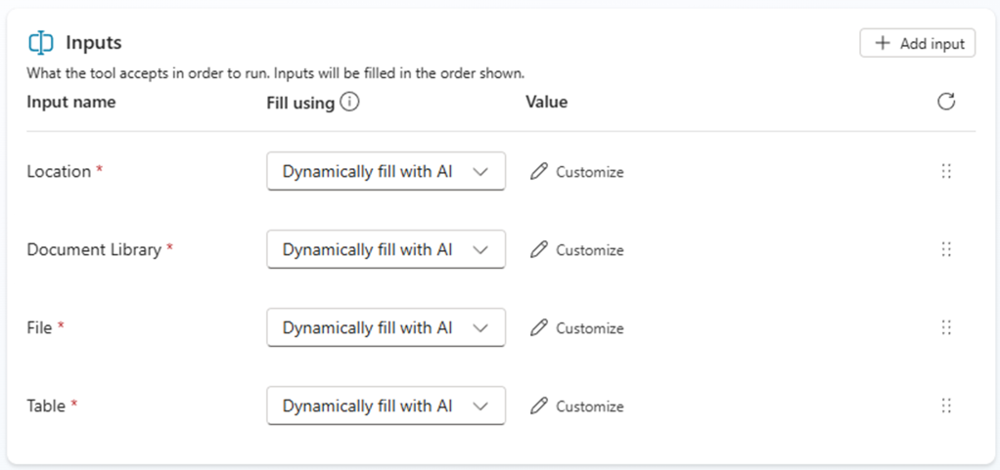

**Location**, **Document Library** und **File** stehen bereits auf `Custom value`; nur **Table** beginnt mit `Dynamically fill with AI`. Wählen Sie dessen Einstellung **Fill using** und stellen Sie sie ebenfalls auf `Custom value`, damit alle Input-Argumente statische Werte haben.

Verwenden Sie diese statischen Werte:

- Location: Wählen Sie aus der Liste die SharePoint Site, in der Sie die Excel-Tabelle abgelegt haben, angezeigt als **SharePoint Site - <site name>**.
- Document Library: der Name der Dokumentbibliothek, in der Sie die Excel-Tabelle abgelegt haben, zum Beispiel: `Shared Documents`.
- File: der Name der Excel-Datei, zum Beispiel: `Sample-list-of-candidates.xlsx`.
- Table: `Candidates_Table`

Sites, Bibliotheken, Dateien und Tabellen durchsuchen Sie direkt in der Oberfläche von Microsoft Copilot Studio.

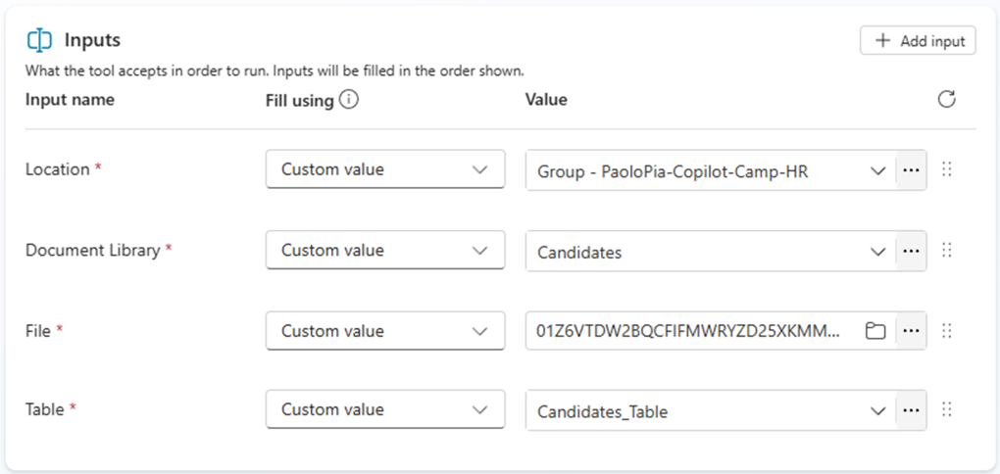

Wählen Sie jetzt die Schaltfläche **Save** rechts oben im Bildschirm, um das Tool zu speichern.

### Schritt 2: Das neue Tool testen

Jetzt können Sie den aktualisierten Agent veröffentlichen und im integrierten Test Panel oder in Microsoft Teams ausprobieren.

Da Sie in [Topics, Entities und Variables definieren](../../03-cs-basics/03-topics/lab-01-build-topics-de.md) Generative Orchestration aktiviert haben, rufen Sie das eben erstellte Tool ganz einfach mit einem Prompt wie diesem auf:

```txt
Show me the list of candidates for an HR role
```

Besonders praktisch an Copilot Studio: Wenn Sie mit Generative Orchestration im Test Panel Prompts ausführen, bekommen Sie standardmäßig eine Activity Map, an der Sie die Arbeit des Orchestrators nachvollziehen. Der folgende Screenshot zeigt die Activity Map für den oben vorgeschlagenen Prompt. Der Orchestrator erkennt anhand des Prompts den Intent des Users und löst das Tool aus, das Sie in Schritt 1 erstellt haben. Außerdem prüfen Sie hier die manuell definierten Input-Argumente.

Da der Power Platform Connector eine gültige Connection braucht, zeigt das Test Panel eine Card **Connect to continue** mit **Allow** und **Cancel**, bevor der Agent die externe Datenquelle nutzen kann. Wählen Sie **Allow**.

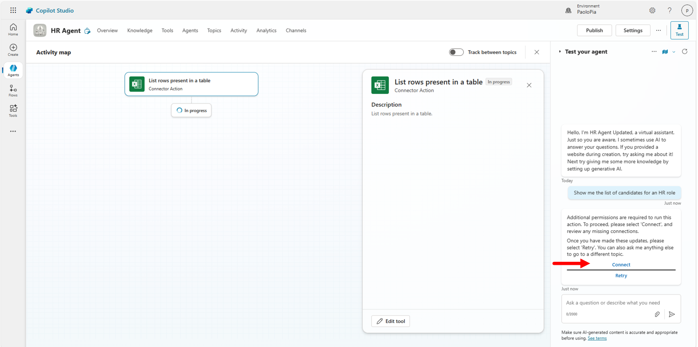

Da die Connection aus Schritt 1 bereits besteht, führt **Allow** das Tool sofort aus, und es öffnet sich kein neuer Browser-Tab.

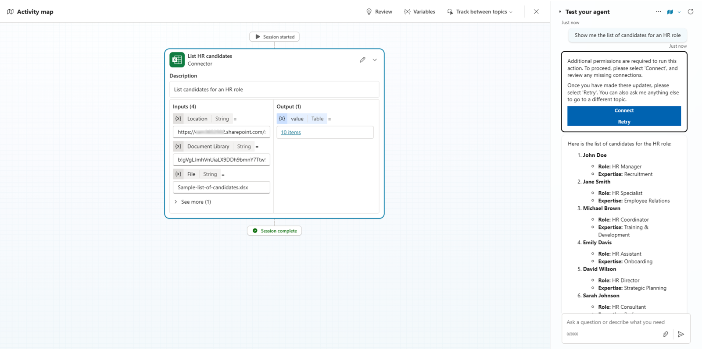

Bis hierhin gut gemacht! Jetzt geht es weiter mit dem nächsten Schritt.

### Schritt 3: Einen Agent Flow nutzen

In diesem Schritt erstellen Sie ein Tool, das einen Power Automate Flow nutzt. Angenommen, Sie möchten anhand des User-Inputs neue Kandidatinnen und Kandidaten in die Excel-Tabelle eintragen. Dafür erstellen Sie einfach ein Tool, das einen externen Power Automate Flow aufruft, der eine neue Zeile in die Tabelle der Excel-Datei einfügt.

Um ein solches Tool zu erstellen, wählen Sie oben im Bildschirm den Tab **Tools** und dann **+ Add a tool**. Wählen Sie diesmal die Kachel **Add new Workflows**. Eine neue Seite öffnet sich mit dem Designer **Agent flows** und einem neuen Flow.

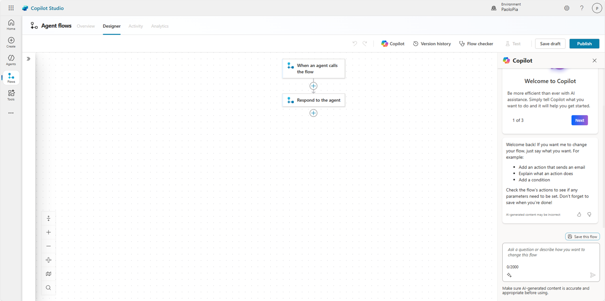

Der Flow beginnt mit einer Trigger-Aktion namens `When an agent calls the flow` und endet mit einer Aktion namens `Respond to the agent`. Die Idee: Zwischen diesen beiden Flow-Aktionen definieren Sie Ihren eigenen Business-Prozess, und das Copilot Studio Tool löst ihn für Sie aus, übergibt dabei gegebenenfalls ein oder mehrere Input-Argumente und liefert eine Response an den Agent zurück. Wählen Sie die erste Aktion, um ihre Eigenschaften zu bearbeiten. Dort konfigurieren Sie Input-Argumente für den Flow, die Copilot Studio beim Auslösen über die Aktion befüllt.

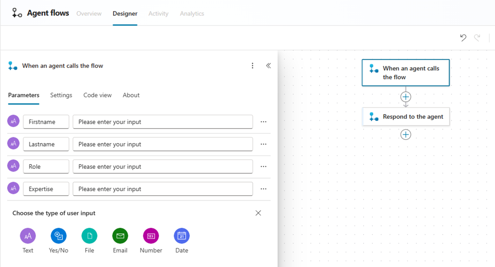

Damit Sie neue Kandidatinnen und Kandidaten hinzufügen können, legen Sie im Trigger nacheinander vier Input-Parameter mit **Add an input** > **Text** an:

- Firstname: Text
- Lastname: Text
- Role: Text
- Expertise: Text

Fügen Sie jetzt zwischen den beiden vorhandenen Aktionen eine neue Aktion vom Typ **Add a row into a table** aus dem Connector **Excel Online (Business)** ein.
Konfigurieren Sie die neue Flow-Aktion so, dass sie die Excel-Tabelle mit der Liste der Kandidatinnen und Kandidaten anspricht. Ordnen Sie unter **Advanced parameters** > **Show all** die Spalten der Zeile den Input-Parametern zu, die Sie in der von Copilot aufgerufenen Trigger-Aktion definiert haben.

Benennen Sie die Aktion in `Add new candidate row` um. Der folgende Screenshot zeigt die Konfiguration der Aktion.

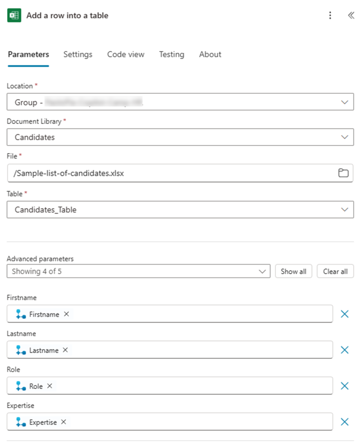

Wählen Sie jetzt die letzte Aktion `Respond to the agent`, bearbeiten Sie ihre Eigenschaften und fügen Sie mit **Add an output** > **Text** einen Output-Parameter mit dem Namen `Result` hinzu. Setzen Sie seinen Wert auf eine Formel, die eine Nachricht wie diese erzeugt:

```text
The candidate @{triggerBody()?['text']} @{triggerBody()?['text_1']} was inserted into the HR Excel spreadsheet as @{triggerBody()?['text_2']} with expertise @{triggerBody()?['text_3']}.
```


Wählen Sie jetzt **Save draft** und ändern Sie den Namen des Flows im Tab **Overview** über **Details** > **Edit** (beim ersten Speichern erhält der Flow den Namen seines Triggers, `manual`).

Verwenden Sie zum Beispiel den Namen `Insert new candidate for HR`. Veröffentlichen Sie den Flow und kehren Sie zum Agent zurück, in dem Sie das Tool bearbeitet haben. Öffnen Sie erneut den Dialog zum Hinzufügen eines neuen Tools und wählen Sie den Filter **Workflows**, dann sehen Sie den eben erstellten Agent Flow. Falls nicht, suchen Sie nach seinem Namen.

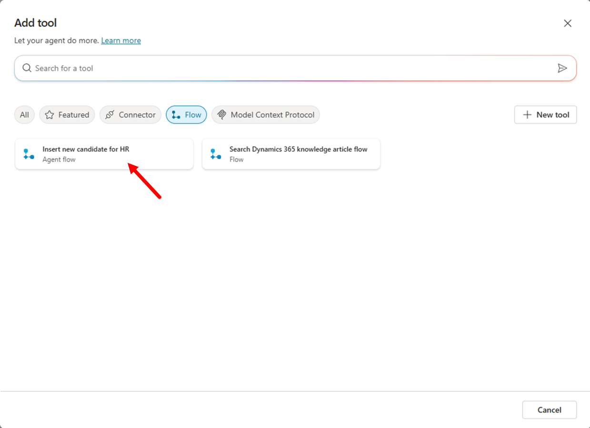

Wählen Sie das neue Tool, im nächsten Dialog **Add and configure**, konfigurieren Sie seine Einstellungen wie in Schritt 1 und probieren Sie es aus. Verwenden Sie zum Beispiel diese Einstellungen:

- Name: Insert new candidate for HR
- Description: Insert new candidate into the Excel spreadsheet for HR

Wählen Sie die Schaltfläche **Save**, dann ist das neue Tool auf Basis des Agent Flows bereit.
Lösen Sie das Tool jetzt mit einem Prompt wie diesem aus:

```txt
Insert a new candidate into the Excel spreadsheet of HR. The candidate firstname is John, 
the lastname is White, the role is "HR Administrator", and the expertise is "Compliance".
```

Wie im vorigen Schritt verbinden Sie sich beim ersten Aufruf des Tools mit Excel Online, um den Connector zu nutzen. Ist das der Fall, wählen Sie **Allow** auf der Card **Connect to continue**, um das Tool auszuführen.

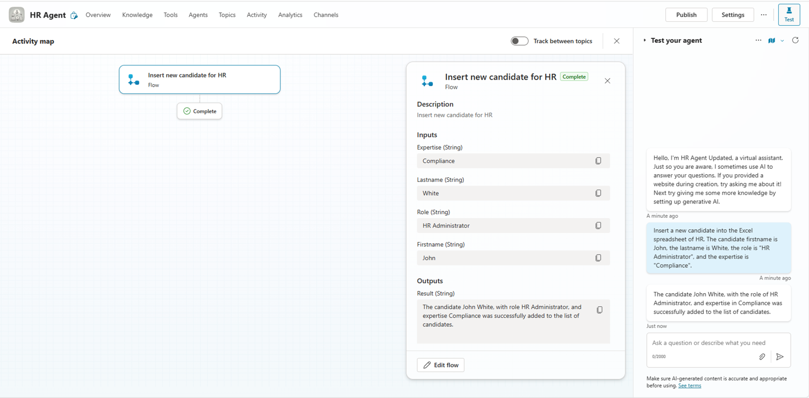

Nach der Ausführung des Tools antwortet Ihnen der Agent mit der Nachricht, die Sie im Power Automate Flow definiert haben. Außerdem steht die neue Kandidatin oder der neue Kandidat in der Tabelle der Excel-Datei.

> **Tipp:** Mehr zu Agent Flows in Microsoft Copilot Studio finden Sie in [Agent Academy - Recruit - Mission 09: Add an agent flow to your Topic for automation](https://microsoft.github.io/agent-academy/recruit/09-add-an-agent-flow/).

## Übung 2: Tools aus einem Topic aufrufen

In dieser Übung rufen Sie das eben definierte Tool aus einem Topic auf.

### Schritt 1: Ein Tool aus einem Topic aufrufen

Erstellen Sie zuerst ein neues, leeres Topic mit dem Namen `Add a new candidate to Excel` und folgen Sie denselben Schritten wie in [Übung 1 aus Input mit Adaptive Cards erfassen](../../03-cs-basics/05-adaptive-cards/lab-01-collect-input-with-adaptive-cards-de.md#übung-1-adaptive-cards-nutzen).

Die Trigger-Beschreibung kann etwa so lauten:

```txt
This topic helps users to insert new candidates in the Excel spreadsheet of HR.
Triggering sentences can be: add a new a new row to the persistence storage.
```

Der Einfachheit halber gehen wir hier nicht alle Schritte durch. Details finden Sie in [Input mit Adaptive Cards erfassen](../../03-cs-basics/05-adaptive-cards/lab-01-collect-input-with-adaptive-cards-de.md). 

Hier das JSON der Adaptive Card, mit der Sie über eine Aktion vom Typ **Ask with adaptive card** die Input-Argumente zur Kandidatin oder zum Kandidaten erfassen.

```json
{
    "type": "AdaptiveCard",
    "body": [
        {
            "type": "TextBlock",
            "size": "Medium",
            "weight": "Bolder",
            "text": "New HR Candidate Information"
        },
        {
            "type": "Input.Text",
            "id": "firstname",
            "placeholder": "First Name"
        },
        {
            "type": "Input.Text",
            "id": "lastname",
            "placeholder": "Last Name"
        },
        {
            "type": "Input.Text",
            "id": "current_role",
            "placeholder": "Current Role"
        },
        {
            "type": "Input.Text",
            "id": "expertise",
            "placeholder": "Expertise"
        }
    ],
    "actions": [
        {
            "type": "Action.Submit",
            "title": "Submit"
        }
    ],
    "$schema": "http://adaptivecards.io/schemas/adaptive-card.json",
    "version": "1.5"
}
```

Fügen Sie dann über die Gruppe **Add a tool** ein neues Tool hinzu, wählen Sie den Tab **Tool** und das Tool, das Sie in [Übung 1 - Schritt 3](#schritt-3-einen-agent-flow-nutzen) erstellt haben.

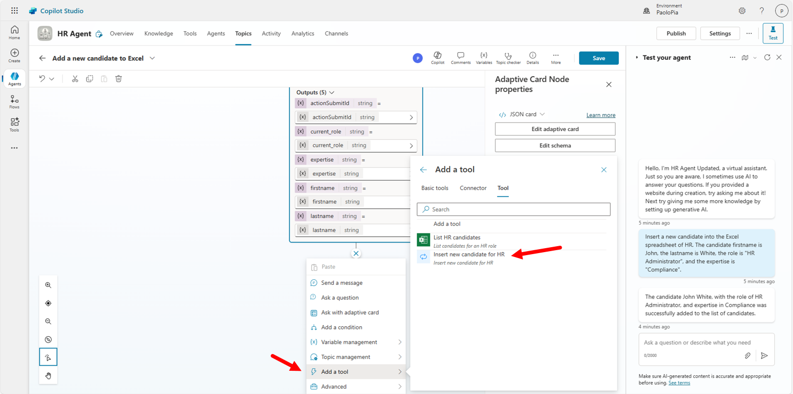

Ordnen Sie jetzt die Input-Argumente des Tools den Variablen zu, die der User über die Adaptive Card eingegeben hat.

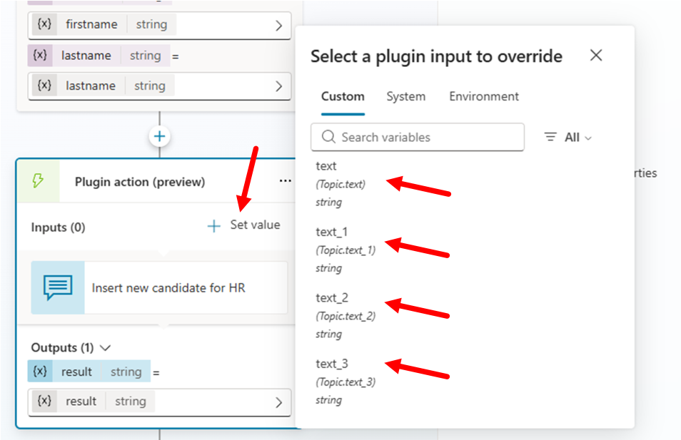

Der Tool Node beginnt mit **Inputs (0)**. Wählen Sie **Set value** einmal pro Input-Argument und dann jeweils **Select variable**, wie folgt:

- text: steht für den Vornamen
- text_1: steht für den Nachnamen
- text_2: steht für die aktuelle Rolle
- text_3: steht für die Expertise


Binden Sie dann per Data Binding in Copilot Studio jedes Input-Argument an die passende Variable auf Topic-Ebene, die der User über die Aktion **Ask with adaptive card** eingegeben hat.
Am Ende sieht die Tool-Aktion so aus wie im folgenden Bild.

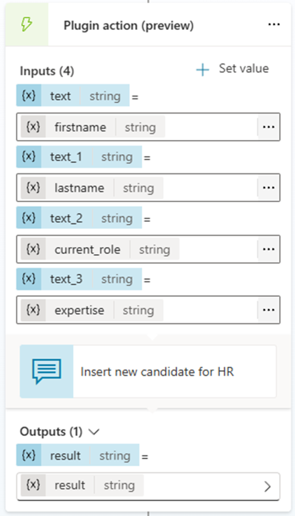

Fügen Sie eine Aktion **End current topic** hinzu und speichern Sie das Topic.

Deaktivieren Sie jetzt alle anderen Topics, die Sie in den Basics Labs erstellt haben, und rufen Sie das neue Topic mit folgendem Prompt auf, um eine neue Zeile für eine Kandidatin oder einen Kandidaten in die Excel-Tabelle einzufügen:

```txt
Add a new a new row to the persistence storage
```

Füllen Sie die Adaptive Card aus und senden Sie die Anfrage ab. Das Topic löst das Tool aus, und in der Excel-Tabelle steht eine weitere neue Kandidatin oder ein weiterer neuer Kandidat.

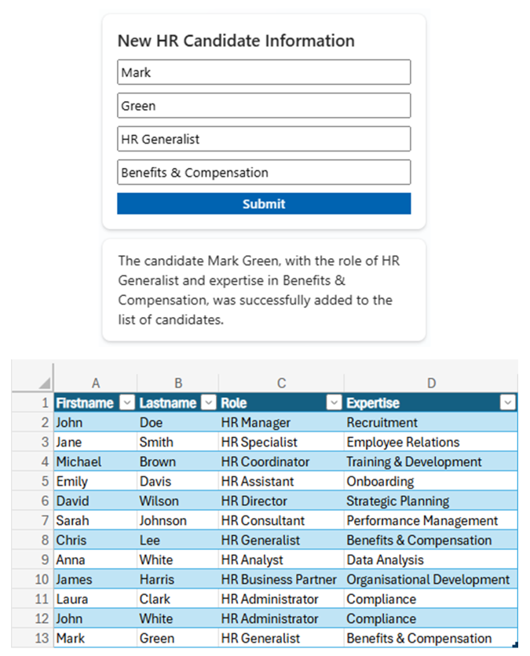

Ihr Agent unterstützt jetzt Tools. Im nächsten Lab lernen Sie, wie Sie mit Copilot Studio Declarative Agents für Microsoft 365 Copilot Chat erstellen.

Weiter mit [Eine gehostete REST API aus einem Agent aufrufen](../05-rest-api/lab-01-call-a-secured-rest-api-de.md).
