# Define Tools with Power Platform Connectors

In this lab, you'll learn how to create Tools in Microsoft Copilot Studio. Tools are another core building block of an agent. With tools you can extend the capabilities of your agent by adding support for external Power Platform connectors (native or custom), external REST APIs, Power Automate flows, MCP (Model Context Protocol) servers, etc.


Tools can be created with a graphical designer. Once you have created a new Tool, you can also edit its definition with a low level code editor, in case you need to apply detailed fine tuning.

In this lab you will learn:

- How to create a tool to invoke a Power Platform connector
- How to create a tool to invoke a Power Automate flow
- How to invoke tools from topics

## Set up the HR Agent

This lab starts from a Standard agent named HR Agent with its description and instructions. If you built it in the Basics labs, for example in [Create Your First Copilot Studio Agent](../../03-cs-basics/01-standard-agents/lab-01-create-your-first-agent.md), open it from **Agents** and skip this section. Otherwise create it now:

1. Go to [Copilot Studio](https://copilotstudio.microsoft.com), on **Home** select **Other ways to build**, then, under **Build with standard orchestration**, select **Agent** with the **Standard** badge.
2. In the **Name your agent** dialog, enter `HR Agent` and select **Create**.
3. Wait until the agent has finished setting up (the **Edit** commands stay disabled for about a minute). On the **Overview** tab, select **Edit** in the **Details** section, paste the following text into **Description** and select **Save**.

```txt
You help employees to find information about HR related policies
```

4. Select **Edit** in the **Instructions** section, paste the following instructions and select **Save**.

```txt
- Provide employees with clear, accurate information about HR policies and procedures.
- Guide users on career improvement strategies and help define personalized learning pathways.
- Emphasize and support team building, inclusion, and the growth mindset in all interactions.
- Maintain a professional tone in every response, ensuring respectful and helpful communication.
- Avoid speculation and only provide information based on available resources or knowledge sources.
- Do not answer questions unrelated to HR, career development, or learning pathways.
- Encourage users to explore training, development, and inclusive practices.
- Respond promptly and clearly to all user queries.
```

Expected: the **Overview** tab of HR Agent shows the description and the instructions.

## Exercise 1 : Creating tools in Microsoft Copilot Studio

In this exercise you are going to enhance the HR Agent to use Excel Online to retrieve a hypotethical list of candidates from an Excel spreadsheet stored in a SharePoint Online document library. Then you will add a tool to consume a Power Automate flow that can add new candidates to the same spreadsheet.


### Step 1: Consuming a Power Platform connector

To create a new tool, in the upper side of the screen select the 1️⃣ **Tools** tab, then select 2️⃣ **+ Add a tool** to start creating a new tool.

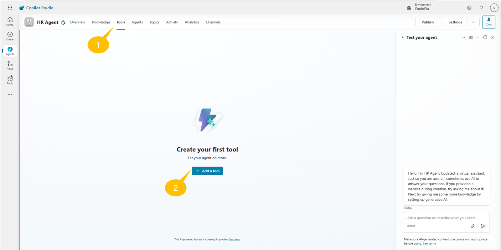

A dialog window titled **Add tool** pops up allowing you to choose what kind of tool to create. By default, the **Popular** tab shows tools like those that allow you to interact with Excel Online content or other common services. 

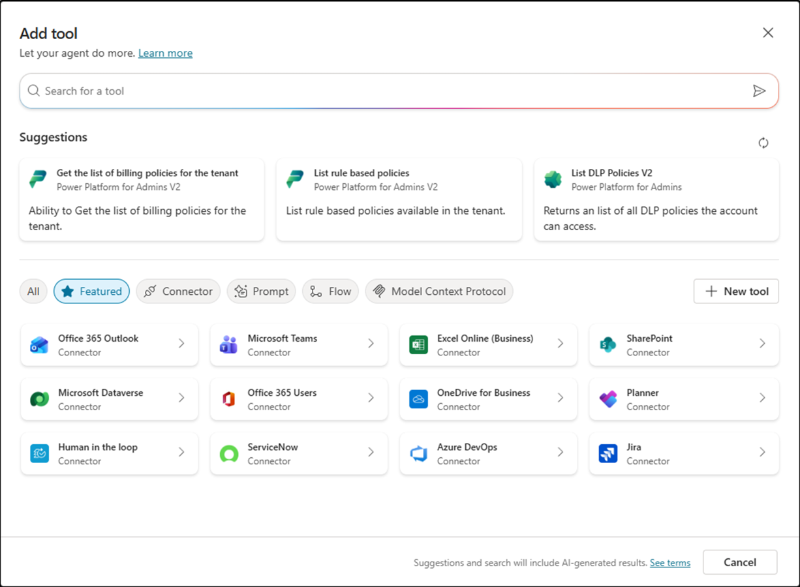

You can also create a new tool from scratch with the **Add new** tiles **Computer use**, **Workflows**, **Prompt** and **MCP**; **See more** adds **REST API** and **Custom connector**. The options are:

- Prompt: allows consuming an AI tool built using a prompt written in natural language.
- Workflows: allows consuming a Power Automate agent flow (see [Step 3](#step-3-consuming-an-agent-flow)).
- Computer use: to allow your agent to directly use web and desktop apps.
- Custom connector: allows consuming a Power Platform custom connector.
- REST API: allows consuming an external REST API. You can find additional details [here](https://learn.microsoft.com/en-us/microsoft-copilot-studio/agent-extend-action-rest-api).
- Model Context Protocol: to consume tools from an external Model Context Protocol (MCP) server.

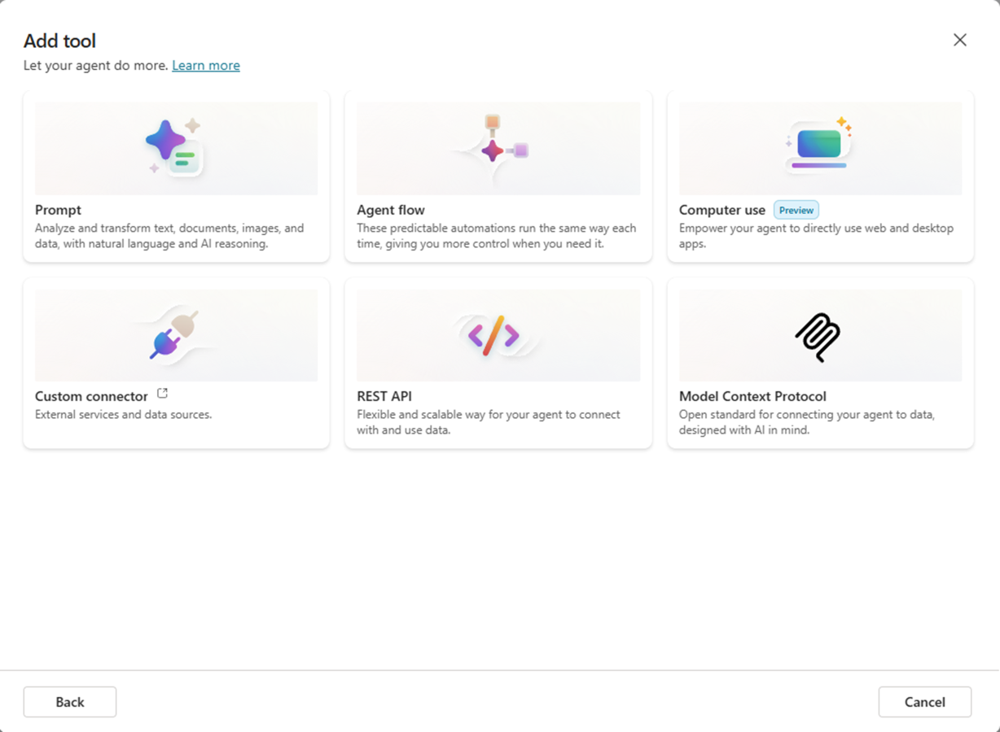

If you don't find the option you are looking for in the list of popular items, simply switch to the **All** group and search by text what you are looking for.

To complete the current step, choose the tool **Excel Online (Business)** and then select **List rows present in a table**. If no connection is preselected, open the **Connection** dropdown, select **Create new connection** and then **Create**. A **Connect to Excel Online (Business)** dialog asks for an optional **Display name**, and then an account picker opens.

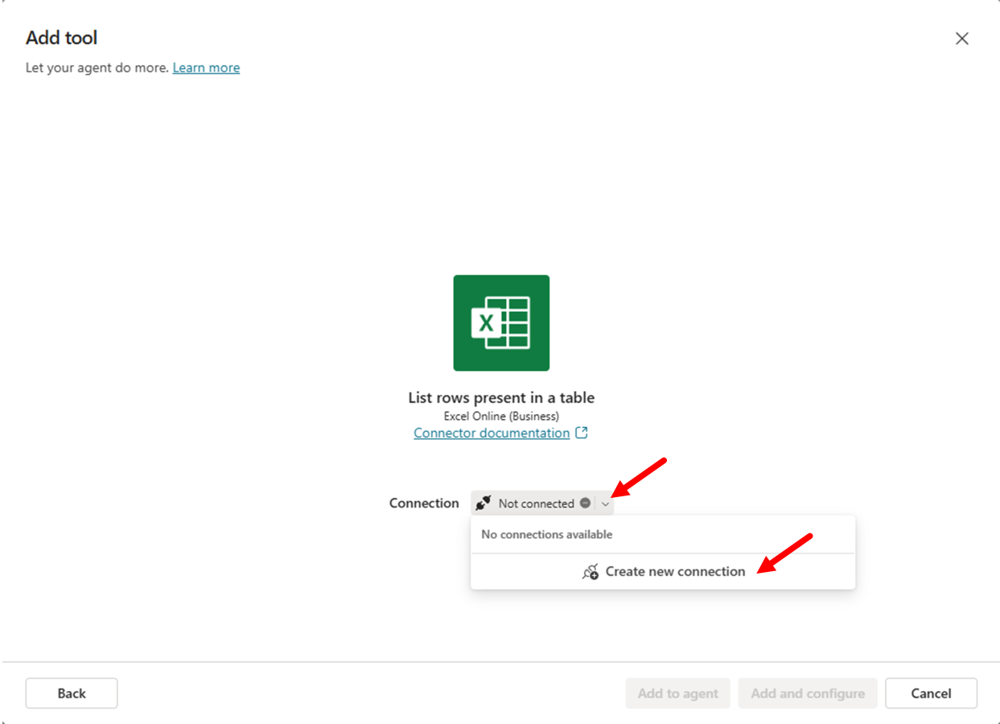

You will need to login with your account and to allow access to Excel Online (Business). Once the connection is configured, select **Add and configure** to add the tool and open its settings.

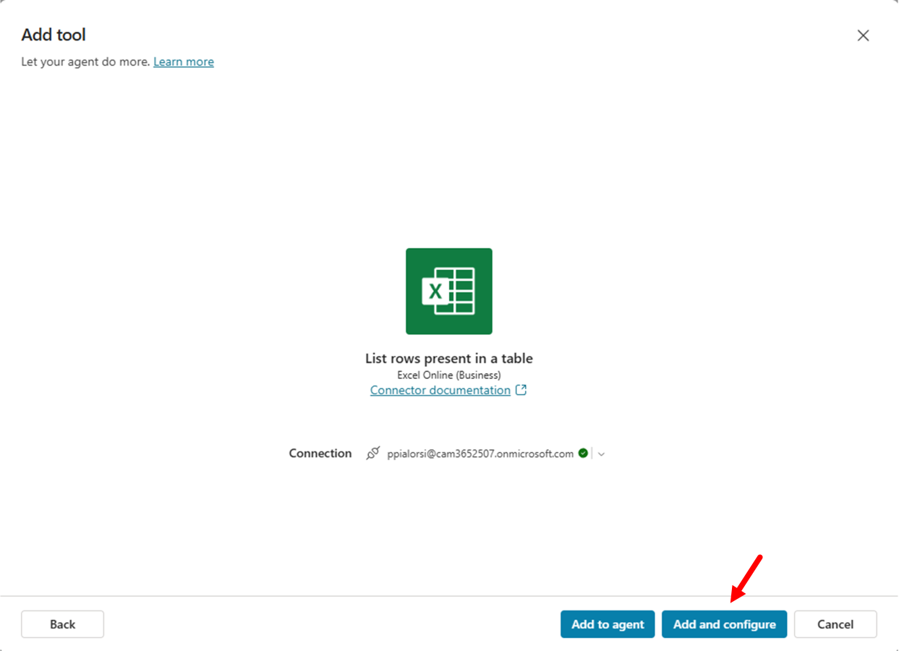

Next, you get a page to configure the actual tool. You need to provide:

- Name: simply a descriptive name for the tools.
- Description: a description in natural language that will be used by generative orchestration to determine when to use your tool. 
- Inputs: to define the input arguments for the tool, if any.
- Completion: defines how the tool handles the request and response to the user.

Before configuring the tool, you need to prepare the Excel spreadsheet with the list of candidates.
Download a sample Excel file by selecting this [link](https://github.com/alexander-kastil/copilot-studio-agents/blob/master/src/assets/candidates/Sample-list-of-candidates.xlsx?raw=true).

Upload the downloaded file yourself to the **Documents** library of a SharePoint Teams site in the same tenant where you are making your agent with Copilot Studio. The document was generated by Microsoft 365 Copilot for the sake of having a hypothetical list of candidates.

- Copy the absolute url of the site. For example: `https://xyz.sharepoint.com/sites/greylogistics/`.
- Copy the name of the document library. For example : `Shared documents`
- Copy also the name of the file. For example: `Sample-list-of-candidates.xlsx`

Now go back to Microsoft Copilot Studio and finalize the tool configuration.

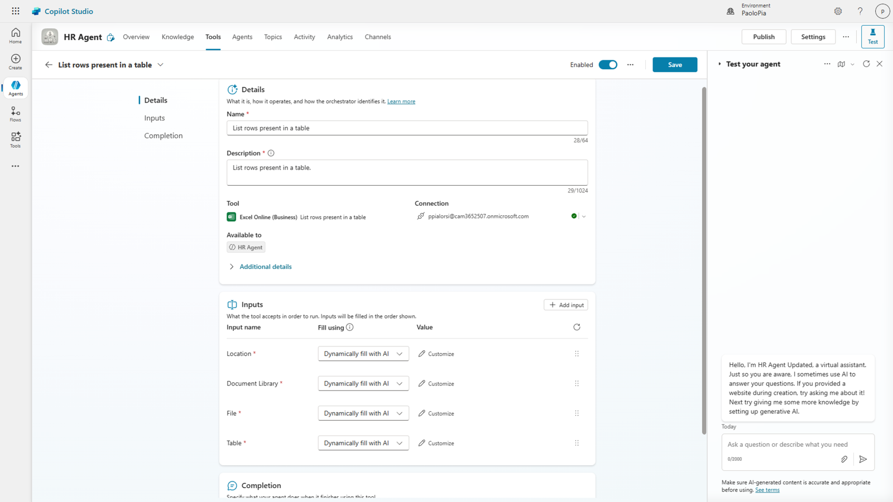

Use the following settings:

- Name: List HR candidates
- Description: List candidates for an HR role

Then select **Inputs** in the sections on the left and start configuring the input arguments.
By default, all the mandatory input arguments have been configured so that their value will be `Dynamically fill with AI` as you can notice in the **Fill using** column of each input argument.

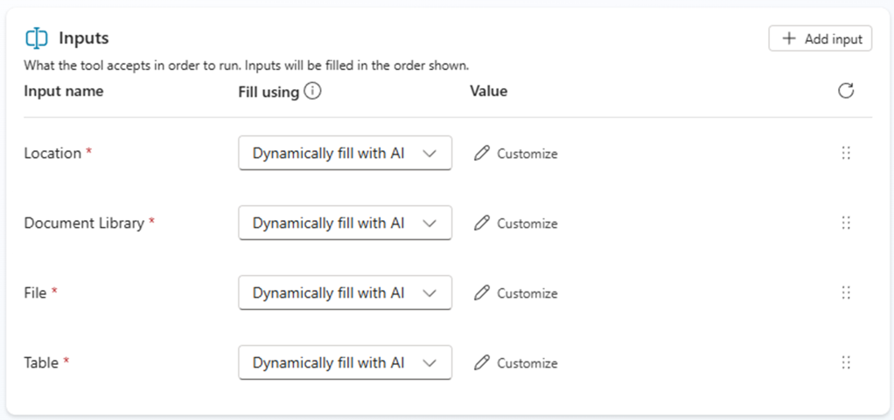

**Location**, **Document Library** and **File** already default to `Custom value`; only **Table** starts as `Dynamically fill with AI`. Select its **Fill using** setting and switch it to `Custom value` too, so that all of the input arguments have static values.

Use the following static values:

- Location: pick the SharePoint site where you stored the Excel spreadsheet from the list, shown as **SharePoint Site - <site name>**.
- Document Library: use the name of the document library where you stored the Excel spreadsheet. For example: `Documents`.
- File: provide the name of the Excel file. For example: `Sample-list-of-candidates.xlsx`. If you pick the file with the file browser, the field shows the file's id instead of its name.
- Table: `Candidates_Table`

You can browse the sites, libraries, files, and tables through the native UI of Microsoft Copilot Studio.

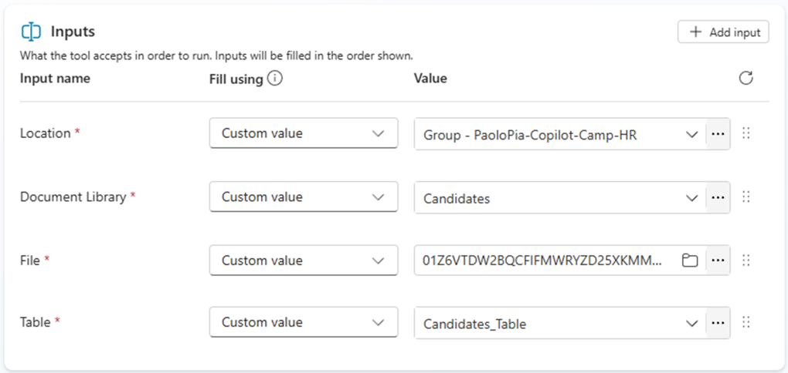

Now select the **Save** button in the upper right corner of the screen to save the updated tool.

### Step 2: Testing the new tool

You are now ready to publish the updated agent and to play with it in the integrated test panel or in Microsoft Teams.

Since the agent uses generative orchestration, it is really easy to invoke the just created tool simply providing to the agent a prompt like the following one:

```txt
Show me the list of candidates for an HR role
```

Something really nice of Copilot Studio when using the generative orchestration and invoking prompts within the test panel is that by default you get an Activity map to investigate how the orchestrator works. In the following screenshot you can see the Activity map for the prompt suggested before. The orchestrator indentifies the user's intent, based on the prompt, and triggers the tool that you created in Step 1. You can also validate the manually defined input arguments.

Since the Power Platform connector requires a valid connection in place, the test panel can show a **Connect to continue** card with **Allow** and **Cancel** before the agent consumes the external data source. If it appears, select **Allow**.

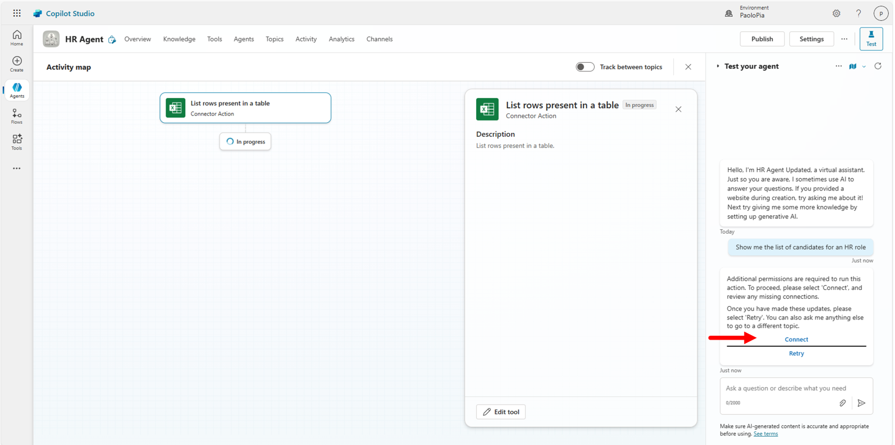

With the connection from Step 1 already in place, **Allow** runs the tool right away and no new browser tab opens.

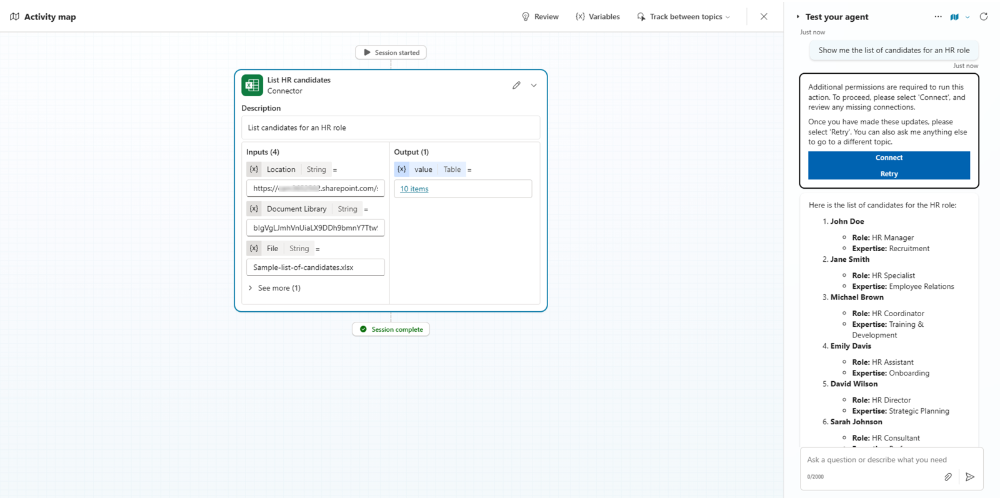

Well done, so far! You can now move to the next step.

### Step 3: Consuming an Agent flow

In this step you are going to create a tool to consume a Power Automate flow. Let's say that you want to add new candidates to the Excel spreadsheet, based on the user's input. You can simply create a tool that invokes an external Power Automate flow, which adds a new row to the table in the Excel spreadsheet.

To create such a tool, in the upper side of the screen select the **Tools** tab, then select **+ Add a tool** to start creating a new tool. This time, select the **Add new Workflows** tile. A new page will be opened, navigating to a the **Agent flows** designer and rendering a new flow.

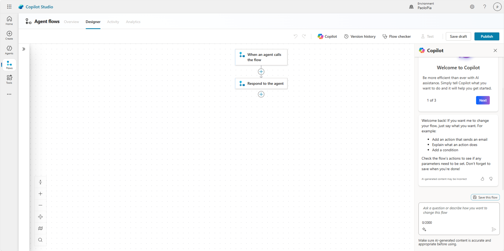

The flow has an initial triggering action with name `When an agent calls the flow` and a final action with name `Respond to the agent`. The overall idea is that you can define your own business process between these two flow actions and the Copilot Studio tool will trigger the business process for you, eventually providing one or more input arguments and providing a response back to the agent. Select the first action to edit it: the trigger expands inline, and **Open panel** on an action shows its parameters and its code view. You can configure a set of input arguments for the flow, so that Copilot Studio will be able to feed the flow through the action upon activation.

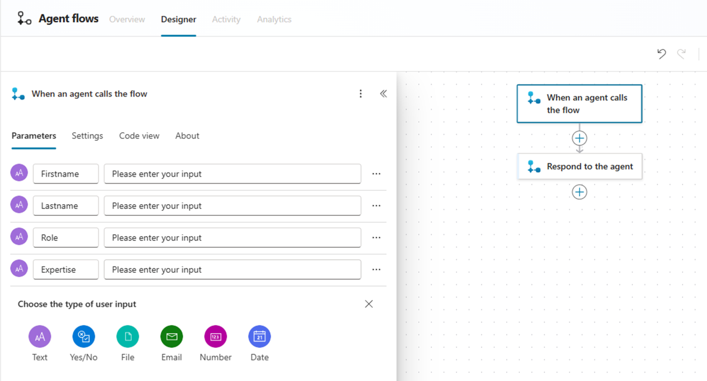

For the sake of being able to add new candidates, add four input parameters to the trigger one by one with **Add an input** > **Text**, and give each one a description such as `The candidate's first name`, so that the agent fills the right value into each input:

- Firstname: text
- Lastname: text
- Role: text
- Expertise: text

Now add, between the two pre-created actions, a new action of type **Add a row into a table** from the **Excel Online (Business)** connector.
Configure the new flow action in order to target the Excel spreadsheet with the list of candidates. Map the column fields of the row, under **Advanced parameters** > **Show all**, to the actual input parameters defined in the triggering action invoked by Copilot.

Rename the action into `Add new candidate row`. In the following screenshot you can see how the action is configured.

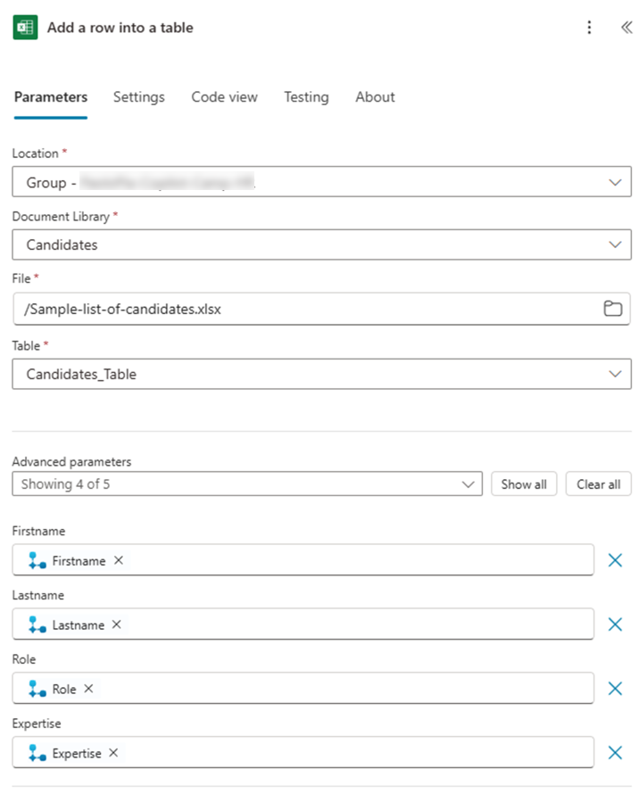

Now select the final action `Respond to the agent`, edit its properties and add an output parameter with **Add an output** > **Text** with name `Result`. Set the value of the output parameter to a formula that renders a message like the following one, and press **Tab** after you enter it, because **Save draft** drops a value that still has the focus:

```text
The candidate @{triggerBody()?['text']} @{triggerBody()?['text_1']} was inserted into the HR Excel spreadsheet as @{triggerBody()?['text_2']} with expertise @{triggerBody()?['text_3']}.
```


Now **Save draft**, update the name of the flow in the **Overview** tab with **Details** > **Edit** (after the first save the flow is still named **Untitled**, and its trigger is named `manual`).

You can use a name like for example `Insert new candidate for HR`. Publish the flow and go back to the agent where you were editing the tool. Open again the dialog window to add a new tool, select **Workflows** as the filter and you will be able to see the new Agent flow that you just created. If not, try searching for its name.

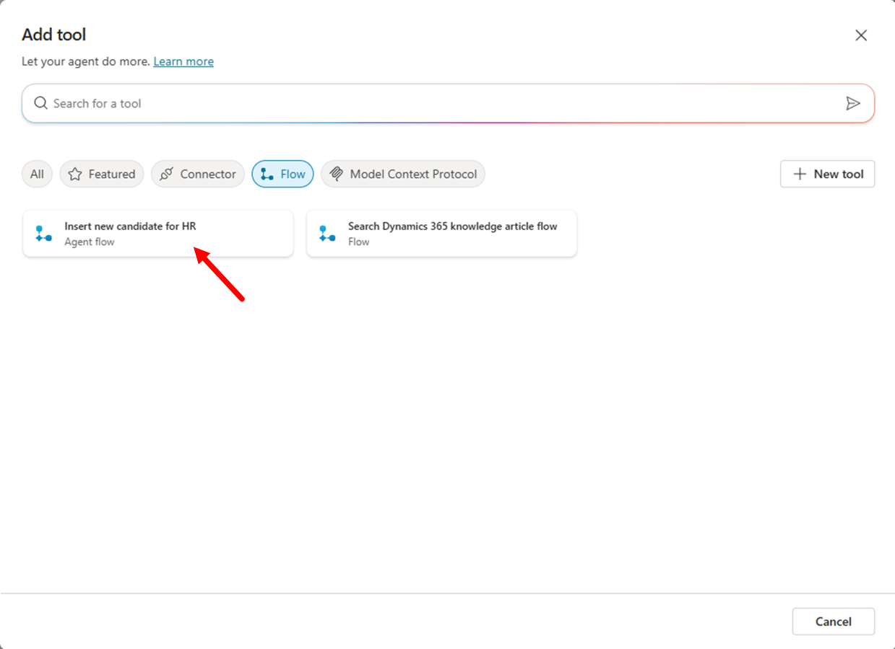

Select the new tool, in the next dialog window select **Add and configure** to configure its settings as like as you did in Step 1, and play with it. For example, use the following settings:

- Name: Insert new candidate for HR
- Description: Insert new candidate into the Excel spreadsheet for HR

Select the **Save** button and the new tool based on the Agent flow will be ready.
Now let's trigger the tool with a prompt like the following one:

```txt
Insert a new candidate into the Excel spreadsheet of HR. The candidate firstname is John, 
the lastname is White, the role is "HR Administrator", and the expertise is "Compliance".
```

As like as it was with the previous Step, the first time you use the tool you need to connect to Excel Online in order to consume the connector. If that is the case, select **Allow** on the **Connect to continue** card to execute the actual tool.

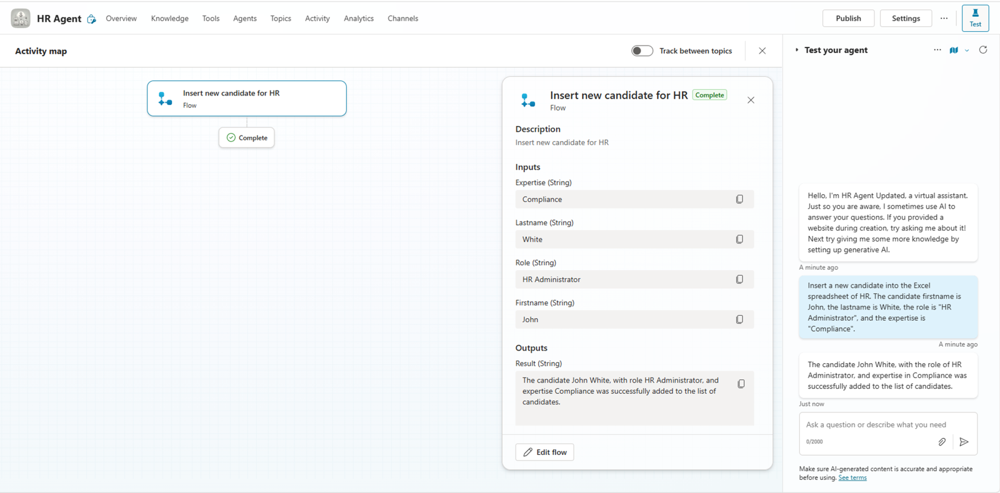

After the execution of the tool, you will see the agent replying back to you with the response message that you defined in the Power Automate flow. Moreover, the new candidate will be added to the table in the Excel spreadsheet.

> **Tip:** To learn more about Agent Flows in Microsoft Copilot Studio, you can refer to [Agent Academy - Recruit - Mission 09: Add an agent flow to your Topic for automation](https://microsoft.github.io/agent-academy/recruit/09-add-an-agent-flow/).

## Exercise 2 : Invoking tools from within a topic

In this exercise you are going to consume the tool that you just defined from within a topic.

### Step 1: Invoking a tool from a topic

First of all, create a new topic from blank, give it name `Add a new candidate to Excel`, and follow the same steps defined in [Exercise 1 of Collect Input with Adaptive Cards](../../03-cs-basics/05-adaptive-cards/lab-01-collect-input-with-adaptive-cards.md#exercise-1--using-adaptive-cards).

The triggering description can be something like the following:

```txt
This topic helps users to insert new candidates in the Excel spreadsheet of HR.
Triggering sentences can be: add a new a new row to the persistence storage.
```

For the sake of simplicy, we are not going to cover all of the steps here. However, you can simply refer to [Collect Input with Adaptive Cards](../../03-cs-basics/05-adaptive-cards/lab-01-collect-input-with-adaptive-cards.md) for additional details. 

Here follows the JSON of the adaptive card that you can use to collect the input arguments about the candidate through an action of type **Ask with adaptive card**.

```json
{
    "type": "AdaptiveCard",
    "body": [
        {
            "type": "TextBlock",
            "size": "Medium",
            "weight": "Bolder",
            "text": "New HR Candidate Information"
        },
        {
            "type": "Input.Text",
            "id": "firstname",
            "placeholder": "First Name"
        },
        {
            "type": "Input.Text",
            "id": "lastname",
            "placeholder": "Last Name"
        },
        {
            "type": "Input.Text",
            "id": "current_role",
            "placeholder": "Current Role"
        },
        {
            "type": "Input.Text",
            "id": "expertise",
            "placeholder": "Expertise"
        }
    ],
    "actions": [
        {
            "type": "Action.Submit",
            "title": "Submit"
        }
    ],
    "$schema": "http://adaptivecards.io/schemas/adaptive-card.json",
    "version": "1.5"
}
```

Then add a new tool from the group **Add a tool**, select the tab **Tool**, and select the tool that you just created in [Exercise 1 - Step 3](#step-3-consuming-an-agent-flow).

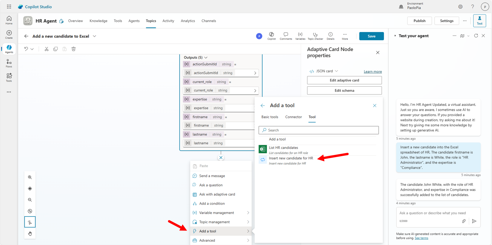

Now you need to map the input arguments of the tool with the variables collected by the user via the adaptive card.

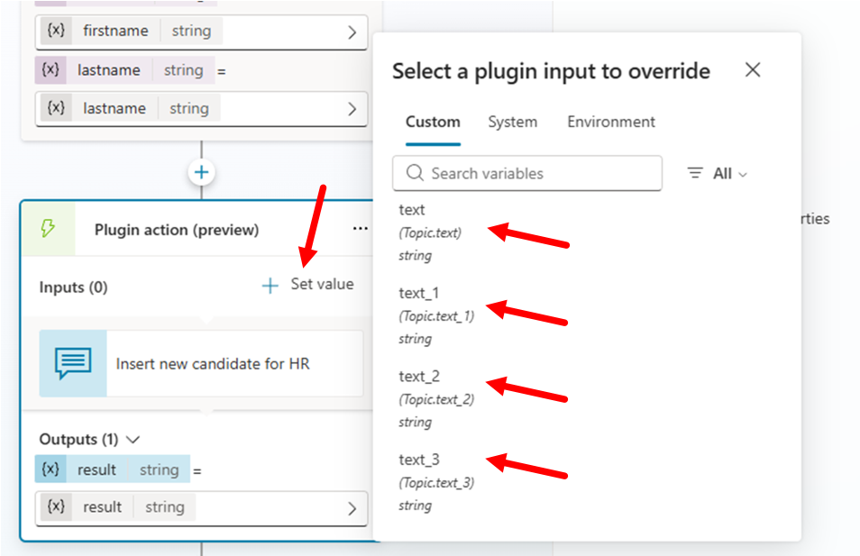

The tool node starts with **Inputs (0)**. Select **Set value** once per input argument, then **Select variable** for each, as follows:

- text: represents the first name
- text_1: represents the last name
- text_2: represents the current role
- text_3: represents the expertise

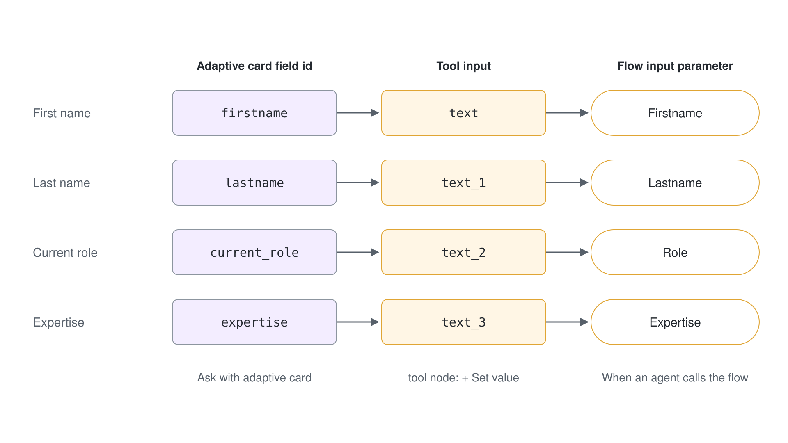

Then, using data binding in Copilot Studio, configure every input argument to the corresponding topic level variables, collected by the user through the **Ask with adaptive card** action.
At the end, the tool action will look like in the following image.

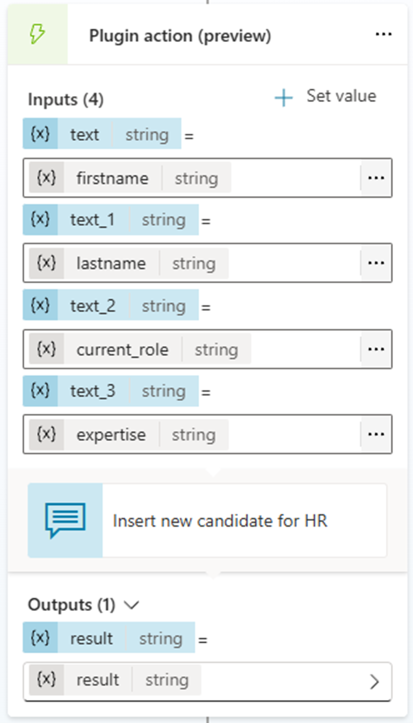

Add an action to **End current topic** and save it.

Now, disable any other custom topic of the agent in the **Enabled** column, such as **Goodbye**, **Greeting**, **Start Over** and **Thank you** on a new agent or the topics of the Basics labs, and invoke the new topic to insert a new candidate row into the Excel spreadsheet using the following prompt:

```txt
Add a new a new row to the persistence storage
```

Fill the adaptive card and submit the request. The tool will be triggered via the topic and you will have yet another new candidate in the Excel spreadsheet.

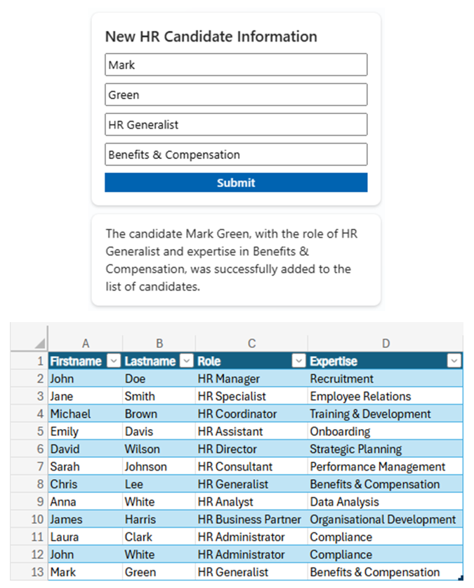

Now your agent supports tools. In the next lab you will learn how to use Copilot Studio to create Declarative Agents for Microsoft 365 Copilot Chat.

Continue with [Call a Hosted REST API from an Agent](../05-rest-api/lab-01-call-a-secured-rest-api.md).
