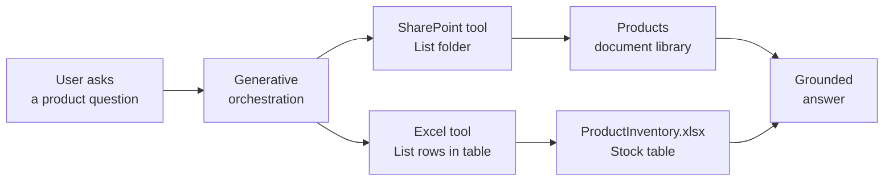
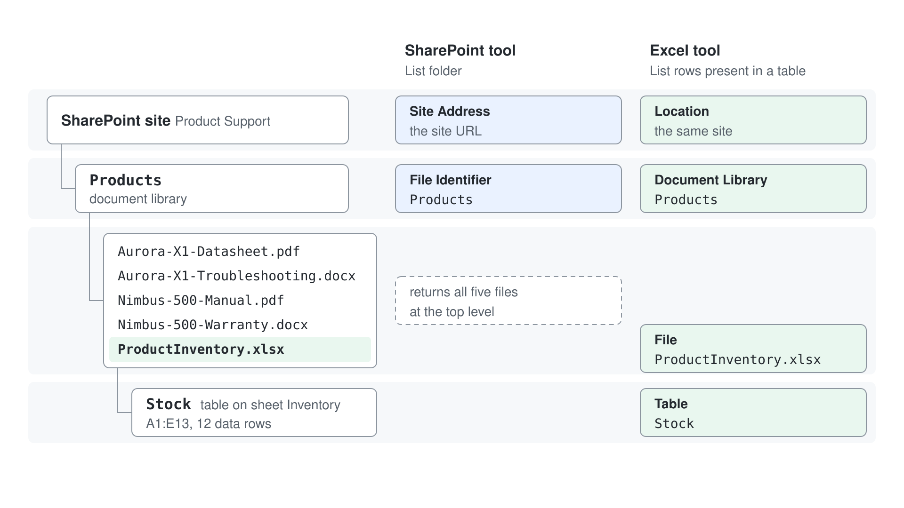
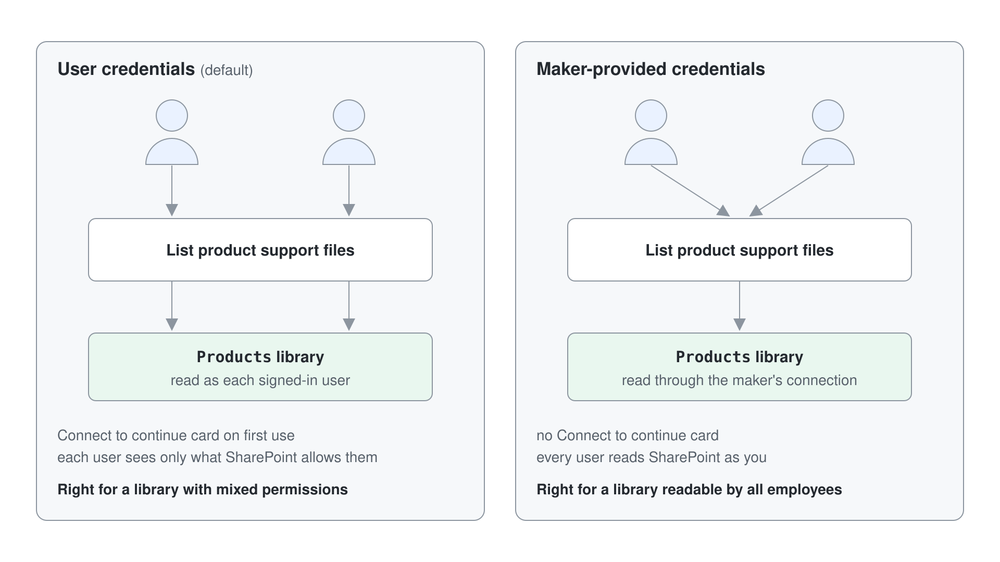

# Dem HR Agent live SharePoint- und Excel-Daten mit Connector Tools geben

Ihr Product-Support-Team hält sein Material an zwei Orten: Datasheets, Handbücher und Troubleshooting-Guides liegen in einer SharePoint Document Library, und die aktuellen Lager- und Garantiezahlen stehen in einer Excel-Arbeitsmappe daneben. Eine Knowledge Source liest diese Dateien, kann einem User aber nicht sagen, was gerade im Ordner liegt oder wie hoch der Lagerbestand heute ist. Connector Tools können das, weil sie die SharePoint und Excel APIs während der Konversation aufrufen und das Ergebnis an den Orchestrator zurückgeben.



In diesem Lab geben Sie dem HR Agent zwei weitere vorgefertigte Connector Tools: SharePoint List folder und Excel List rows present in a table. Danach schärfen Sie die Tool-Beschreibungen, bis Generative Orchestration selbst das richtige Tool wählt, und belegen mit der Activity Map, welches Tool lief.

Dies ist eine Überarbeitung des Microsoft Learn Labs [Create a connector action](https://microsoftlearning.github.io/MS-4022-Extend-Microsoft-365-Copilot-in-Copilot-Studio/Instructions/Labs/03-Connector-actions/01-create-connector-action.html), erweitert um die Excel- und SharePoint-Szenarien aus Copilot Camp.

## Was Sie bauen

- Ein SharePoint Connector Tool, das den aktuellen Inhalt einer Document Library `Products` auflistet.
- Ein Excel Connector Tool, das eine Lagertabelle aus einer Arbeitsmappe in derselben Library liest.
- Agent Instructions, die eine Frage an das richtige Tool weiterleiten, und Tool-Beschreibungen, die Sie schärfen, bis der Orchestrator nicht mehr rät.

## Die beteiligten Teile



## Voraussetzungen

- Den HR Agent; [Den HR Agent einrichten](#den-hr-agent-einrichten) baut ihn, falls Sie ihn noch nicht haben.
- Die Berechtigung, eine SharePoint Site anzulegen, oder eine bestehende Site, in der Sie eine Document Library hinzufügen dürfen.
- Eine Site namens `Product Support` mit einer Document Library namens `Products`, gefüllt mit den fünf Dateien aus dem Ordner [assets](./lab-02-sharepoint-and-excel-connector-tools/assets). Bauen Sie sie von Hand, wie unten beschrieben.

## Den HR Agent einrichten

Dieses Lab startet mit einem Standard Agent namens HR Agent mit seiner Description und seinen Instructions. Wenn Sie ihn in den Basics Labs gebaut haben, zum Beispiel in [Ihren ersten Copilot Studio Agent erstellen](../../03-cs-basics/01-standard-agents/lab-01-create-your-first-agent-de.md), öffnen Sie ihn unter **Agents** und überspringen diesen Abschnitt. Andernfalls erstellen Sie ihn jetzt:

1. Rufen Sie [Copilot Studio](https://copilotstudio.microsoft.com) auf, wählen Sie auf **Home** den Befehl **Other ways to build** und dann unter **Build with standard orchestration** den Eintrag **Agent** mit dem Badge **Standard**.
2. Geben Sie im Dialog **Name your agent** den Namen `HR Agent` ein und wählen Sie **Create**.
3. Warten Sie, bis der Agent eingerichtet ist (die Befehle **Edit** bleiben etwa eine Minute deaktiviert). Wählen Sie dann im Tab **Overview** im Abschnitt **Details** den Befehl **Edit**, fügen Sie den folgenden Text in **Description** ein und wählen Sie **Save**.

```txt
You help employees to find information about HR related policies
```

4. Wählen Sie im Abschnitt **Instructions** den Befehl **Edit**, fügen Sie die folgenden Instructions ein und wählen Sie **Save**.

```txt
- Provide employees with clear, accurate information about HR policies and procedures.
- Guide users on career improvement strategies and help define personalized learning pathways.
- Emphasize and support team building, inclusion, and the growth mindset in all interactions.
- Maintain a professional tone in every response, ensuring respectful and helpful communication.
- Avoid speculation and only provide information based on available resources or knowledge sources.
- Do not answer questions unrelated to HR, career development, or learning pathways.
- Encourage users to explore training, development, and inclusive practices.
- Respond promptly and clearly to all user queries.
```

Erwartet: Der Tab **Overview** des HR Agent zeigt die Description und die Instructions.

## Lab-Dateien

Alles, was der Agent liest, liegt in [assets](./lab-02-sharepoint-and-excel-connector-tools/assets). Die Inhalte sind fiktiv (Happy Longnose Ltd, ein Hardwarehersteller), aber in sich stimmig, sodass Antworten zu einem Produkt über die Dokumente und die Lagertabelle hinweg zusammenpassen.

| Datei | Was sie darstellt |
|-------|-------------------|
| `Aurora-X1-Datasheet.pdf` | Datasheet der Konferenzkamera Aurora X1: Spezifikationstabelle, Raumgrößen, SKU-Liste |
| `Aurora-X1-Troubleshooting.docx` | Troubleshooting-Guide des Support Desks: Symptomtabelle, Eskalationsweg, bekannte Probleme |
| `Nimbus-500-Manual.pdf` | Installations- und Administrationshandbuch des Access Points Nimbus 500: Montage, Funkplanung, Statusleuchten |
| `Nimbus-500-Warranty.docx` | Garantiebedingungen des Nimbus 500: Leistungstabelle, Verlängerung, Ablauf eines Garantiefalls, Ausschlüsse |
| `ProductInventory.xlsx` | Lager-Arbeitsmappe, Blatt `Inventory`, Tabelle `Stock`, 12 Zeilen: Produktcode, Name, Lagerbestand, Lager, Garantiemonate |

### Von Hand anlegen

Vier Schritte im Browser, etwa fünf Minuten. Führen Sie sie der Reihe nach aus; die Connector-Inputs in Übung 2 und Übung 4 sind die Werte, die Sie am Ende notieren.

#### Schritt 1: Die Site anlegen

Springen Sie zu Schritt 2, wenn Sie bereits eine Site haben, die Sie nutzen können.

1. Öffnen Sie [https://www.office.com/launch/sharepoint](https://www.office.com/launch/sharepoint) und wählen Sie **Build** > **Site**.
2. Wählen Sie **Team site** und die Vorlage **Standard team**. Eine Communication Site funktioniert genauso gut; dem Connector ist das egal.
3. Setzen Sie **Site name** auf:

```text
Product Support
```

4. Prüfen Sie die Site-Adresse, die SharePoint unter dem Namen vorschlägt, zum Beispiel `https://greylogistics.sharepoint.com/sites/ProductSupport`. Kopieren Sie sie jetzt, denn sie ist der Input **Site Address**, den der Connector braucht.
5. Wählen Sie **Create site** und dann auf **Your site is ready!** die Schaltfläche **Go to site**.

Erwartet: Die neue Site öffnet sich auf ihrer Home Page, und **Documents** steht bereits in der linken Navigation.

#### Schritt 2: Die Document Library Products anlegen

Das Lab braucht eine Document Library, keine Liste und keinen Ordner. Eine Library speichert Dateien, und genau sie lesen die SharePoint Action **List folder** und der Excel Connector. Eine Custom List speichert Zeilen mit Spalten und enthält gar keine Dateien, deshalb taugt sie für dieses Lab nicht.

1. Wählen Sie auf der Home Page der Site oben in der Befehlsleiste **+ New**.
2. Wählen Sie **Document library** und dann **Create blank document library**.
3. Setzen Sie **Name** auf genau:

```text
Products
```

4. Setzen Sie optional **Description** auf `Product support material`.
5. Lassen Sie **Show in site navigation** aktiviert und wählen Sie **Create**.

Erwartet: Die leere Library `Products` öffnet sich, und `Products` erscheint in der linken Navigation neben **Documents**. Die Adressleiste zeigt etwa `https://greylogistics.sharepoint.com/sites/ProductSupport/Products`.

> **Warnung:** Der Name muss genau `Products` lauten, mit großem P und ohne Leerzeichen am Ende. Sie tippen diesen String in Übung 2 in den Connector-Input **File Identifier**, und SharePoint vergleicht ihn wörtlich. Benennen Sie die Library später um, ändert sich nur der Anzeigename, nicht die interne URL, die dann nicht mehr zu Ihrer Eingabe passt.

#### Schritt 3: Die fünf Dateien hochladen

1. Öffnen Sie die Library `Products`.
2. Wählen Sie in der Befehlsleiste **Create or upload** und dann **Files upload**.
3. Navigieren Sie zum Ordner [assets](./lab-02-sharepoint-and-excel-connector-tools/assets) neben diesem Lab, wählen Sie alle fünf Dateien und bestätigen Sie.
4. Warten Sie, bis die Upload-Spalte keinen Fortschritt mehr anzeigt.

Erwartet: Die Library zeigt genau fünf Einträge, vier Dokumente und eine Arbeitsmappe, ohne Ordner und ohne Unterordner.

> **Hinweis:** Lassen Sie die Dateien auf der obersten Ebene der Library. Legen Sie sie in einen Unterordner, muss der Wert **File Identifier** in Übung 2 stattdessen `Products/<subfolder>` lauten, und die Auswahl **File** des Excel Connectors bekommt eine zusätzliche Ebene. Eine flache Ablage passt zu jedem Wert in diesem Lab.

#### Schritt 4: Die Excel-Tabelle prüfen

Der Excel Connector liest eine benannte Tabelle, kein Blatt und keinen einfachen Bereich. Die mitgelieferte Arbeitsmappe hat bereits eine, deshalb ist dieser Schritt eine Kontrolle und keine Aufgabe. Er lohnt sich trotzdem, weil ein unbenannter Bereich der häufigste Grund ist, warum Übung 4 an einer leeren Tabellenauswahl hängt.

1. Wählen Sie in der Library `ProductInventory.xlsx`, um die Datei in Excel für das Web zu öffnen.
2. Wählen Sie eine beliebige Zelle in den Daten, zum Beispiel `B4`.
3. Öffnen Sie im Menüband den Tab **Table Design** und lesen Sie links das Feld **Table Name**.

Erwartet: Die Tabelle heißt `Stock` und umfasst den Bereich `A1:E13`, eine Kopfzeile plus zwölf Datenzeilen. Die Tabelle `Stock` enthält:

```text
ProductCode | ProductName | UnitsInStock | WarehouseLocation | WarrantyMonths
AUR-X1      | Aurora X1   | 142          | Vienna            | 24
NIM-500     | Nimbus 500  | 18           | Graz              | 12
```

#### Diese vier Werte notieren

Jeder Connector-Input im Lab stammt aus dieser Tabelle. Tragen Sie Ihre eigene Site-Adresse ein und halten Sie die Werte bereit.



| Wo er gebraucht wird | Input | Ihr Wert |
|----------------------|-------|----------|
| Übung 2, SharePoint Tool | Site Address | `https://<tenant>.sharepoint.com/sites/ProductSupport` |
| Übung 2, SharePoint Tool | File Identifier | `Products` |
| Übung 4, Excel Tool | Document Library | `Products` |
| Übung 4, Excel Tool | File | `ProductInventory.xlsx` |
| Übung 4, Excel Tool | Table | `Stock` |

## Übung 1: Das SharePoint Connector Tool List folder hinzufügen

Ein Connector Tool ist eine einzelne Action eines Power Platform Connectors, die der Orchestrator als etwas sieht, das der Agent aufrufen darf. SharePoint ist ein Standard Connector und deshalb in jedem Copilot Studio Plan enthalten. Die Action **List folder** liefert die Einträge eines Ordners einer Document Library, also genau die Live-Sicht, die eine Knowledge Source nicht bietet.

1. Öffnen Sie den HR Agent, wählen Sie den Tab **Tools** und dann **+ Add a tool**.
2. Wählen Sie die Gruppe **Connector**, dann die Kachel **SharePoint** und **List folder**.
3. Ist keine eigene Connection ausgewählt, wählen Sie **Connection** > **Create new connection**, dann **Create**, und wählen Sie Ihr Microsoft 365 Konto.
4. Wählen Sie **Add and configure**.

Erwartet: Die Konfigurationsseite des neuen Tools **List folder** öffnet sich mit Name, Beschreibung, Inputs und Completion-Einstellungen.

> **Tipp:** Zeigt der SharePoint-Eintrag Dutzende Actions, filtern Sie mit dem Wort `folder`. Wählen Sie nicht **List root folder**; diese Action liefert die oberste Ebene der Site, nicht die Library `Products`, und führt später zu verwirrenden Antworten.

## Übung 2: Das SharePoint Tool so konfigurieren, dass der Orchestrator es findet

Der Orchestrator kennt Ihre Absicht nicht. Er liest den Tool-Namen, die Beschreibung und die Input-Beschreibungen und entscheidet allein daraus, ob eine Frage ein Fall für dieses Tool ist. Ein Tool namens List folder mit der mitgelieferten Standardbeschreibung konkurriert mit jedem weiteren Tool, das Sie hinzufügen. Erst ein Name in Business-Sprache und feste Input-Werte machen die Auswahl verlässlich.

1. Ändern Sie auf der Konfigurationsseite des Tools **List folder** den **Name** auf:

```text
List product support files
```

2. Ändern Sie **Description** auf:

```text
Lists the product support files that are currently available in the Products document
library on the Product Support SharePoint site. Use this when the user asks which
manuals, datasheets, troubleshooting guides, or warranty documents exist for a product.
```

3. Klappen Sie **Additional details** auf und setzen Sie **Description**, den Text, den User bei der Anmeldung sehen, auf:

```text
Please sign in to access the Product Support SharePoint site.
```

4. Setzen Sie unter **Inputs** bei **Site Address** den Wert **Fill using** auf **Custom value**, wählen Sie **Enter custom value** und fügen Sie die URL der Site ein; eine neue Site fehlt oft in der Liste.
5. Setzen Sie bei **File Identifier** den Wert **Fill using** auf **Custom value** und geben Sie ein:

```text
Products
```

6. Wählen Sie **Save**.

Erwartet: Das Tool steht im Tab **Tools** als **List product support files**, und beide Inputs zeigen Custom Values statt Werten, die der Agent beim User erfragen muss.

## Übung 3: Fragen an das Tool leiten und den Aufruf beobachten

Instructions und Tool-Beschreibungen arbeiten zusammen. Die Beschreibung sagt dem Orchestrator, was das Tool kann, die Instructions sagen ihm, wann Ihr Business es einsetzen will. Eine ausdrückliche Routing-Zeile ist der günstigste Weg, damit ein Agent eine Frage nach Live-Daten nicht aus seinem Allgemeinwissen beantwortet. Die Activity Map im Test Pane zeigt Ihnen dann, welchen Weg er tatsächlich genommen hat.

1. Bearbeiten Sie auf der Seite **Overview** die **Instructions**, fügen Sie am Ende den folgenden Text hinzu und wählen Sie **Save**:

```text
When the user asks what support material, documents, manuals, or files exist for a
product, call the "List product support files" tool and answer only from what it
returns. Name the tool you used in your answer.
```

2. Öffnen Sie den Test Pane und prüfen Sie, dass **...** > **Show activity map when testing** eingeschaltet ist.
3. Senden Sie:

```text
What product support files are available?
```

4. Zeigt der Agent eine Karte, die Sie bittet, die Connection zu erlauben, wählen Sie **Allow**.

Erwartet: Die Antwort nennt die echten Dateinamen aus Ihrer Library `Products` und sagt, dass sie das SharePoint Tool genutzt hat. Die Activity Map zeigt einen Knoten **List product support files** mit den Werten, die er geliefert hat.

## Übung 4: Das Excel-Lager-Tool hinzufügen

Dateinamen beantworten, was es gibt. Sie beantworten nicht, wie viel noch da ist. Die Excel Online (Business) Action **List rows present in a table** liest eine benannte Tabelle aus einer Arbeitsmappe und liefert sie als strukturierte Zeilen, die der Orchestrator filtern, zählen und zusammenfassen kann. Sie fügen sie genauso hinzu wie **List HR candidates** in [Tools mit Power Platform Connectors definieren](./lab-01-connector-and-flow-tools-de.md#schritt-1-einen-power-platform-connector-nutzen), mit einer Excel Online (Business) Connection, und legen alle vier Inputs auf die Lagertabelle fest, damit der Agent den User nie fragen muss, wo die Daten liegen.

1. Wählen Sie im Tab **Tools** den Eintrag **+ Add a tool** und dann **Excel Online (Business)** > **List rows present in a table**. Ist keine eigene Connection ausgewählt, wählen Sie **Connection** > **Create new connection**, dann **Create**, und wählen Sie Ihr Microsoft 365 Konto. Wählen Sie dann **Add and configure**.
2. Ändern Sie **Name** auf:

```text
Get product stock levels
```

3. Ändern Sie **Description** auf:

```text
Returns the current stock table for all products, including product code, product name,
units in stock, warehouse location, and warranty length in months. Use this when the
user asks about availability, stock, quantities, warehouses, or warranty duration.
```

4. Setzen Sie unter **Inputs** bei jedem Input **Fill using** auf **Custom value** mit diesen Werten:

| Input | Wert |
|-------|------|
| Location | Ihre SharePoint Site `Product Support` |
| Document Library | `Products` |
| File | `ProductInventory.xlsx` |
| Table | `Stock` |

In der Liste **Location** erscheint die Site als **Group - <site name>**. Die Listen **Document Library** und **Table** bleiben leer, bis Sie **Refresh** wählen, und **File** wählen Sie im Datei-Browser.

5. Wählen Sie **Save**.

Erwartet: Das Tool steht als **Get product stock levels** in der Liste, und alle vier Inputs zeigen konkrete Werte statt `Dynamically fill with AI`.

## Übung 5: Den Orchestrator zwischen zwei Tools wählen lassen

Mit einem Tool ist die Auswahl trivial. Mit zweien muss der Orchestrator unterscheiden, und genau hier zeigen sich vage Beschreibungen als falsche Antworten. Fügen Sie eine Routing-Regel für das zweite Tool hinzu, stellen Sie dann bewusst eine Frage, die beide Tools in einem Turn braucht, und lesen Sie den Plan, den der Orchestrator gebaut hat.



1. Fügen Sie auf der Seite **Overview** diesen Text zu den **Instructions** hinzu und wählen Sie **Save**:

```text
When the user asks about availability, stock, quantities, warehouse, or warranty length,
call the "Get product stock levels" tool. When a question needs both the available
documents and the stock figures, call both tools and combine the results into one answer.
```

2. Starten Sie mit dem Aktualisieren-Symbol oben im Test Pane eine neue Test-Session.
3. Senden Sie:

```text
How many Nimbus 500 units do we have in stock, and where are they?
```

4. Senden Sie danach:

```text
Give me everything you have on the Aurora X1: which support documents exist and how many
units are left.
```

Erwartet: Die erste Antwort nennt Bestand und Lager aus Ihrer Tabelle. Die zweite Antwort enthält sowohl Dateinamen als auch Lagerzahlen, und die Activity Map zeigt zwei Tool-Knoten in einem Turn, einen pro Tool.

## Übung 6: Eine Beschreibung schärfen, bis die Fehlauswahl aufhört

Die Qualität der Tool-Auswahl ist ein Problem der Beschreibung, kein Problem des Models. Am schnellsten sehen Sie das, wenn Sie es absichtlich kaputt machen: Machen Sie eine Beschreibung vage, beobachten Sie, wie der Orchestrator das falsche Tool wählt, und reparieren Sie es dann. Diese Debugging-Schleife nutzen Sie bei jedem echten Agent, und die Activity Map ist Ihr Messinstrument.

1. Öffnen Sie **Get product stock levels** und ersetzen Sie die Beschreibung vorübergehend durch:

```text
Gets product data.
```

2. Wählen Sie **Save**, starten Sie eine neue Test-Session und senden Sie:

```text
What warranty do we give on the Nimbus 500?
```

3. Lesen Sie die Activity Map und notieren Sie, welches Tool der Orchestrator gewählt hat und ob die Antwort stimmt.
4. Stellen Sie eine präzise Beschreibung wieder her:

```text
Returns the current stock table for all products, including product code, product name,
units in stock, warehouse location, and warranty length in months. Use this when the
user asks about availability, stock, quantities, warehouses, or warranty duration. Do
not use this tool to list documents or files.
```

5. Wählen Sie **Save**, starten Sie eine neue Test-Session und senden Sie dieselbe Garantiefrage erneut.

Erwartet: Mit der vagen Beschreibung wählt der Agent womöglich trotzdem das Lager-Tool, weil die Routing-Zeile aus Übung 5 es nennt; sonst wählt er das SharePoint Tool, stellt eine Rückfrage oder antwortet aus dem Garantiedokument statt aus der Tabelle. Mit der präzisen Beschreibung zeigt die Activity Map **Get product stock levels**, und die Antwort nennt die Zahl der Garantiemonate aus der Tabelle.

> **Tipp:** Negative Hinweise (`Do not use this tool to list documents or files`) sind die wirksamste Lösung, wenn sich zwei Tools überschneiden. Fügen Sie sie dem Tool hinzu, das immer wieder fälschlich gewählt wird, nicht dem, das übergangen wird.

## Übung 7: Entscheiden, mit wessen Credentials die Connectors laufen

Standardmäßig läuft ein Connector Tool mit den Credentials der Person, die mit dem Agent chattet, sodass jeder User nur sieht, was seine SharePoint-Berechtigungen erlauben. Das ist der richtige Standard für eine Support Library mit gemischten Berechtigungen. Sind die Daten im Unternehmen bewusst für alle lesbar und wollen Sie keine Anmeldeaufforderung, stellen Sie das Tool auf Maker-provided Credentials um, sodass es über Ihre Connection läuft. Der Zielkonflikt ist klar: Bequemlichkeit für den User gegen Ihre eigenen Berechtigungen, die für alle gelten.



1. Öffnen Sie das Tool **List product support files**.
2. Klappen Sie unter **Details** den Bereich **Additional details** auf und suchen Sie **Credentials to use**.
3. Notieren Sie die aktuelle Einstellung User Credentials und sehen Sie sich die Option **Maker-provided credentials** an, ohne sie schon anzuwenden.
4. Entscheiden Sie für dieses Szenario: Die Library `Products` ist für alle Mitarbeitenden lesbar, deshalb ersparen Maker-provided Credentials eine unnötige Anmeldung. Wählen Sie **Maker-provided credentials**.
5. Wählen Sie **Save**, starten Sie eine neue Test-Session und stellen Sie die Frage nach den Dateien erneut.

Erwartet: Das Tool braucht keine eigene Connection des Users mehr, daher kann für dieses Tool keine Karte für die Connection erscheinen, und die Dateiliste kommt sofort.

> **Warnung:** Maker-provided Credentials bedeuten, dass jeder User des Agents SharePoint als Sie liest. Nutzen Sie sie nie für eine Library mit Einschränkungen pro User oder pro Abteilung; lassen Sie solche Tools auf User Credentials.

## Troubleshooting

| Symptom | Wahrscheinliche Ursache | Lösung |
|---------|-------------------------|--------|
| Das Tool liefert eine leere Dateiliste | **File Identifier** zeigt auf die Wurzel der Site, nicht auf den Ordner der Library | Setzen Sie **File Identifier** auf den **Custom value** `Products` und prüfen Sie, ob der Name der Library genau passt |
| Der Befehl **Upload** bietet keine Dateioption, nur **New item** | Sie haben eine Custom List statt einer Document Library angelegt | Löschen Sie sie und wiederholen Sie Schritt 2 des Setups mit **Document library** unter **+ New** |
| Die Library heißt `Products`, aber der Connector findet sie nicht | Die Library wurde nach dem Anlegen umbenannt, ihre URL trägt noch den alten Namen | Prüfen Sie die Adressleiste der Library und nutzen Sie das letzte Pfadsegment als **File Identifier** |
| Die Tabellenauswahl in Excel ist leer | Der Bereich der Arbeitsmappe ist nicht als Tabelle formatiert | Öffnen Sie `ProductInventory.xlsx`, wenden Sie **Format as Table** an und nennen Sie die Tabelle `Stock` |
| Der Agent beantwortet Lagerfragen aus Allgemeinwissen | Keine Routing-Zeile in den Instructions, oder eine vage Tool-Beschreibung | Fügen Sie die ausdrückliche Regel "when the user asks about availability" hinzu und lassen Sie die Beschreibung die gelieferten Spalten nennen |
| Beide Tools laufen bei jeder Frage | Die beiden Beschreibungen überschneiden sich | Fügen Sie dem zu oft gewählten Tool einen negativen Hinweis hinzu, zum Beispiel `Do not use this tool to list documents or files` |
| Eine veröffentlichte Änderung kommt bei den Usern nicht an | Der Agent wurde gespeichert, aber nicht veröffentlicht | Wählen Sie nach jeder Änderung an Instructions oder Tools erneut **Publish** |
| User sehen weniger Dateien als Sie | Das Tool läuft mit User Credentials, und die SharePoint-Berechtigungen unterscheiden sich | Passen Sie die Berechtigungen der Library an oder stellen Sie das Tool auf Maker-provided Credentials um |

## Zusammenfassung

Sie haben dem HR Agent über Connector Tools Live-Daten aus SharePoint und Excel gegeben. Sie können jetzt:

- Eine vorgefertigte Connector Action als Tool hinzufügen.
- Connector-Inputs auf Custom Values festlegen, damit der Agent den User nicht mehr danach fragt.
- Tool-Namen und Beschreibungen so schreiben, dass Generative Orchestration zwischen konkurrierenden Tools richtig wählt.
- Mit der Activity Map belegen, welches Tool lief, und eine falsche Auswahl debuggen.
- Bewusst zwischen User Credentials und Maker-provided Credentials für einen Connector entscheiden.

Geben Sie als Nächstes einem Agent eine eigene Action in [Eine gehostete REST API aus einem Agent aufrufen](../05-rest-api/lab-01-call-a-secured-rest-api-de.md), wo die Datenquelle ein Service ist, den Sie selbst hosten, statt eines vorgefertigten Connectors.

## Links und Ressourcen

[Use Power Platform connectors as tools](https://learn.microsoft.com/microsoft-copilot-studio/advanced-connectors)

[Extend declarative agents with connector actions (training module)](https://learn.microsoft.com/training/modules/extend-declarative-agents-connector-actions-copilot-studio)
