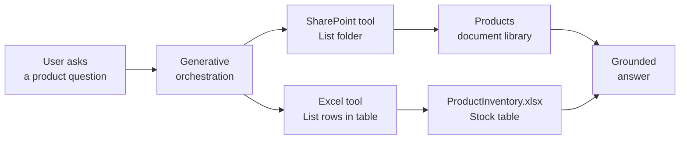
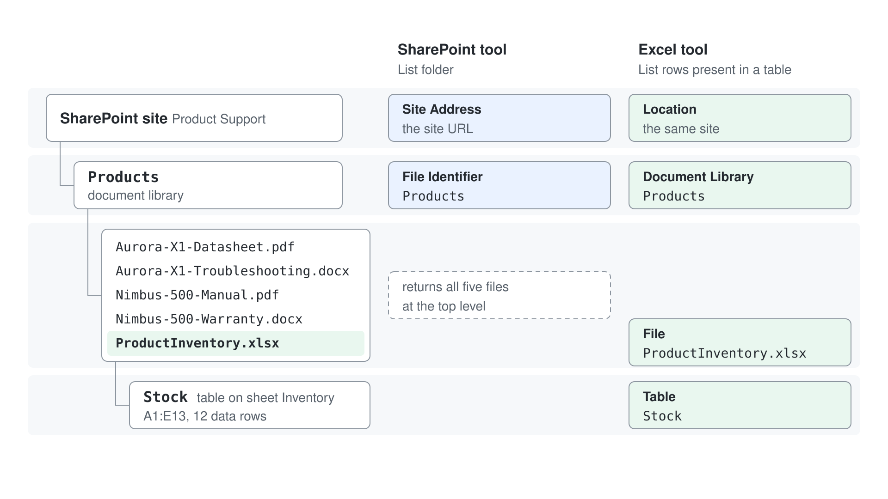
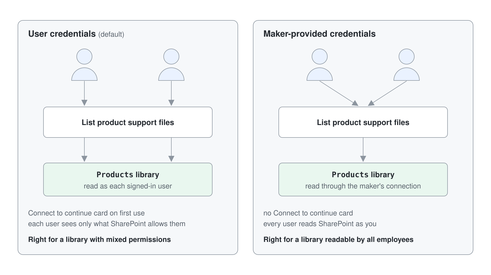

# Give the HR Agent Live SharePoint and Excel Data with Connector Tools

Your product support team keeps its material in two places: the datasheets, manuals, and troubleshooting guides sit in a SharePoint document library, and the current stock and warranty figures live in an Excel workbook next to them. A knowledge source can read those files, but it cannot tell a user what is in the folder right now or what today's stock number is. Connector tools can, because they call the SharePoint and Excel APIs at conversation time and hand the result back to the orchestrator.



In this lab you give the HR agent two more prebuilt connector tools: SharePoint List folder and Excel List rows present in a table. You then tune the tool descriptions until generative orchestration picks the right tool on its own, and use the activity map to prove which tool ran.

This is a rewrite of the Microsoft Learn lab [Create a connector action](https://microsoftlearning.github.io/MS-4022-Extend-Microsoft-365-Copilot-in-Copilot-Studio/Instructions/Labs/03-Connector-actions/01-create-connector-action.html), extended with the Excel and SharePoint scenarios from Copilot Camp.

## What you'll build

- A SharePoint connector tool that lists the live contents of a `Products` document library.
- An Excel connector tool that reads a stock table out of a workbook in that same library.
- Agent instructions that route a question to the right tool, and tool descriptions tuned until the orchestrator stops guessing.

## How the pieces fit



## Prerequisites

- The HR agent; [Set up the HR Agent](#set-up-the-hr-agent) builds it if you don't have it.
- Permission to create a SharePoint site, or an existing site where you may add a document library.
- A site named `Product Support` holding a document library named `Products`, filled with the five files from the [assets](./lab-02-sharepoint-and-excel-connector-tools/assets) folder. Build it by hand as described below.

## Set up the HR Agent

This lab starts from a Standard agent named HR Agent with its description and instructions. If you built it in the Basics labs, for example in [Create Your First Copilot Studio Agent](../../03-cs-basics/01-standard-agents/lab-01-create-your-first-agent.md), open it from **Agents** and skip this section. Otherwise create it now:

1. Go to [Copilot Studio](https://copilotstudio.microsoft.com), on **Home** select **Other ways to build**, then, under **Build with standard orchestration**, select **Agent** with the **Standard** badge.
2. In the **Name your agent** dialog, enter `HR Agent` and select **Create**.
3. Wait until the agent has finished setting up (the **Edit** commands stay disabled for about a minute). On the **Overview** tab, select **Edit** in the **Details** section, paste the following text into **Description** and select **Save**.

```txt
You help employees to find information about HR related policies
```

4. Select **Edit** in the **Instructions** section, paste the following instructions and select **Save**.

```txt
- Provide employees with clear, accurate information about HR policies and procedures.
- Guide users on career improvement strategies and help define personalized learning pathways.
- Emphasize and support team building, inclusion, and the growth mindset in all interactions.
- Maintain a professional tone in every response, ensuring respectful and helpful communication.
- Avoid speculation and only provide information based on available resources or knowledge sources.
- Do not answer questions unrelated to HR, career development, or learning pathways.
- Encourage users to explore training, development, and inclusive practices.
- Respond promptly and clearly to all user queries.
```

Expected: the **Overview** tab of HR Agent shows the description and the instructions.

## Lab files

Everything the agent reads is in [assets](./lab-02-sharepoint-and-excel-connector-tools/assets). The content is fictional (Happy Longnose Ltd, a hardware vendor) but internally consistent, so answers about one product line up across the documents and the stock table.

| File | What it represents |
|------|--------------------|
| `Aurora-X1-Datasheet.pdf` | Product datasheet for the Aurora X1 conference camera: specification table, room sizing, SKU list |
| `Aurora-X1-Troubleshooting.docx` | Support desk troubleshooting guide: symptom table, escalation path, known issues |
| `Nimbus-500-Manual.pdf` | Installation and administration manual for the Nimbus 500 access point: mounting, radio plan, status lights |
| `Nimbus-500-Warranty.docx` | Warranty terms for the Nimbus 500: coverage table, extension, claim process, exclusions |
| `ProductInventory.xlsx` | Stock workbook, sheet `Inventory`, table `Stock`, 12 rows: product code, name, units in stock, warehouse, warranty months |

### Create it by hand

Four steps in the browser, roughly five minutes. Do them in order; the connector inputs in Exercise 2 and Exercise 4 are the values you write down at the end.

#### Step 1: Create the site

Skip to Step 2 if you already have a site you can use.

1. Go to [https://www.office.com/launch/sharepoint](https://www.office.com/launch/sharepoint) and select **Build** > **Site**.
2. Choose **Team site** and the **Standard team** template. A communication site works equally well; the connector does not care which.
3. Set **Site name** to:

```text
Product Support
```

4. Check the site address that SharePoint proposes underneath the name, for example `https://greylogistics.sharepoint.com/sites/ProductSupport`. Copy it now, this is the **Site Address** input the connector needs.
5. Select **Create site**, then **Go to site** on **Your site is ready!**.

Expected: the new site opens on its Home page, with **Documents** already listed in the left navigation.

#### Step 2: Create the Products document library

The lab needs a document library, not a list and not a folder. A library stores files and is what the SharePoint **List folder** action and the Excel connector both read. A custom list stores rows of columns and holds no files at all, so it cannot serve this lab.

1. On the site Home page, select **+ New** in the command bar at the top.
2. Select **Document library**, then **Create blank document library**.
3. Set **Name** to exactly:

```text
Products
```

4. Optionally set **Description** to `Product support material`.
5. Leave **Show in site navigation** checked, then select **Create**.

Expected: the empty `Products` library opens, and `Products` now appears in the left navigation next to **Documents**. The address bar reads something like `https://greylogistics.sharepoint.com/sites/ProductSupport/Products`.

> **Warning:** The name must be exactly `Products`, with a capital P and no trailing space. You type this string into the connector's **File Identifier** input in Exercise 2, and SharePoint matches it literally. Renaming the library later changes its display name but not its internal URL, which then no longer matches what you typed.

#### Step 3: Upload the five files

1. Open the `Products` library.
2. Select **Create or upload** in the command bar, then **Files upload**.
3. Navigate to the [assets](./lab-02-sharepoint-and-excel-connector-tools/assets) folder next to this lab, select all five files, and confirm.
4. Wait until the upload column stops showing progress.

Expected: the library lists exactly five items, four documents and one workbook, with no folders and nothing nested inside a subfolder.

> **Note:** Leave the files at the top level of the library. If you drop them into a subfolder, the **File Identifier** value in Exercise 2 has to become `Products/<subfolder>` instead, and the Excel connector's **File** picker gains an extra level. Keeping them flat matches every value printed in this lab.

#### Step 4: Verify the Excel table

The Excel connector reads a named table, not a sheet and not a plain range. The shipped workbook already has one, so this step is a confirmation rather than a task, but it is worth doing because an unnamed range is the single most common reason Exercise 4 stalls with an empty table picker.

1. In the library, select `ProductInventory.xlsx` to open it in Excel for the web.
2. Select any cell inside the data, for example `B4`.
3. Open the **Table Design** tab in the ribbon and read the **Table Name** box on the left.

Expected: the table name is `Stock` and the range is `A1:E13`, one header row plus twelve data rows. The `Stock` table holds:

```text
ProductCode | ProductName | UnitsInStock | WarehouseLocation | WarrantyMonths
AUR-X1      | Aurora X1   | 142          | Vienna            | 24
NIM-500     | Nimbus 500  | 18           | Graz              | 12
```

#### Write down these four values

Every connector input in the lab comes from this table. Fill in your own site address and keep it next to you.



| Where it is used | Input | Your value |
|------------------|-------|------------|
| Exercise 2, SharePoint tool | Site Address | `https://<tenant>.sharepoint.com/sites/ProductSupport` |
| Exercise 2, SharePoint tool | File Identifier | `Products` |
| Exercise 4, Excel tool | Document Library | `Products` |
| Exercise 4, Excel tool | File | `ProductInventory.xlsx` |
| Exercise 4, Excel tool | Table | `Stock` |

## Exercise 1: Add the SharePoint List folder connector tool

A connector tool is a single action from a Power Platform connector, exposed to the orchestrator as something the agent may call. SharePoint ships as a standard connector, so it is included with every Copilot Studio plan. The **List folder** action returns the items in one folder of one document library, which is exactly the live view a knowledge source cannot give you.

1. Open the HR agent, select the **Tools** tab, then select **+ Add a tool**.
2. Select the **Connector** group, then the **SharePoint** tile, and select **List folder**.
3. If no connection of your own is selected, select **Connection** > **Create new connection**, then **Create**, and pick your Microsoft 365 account.
4. Select **Add and configure**.

Expected: the configuration page of the new **List folder** tool opens, with its name, description, inputs, and completion settings.

> **Tip:** If the SharePoint entry shows dozens of actions, filter with the word `folder`. Do not pick **List root folder**; it returns the top level of the site, not the `Products` library, and produces confusing answers later.

## Exercise 2: Configure the SharePoint tool so the orchestrator can find it

The orchestrator has no memory of your intent. It reads the tool name, the description, and the input descriptions, and from those alone decides whether a user question is a job for this tool. A tool called List folder with the stock description that ships by default competes with every other tool you add. Renaming it in business language and pinning its inputs to fixed values is what makes selection reliable.

1. On the configuration page of the **List folder** tool, change **Name** to:

```text
List product support files
```

2. Change **Description** to:

```text
Lists the product support files that are currently available in the Products document
library on the Product Support SharePoint site. Use this when the user asks which
manuals, datasheets, troubleshooting guides, or warranty documents exist for a product.
```

3. Expand **Additional details** and set **Description**, the text users see when they are asked to sign in, to:

```text
Please sign in to access the Product Support SharePoint site.
```

4. Under **Inputs**, set **Fill using** of **Site Address** to **Custom value** and select **Enter custom value** and paste the site URL; a new site can be missing from the list.
5. Set **Fill using** of **File Identifier** to **Custom value** and enter:

```text
Products
```

6. Select **Save**.

Expected: the tool is listed on the **Tools** tab as **List product support files**, and both inputs show as custom values rather than values the agent must ask the user for.

## Exercise 3: Route questions to the tool and watch it fire

Instructions and tool descriptions work together. The description tells the orchestrator what the tool can do, the instructions tell it when your business wants it used. Adding an explicit routing line is the cheapest way to stop an agent from answering a live-data question from its own general knowledge. The activity map in the test pane then shows you which path it actually took.

1. On the **Overview** page, edit the **Instructions**, add the following to the end, and select **Save**:

```text
When the user asks what support material, documents, manuals, or files exist for a
product, call the "List product support files" tool and answer only from what it
returns. Name the tool you used in your answer.
```

2. Open the test pane and check that **...** > **Show activity map when testing** is on.
3. Send:

```text
What product support files are available?
```

4. If the agent shows a card asking you to allow the connection, select **Allow**.

Expected: the answer lists the real file names from your `Products` library and states that it used the SharePoint tool, and the activity map shows a **List product support files** node together with the values it returned.

## Exercise 4: Add the Excel stock tool

File names answer what exists. They cannot answer how many are left. The Excel Online (Business) action **List rows present in a table** reads a named table out of a workbook and returns it as structured rows, which the orchestrator can filter, count, and summarise. You add it the same way as **List HR candidates** in [Define Tools with Power Platform Connectors](./lab-01-connector-and-flow-tools.md#step-1-consuming-a-power-platform-connector), with an Excel Online (Business) connection, and pin all four inputs to the stock table so the agent never has to ask the user where the data lives.

1. On the **Tools** tab, select **+ Add a tool**, select **Excel Online (Business)** > **List rows present in a table**. If no connection of your own is selected, select **Connection** > **Create new connection**, then **Create**, and pick your Microsoft 365 account. Then select **Add and configure**.
2. Change **Name** to:

```text
Get product stock levels
```

3. Change **Description** to:

```text
Returns the current stock table for all products, including product code, product name,
units in stock, warehouse location, and warranty length in months. Use this when the
user asks about availability, stock, quantities, warehouses, or warranty duration.
```

4. Under **Inputs**, set **Fill using** of every input to **Custom value** with these values:

| Input | Value |
|-------|-------|
| Location | your `Product Support` SharePoint site |
| Document Library | `Products` |
| File | `ProductInventory.xlsx` |
| Table | `Stock` |

In the **Location** list the site appears as **Group - <site name>**. The **Document Library** and **Table** lists stay empty until you select **Refresh**, and **File** is picked with the file browser.

5. Select **Save**.

Expected: the tool is listed as **Get product stock levels**, and all four inputs show concrete values rather than `Dynamically fill with AI`.

## Exercise 5: Make the orchestrator choose between two tools

With one tool, selection is trivial. With two, the orchestrator has to discriminate, and this is where vague descriptions show up as wrong answers. Add a routing rule for the second tool, then deliberately ask a question that needs both tools in one turn and read the plan the orchestrator built.



1. On the **Overview** page, add this to the **Instructions** and select **Save**:

```text
When the user asks about availability, stock, quantities, warehouse, or warranty length,
call the "Get product stock levels" tool. When a question needs both the available
documents and the stock figures, call both tools and combine the results into one answer.
```

2. Start a new test session with the refresh icon at the top of the test pane.
3. Send:

```text
How many Nimbus 500 units do we have in stock, and where are they?
```

4. Then send:

```text
Give me everything you have on the Aurora X1: which support documents exist and how many
units are left.
```

Expected: the first answer quotes the units and warehouse from your table. The second answer contains both file names and stock figures, and the activity map shows two tool nodes in one turn, one per tool.

## Exercise 6: Tune a description until mis-selection stops

Tool selection quality is a description problem, not a model problem. The fastest way to see this is to break it on purpose: make one description vague, watch the orchestrator pick the wrong tool, then repair it. This is the debugging loop you will use on every real agent, and the activity map is the instrument.

1. Open **Get product stock levels** and temporarily replace its description with:

```text
Gets product data.
```

2. Select **Save**, start a new test session, and send:

```text
What warranty do we give on the Nimbus 500?
```

3. Read the activity map and note which tool the orchestrator picked, and whether the answer is right.
4. Restore a precise description:

```text
Returns the current stock table for all products, including product code, product name,
units in stock, warehouse location, and warranty length in months. Use this when the
user asks about availability, stock, quantities, warehouses, or warranty duration. Do
not use this tool to list documents or files.
```

5. Select **Save**, start a new test session, and send the same warranty question again.

Expected: with the vague description the agent may still pick the stock tool, because the routing line from Exercise 5 names it; otherwise it picks the SharePoint tool, asks a clarifying question, or answers from the warranty document instead of the table. With the precise description the activity map shows **Get product stock levels** and the answer quotes the number of months from the table.

> **Tip:** Negative guidance (`Do not use this tool to list documents or files`) is the single most effective fix when two tools overlap. Add it to the tool that keeps getting picked wrongly, not to the one being missed.

## Exercise 7: Decide whose credentials the connectors use

By default a connector tool runs under the credentials of the person chatting with the agent, so every user sees only what SharePoint permissions allow them to see. That is the right default for a support library with mixed permissions. When the data is deliberately public inside the company and you do not want a sign-in prompt, you switch the tool to maker-provided credentials so it runs under your connection instead. The trade-off is explicit: convenience for the user against your own permissions being applied to everyone.



1. Open the **List product support files** tool.
2. Under **Details**, expand **Additional details** and find **Credentials to use**.
3. Note the current setting of user credentials, and review the **Maker-provided credentials** option without applying it yet.
4. Decide for this scenario: the `Products` library is readable by all employees, so maker-provided credentials remove a needless sign-in step. Select **Maker-provided credentials**.
5. Select **Save**, start a new test session, and ask the file listing question again.

Expected: the tool no longer needs the user's own connection, so no connection card can appear for it, and the file list returns immediately.

> **Warning:** Maker-provided credentials mean every user of the agent reads SharePoint as you. Never use it for a library with per-user or per-department restrictions; leave those tools on user credentials.

## Troubleshooting

| Symptom | Likely cause | Fix |
|---------|--------------|-----|
| The tool returns an empty list of files | **File Identifier** points at the site root, not the library folder | Set **File Identifier** to **Custom value** `Products`, and confirm the library name matches exactly |
| The **Upload** command offers no file option, only **New item** | You created a custom list instead of a document library | Delete it and repeat Step 2 of the setup, choosing **Document library** under **+ New** |
| The library is called `Products` but the connector cannot find it | The library was renamed after creation, so its URL still holds the old name | Check the address bar on the library and use that final path segment as the **File Identifier** |
| The Excel table dropdown is empty | The workbook range is not formatted as a table | Open `ProductInventory.xlsx`, apply **Format as Table**, and name the table `Stock` |
| The agent answers stock questions from general knowledge | No routing line in the instructions, or a vague tool description | Add the explicit "when the user asks about availability" rule and make the description name the columns it returns |
| Both tools fire on every question | The two descriptions overlap | Add negative guidance to the over-selected tool, for example `Do not use this tool to list documents or files` |
| A published change does not appear for users | The agent was saved but not published | Select **Publish** again after every instruction or tool change |
| Users see fewer files than you do | The tool runs under user credentials and SharePoint permissions differ | Either fix the library permissions or switch the tool to maker-provided credentials |

## Summary

You gave the HR agent live data out of SharePoint and Excel through connector tools. You can now:

- Add a prebuilt connector action as a tool.
- Pin connector inputs to custom values so the agent stops asking the user for them.
- Write tool names and descriptions that make generative orchestration select correctly between competing tools.
- Use the activity map to prove which tool ran and debug a wrong selection.
- Choose deliberately between user credentials and maker-provided credentials for a connector.

Next, give an agent an action of your own in [Call a Hosted REST API from an Agent](../05-rest-api/lab-01-call-a-secured-rest-api.md), where the data source is a service you host rather than a prebuilt connector.

## Links and resources

[Use Power Platform connectors as tools](https://learn.microsoft.com/microsoft-copilot-studio/advanced-connectors)

[Extend declarative agents with connector actions (training module)](https://learn.microsoft.com/training/modules/extend-declarative-agents-connector-actions-copilot-studio)
