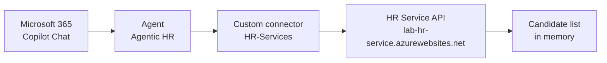

# Eine gehostete REST API aus einem Agent aufrufen

Dies ist die alternative Version von [Eine gesicherte REST API aus einem Agent aufrufen](./lab-01-call-a-secured-rest-api-de.md). Diese Version nutzt den HR Service, der für den Kurs bereits deployt ist, deshalb führen Sie nichts auf Ihrem Rechner aus: keinen Azure Functions Host, keinen Dev Tunnel und keine Entra ID App Registrations. Sie stellen die gehostete API hinter einen Power Platform Custom Connector und lassen einen Agent sie aufrufen.

Der gehostete Service akzeptiert Aufrufe ohne Token. Sie lernen die Mechanik des Connectors (OpenAPI Import, Host-Konfiguration, den Tab **Test**, das Hinzufügen der Action zu einem Agent) und lassen die Identity Chain aus, die das Haupt-Lab behandelt.

**Geschätzte Dauer:** 20 bis 30 Minuten

## Was Sie lernen

- Wie aus einer OpenAPI Specification ein Power Platform Custom Connector wird
- Wie Sie einen Custom Connector auf eine gehostete API richten
- Wie Sie eine Custom Connector Action zu einem Agent hinzufügen und ausführen

## Die beteiligten Teile



Der Service ist derselbe Code wie im Haupt-Lab, [`./hr-service`](./hr-service), und läuft in Azure mit `UseOAuth` auf `false`:

```text
https://lab-hr-service.azurewebsites.net
```

> Der gehostete Service hält die Liste der Kandidatinnen und Kandidaten im Speicher. Alle im Kurs sehen dieselbe Liste, rechnen Sie also mit Einträgen anderer Personen und verwenden Sie Ihren eigenen Namen, wenn Sie Datensätze hinzufügen. Bei jedem Neustart des Service kehrt die Liste zu den Startdaten zurück.

## Voraussetzungen

- Ein Microsoft 365 Tenant und eine Power Platform Environment mit Copilot Studio (die für Sie vorbereitete Environment)
- Ein Browser oder [Visual Studio Code](https://code.visualstudio.com/) mit der [REST Client Extension](https://marketplace.visualstudio.com/items?itemName=humao.rest-client)

Die Specification, die Sie in die Power Platform importieren, ist [`./hr-service-swagger.json`](./hr-service-swagger.json), in diesem Ordner.

---

## Übung 1: Die gehostete API prüfen

Öffnen Sie diese URL in einem Browser:

```text
https://lab-hr-service.azurewebsites.net/api/candidates
```

Sie erhalten ein JSON Array mit Kandidatinnen und Kandidaten zurück. Senden Sie mit dem REST Client denselben Request:

```http
GET https://lab-hr-service.azurewebsites.net/api/candidates
```

Die API stellt vier Operations bereit, alle anonym:

| Methode | Route | Operation |
| --- | --- | --- |
| `GET` | `/api/candidates` | `getCandidates` |
| `GET` | `/api/candidates/{email}` | `getCandidate` |
| `POST` | `/api/candidates` | `addCandidate` |
| `DELETE` | `/api/candidates/{email}` | `removeCandidate` |

Jede Person, die die URL erreicht, kann Datensätze von Kandidatinnen und Kandidaten lesen und löschen. Für einen Kurs-Service ist das akzeptabel, und genau das behebt das Haupt-Lab mit Entra ID.

---

## Übung 2: Den Custom Connector bauen

### Schritt 1: Die OpenAPI-Datei importieren

Öffnen Sie [Power Automate](https://make.powerautomate.com) und wechseln Sie über die Environment-Auswahl rechts oben zur für Sie vorbereiteten Environment. Navigieren Sie zu **More**, **Discover all** und dann **Custom connectors**.

Wählen Sie **+ New custom connector** und dann **Import an OpenAPI file**. Nennen Sie den Connector `HR-Services` und wählen Sie [`hr-service-swagger.json`](./hr-service-swagger.json) in diesem Lab-Ordner. Wählen Sie **Continue**.

Verwenden Sie diese Datei, nicht `hr-service/src/openapi.json`. Der Service liefert eine OpenAPI 3.0 Specification mit, Power Platform Custom Connectors beruhen aber auf Swagger 2.0, deshalb wird die 3.0-Datei abgelehnt oder mit fehlenden Operations importiert. `hr-service-swagger.json` beschreibt dieselbe API in Swagger 2.0, mit drei Ergänzungen, die später wichtig werden:

- Eine `description` an jeder Operation. Generative Orchestration liest sie, um zu entscheiden, ob der Agent die Action aufrufen soll.
- `x-ms-summary` an jedem Parameter und jeder Property; das zeigt die Power Platform als lesbares Feld-Label statt `current_role`.
- `required` Felder in der Candidate Definition, damit der Agent weiß, dass er Vorname, Nachname und E-Mail erfassen muss, bevor er `addCandidate` aufruft.

### Schritt 2: Den Connector auf den gehosteten Service richten

Der Wert `host` in der Datei ist der Platzhalter `your-tunnel-id-7071.euw.devtunnels.ms`, den Sie korrigieren müssen. Im Tab **General**:

- **Host:** `lab-hr-service.azurewebsites.net`, ohne `https://` Präfix und ohne abschließenden Schrägstrich
- **Base URL:** `/` belassen, wie aus der Datei importiert

### Schritt 3: Security ausgeschaltet lassen

Wählen Sie unten auf der Seite **Security** und behalten Sie **No authentication** als Authentication Type. Der gehostete Service validiert kein Token, deshalb gibt es hier nichts zu konfigurieren.

Wählen Sie **Create connector**.

### Schritt 4: Den Connector testen

Öffnen Sie den Tab **Definition** und prüfen Sie, ob die vier Operations aus der Specification importiert wurden. Hier müssen Sie nichts ändern.

Wechseln Sie zum Tab **5. Test** und wählen Sie **+ New connection**. Der Connector hat keine Authentication, deshalb entsteht die Connection ohne Anmeldung. Sobald die Connection besteht, wählen Sie die Operation `getCandidates` und dann **Test operation**.

Eine 200 Response mit der Liste der Kandidatinnen und Kandidaten bedeutet, dass der Connector den gehosteten Service erreicht.

---

## Übung 3: Den Connector aus einem Agent nutzen

### Schritt 1: Die Action hinzufügen

Öffnen Sie [Copilot Studio](https://copilotstudio.microsoft.com) in derselben Environment und bearbeiten Sie Ihren Agent `Agentic HR` aus dem vorigen Lab. Öffnen Sie **Tools** (oder **Actions**, je nach Release) und wählen Sie **+ Add a tool**.

Suchen Sie nach `HR-Services`, wählen Sie **See all**, dann die Operation **Get all candidates** und dann **Add and configure**. Konfigurieren Sie:

| Feld | Wert |
| --- | --- |
| Name | `Get all candidates` |
| Description | Ersetzen Sie den aus der Specification vorausgefüllten Text durch `Lists all the HR candidates from an external system` |
| **Additional details** > **Credentials to use** | **End user credentials** (Standard) |

Wählen Sie **Save**.

Die Description ist keine Dokumentation. Generative Orchestration liest sie, um zu entscheiden, ob diese Action zum Intent des Users passt; bei einer vagen Description wählt der Agent das Tool nicht.

Haben Sie in einem früheren Lab ein gleichwertiges Tool hinzugefügt, etwa **List HR candidates** aus dem Connectors Lab, deaktivieren Sie es jetzt mit seinem Schalter **Enabled** in der Liste **Tools**. Zwei Tools, die dasselbe versprechen, machen die Orchestration unberechenbar.

### Schritt 2: Veröffentlichen und ausführen

Wählen Sie **Publish**. Sobald die Veröffentlichung fertig ist, öffnen Sie Microsoft 365 Copilot Chat, wählen Sie den Agent und senden Sie:

```text
Lists all the HR candidates from an external system
```

Beim ersten Mal fragt ein Consent Prompt, ob der Agent einen externen Service aufrufen darf. Wählen Sie **Allow once**, solange Sie noch testen, oder **Always allow**, sobald Sie dem Service vertrauen. Fordert der Agent Sie auf, sich zuerst zu verbinden, öffnen Sie den Connection Manager, verbinden Sie `HR-Services` und senden Sie den Prompt erneut.

Sie erhalten die Liste der Kandidatinnen und Kandidaten, mit einer Kennzeichnung in der Antwort, dass die Daten aus einem externen Service stammen.

---

## Checkpoint

Sie sind fertig, wenn alle folgenden Punkte zutreffen:

- [ ] `https://lab-hr-service.azurewebsites.net/api/candidates` liefert die Liste der Kandidatinnen und Kandidaten
- [ ] Der Tab **Test** des Custom Connectors liefert 200 mit einer Connection
- [ ] Der Agent liefert die Liste der Kandidatinnen und Kandidaten in Microsoft 365 Copilot Chat
- [ ] Die alte doppelte Action, falls vorhanden, ist deaktiviert

## Troubleshooting

| Symptom | Ursache |
| --- | --- |
| Der Import scheitert, oder der Tab **Definition** zeigt keine Operations | Sie haben `hr-service/src/openapi.json` importiert; importieren Sie stattdessen `hr-service-swagger.json` |
| Aufrufe gehen an die falsche Adresse | Der Platzhalter `host` wurde im Tab **General** nicht ersetzt |
| Der Connector-Test liefert 404 | Der Host trägt ein `https://` Präfix oder einen abschließenden Schrägstrich, oder die Base URL ist nicht `/` |
| Der Agent antwortet aus seinem eigenen Wissen und ruft das Tool nie auf | Die Description der Action ist zu vage, oder eine doppelte Action ist noch aktiviert |
| Die Liste enthält unbekannte Kandidatinnen und Kandidaten | Auf dem gemeinsamen Deployment so gewollt; alle schreiben in dieselbe Liste |
| Von Ihnen hinzugefügte Kandidatinnen und Kandidaten sind verschwunden | Der Service wurde neu gestartet, und die Liste im Speicher ist zu den Startdaten zurückgekehrt |

## Optional: eine zweite gehostete API

Für den Kurs ist auch eine Food Catalog API deployt:

```text
https://lab-food-catalog-api.azurewebsites.net
```

Der Service veröffentlicht ein OpenAPI 3.0 Dokument unter `/openapi/v1.json` und rendert es mit Scalar auf der Startseite der Site, Custom Connectors akzeptieren aber kein OpenAPI 3.0. Importieren Sie stattdessen [`src/assets/food-api-swagger.json`](../../../src/assets/food-api-swagger.json): Es ist das Swagger 2.0 Gegenstück, genauso vorbereitet wie `hr-service-swagger.json`. Es stellt einen Food Inventory Katalog bereit:

| Methode | Route |
| --- | --- |
| `GET`, `POST`, `PUT` | `/Food` |
| `GET` | `/Food/byname` |
| `GET`, `DELETE` | `/Food/{id}` |

Bauen Sie daraus einen Custom Connector genau wie in Übung 2, mit dem Host `lab-food-catalog-api.azurewebsites.net`, der Base URL `/` und **No authentication** im Tab **Security**.

## Weiterführende Ideen

- Importieren Sie die übrigen Operations als Actions und lassen Sie den Agent eine Kandidatin oder einen Kandidaten hinzufügen oder entfernen
- Erfassen Sie die Daten neuer Kandidatinnen und Kandidaten mit `askCandidateData.json` über eine Adaptive Card statt über Freitext-Prompts
- Sichern Sie dieselbe API im Haupt-Lab mit Entra ID ab: [Eine gesicherte REST API aus einem Agent aufrufen](./lab-01-call-a-secured-rest-api-de.md)
- Vergleichen Sie diesen Ablauf mit [Einem Agent MCP Tools auf dem gehosteten Server geben](../06-mcp/lab-01-give-an-agent-mcp-tools-alt-de.md), wo ein MCP Server seine Tools ohne OpenAPI-Datei und ohne Connector-Definition bereitstellt



## Referenz

- [Extend agents with custom connectors](https://microsoft.github.io/copilot-camp/pages/make/copilot-studio/05-connectors/) (das Original-Lab, mit Screenshots zu jedem Schritt)
- [Create a custom connector from an OpenAPI definition](https://learn.microsoft.com/connectors/custom-connectors/define-openapi-definition)
