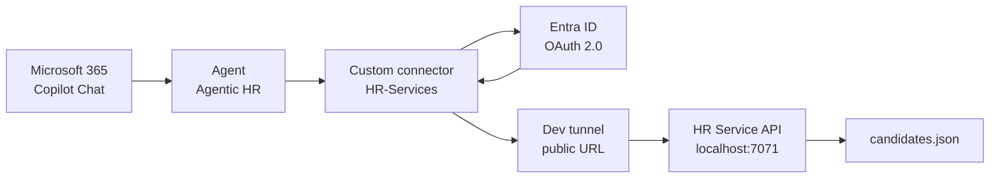
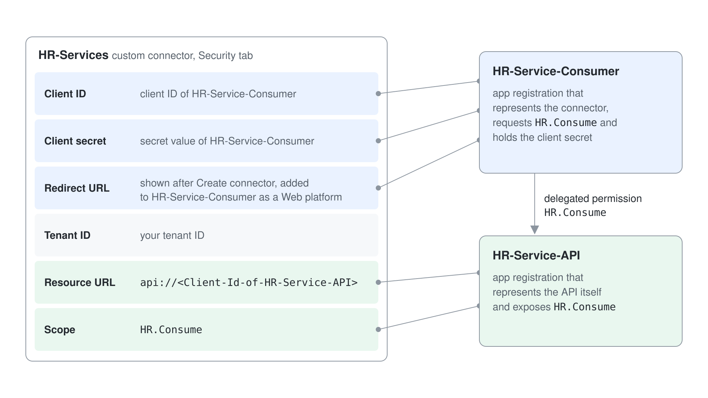

# Eine gesicherte REST API aus einem Agent aufrufen

Über einen Connector erreicht Copilot Studio eine API, für die Microsoft keinen Connector mitliefert. In diesem Lab stellen Sie eine einfache REST API hinter einen Power Platform Custom Connector, sichern den ganzen Weg mit Microsoft Entra ID ab und lassen einen Agent die API im Namen des angemeldeten Users aufrufen. Die API ist ein kleiner HR Service, der eine Liste von Job-Kandidatinnen und -Kandidaten verwaltet.

Es geht in diesem Lab nicht um die API. Es geht um die Identity Chain: Der Agent ruft den Connector auf, der Connector hält eine OAuth 2.0 Client Registration, und die API validiert das Token, das sie erhält. Nirgends in dieser Kette steckt ein Shared Secret fest im Agent, deshalb lässt sich jeder Aufruf einem echten User zuordnen.

**Geschätzte Dauer:** 45 bis 60 Minuten

## Was Sie lernen

- Wie aus einer OpenAPI Specification ein Power Platform Custom Connector wird
- Wie Sie eine API und ihren Consumer als zwei getrennte Entra ID Applications registrieren
- Warum die Consumer App eine Delegated Permission auf der API App braucht und was Ihnen ein Scope tatsächlich bringt
- Wie Sie eine lokal laufende API mit einem Dev Tunnel für die Cloud erreichbar machen
- Wie Sie eine Custom Connector Action zu einem Agent hinzufügen und mit User Authentication ausführen

## Die beteiligten Teile



In diesem Bild tauchen zwei Entra ID Applications auf, und sie zu verwechseln ist der häufigste Grund, warum dieses Lab scheitert:

- **HR-Service-API** steht für die API selbst. Diese Application *stellt* einen Scope namens `HR.Consume` *bereit* und validiert eingehende Tokens.
- **HR-Service-Consumer** steht für den Custom Connector. Diese Application *fordert* den Scope `HR.Consume` *an* und hält das Client Secret, das der Connector nutzt.

Eine API hält nie das Secret ihres eigenen Aufrufers. Erst die beiden getrennten Registrierungen machen das Token aussagekräftig.


## Voraussetzungen

- Ein Microsoft 365 Tenant, in dem Sie Entra ID Applications registrieren dürfen
- Eine Power Platform Environment mit Copilot Studio (die für Sie vorbereitete Environment)
- [Visual Studio Code](https://code.visualstudio.com/)
- [REST Client Extension](https://marketplace.visualstudio.com/items?itemName=humao.rest-client) für Visual Studio Code
- [Node.js v22 oder höher](https://nodejs.org/en) und die [Azure Functions Core Tools](https://learn.microsoft.com/azure/azure-functions/functions-run-local)
- [Dev Tunnel CLI](https://learn.microsoft.com/azure/developer/dev-tunnels/get-started)

Der Quellcode der API liegt bereits in diesem Repository. Sie müssen nichts herunterladen: Nutzen Sie [`./hr-service`](./hr-service). Die Specification, die Sie in die Power Platform importieren, ist [`./hr-service-swagger.json`](./hr-service-swagger.json), ebenfalls in diesem Ordner.

> **Hinweis zum Provisioning:** Der Hauptweg dieses Labs läuft komplett auf Ihrem Rechner und braucht keine Azure Resources. Die gehostete Abkürzung am Ende des Labs und [Einem Agent MCP Tools geben](../06-mcp/lab-01-give-an-agent-mcp-tools-de.md) hängen von zwei Azure App Service Resources ab, `food-catalog-api` und `human-resource-mcp`. Beide müssen provisioniert sein, bevor diese Teile funktionieren. Der Trainer erstellt sie mit [`src/deploy-apis.azcli`](../../../src/deploy-apis.azcli), das auch den Storage Account, Application Insights und die SQL Connection Strings einrichtet, die die Services lesen.

---

## Übung 1: Die API lokal ausführen

### Schritt 1: Den Service starten

Öffnen Sie [`./hr-service`](./hr-service) in Visual Studio Code. Die wichtigen Teile:

| Pfad | Was es ist |
| --- | --- |
| `src/functions/candidatesFunction.ts` | Die Azure Function, die die API implementiert |
| `src/data/candidates.json` | Die Startliste der Kandidatinnen und Kandidaten |
| `src/openapi.json` | Die OpenAPI 3.0 Specification, die der Service mitliefert |
| `askCandidateData.json` | Eine Adaptive Card, die Daten für eine neue Kandidatin oder einen neuen Kandidaten erfasst |
| `http/ht-service.http` | REST Client Requests für lokale Tests |
| `local.settings.json.sample` | Die Konfigurationsvorlage |

Kopieren Sie die Settings-Vorlage in die Datei, die die Runtime tatsächlich liest, und starten Sie dann den Service:

```powershell
cd hr-service
Copy-Item local.settings.json.sample local.settings.json
npm install
npm start
```

Die API stellt vier Operations bereit, vorerst alle anonym:

| Methode | Route | Operation |
| --- | --- | --- |
| `GET` | `/api/candidates` | `getCandidates` |
| `GET` | `/api/candidates/{email}` | `getCandidate` |
| `POST` | `/api/candidates` | `addCandidate` |
| `DELETE` | `/api/candidates/{email}` | `removeCandidate` |

### Schritt 2: Prüfen, ob sie antwortet

Öffnen Sie `http/ht-service.http` und wählen Sie **Send request** über der Zeile `GET http://localhost:7071/api/candidates`. Sie sollten ein JSON Array mit Kandidatinnen und Kandidaten zurückbekommen.

Sehen Sie sich das Terminal an. Neben dem Request Trace steht dort `OAuth is disabled. Skipping token validation`. Genau diesen Zustand ändern Sie gleich: Im Moment kann jede Person, die die URL erreicht, Datensätze von Kandidatinnen und Kandidaten lesen und löschen.

---

## Übung 2: Die API mit Entra ID absichern

### Schritt 1: Die API Application registrieren

Öffnen Sie das [Microsoft Entra Admin Center](https://entra.microsoft.com), wählen Sie **App registrations** und dann **+ New registration**.

- **Name:** `HR-Service-API`
- **Supported account types:** nur Konten in diesem Organisationsverzeichnis

Registrieren Sie die Application und kopieren Sie dann auf der Seite **Overview** die **Application (client) ID** und die **Directory (tenant) ID**. Notieren Sie beide; Sie brauchen jede davon zweimal.

### Schritt 2: Einen Scope bereitstellen

Wählen Sie **Expose an API** und dann **+ Add a scope**. Beim ersten Mal fordert Entra Sie auf, eine **Application ID URI** zu akzeptieren. Übernehmen Sie den Standardwert `api://<Client-Id>` und wählen Sie **Save and continue**.

Definieren Sie jetzt den Scope:

| Feld | Wert |
| --- | --- |
| Scope name | `HR.Consume` |
| Who can consent? | Admins and users |
| Admin consent display name | `HR.Consume` |
| Admin consent description | `Allows consuming the HR Service` |
| User consent display name | `HR.Consume` |
| User consent description | `Allows consuming the HR Service` |
| State | Enabled |

Ein Scope ist eine Delegated Permission: Er ist das Label, das im Token steht, und anhand dessen entscheidet die API, ob dieser Aufrufer hinein darf. Ohne Scope sähe jedes Token aus Ihrem Tenant gleich gültig aus.

### Schritt 3: v2.0 Tokens anfordern

Wählen Sie **Manifest**, wechseln Sie zur Ansicht **Microsoft Graph App Manifest (new)** und setzen Sie:

```json
"requestedAccessTokenVersion": 2
```

Speichern Sie. Die Beispiel-API validiert v2.0 JWTs; bleibt der Standardwert stehen, scheitert die Token-Validierung mit Fehlern, die wie generische 401 Responses aussehen.

### Schritt 4: Die Validierung in der API einschalten

Bearbeiten Sie in Visual Studio Code die Datei `local.settings.json` mit den kopierten Werten:

```json
{
  "IsEncrypted": false,
  "Values": {
    "AzureWebJobsStorage": "UseDevelopmentStorage=true",
    "FUNCTIONS_WORKER_RUNTIME": "node",
    "AAD_APP_CLIENT_ID": "<Client-ID>",
    "AAD_APP_TENANT_ID": "<Tenant-ID>",
    "AAD_APP_OAUTH_AUTHORITY": "https://login.microsoftonline.com/<Tenant-ID>",
    "UseOAuth": "true"
  }
}
```

Starten Sie den Service neu. Senden Sie denselben Request aus `http/ht-service.http` erneut: Er liefert jetzt **401 Unauthorized**, weil der REST Client kein Token mitschickt. Dieser Fehler ist der Checkpoint dieser Übung.

### Schritt 5: Die Consumer Application registrieren

Registrieren Sie eine zweite Application, genau wie in Schritt 1, mit dem Namen `HR-Service-Consumer`. Kopieren Sie ihre Client ID und Tenant ID.

Wählen Sie **Certificates & secrets** und dann **+ New client secret**. Geben Sie eine Beschreibung und ein Ablaufdatum an, fügen Sie das Secret hinzu und kopieren Sie sofort den **Value**. Entra zeigt den Wert eines Secrets einmal und nie wieder.

Wählen Sie **API permissions**, dann **+ Add a permission** und dann **APIs my organization uses**. Suchen Sie nach `HR-Service-API`, wählen Sie die Application, wählen Sie **Delegated permissions**, setzen Sie das Häkchen bei `HR.Consume` und wählen Sie **Add permissions**. Schließen Sie mit **Grant admin consent for \<tenant\>** ab, damit User nicht einzeln gefragt werden.

Lassen Sie diesen Browser-Tab offen. In Übung 4 kehren Sie mit einer Redirect URL hierher zurück.

---

## Übung 3: Die API mit einem Dev Tunnel veröffentlichen

Die Power Platform läuft in der Cloud und erreicht `localhost` nicht. Ein Dev Tunnel gibt Ihrem lokalen Port für die Dauer des Labs eine öffentliche HTTPS URL.


```powershell
devtunnel user login
devtunnel create hr-service -a --host-header unchanged
devtunnel port create hr-service -p 7071
devtunnel host hr-service
```

> Erhalten Sie `Request not permitted. Unauthorized tunnel creation access`, ist der Name des Tunnels bereits vergeben. Wählen Sie einen eindeutigen Namen, zum Beispiel `hr-service-<yourname>`, und verwenden Sie ihn in allen drei Befehlen.

Kopieren Sie aus der Ausgabe die URL **Connect via browser** für Port 7071 und bewahren Sie sie auf. Ihr Host Name hat die Form `<tunnel-id>-7071.euw.devtunnels.ms`, wobei die Tunnel ID ein generierter Wert wie `npjls4nf` ist, nicht der Name, den Sie für den Tunnel gewählt haben. Lassen Sie dieses Terminal für den Rest des Labs laufen. Bricht es ab, starten Sie es mit `devtunnel host hr-service` neu; die URL bleibt dieselbe.

Prüfen Sie den Tunnel mit `http/ht-service-dev-tunnel.http` und ersetzen Sie dabei den Host in dieser Datei durch Ihren eigenen. Sie sollten weiterhin 401 sehen, jetzt über die öffentliche URL.

---

## Übung 4: Den Custom Connector bauen

### Schritt 1: Die OpenAPI-Datei importieren

Öffnen Sie [Power Automate](https://make.powerautomate.com) und wechseln Sie über die Environment-Auswahl rechts oben zur für Sie vorbereiteten Environment. Navigieren Sie zu **More**, **Discover all** und dann **Custom connectors**.

Wählen Sie **+ New custom connector** und dann **Import an OpenAPI file**. Nennen Sie den Connector `HR-Services` und wählen Sie [`hr-service-swagger.json`](./hr-service-swagger.json) in diesem Lab-Ordner. Wählen Sie **Continue**.

Verwenden Sie diese Datei, nicht `hr-service/src/openapi.json`. Der Service liefert eine OpenAPI 3.0 Specification mit, Power Platform Custom Connectors beruhen aber auf Swagger 2.0, deshalb wird die 3.0-Datei abgelehnt oder mit fehlenden Operations importiert. `hr-service-swagger.json` beschreibt dieselbe API in Swagger 2.0, mit drei Ergänzungen, die später wichtig werden:

- Eine `description` an jeder Operation. Generative Orchestration liest sie, um zu entscheiden, ob der Agent die Action aufrufen soll.
- `x-ms-summary` an jedem Parameter und jeder Property; das zeigt die Power Platform als lesbares Feld-Label statt `current_role`.
- `required` Felder in der Candidate Definition, damit der Agent weiß, dass er Vorname, Nachname und E-Mail erfassen muss, bevor er `addCandidate` aufruft.

### Schritt 2: Den Connector auf den Tunnel richten

Der Wert `host` in der Datei ist der Platzhalter `your-tunnel-id-7071.euw.devtunnels.ms`, den Sie korrigieren müssen. Im Tab **General**:

- **Host:** der Host Name Ihrer Dev Tunnel URL, ohne `https://` Präfix und ohne abschließenden Schrägstrich, zum Beispiel `npjls4nf-7071.euw.devtunnels.ms`
- **Base URL:** `/` belassen, wie aus der Datei importiert

### Schritt 3: OAuth 2.0 konfigurieren

Wählen Sie unten auf der Seite **Security**. Wählen Sie **OAuth 2.0** als Authentication Type und **Azure Active Directory** als Identity Provider; das Feld **Resource URL** erscheint erst, wenn Sie den Identity Provider gewählt haben. Füllen Sie dann aus:

| Feld | Wert |
| --- | --- |
| Client ID | Client ID von **HR-Service-Consumer** |
| Secret options | **Use client secret** (Standard) |
| Client secret | Der Secret-Wert aus **HR-Service-Consumer** |
| Authorization URL | Standardwert belassen |
| Tenant ID | Ihre Tenant ID |
| Resource URL | `api://<Client-Id-of-HR-Service-API>` |
| Enable on-behalf-of login | False |
| Scope | `HR.Consume` |

Die Resource URL ist das Feld, bei dem die meisten Fehler passieren. Das Feld bezeichnet die aufgerufene API und nutzt deshalb die Client ID der **API** Application, während jedes andere Feld auf dieser Seite zur **Consumer** Application gehört.



Wählen Sie **Create connector**.

### Schritt 4: Den Kreis mit einer Redirect URL schließen

Nach dem Speichern zeigt der Tab **Security** eine ausgefüllte **Redirect URL**. Kopieren Sie sie.

Kehren Sie in Entra ID zur Registrierung `HR-Service-Consumer` zurück, wählen Sie **Authentication**, dann **+ Add a platform** und dann **Web**. Fügen Sie die Redirect URL ein und wählen Sie **Configure**.

Damit kann Entra den Authorization Code nach der Anmeldung eines Users an die Power Platform zurückgeben. Ohne diesen Eintrag endet der Verbindungsversuch im nächsten Schritt mit dem Redirect-Mismatch-Fehler `AADSTS50011`.

### Schritt 5: Den Connector testen

Öffnen Sie den Tab **Definition** und prüfen Sie, ob die vier Operations aus der Specification importiert wurden. Hier müssen Sie nichts ändern.

Wechseln Sie zum Tab **5. Test**, wählen Sie **+ New connection** und melden Sie sich an, wenn Sie dazu aufgefordert werden. Die Redirect URL aus Schritt 4 muss bereits in der Consumer App eingetragen sein, sonst scheitert die Anmeldung. Sobald die Connection besteht, wählen Sie die Operation `getCandidates` und dann **Test operation**.

Eine 200 Response mit der Liste der Kandidatinnen und Kandidaten bedeutet, dass die ganze Kette funktioniert. Sehen Sie im Terminal von Visual Studio Code nach: Dort steht jetzt `Token is valid for user <username>` statt der früheren Skip-Meldung.

---

## Übung 5: Den Connector aus einem Agent nutzen

### Schritt 1: Die Action hinzufügen

Öffnen Sie [Copilot Studio](https://copilotstudio.microsoft.com) in derselben Environment und bearbeiten Sie Ihren Agent `Agentic HR` aus dem vorigen Lab. Öffnen Sie **Tools** (oder **Actions**, je nach Release) und wählen Sie **+ Add a tool**.

Suchen Sie nach `HR-Services`, wählen Sie **See all**, dann die Operation **Get all candidates** und dann **Add and configure**. Konfigurieren Sie:

| Feld | Wert |
| --- | --- |
| Name | `Get all candidates` |
| Description | Ersetzen Sie den aus der Specification vorausgefüllten Text durch `Lists all the HR candidates from an external system` |
| **Additional details** > **Credentials to use** | **End user credentials** (Standard) |

Wählen Sie **Save**.

Die Description ist keine Dokumentation. Generative Orchestration liest sie, um zu entscheiden, ob diese Action zum Intent des Users passt; bei einer vagen Description wählt der Agent das Tool nicht.

Haben Sie in einem früheren Lab ein gleichwertiges Tool hinzugefügt, etwa **List HR candidates** aus dem Connectors Lab, deaktivieren Sie es jetzt mit seinem Schalter **Enabled** in der Liste **Tools**. Zwei Tools, die dasselbe versprechen, machen die Orchestration unberechenbar.

### Schritt 2: Veröffentlichen und ausführen

Wählen Sie **Publish**. Sobald die Veröffentlichung fertig ist, öffnen Sie Microsoft 365 Copilot Chat, wählen Sie den Agent und senden Sie:

```text
Lists all the HR candidates from an external system
```

Beim ersten Mal erscheinen zwei Aufforderungen:

1. Ein Consent Prompt für den Aufruf eines externen Service. Wählen Sie **Allow once**, solange Sie noch testen, oder **Always allow**, sobald Sie dem Service vertrauen.
2. Eine Anmeldeaufforderung, **Sign in to Agentic HR**. Schließen Sie die Anmeldung ab und senden Sie den Prompt dann erneut.

Sie erhalten die Liste der Kandidatinnen und Kandidaten, mit einer Kennzeichnung in der Antwort, dass die Daten aus einem externen Service stammen. Das Terminal in Visual Studio Code zeigt den passenden Request und die validierte Identität des Users.

---

## Checkpoint

Sie sind fertig, wenn alle folgenden Punkte zutreffen:

- [ ] `GET /api/candidates` liefert 401 ohne Token
- [ ] Der Tab **Test** des Custom Connectors liefert 200 mit einer Connection
- [ ] Das Terminal protokolliert `Token is valid for user <username>`
- [ ] Der Agent liefert die Liste der Kandidatinnen und Kandidaten in Microsoft 365 Copilot Chat
- [ ] Die alte doppelte Action, falls vorhanden, ist deaktiviert

## Troubleshooting

| Symptom | Ursache |
| --- | --- |
| Der Import scheitert, oder der Tab **Definition** zeigt keine Operations | Sie haben `hr-service/src/openapi.json` importiert; importieren Sie stattdessen `hr-service-swagger.json` |
| Aufrufe gehen an die falsche Adresse | Der Platzhalter `host` wurde im Tab **General** nicht ersetzt |
| `AADSTS50011` Reply URL Mismatch | Die Redirect URL des Connectors fehlt in der Plattform **Web** der Consumer App |
| 401 trotz gültiger Connection | `requestedAccessTokenVersion` ist nicht `2`, oder `local.settings.json` enthält die falsche Client ID |
| Der Connector-Test liefert 502 oder läuft in einen Timeout | Der Dev Tunnel oder der Functions Host ist gestoppt; starten Sie beide neu |
| Der Agent antwortet aus seinem eigenen Wissen und ruft das Tool nie auf | Die Description der Action ist zu vage, oder eine doppelte Action ist noch aktiviert |
| Der Consent Prompt wiederholt sich endlos | Für `HR.Consume` in der Consumer App wurde kein Admin Consent erteilt |

## Optional: eine gehostete API ohne lokales Setup

Wenn Sie Azure Functions oder einen Dev Tunnel nicht ausführen können, gibt es eine REST API, die für diesen Kurs bereits deployt ist:

```text
https://food-catalog-api.azurewebsites.net
```

Der Service veröffentlicht ein OpenAPI 3.0 Dokument unter `/openapi/v1.json` und rendert es mit Scalar auf der Startseite der Site, Custom Connectors akzeptieren aber kein OpenAPI 3.0. Importieren Sie stattdessen [`src/assets/food-api-swagger.json`](../../../src/assets/food-api-swagger.json): Es ist das Swagger 2.0 Gegenstück, genauso vorbereitet wie `hr-service-swagger.json`. Es stellt einen Food Inventory Katalog bereit:

| Methode | Route |
| --- | --- |
| `GET`, `POST`, `PUT` | `/Food` |
| `GET` | `/Food/byname` |
| `GET`, `DELETE` | `/Food/{id}` |

Bauen Sie daraus einen Custom Connector genau wie in Übung 4, mit dem Host `food-catalog-api.azurewebsites.net`, der Base URL `/` und **No authentication** im Tab **Security**. Der Service ist anonym, deshalb entfallen Übung 2 und 3.

Die Mechanik des Connectors lernen Sie trotzdem: OpenAPI Import, Host-Konfiguration, den Tab **Test** und das Hinzufügen der Action zu einem Agent. Die Identity Chain, die spannendere Hälfte dieses Labs, lassen Sie aus; nutzen Sie diesen Weg deshalb nur als Ausweichlösung oder zum Aufwärmen vor dem gesicherten Weg.

## Weiterführende Ideen

- Importieren Sie die übrigen Operations als Actions und lassen Sie den Agent eine Kandidatin oder einen Kandidaten hinzufügen oder entfernen
- Erfassen Sie die Daten neuer Kandidatinnen und Kandidaten mit `askCandidateData.json` über eine Adaptive Card statt über Freitext-Prompts
- Vergleichen Sie diesen Ablauf mit [Einem Agent MCP Tools geben](../06-mcp/lab-01-give-an-agent-mcp-tools-de.md), wo ein MCP Server seine Tools ohne OpenAPI-Datei und ohne Connector-Definition bereitstellt



## Referenz

- [Extend agents with custom connectors](https://microsoft.github.io/copilot-camp/pages/make/copilot-studio/05-connectors/) (das Original-Lab, mit Screenshots zu jedem Schritt)
- [Create a custom connector from an OpenAPI definition](https://learn.microsoft.com/connectors/custom-connectors/define-openapi-definition)
- [Configure a client application to access a web API](https://learn.microsoft.com/entra/identity-platform/quickstart-configure-app-access-web-apis)
