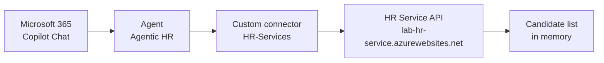

# Call a Hosted REST API from an Agent

This lab uses the HR service that is already deployed for the class, so you run nothing on your machine: no Azure Functions host, no dev tunnel, and no Entra ID app registrations. You put the hosted API behind a Power Platform custom connector and let an agent call it.

The hosted service accepts calls without a token. You learn the connector mechanics (OpenAPI import, host configuration, the **Test** tab, adding the action to an agent) and skip the identity chain.

**Estimated time:** 20 to 30 minutes

## What you will learn

- How an OpenAPI specification becomes a Power Platform custom connector
- How to point a custom connector at a hosted API
- How to add a custom connector action to an agent and run it

## The moving parts



The service is the same code as in the main lab, [`./hr-service`](./hr-service), running in Azure with `UseOAuth` set to `false`:

```text
https://lab-hr-service.azurewebsites.net
```

> The hosted service keeps the candidate list in memory. Everyone in the class sees the same list, so expect to find other people's additions, and use your own name when you add records. The list returns to the seed data whenever the service restarts.

## Prerequisites

- A Microsoft 365 tenant and a Power Platform environment with Copilot Studio (the environment prepared for you)
- A Standard agent named `Agentic HR` that is available in Microsoft 365 Copilot; [Set up the Agentic HR agent](#set-up-the-agentic-hr-agent) builds it if you don't have it.
- A browser, or [Visual Studio Code](https://code.visualstudio.com/) with the [REST Client extension](https://marketplace.visualstudio.com/items?itemName=humao.rest-client)

The specification you import into Power Platform is [`./hr-service-swagger.json`](./hr-service-swagger.json), in this folder.

---

## Set up the Agentic HR agent

Exercise 3 adds the connector to a Standard agent named `Agentic HR` that is available in Microsoft 365 Copilot. If you built it in [Publish the HR Agent to Teams and Microsoft 365 Copilot](../../03-cs-basics/06-publishing/lab-01-publish-to-teams-and-copilot.md), open it from **Agents** and skip this section. Otherwise create it now:

1. Go to [Copilot Studio](https://copilotstudio.microsoft.com), on **Home** select **Other ways to build**, then, under **Build with standard orchestration**, select **Agent** with the **Standard** badge.
2. In the **Name your agent** dialog, enter `Agentic HR` and select **Create**.
3. Wait until the agent has finished setting up (the **Edit** commands stay disabled for about a minute). On the **Overview** page, select **Edit** in **Instructions**, paste the following instructions and select **Save**.

```text
You are an agent helping employees to find information about HR policies and procedures, about how to improve their career, and about how to define learning pathways.
Emphasize everything that helps team building, inclusion, and the growth mindset.
It should have a professional tone.
```

4. Select **Publish** in the upper right corner of the page, then **Publish** in the dialog.
5. Open **Channels**, select **Microsoft 365 and Microsoft Teams**, keep **Make agent available in Microsoft 365 Copilot** selected and select **Add channel**.

Expected: **Channels** lists **Microsoft 365 and Microsoft Teams** as added for `Agentic HR`.

---

## Exercise 1: Check the hosted API

Open this URL in a browser:

```text
https://lab-hr-service.azurewebsites.net/api/candidates
```

You get a JSON array of candidates back. With REST Client, send the same request:

```http
GET https://lab-hr-service.azurewebsites.net/api/candidates
```

The API exposes four operations, all anonymous:

| Method | Route | Operation |
| --- | --- | --- |
| `GET` | `/api/candidates` | `getCandidates` |
| `GET` | `/api/candidates/{email}` | `getCandidate` |
| `POST` | `/api/candidates` | `addCandidate` |
| `DELETE` | `/api/candidates/{email}` | `removeCandidate` |

Anyone who can reach the URL can read and delete candidate records. That is acceptable for a class service and exactly what the main lab fixes with Entra ID.

---

## Exercise 2: Build the custom connector

### Step 1: Import the OpenAPI file

Go to [Power Automate](https://make.powerautomate.com) and switch to the environment prepared for you with the environment picker in the top right corner. Navigate to **More**, **Discover all**, then **Custom connectors**.

Select **+ New custom connector**, then **Import an OpenAPI file**. Name the connector `HR-Services` and browse to [`hr-service-swagger.json`](./hr-service-swagger.json) in this lab folder. Select **Continue**.

Use that file, not `hr-service/src/openapi.json`. The service ships an OpenAPI 3.0 specification, and Power Platform custom connectors are built on Swagger 2.0, so the 3.0 file is rejected or imported with missing operations. `hr-service-swagger.json` is the same API expressed in Swagger 2.0, with three additions that matter downstream:

- A `description` on every operation. Generative orchestration reads these to decide whether the agent should call the action.
- `x-ms-summary` on every parameter and property, which is what Power Platform shows as a friendly field label instead of `current_role`.
- `required` fields on the candidate definition, so the agent knows it must collect a first name, last name, and email before calling `addCandidate`.

### Step 2: Point the connector at the hosted service

The `host` value in the file is the placeholder `your-tunnel-id-7071.euw.devtunnels.ms`, so you have to correct it. On the **General** tab:

- **Host:** `lab-hr-service.azurewebsites.net`, with no `https://` prefix and no trailing slash
- **Base URL:** leave `/`, as imported from the file

### Step 3: Leave security off

Select **Security** at the bottom of the page and keep **No authentication** as the authentication type. The hosted service validates no token, so there is nothing to configure here.

Select **Create connector**.

### Step 4: Test the connector

Open the **Definition** tab and confirm the four operations imported from the specification. You do not need to change anything here.

Switch to the **5. Test** tab and select **+ New connection**. The connector has no authentication, so the connection is created without a sign-in. Once the connection exists, select the `getCandidates` operation and select **Test operation**.

A 200 response with the candidate list means the connector reaches the hosted service.

---

## Exercise 3: Consume the connector from an agent

### Step 1: Add the action

Open [Copilot Studio](https://copilotstudio.microsoft.com) in the same environment and edit your `Agentic HR` agent. Go to **Tools** (or **Actions**, depending on your release) and select **+ Add a tool**.

Search for `HR-Services`, select **See all**, select the **Get all candidates** operation, then **Add and configure**. Configure:

| Field | Value |
| --- | --- |
| Name | `Get all candidates` |
| Description | Replace the text prefilled from the specification with `Lists all the HR candidates from an external system` |
| **Additional details** > **Credentials to use** | **End user credentials** (default) |

Select **Save**.

The description is not documentation. Generative orchestration reads it to decide whether this action matches the user's intent, so a vague description means the agent will not pick the tool.

If you added an equivalent tool in an earlier lab, such as **List HR candidates** from the connectors lab, disable it now with its **Enabled** switch in the **Tools** list. Two tools that claim to do the same thing make orchestration unpredictable.

### Step 2: Publish and run it

Select **Publish**. Once publishing finishes, open Microsoft 365 Copilot Chat, select the agent, and send:

```text
Lists all the HR candidates from an external system
```

The first time, a consent prompt asks to call an external service. Select **Allow once** while you are still testing, or **Always allow** once you trust it. If the agent asks you to connect first, open the connection manager, connect `HR-Services`, and send the prompt again.

You get the candidate list, with an indicator in the response showing the data came from an external service.

---

## Checkpoint

You are done when all of the following are true:

- [ ] `https://lab-hr-service.azurewebsites.net/api/candidates` returns the candidate list
- [ ] The custom connector's **Test** tab returns 200 with a connection
- [ ] The agent returns the candidate list in Microsoft 365 Copilot Chat
- [ ] The old duplicate action, if any, is disabled

## Troubleshooting

| Symptom | Cause |
| --- | --- |
| The import fails, or the **Definition** tab shows no operations | You imported `hr-service/src/openapi.json`; import `hr-service-swagger.json` instead |
| Calls go to the wrong address | The `host` placeholder was not replaced on the **General** tab |
| Connector test returns 404 | The host carries an `https://` prefix or a trailing slash, or the base URL is not `/` |
| The agent answers from its own knowledge and never calls the tool | The action description is too vague, or a duplicate action is still enabled |
| The list contains unfamiliar candidates | Expected on the shared deployment; everyone writes to the same list |
| Candidates you added are gone | The service restarted and the in-memory list returned to the seed data |

## Optional: a second hosted API

A food catalog API is deployed for the class as well:

```text
https://lab-food-catalog-api.azurewebsites.net
```

The service publishes an OpenAPI 3.0 document at `/openapi/v1.json` and renders it with Scalar at the site root, but custom connectors do not accept OpenAPI 3.0. Import [`src/assets/food-api-swagger.json`](../../../src/assets/food-api-swagger.json) instead: it is the Swagger 2.0 equivalent, prepared the same way as `hr-service-swagger.json`. It exposes a Food Inventory catalog:

| Method | Route |
| --- | --- |
| `GET`, `POST`, `PUT` | `/Food` |
| `GET` | `/Food/byname` |
| `GET`, `DELETE` | `/Food/{id}` |

Build a custom connector from it the same way as in Exercise 2, with the host `lab-food-catalog-api.azurewebsites.net`, base URL `/`, and **No authentication** on the **Security** tab.

## Going further

- Import the remaining operations as actions and ask the agent to add or remove a candidate
- Use `askCandidateData.json` to collect new candidate data with an Adaptive Card instead of free-text prompts
- Compare this flow with [Give an Agent MCP Tools on the Hosted Server](../06-mcp/lab-01-give-an-agent-mcp-tools.md), where an MCP server exposes its tools without an OpenAPI file or a connector definition



## Reference

- [Extend agents with custom connectors](https://microsoft.github.io/copilot-camp/pages/make/copilot-studio/05-connectors/) (the upstream lab, with screenshots for every step)
- [Create a custom connector from an OpenAPI definition](https://learn.microsoft.com/connectors/custom-connectors/define-openapi-definition)
