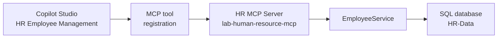
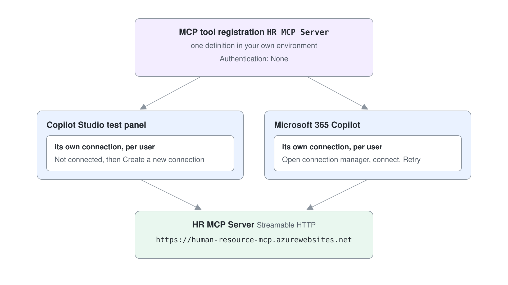
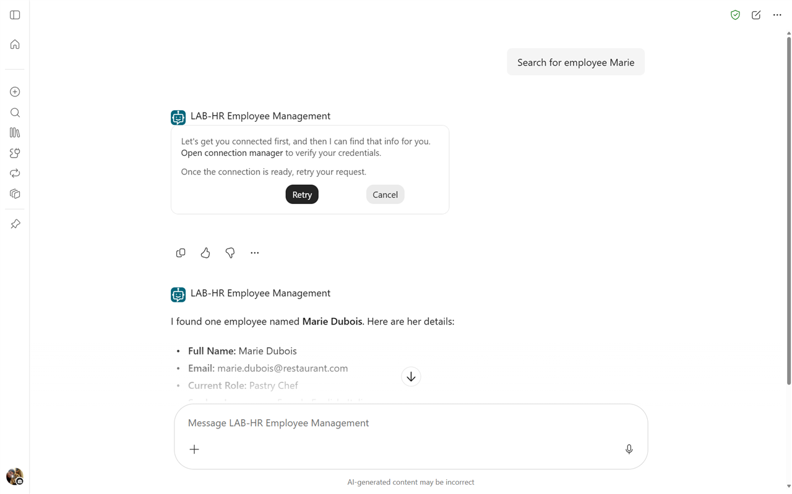

# Einem Agent MCP Tools auf dem gehosteten Server geben

Dieses Lab läuft gegen den HR MCP Server, der für den Kurs bereits deployt ist. In [Eine gehostete REST API aus einem Agent aufrufen](../05-rest-api/lab-01-call-a-secured-rest-api-de.md) haben Sie eine API mit OpenAPI beschrieben, in einen Custom Connector verpackt und eine Operation auf eine Action abgebildet. Dieses Lab erledigt dieselbe Aufgabe mit weit weniger Aufwand. Sie geben Copilot Studio die URL eines Model Context Protocol (MCP) Servers, und jedes Tool, das der Server bereitstellt, erscheint sofort im Agent.

Genau dieser Unterschied ist die Lektion. Ein Connector ist ein Design-Time Contract: Sie importieren eine Specification, und die Tool-Liste bleibt eingefroren, bis Sie sie neu importieren. Ein MCP Server ist ein Runtime Contract: Der Agent fragt den Server, was er kann, deshalb steht ein serverseitig hinzugefügtes Tool dem Agent zur Verfügung, ohne dass Sie den Agent anfassen.



Sie nutzen den HR MCP Server aus diesem Repository, eine .NET 10 Anwendung auf Basis des MCP C# SDK. Er verwaltet Mitarbeitende in einer SQL-Datenbank und kann Schichten zuweisen.

**Geschätzte Dauer:** 30 bis 40 Minuten

## Was Sie lernen

- Was ein MCP Server bereitstellt und wie sich Tool Discovery von der festen Operation-Liste eines Connectors unterscheidet
- Wie Sie einen MCP Server in Copilot Studio als Tool registrieren und sich mit ihm verbinden
- Wie Connections für MCP Tools im Test Panel und noch einmal in Microsoft 365 Copilot funktionieren

## Die beteiligten Teile



Die Tool-Liste erfährt der Agent nie von Ihnen. Er ruft `tools/list` auf dem Server auf und erhält den aktuellen Satz, mit Namen, Beschreibungen und Parameter Schemas, die aus den C# Methodensignaturen generiert werden.

## Die verfügbaren Tools

| Tool | Was es tut |
| --- | --- |
| `list_employees` | Liefert die ganze Liste der Mitarbeitenden |
| `search_employees` | Sucht nach Name, E-Mail, Skills oder aktueller Rolle |
| `add_employee` | Fügt eine mitarbeitende Person hinzu, optional mit Sprachen und Skills |
| `update_employee` | Aktualisiert eine vorhandene mitarbeitende Person, gefunden über die E-Mail |
| `remove_employee` | Entfernt eine mitarbeitende Person über die E-Mail |
| `assign_shift` | Weist eine mitarbeitende Person nach Name, Datum und Position einer 8-Stunden-Schicht zu |

Zu jeder mitarbeitenden Person gehören persönliche Angaben (Vorname, Nachname, E-Mail) und berufliche Angaben (gesprochene Sprachen, Skills, aktuelle Rolle).

## Voraussetzungen

- Ein Microsoft 365 Tenant und eine Power Platform Environment mit Copilot Studio.
- Ihre eigene Environment: Wählen Sie unten in der linken Navigation den Namen der Environment (**Switch environment**) und prüfen Sie, dass unter **Current environment** die nach Ihrem Account benannte Environment steht, zum Beispiel `copilot-studio-01` (Sandbox) für `copilot-studio-01@mst.fastlane.net`. Arbeiten Sie das ganze Lab darin, nie in der gemeinsamen Default Environment.

Der Server ist für diesen Kurs deployt und akzeptiert Aufrufe ohne Authentication:

```text
https://lab-human-resource-mcp.azurewebsites.net
```

Den Quellcode finden Sie in diesem Repository unter [`src/hr-mcp-server`](../../../src/hr-mcp-server), falls Sie ihn lesen oder ändern möchten.

> Der deployte Server schreibt in eine gemeinsame Datenbank. Alle im Kurs sehen dieselbe Liste der Mitarbeitenden, rechnen Sie also mit Einträgen anderer Personen und verwenden Sie Ihren eigenen Namen, wenn Sie Datensätze hinzufügen.

---

## Übung 1: Den Agent erstellen

### Schritt 1: Den Agent anlegen

Öffnen Sie [Copilot Studio](https://copilotstudio.microsoft.com) und wechseln Sie zu Ihrer eigenen Environment, der nach Ihrem Account benannten. Wählen Sie auf der Startseite unter **Other ways to build** den Eintrag **Agent** mit dem Badge **Standard**. Der Dialog **Name your agent** fragt nur nach dem Namen; geben Sie ihn ein und bestätigen Sie.

- **Name:**

```text
HR Employee Management
```

Wählen Sie dann auf der Seite **Overview** jeweils **Edit** in **Details** und **Instructions**, tragen Sie die folgenden Werte ein und wählen Sie jeweils **Save**:

- **Description:**

```text
An AI assistant that helps manage HR employees using MCP server integration
for comprehensive employee management
```

- **Instructions:**

```text
You are a helpful HR assistant that specializes in employee management. You can help users search
for employees, get detailed employee information, add new employees to the system, and assign
employees to shifts.
Always provide clear and helpful information about employees, including their skills, spoken
languages, current role, and contact details.
When assigning a shift, confirm the employee name, the date, and the position back to the user.
```

- **Model:** GPT-5 Chat (das Model Dropdown steht standardmäßig auf GPT Chat Latest)

Wählen Sie **Publish**.

Beachten Sie, was in den Instructions fehlt: jede Erwähnung von Tool-Namen. Die Orchestration gleicht den Intent mit den Tool-Beschreibungen ab, die der Server veröffentlicht, deshalb legen die Instructions Verhalten und Tonfall fest, während der Server die Fähigkeiten liefert.

### Schritt 2: Suggested Prompts hinzufügen

Füllen Sie auf der Seite **Overview** die **Suggested prompts** aus:

| Titel | Prompt |
| --- | --- |
| List all employees | `List all the employees` |
| Search employees | `Search for employees with name [NAME_TO_SEARCH]` |
| Add new employee | `Add an employee with firstname [FIRSTNAME], lastname [LASTNAME], e-mail [EMAIL], role [ROLE], spoken languages [LANGUAGES], and skills [SKILLS]` |
| Assign a shift | `Assign [NAME] to the [POSITION] shift on [DATE]` |

Wählen Sie **Save**.

---

## Übung 2: Den MCP Server an den Agent anbinden

### Schritt 1: Den Server als Tool registrieren

Öffnen Sie in Ihrem Agent **Tools** und wählen Sie **Add tool**. Wählen Sie im Dialog **Add tool** die Karte **Add new MCP**.

Konfigurieren Sie den Server im Formular **Add a Model Context Protocol server**:

| Feld | Wert |
| --- | --- |
| Server name | `HR MCP Server` |
| Server description | `Allows managing the list of employees and their shifts for the HR department` |
| Server URL | `https://lab-human-resource-mcp.azurewebsites.net` |
| Authentication | None |

Wählen Sie **Create**.

Die Authentication ist `None`, weil dieser Server für den Kurs offen ist. In Production würden Sie Entra ID davorschalten.

### Schritt 2: Verbinden

Copilot Studio erstellt das Tool und fordert dann eine Connection an; der Status zeigt **Not connected**. Wählen Sie diesen Status, dann **Create new connection** und dann **Create** (der Display Name ist optional).

Einen Server zu registrieren und sich mit ihm zu verbinden sind zwei getrennte Vorgänge. Die Registrierung ist eine Definition in der Environment; die Connection gilt pro User, und deshalb verbinden Sie sich später in Microsoft 365 Copilot erneut.



Wählen Sie nach dem Verbinden **Add**. Wählen Sie das Tool in der Liste **Tools**, um seine Detailseite zu öffnen; sie listet alle sechs Tools, die dem Agent jetzt zur Verfügung stehen.

### Schritt 3: Im Agent testen

Wählen Sie **Publish** und nutzen Sie dann das Test Panel:

```text
List all employees
```

Bittet Copilot Studio Sie, **Open connection manager** zu wählen, verbinden Sie sich dort und wählen Sie **Retry**. Danach erhalten Sie die Liste der Mitarbeitenden, erzeugt vom Tool `list_employees`.

Probieren Sie ein Tool mit Argumenten:

```text
Add an employee with firstname John, lastname Smith, email john.smith@greylogistics.com,
role Software Engineer, spoken languages English and Spanish, skills React and Node.js
```

Der Agent extrahiert jedes Argument aus Ihrem Satz und ruft `add_employee` auf. Prüfen Sie das Ergebnis mit `List all employees` und finden Sie den neuen Datensatz am Ende.

Testen Sie jetzt das Tool, für das es im Connector Lab kein Gegenstück gibt:

```text
Assign John Smith to the bar shift on 2026-08-03 starting at 10
```

Weitere Prompts, die sich lohnen:

```text
Update the employee with email john.smith@greylogistics.com to speak also French
```

```text
Search for employees with skill Wine Pairing
```

```text
Remove employee john.smith@greylogistics.com
```

---

## Übung 3: In Microsoft 365 Copilot veröffentlichen

Wählen Sie **Channels** und dann die Karte **Microsoft 365 and Microsoft Teams**. Wählen Sie **Add channel**, setzen Sie das Häkchen bei **Make agent available in Microsoft 365 Copilot**, wählen Sie **Save** und wählen Sie erneut **Publish**.

Wählen Sie dann **See agent in Microsoft 365**. Microsoft 365 Copilot öffnet sich mit Ihrem Agent. Zeigt Microsoft 365 Copilot eine Schaltfläche **Add**, wählen Sie sie.

Führen Sie einen Prompt aus wie:

```text
Search for employee Marie
```

Sie werden erneut aufgefordert, den Connection Manager zu öffnen. Das ist so gewollt: Die Connection, die Sie im Maker Portal erstellt haben, gehört zu diesem Kontext, und Microsoft 365 Copilot ist ein anderer.

1. Der Agent antwortet zuerst mit `Let's get you connected first` und einem Link **Open connection manager**. Wählen Sie den Link.
1. Auf **Manage your connections** zeigt Ihr MCP Server **Not Connected**. Wählen Sie **Connect**.
1. Der Dialog **Create or pick a connection** bietet die Connection an, die Sie in Übung 2 erstellt haben. Behalten Sie sie und wählen Sie **Submit**.
1. Sobald die Zeile **Connected** zeigt, wählen Sie **Submit** auf der Seite.
1. Kehren Sie zum Chat zurück und wählen Sie **Retry** in der Antwort des Agents.

Der Agent antwortet mit der passenden Mitarbeiterin, Marie Dubois.



---

## Checkpoint

- [ ] Das Tool `HR MCP Server` ist im Agent mit einer aktiven Connection registriert
- [ ] Der Agent listet die Mitarbeitenden im Test Panel
- [ ] Der Agent fügt mit einem einzigen Prompt in natürlicher Sprache eine mitarbeitende Person hinzu
- [ ] Der Agent weist eine Schicht zu
- [ ] Der Agent antwortet in Microsoft 365 Copilot, nachdem Sie sich dort verbunden haben

## Troubleshooting

| Symptom | Ursache |
| --- | --- |
| Copilot Studio lehnt die URL ab | Ein abschließender Schrägstrich oder ein Pfad wurde angehängt; verwenden Sie die reine Server URL |
| Der Agent antwortet, ruft aber nie ein Tool auf | Der Agent wurde nach dem Hinzufügen des Tools nicht veröffentlicht, oder die Connection fehlt |
| `Open connection manager` erscheint immer wieder | Sie haben sich in einem anderen Kontext verbunden; jeder Channel braucht seine eigene Connection |
| Die Liste der Mitarbeitenden enthält unbekannte Datensätze | Auf dem gemeinsamen Deployment so gewollt; alle schreiben in dieselbe Datenbank |

## Connector oder MCP Server

| | Custom Connector (REST API Lab) | MCP Server (dieses Lab) |
| --- | --- | --- |
| Contract | OpenAPI-Datei, zur Design Time importiert | Zur Runtime über `tools/list` entdeckt |
| Eine Fähigkeit hinzufügen | Specification neu importieren, Action neu hinzufügen | Methode hinzufügen, Server neu starten |
| Konfiguration pro Action | Name, Description und Authentication pro Action | Aus den Tool-Metadaten des Servers übernommen |
| Authentication | OAuth 2.0, im Connector verdrahtet | Auf der Server-Registrierung konfiguriert |
| Am besten für | Bestehende REST APIs und stabile Contracts | Tool Sets, die sich weiterentwickeln, und Wiederverwendung über AI Clients hinweg |

MCP ersetzt Connectors nicht. Es passt zu Capability Sets, die sich oft ändern und die Sie über mehrere AI Clients hinweg wiederverwenden möchten, denn derselbe Server funktioniert auch mit Claude, VS Code und jedem anderen MCP Host.



## Referenz

- [Consuming an MCP server](https://microsoft.github.io/copilot-camp/pages/make/copilot-studio/06-mcp/) (das Original-Lab, mit Screenshots zu jedem Schritt)
- [Extend your agent with Model Context Protocol](https://learn.microsoft.com/microsoft-copilot-studio/agent-extend-action-mcp)
- [Model Context Protocol specification](https://modelcontextprotocol.io/)
- [MCP for beginners](https://github.com/microsoft/mcp-for-beginners)
