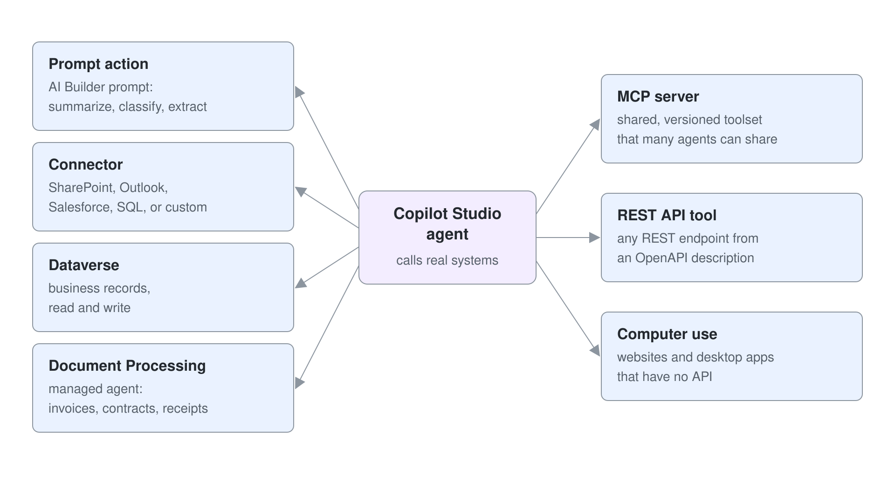

# Extending Copilot Studio Agents with Tools

These labs give the Standard HR agent tools that act: a prompt, connector and flow tools, a secured REST API behind a custom connector, and an MCP server. The theory and demos for each topic are in [demos/04-cs-tools](../../demos/04-cs-tools/readme.md).

| Lab | Focus |
|-----|-------|
| [Invoke Prompts from a Copilot Studio Agent](./01-prompts/lab-01-build-a-prompt-tool.md) | A prompt built in prompt builder with typed inputs, called from the agent as a tool |
| [Define Tools with Power Platform Connectors](./03-connectors/lab-01-connector-and-flow-tools.md) | Excel Online connector tools and a Power Automate flow tool for the HR agent, called from a topic and by generative orchestration |
| [Call a Secured REST API from an Agent](./05-rest-api/lab-01-call-a-secured-rest-api.md) | An HR API behind a custom connector secured with Microsoft Entra ID, called on behalf of the signed-in user; the API source is in [05-rest-api/hr-service](./05-rest-api/hr-service) |
| [Give an Agent MCP Tools](./06-mcp/lab-01-give-an-agent-mcp-tools.md) | The HR MCP server registered as a tool, with every server tool discovered at runtime; its source is in [src/hr-mcp-server](../../src/hr-mcp-server) |

## More Practice on Microsoft Learn

- [Use prompts to make your agent perform specific tasks](https://learn.microsoft.com/en-us/microsoft-copilot-studio/nlu-prompt-node)
- [Extend declarative agents with prompt tools in Copilot Studio](https://learn.microsoft.com/en-us/training/modules/extend-declarative-agents-prompt-actions-copilot-studio/)
- [Extend declarative agents with connector tools in Copilot Studio](https://learn.microsoft.com/en-us/training/modules/extend-declarative-agents-connector-actions-copilot-studio)
- [Using Dataverse and integrating data](https://learn.microsoft.com/en-us/training/modules/create-bots-power-virtual-agents-copilot/)
- [Configure the Store Operations agent in Copilot Studio](https://learn.microsoft.com/en-us/training/modules/retail-configure-store-operations-copilot-studio/) (optional)
