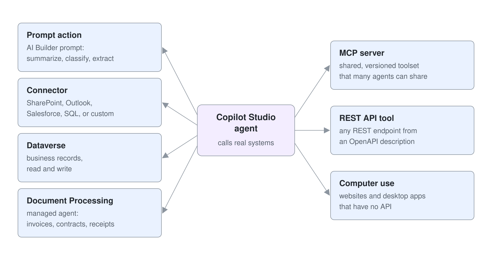

# Extending Copilot Studio Agents with Tools

These labs give the Standard HR agent tools that act: a prompt, connector and flow tools, a secured REST API behind a custom connector, and an MCP server. The theory and demos for each topic are in [demos/04-cs-tools](../../demos/04-cs-tools/readme.md).

| Lab | Deutsch | Focus | Minutes |
|-----|---------|-------|---------|
| [Invoke Prompts from a Copilot Studio Agent](./01-prompts/lab-01-build-a-prompt-tool.md) | [Prompts aus einem Copilot Studio Agent aufrufen](./01-prompts/lab-01-build-a-prompt-tool-de.md) | A prompt built in prompt builder with typed inputs, called from the agent as a tool | 10 |
| [Answer and Record Job Openings in Dataverse](./02-dataverse/lab-01-answer-and-record-job-openings-in-dataverse.md) | [Job Openings in Dataverse beantworten und erfassen](./02-dataverse/lab-01-answer-and-record-job-openings-in-dataverse-de.md) | A Dataverse table as knowledge for the HR agent, and a Dataverse connector tool that records a new row after the user confirms | 20 |
| [Define Tools with Power Platform Connectors](./03-connectors/lab-01-connector-and-flow-tools.md) | [Tools mit Power Platform Connectors definieren](./03-connectors/lab-01-connector-and-flow-tools-de.md) | Excel Online connector tools and a Power Automate flow tool for the HR agent, called from a topic and by generative orchestration | 15 |
| [Give the HR Agent Live SharePoint and Excel Data with Connector Tools](./03-connectors/lab-02-sharepoint-and-excel-connector-tools.md) | [Dem HR Agent live SharePoint- und Excel-Daten mit Connector Tools geben](./03-connectors/lab-02-sharepoint-and-excel-connector-tools-de.md) | SharePoint List folder and Excel List rows tools for the HR agent, with descriptions tuned until generative orchestration picks the right one | 25 |
| [Calculate a Start Date with an Agent Flow](./04-agent-flows/lab-01-calculate-a-start-date-with-an-agent-flow.md) | [Ein Startdatum mit einem Agent Flow berechnen](./04-agent-flows/lab-01-calculate-a-start-date-with-an-agent-flow-de.md) | An agent flow that calculates a new hire's earliest start date with a built-in date action, called by the HR agent as a tool | 15 |
| [Call a Secured REST API from an Agent](./05-rest-api/lab-01-call-a-secured-rest-api.md) | [Eine gesicherte REST API aus einem Agent aufrufen](./05-rest-api/lab-01-call-a-secured-rest-api-de.md) | An HR API behind a custom connector secured with Microsoft Entra ID, called on behalf of the signed-in user; the API source is in [05-rest-api/hr-service](./05-rest-api/hr-service) | 50 |
| [Give an Agent MCP Tools](./06-mcp/lab-01-give-an-agent-mcp-tools.md) | [Einem Agent MCP Tools geben](./06-mcp/lab-01-give-an-agent-mcp-tools-de.md) | The HR MCP server registered as a tool, with every server tool discovered at runtime; its source is in [src/hr-mcp-server](../../src/hr-mcp-server) | 40 |
| [Run a Food Shop Back Office with Computer Use](./07-computer-use/lab-01-run-the-food-shop-with-computer-use.md) | [Das Back Office eines Food Shops mit Computer Use betreiben](./07-computer-use/lab-01-run-the-food-shop-with-computer-use-de.md) | Three computer use tools that read stock, change a dish on its edit page and check out an order in the class food shop; its source is in [src/food-shop](../../src/food-shop) and [src/food-catalog-service](../../src/food-catalog-service) | 65 |
| **Total** | | | **240** |

## More Practice on Microsoft Learn

- [Use prompts to make your agent perform specific tasks](https://learn.microsoft.com/en-us/microsoft-copilot-studio/nlu-prompt-node)
- [Extend declarative agents with prompt tools in Copilot Studio](https://learn.microsoft.com/en-us/training/modules/extend-declarative-agents-prompt-actions-copilot-studio/)
- [Extend declarative agents with connector tools in Copilot Studio](https://learn.microsoft.com/en-us/training/modules/extend-declarative-agents-connector-actions-copilot-studio)
- [Using Dataverse and integrating data](https://learn.microsoft.com/en-us/training/modules/create-bots-power-virtual-agents-copilot/)
- [Configure the Store Operations agent in Copilot Studio](https://learn.microsoft.com/en-us/training/modules/retail-configure-store-operations-copilot-studio/) (optional)
