# Einen Autonomous Agent erstellen

In diesem Lab lernen Sie, wie Sie mit Microsoft Copilot Studio einen Autonomous Agent erstellen. Der Autonomous Agent, den Sie erstellen, verarbeitet automatisch Kandidatendaten aus PDF-Dateien, die nach SharePoint hochgeladen werden. Der Agent überwacht eine SharePoint Dokumentbibliothek auf neue PDF-Uploads, extrahiert die Kandidateninformationen mit AI und legt über den HR MCP Server dieses Repositorys automatisch Mitarbeiterdatensätze an. Dieses Lab zeigt, wie Autonomous Agents HR Workflows vereinfachen, indem sie Dokumentverarbeitung und Dateneingabe automatisieren.


> **Hinweis:** Dieses Lab baut auf [Einem Agent MCP Tools geben](../../04-cs-tools/06-mcp/lab-01-give-an-agent-mcp-tools-de.md) auf und nutzt denselben Server, den HR MCP Server in [`src/hr-mcp-server`](../../../src/hr-mcp-server). Der Server ist eine .NET 10 Anwendung auf Basis des MCP C# SDK und verwaltet Mitarbeitende in einer SQL-Datenbank. Sie bauen hier nichts Neues, Sie registrieren den Server nur erneut als Tool, diesmal in einem Agent, der ohne User in the Loop läuft.

In diesem Lab lernen Sie:

- Wie Sie Autonomous Agents in Microsoft Copilot Studio erstellen
- Wie Sie Trigger für SharePoint Dokumentbibliotheken konfigurieren
- Wie Sie PDF-Dokumente mit AI verarbeiten, um strukturierte Daten zu extrahieren
- Wie Sie Autonomous Agents mit MCP Servern integrieren

## Übung 1: Die SharePoint Environment einrichten

In dieser Übung bereiten Sie eine SharePoint Dokumentbibliothek vor, an der der Trigger Ihres Autonomous Agents ansetzt. Der Agent überwacht diese Bibliothek auf neue PDF-Dateien mit Kandidatendaten und verarbeitet sie automatisch.

### Schritt 1: Die SharePoint Dokumentbibliothek erstellen

Bevor Sie den Autonomous Agent erstellen, richten Sie eine SharePoint Dokumentbibliothek ein, in die HR-Mitarbeitende PDF-Dateien von Kandidaten hochladen können.

Öffnen Sie Ihre SharePoint Site (Sie können jede SharePoint Site Ihres Microsoft 365 Tenants verwenden oder eine neue von Grund auf erstellen) und erstellen Sie eine neue Dokumentbibliothek:

1. Öffnen Sie **Site contents** und wählen Sie **New** → **Document library**
1. Wählen Sie **Create blank document library**
1. Benennen Sie die Bibliothek: `Candidate Data`
1. Legen Sie die Beschreibung fest: `Document library for candidate PDF data files`
1. Wählen Sie **Create**, um die Bibliothek zu erstellen

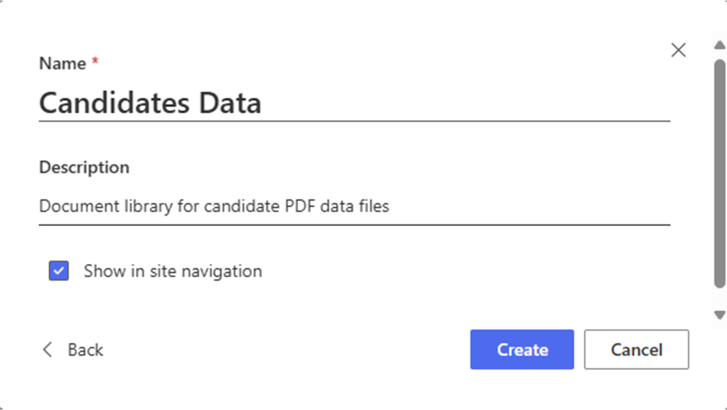

Konfigurieren Sie nach dem Erstellen die Berechtigungen der Bibliothek, damit Ihr Autonomous Agent darauf zugreifen kann:

1. Wählen Sie **Settings** (Zahnrad-Symbol) → **Library settings**
1. Wählen Sie unter **Permissions and Management** den Eintrag **Permissions for this document library**
1. Stellen Sie sicher, dass der Account, den Sie für Microsoft Copilot Studio verwenden, mindestens die Berechtigung **Contribute** hat

### Schritt 2: Beispiel-PDF-Dateien vorbereiten

Laden Sie zum Testen [resumes.zip](https://download-directory.github.io/?url=https://github.com/microsoft/copilot-camp/tree/main/src/make/copilot-studio/autonomous-agent&filename=resumes) herunter und entpacken Sie den Ordner.
Die heruntergeladenen Dateien beschreiben fiktive Kandidaten mit Informationen wie:

- Vollständiger Name
- E-Mail-Adresse  
- Aktuelle Rolle/Position
- Skills und Expertise
- Gesprochene Sprachen

Sie können auch einfache PDF-Dateien mit einem beliebigen Textverarbeitungsprogramm erstellen und als PDF speichern oder vorhandene Lebensläufe (Resume/CV) verwenden. Achten Sie darauf, dass der Text lesbar ist (keine gescannten Bilder), damit die AI die Informationen korrekt extrahieren kann.

### Schritt 3: Voraussetzungen sicherstellen

Stellen Sie vor dem Weitermachen sicher, dass Sie Folgendes haben:

- **HR MCP server**: aus Copilot Studio erreichbar, entweder die deployte Instanz oder Ihre eigene lokale Instanz hinter einem Dev Tunnel
- **SharePoint-Zugriff**: Berechtigungen, um Dokumentbibliotheken zu erstellen und zu verwalten
- **Power Platform Environment**: Zugriff auf dieselbe Environment wie in den vorigen Labs
- **Beispiel-PDF-Dateien**: mindestens 2 oder 3 Test-PDF-Dateien mit Kandidatendaten

Der Server aus [Einem Agent MCP Tools geben](../../04-cs-tools/06-mcp/lab-01-give-an-agent-mcp-tools-de.md) ist für diesen Kurs deployt, daher braucht der Hauptweg kein lokales Setup. Verwenden Sie diese URL, wenn Sie das MCP Tool registrieren:

```text
https://human-resource-mcp.azurewebsites.net
```

Prüfen Sie, ob der Server antwortet, bevor Sie weitermachen, zum Beispiel mit MCP Inspector:

```powershell
npx @modelcontextprotocol/inspector
```

Verbinden Sie sich mit dem Transport **Streamable HTTP** mit der obigen URL und wählen Sie **List Tools**. Kommen die Tools zurück, kann auch der Autonomous Agent sie aufrufen.

> **Hinweis zum Provisioning:** Der deployte Server läuft im App Service `human-resource-mcp`, den die Trainerin oder der Trainer mit [`src/deploy-apis.azcli`](../../../src/deploy-apis.azcli) provisioniert. Antwortet die URL nicht, starten Sie den Server stattdessen selbst aus dem Repository:
>
> ```powershell
> cd src/hr-mcp-server
> dotnet run
> ```
>
> Er lauscht auf `http://localhost:47002`, das Copilot Studio nicht erreicht, also machen Sie ihn mit einem Dev Tunnel erreichbar:
>
> ```powershell
> devtunnel user login
> devtunnel create hr-mcp -a --host-header unchanged
> devtunnel port create hr-mcp -p 47002
> devtunnel host hr-mcp
> ```
>
> Öffnen Sie die URL **Connect via browser** einmal und wählen Sie **Continue**, dann verwenden Sie diese URL als MCP Server URL. Lassen Sie `dotnet run` und den Tunnel während des gesamten Labs laufen, denn der Autonomous Agent ruft den Server bei jedem Trigger auf, auch bei Runs, die Sie nicht beobachten.

> Der deployte Server schreibt in eine gemeinsame Datenbank, daher sehen alle im Kurs dieselbe Mitarbeiterliste. Verwenden Sie Lebensläufe mit eindeutigen Namen, um Ihre eigenen Datensätze wiederzuerkennen.

## Übung 2: Den Autonomous Agent erstellen

In dieser Übung erstellen Sie in Microsoft Copilot Studio den Autonomous Agent, der die SharePoint Dokumentbibliothek überwacht und neue PDF-Uploads automatisch verarbeitet.

### Schritt 1: Den Autonomous Agent erstellen

Öffnen Sie einen Browser und rufen Sie mit dem Work Account Ihres Microsoft 365 Ziel-Tenants [https://copilotstudio.microsoft.com](https://copilotstudio.microsoft.com) auf, um mit Microsoft Copilot Studio zu arbeiten.

Wählen Sie die für Sie vorbereitete Environment und dann **Agents** → **More create options** → **Agent (Standard)**. Die voreingestellte Schaltfläche **New agent** erstellt einen anderen Agent-Typ, der keine Trigger hat.

Konfigurieren Sie Ihren Autonomous Agent mit den folgenden Einstellungen. Der Dialog zum Erstellen fragt nur nach dem **Name**; **Description** und **Instructions** legen Sie danach auf der Seite **Overview** mit **Edit** fest.

- **Name**: 

```text
Autonomous HR Docs Processor
```

- **Description**: 

```text
An autonomous AI agent that monitors SharePoint for new candidate PDF uploads and automatically processes them to create employee records via the HR MCP server
```

- **Instructions**: 

```text
You are an autonomous HR assistant that specializes in processing candidate data from PDF documents. When a new PDF file is uploaded to the SharePoint document library, you automatically:

1. Extract candidate information from the PDF file content including first name, last name, email, skills, spoken languages, and current role
2. Validate and structure the extracted data
3. Create a new employee record using the 'add_employee' tool of the HR MCP server
4. Provide confirmation of successful processing
5. Send me an email with confirmation that the new employee record was created and with a recap of the candidate's data

Always ensure data accuracy and provide clear feedback about the processing results. Handle errors gracefully and provide informative messages when processing fails.

IMPORTANT: Do not wait for any user input. Work completely autonomously.

DO NOT invent or assume fake data about candidates. AVOID hallucinations. You MUST ONLY process real and existing data.
```

Wählen Sie **Publish**, um Ihren Autonomous Agent zu veröffentlichen.

### Schritt 2: Die Intelligenz des Agents erweitern

Nachdem Sie den Agent erstellt haben, stellen Sie sicher, dass seine Fähigkeiten durch Generative AI Reasoning und Knowledge Integration erweitert sind.

Im Abschnitt **Knowledge** des Agents können Sie optional Knowledge Sources hinzufügen, wenn Sie eigene HR-Dokumentation oder Richtlinien zur Verarbeitung von Kandidaten haben. In diesem Lab verlassen wir uns auf die eingebauten AI-Fähigkeiten des Agents und die Integration des MCP Servers.

Wählen Sie nach Konfigurationsänderungen **Save**, um sie zu bestätigen.

### Schritt 3: Die MCP Server Integration hinzufügen

Ihr Autonomous Agent braucht Zugriff auf die Tools des HR MCP Servers, um Mitarbeiterdatensätze anzulegen. Öffnen Sie den Abschnitt **Tools** und wählen Sie **Add tool**.

1. Wählen Sie die Gruppe **Model Context Protocol**
2. Suchen Sie nach `HR MCP` und wählen Sie den **HR MCP Server**, den Sie in [Einem Agent MCP Tools geben](../../04-cs-tools/06-mcp/lab-01-give-an-agent-mcp-tools-de.md) registriert haben. Steht er nicht in der Liste, fügen Sie ihn mit **+ New tool**, **Model Context Protocol** und der Server-URL aus Übung 1 hinzu
3. Wählen Sie **Add**, um die Tools des MCP Servers zu integrieren

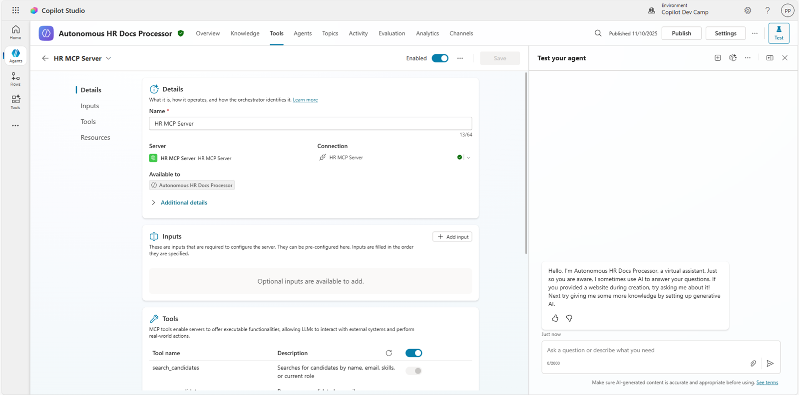

Damit hat Ihr Autonomous Agent Zugriff auf alle Tools, die [`src/hr-mcp-server`](../../../src/hr-mcp-server) bereitstellt:

| Tool | Was es tut |
| --- | --- |
| `list_employees` | Gibt die gesamte Mitarbeiterliste zurück |
| `search_employees` | Sucht nach Name, E-Mail, Skills oder aktueller Rolle |
| `add_employee` | Legt einen Mitarbeiter mit optionalen Sprachen und Skills an |
| `update_employee` | Aktualisiert einen bestehenden Mitarbeiter, gefunden über die E-Mail |
| `remove_employee` | Entfernt einen Mitarbeiter anhand der E-Mail |
| `assign_shift` | Teilt einen Mitarbeiter nach Name, Datum und Position einer 8-Stunden-Schicht zu |

Der Agent nutzt für neue PDF-Uploads vor allem das Tool `add_employee`. Beachten Sie, dass Sie diese Liste nirgends deklariert haben: Der Agent hat auf dem Server `tools/list` aufgerufen und sie so entdeckt. Deshalb steht ein neues Tool in `Tools/HRTools.cs` dem Autonomous Agent zur Verfügung, ohne dass Sie den Agent überhaupt anfassen.


### Schritt 4: Den Mail MCP Server hinzufügen

Ihr Autonomous Agent braucht außerdem Zugriff auf den MCP Server **Mail (Preview)**, um E-Mails senden zu können; der ältere **Email Management MCP Server** ist als deprecated markiert. Öffnen Sie den Abschnitt **Tools** und wählen Sie **Add tool**.

1. Wählen Sie die Gruppe **Model Context Protocol**
2. Suchen und wählen Sie **Mail (Preview)**
3. Wählen Sie **Add**, um die Tools des MCP Servers zu integrieren

Damit hat Ihr Autonomous Agent Zugriff auf eine breite Auswahl an Tools, um die E-Mails in der Mailbox des aktuellen Users zu verwalten.
Der Agent nutzt für Benachrichtigungs-E-Mails vor allem das Tool `SendEmailWithAttachments`.

### Schritt 5: Den SharePoint MCP Server hinzufügen

Der Trigger übergibt dem Agent nur die Eigenschaften der neuen Datei, nicht ihren Inhalt, daher braucht der Agent ein Tool, um die PDF zu lesen. Fügen Sie **SharePoint (Preview)** auf dieselbe Weise hinzu: **Add tool**, **Model Context Protocol**, **SharePoint (Preview)**, dann **Add**. Der Agent liest die hochgeladene Datei dann selbst. Die SharePoint Connector Action **Get file content using path** reicht nicht aus, weil sie nur eine Referenz auf die Datei zurückgibt.

## Übung 3: SharePoint Trigger konfigurieren

In dieser Übung konfigurieren Sie den Autonomous Agent so, dass er automatisch getriggert wird, wenn neue PDF-Dateien in die SharePoint Dokumentbibliothek hochgeladen werden.

### Schritt 1: Den SharePoint Trigger hinzufügen

Öffnen Sie in Ihrem Autonomous Agent den Bereich 1️⃣ **Overview**, scrollen Sie zum Panel 2️⃣ **Triggers** und wählen Sie 3️⃣ **+ Add trigger**.

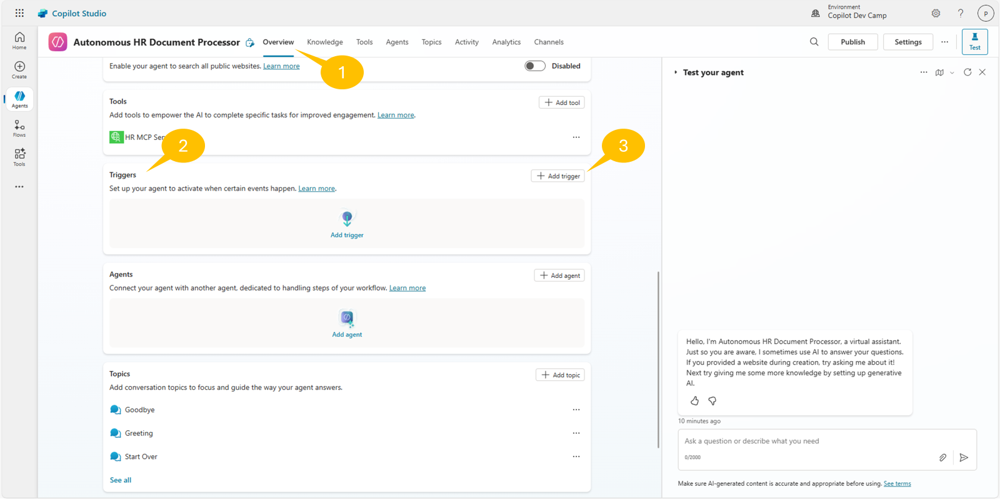

Wählen Sie im Dialog **Add trigger** unter den Optionen des SharePoint Connectors **When a file is created (properties only)**. Wählen Sie dann **Next**, um den Trigger zu konfigurieren.


Im nächsten Schritt der Konfiguration geben Sie dem Trigger einen Namen und konfigurieren bzw. verbinden die Berechtigungen für den Zugriff auf die Ziel-Apps. Im aktuellen Szenario sind das diese Apps:

- Microsoft Copilot Studio
- SharePoint

Konfigurieren Sie den Trigger so:

- **Trigger name**: `When PDF uploaded to Candidate Data library`

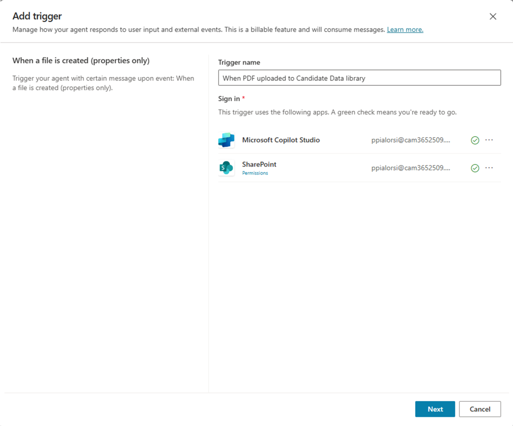

Wählen Sie **Next** und konfigurieren Sie den Trigger mit diesen zusätzlichen Einstellungen:

- **Site Address**: Wählen Sie Ihre SharePoint Ziel-Site oder geben Sie ihre URL ein
- **Library Name**: Wählen Sie `Candidate Data` (die Bibliothek, die Sie erstellt haben)
- **Folder**: Lassen Sie das Feld leer, um die gesamte Bibliothek zu überwachen
- **Limit columns by View (Optional)**: All Documents
- **Additional instructions to the agent when it's invoked by this trigger**: Das Feld enthält bereits `Use content from Body`; hängen Sie ` and read content of the PDF file.` an.

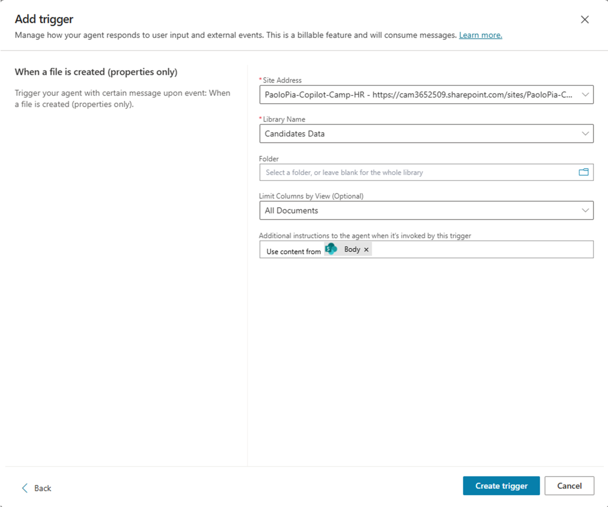

Wählen Sie **Create trigger**, um den SharePoint Trigger zur Überwachung zu Ihrem Agent hinzuzufügen. Der Vorgang dauert eine Weile. Sobald er fertig ist, sehen Sie einen Dialog, der Sie einlädt, den Trigger zu testen.

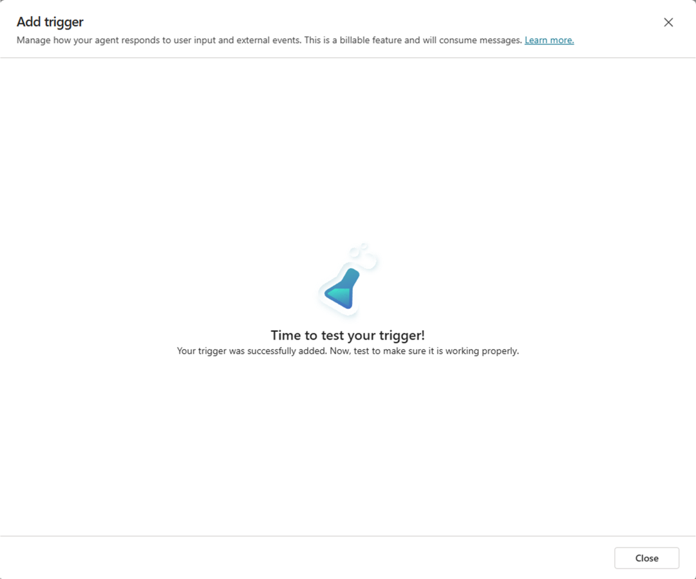

Wählen Sie **Close**, um zum Bereich **Overview** Ihres Agents zurückzukehren.

### Schritt 2: Den Trigger testen

In der Liste **Triggers** steht jetzt der neue Trigger, und Sie können ihn mit dem kleinen Kolben-Symbol neben den Auslassungspunkten (**...**) testen.

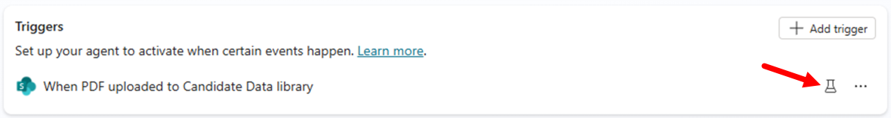

Wählen Sie den Kolben; ein Dialogfenster erscheint und wartet darauf, dass eine Datei in die Ziel-Bibliothek in SharePoint Online hochgeladen wird.

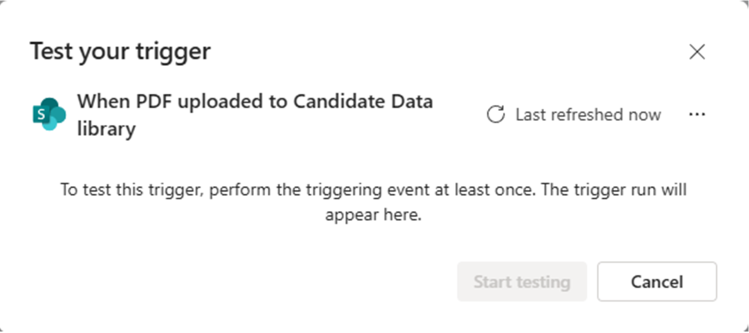

Sobald mindestens eine Datei in der Ziel-Bibliothek liegt, aktualisiert sich der Dialog, und Sie können mit dem Befehl **Start testing** den Autonomous Agent testen. Liegen mehrere hochgeladene Dateien vor, wählen Sie die Datei, mit der Sie den Trigger testen möchten.

Laden Sie einfach einen der zuvor heruntergeladenen Lebensläufe in die Ziel-Bibliothek in SharePoint Online hoch und warten Sie, bis der Agent ihn verarbeitet.

> **Hinweis:** Der Trigger reagiert nur auf Dateien, die nach seiner Erstellung hochgeladen werden, laden Sie die Testdatei also jetzt hoch, nicht vorher. Es kann bis zu einer Minute dauern, bis der Agent die neuen Dateien bemerkt, und **Start testing** bleibt bis dahin grau. Die Dateiliste zeigt Zeitstempel, keine Dateinamen.

> **Hinweis:** Sieht der Testdialog Ihre Datei nie, öffnen Sie Power Automate und wählen Sie **Connections**. Zeigt die SharePoint Connection **Reconnect**, wählen Sie **Reconnect**, dann **Update**, und wählen Sie Ihren Account; der Trigger Flow zeigt keine Runs, solange diese Connection unterbrochen ist.

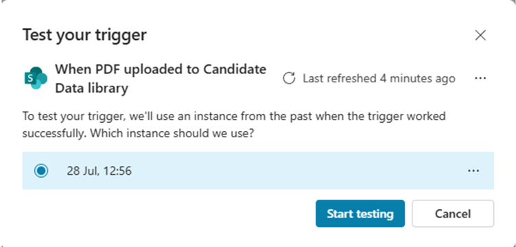

Sobald der Test startet, kann der Agent über das Seitenpanel **Test your agent** mit Ihnen interagieren. In diesem Szenario verbinden Sie als Erstes die Agent-Instanz mit ihren Tools, damit der Agent den neuen Mitarbeiterdatensatz anlegen kann. Wählen Sie **Allow** auf der Card für den Mail MCP Server. Wählen Sie dann **Open connection manager** in der automatischen Nachricht des Agents, verbinden Sie den HR MCP Server mit **Connect**, wählen Sie **Submit**, kehren Sie zum Panel **Test your agent** zurück und wählen Sie **Retry**.

Sie sollten eine Bestätigung sehen, dass die Kandidatin oder der Kandidat aus dem hochgeladenen PDF-Lebenslauf als Mitarbeiter auf dem HR MCP Server angelegt wurde.

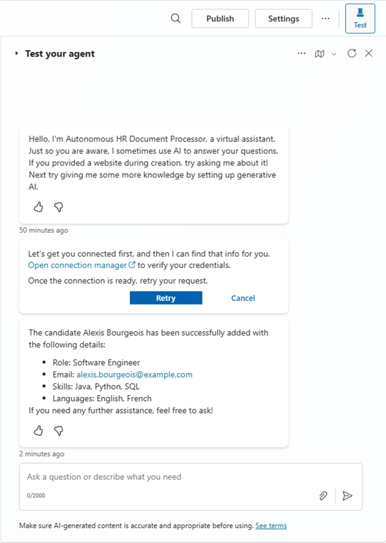

Wenn Sie möchten, senden Sie den Prompt `List all the employees`, um zu prüfen, dass der neue Datensatz jetzt in der Liste steht. Sie können das auch außerhalb von Copilot Studio bestätigen, indem Sie in MCP Inspector `list_employees` gegen dieselbe Server-URL ausführen.
Ihr Autonomous Agent ist fertig! Sie können ihn jetzt mit **Publish** veröffentlichen, und er beginnt, Dateien autonom zu verarbeiten!

Beim Veröffentlichen des Agents sehen Sie möglicherweise einige Warnungen wie im folgenden Bild.

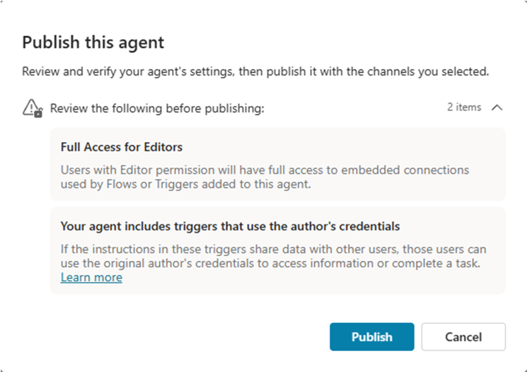

1. **Full access for editors**: User mit der Berechtigung Editor haben Zugriff auf eingebettete Connections, die Flows oder Trigger dieses Agents nutzen.
1. **Your agent includes triggers that use the author's credentials**: Teilen die Instructions in diesen Triggern Daten mit anderen Usern, können diese User die Credentials des ursprünglichen Editors nutzen, um auf Informationen zuzugreifen oder eine Aufgabe zu erledigen.

Nachdem Sie den Agent veröffentlicht haben, laden Sie neue PDF-Lebensläufe hoch und beobachten Sie, was passiert. Öffnen Sie nach dem Hochladen einer oder mehrerer Dateien in die Ziel-Bibliothek in SharePoint Online den Bereich **Activity** des Agents, dann sehen Sie den Aufruf des Agents vom Typ `Automated`.

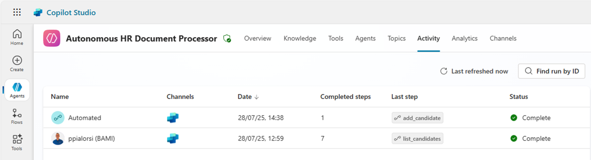

## Übung 4: Autonomous Agents von innen

In dieser Übung verstehen Sie, wie ein Autonomous Agent funktioniert und was hinter den Kulissen passiert.

### Schritt 1: Hinter den Kulissen des Triggers

Nachdem Sie den Trigger erstellt und getestet haben, möchten Sie vielleicht verstehen, wie ein Autonomous Agent funktioniert. Wählen Sie die Auslassungspunkte (**...**) neben Ihrem Trigger und dann **Edit in Power Automate**.

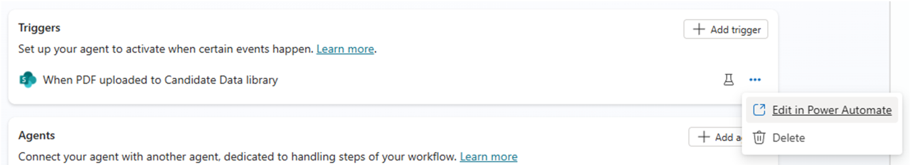

In Power Automate sehen Sie den Flow, der hinter dem Trigger des Autonomous Agents steckt. 

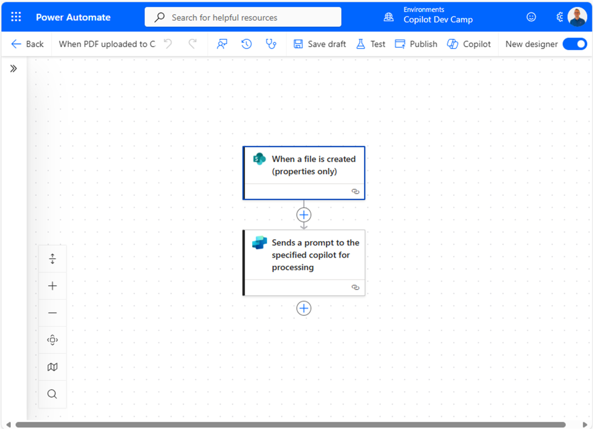

Der Flow ist wirklich trivial. Er besteht nur aus einer auslösenden Action vom Typ **When a file is created (properties only)** des SharePoint Connectors und einer weiteren Action **Sends a prompt to the specified copilot for processing**, die den Ziel-Agent aufruft. Praktisch gesehen ist ein Trigger eines Autonomous Agents ein Power Automate Flow, der dem Agent einen Prompt sendet. Damit kann fast jeder Trigger eines Power Automate Flows zum Trigger für einen Autonomous Agent in Copilot Studio werden.

Bei Bedarf passen Sie das Verhalten des Flows an, um dem Trigger zusätzliche Verhaltensweisen oder Funktionen hinzuzufügen, bevor er den Autonomous Agent aufruft. In diesem Fall sollten Sie jedoch die Erkenntnisse aus dem nächsten Schritt berücksichtigen.

### Schritt 2: Mehrere Datei-Uploads verarbeiten

Interessant an Triggern von Autonomous Agents ist außerdem: Wenn Sie mehrere Dateien nach SharePoint hochladen, oder allgemein wenn mehrere auslösende Ereignisse eintreten, sehen Sie nicht immer einen Power Automate Flow pro Datei/Ereignis. Ebenso sehen Sie nicht für jede Datei/jedes Ereignis eine eigene Agent-Instanz. Beim Verarbeiten von Dateien in einer SharePoint Online Dokumentbibliothek kann zum Beispiel eine Flow-Instanz mehrere Dateien verarbeiten, die in derselben Zeiteinheit hochgeladen wurden.
Der Power Automate Flow startet dann eine Agent-Instanz, die jede einzelne Datei nacheinander verarbeitet.


Sie können das beschriebene Verhalten gut beobachten, wenn Sie zwei (oder mehr) Dateien auf einmal hochladen und dann warten, bis der Flow in Power Automate läuft und der Autonomous Agent in Copilot Studio aufgerufen wird. Tatsächlich gibt es nur einen Flow Run für eine Gruppe hochgeladener Dateien und eine Agent-Instanz für diesen Flow.

Prüfen Sie dieses Verhalten, indem Sie den Bereich **Activity** des Autonomous Agents wählen und eine `Automated` Instanz mit mehr als einem `Completed steps` untersuchen, wie im folgenden Screenshot.

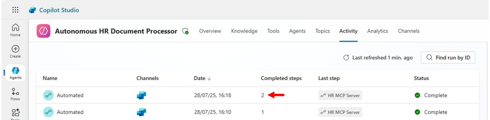

Wählen Sie die Instanz, dann sehen Sie, dass der Agent zwei (oder mehr) Dateien autonom verarbeitet und für jede das Tool `add_employee` aufgerufen hat. Sie müssen keine komplexe Logik in Ihrem Agent definieren. Es genügt, dass wir in den Instructions des Agents geschrieben haben

```text
... When a new PDF file is uploaded to the SharePoint document library: ...
```

Das reicht der autonomen Intelligenz des Agents, um über alle hochgeladenen Dateien zu iterieren und auf alle dieselbe Logik anzuwenden. Das ist erstaunlich und zeigt Ihnen, wie leistungsfähig AI heute ist!

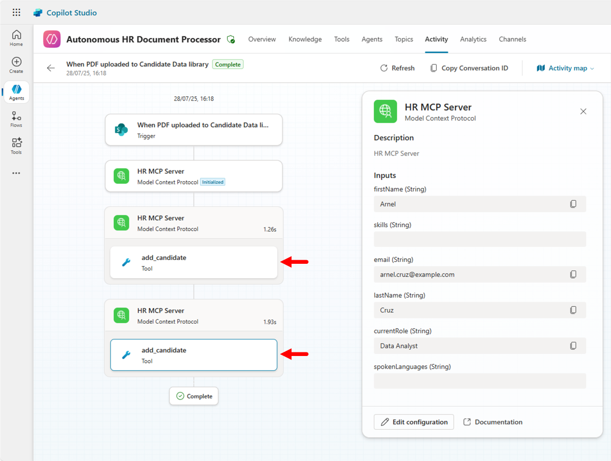

> **Tipp:** Mehr über Autonomous Agents in Microsoft Copilot Studio erfahren Sie in [Agent Academy - Recruit - Mission 10: Add Event Triggers - Enable autonomous agent capabilities](https://microsoft.github.io/agent-academy/recruit/10-add-event-triggers/) und [Agent Academy - Operative - Mission 04: Add Event Triggers to act autonomously](https://microsoft.github.io/agent-academy/operative/04-automate-triggers/).


Sie haben das Lab zu Autonomous Agents abgeschlossen!
