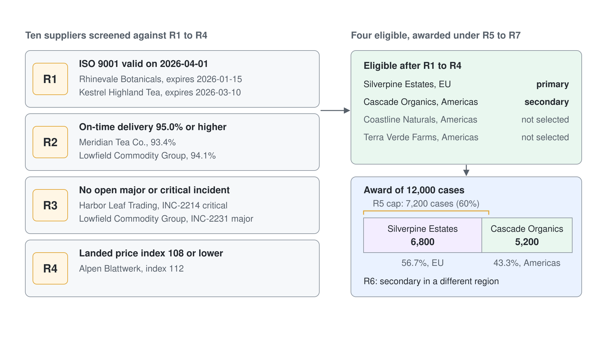

# Mit einem Deep Reasoning Agent einen Lieferanten empfehlen

Sourcing-Entscheidungen sind die Art von Arbeit, die ein Agent meist fast richtig macht: Er liest die Scorecard, wählt den Lieferanten mit den besten Zahlen und ignoriert stillschweigend das Zertifikat, das zwei Wochen vor Vertragsbeginn abläuft. Der Preis für "fast richtig" ist hier ein Zwölfmonatsvertrag an einen Lieferanten, der nie zugelassen war. In diesem Lab bauen Sie einen Sourcing Advisor für Aurora Provisions, der zehn Lieferanten gegen vier Ausschlussregeln prüfen, eine Mengenobergrenze einhalten und einen Zuschlag auf zwei Regionen aufteilen muss, und Sie bringen ihn dazu, das Problem Schritt für Schritt zu lösen, statt per Pattern Matching eine Antwort zu raten.

Sie stellen dieselbe schwierige Frage zweimal: einmal ohne Instructions, wobei der Agent selbst entscheidet, ob er Reasoning einsetzt, und einmal mit dem Keyword reason auf einem einzigen Instruction-Schritt. Danach öffnen Sie die Activity Map und sehen den Reasoning Node, den der Run erzeugt hat. Planen Sie 20 bis 25 Minuten ein.

## Was Sie bauen

- Einen Copilot Studio Agent namens Sourcing Advisor mit eingeschalteter Generative Orchestration und Deep Reasoning.
- Drei Knowledge Sources für das Grounding: eine Lieferanten-Scorecard, eine Sourcing Policy und ein Incident Log, die sich absichtlich widersprechen.
- Einen Instruction-Block, der das Keyword reason auf genau einem Schritt trägt, sodass das langsame Model nur dort läuft, wo es sich lohnt, und nirgends sonst.
- Eine Baseline-Antwort und eine Deep Reasoning Antwort auf dieselbe Frage im direkten Vergleich, dazu die Activity Map, die zeigt, welches Model was getan hat.

## Lab-Dateien

| Datei | Was sie darstellt |
|------|--------------------|
| [lab-01-supplier-recommendation/supplier-scorecard.xlsx](lab-01-supplier-recommendation/supplier-scorecard.xlsx) | Zehn Lieferanten mit Kapazität, On-Time Delivery, Fehlerquote, Landed Price Index und Ablaufdatum der Zertifizierung |
| [lab-01-supplier-recommendation/sourcing-policy.docx](lab-01-supplier-recommendation/sourcing-policy.docx) | Policy SP-14: die vier Zulassungsregeln, die Konzentrationsgrenze von 60 Prozent, die Kontinuitätsregel und die Rangfolge |
| [lab-01-supplier-recommendation/supplier-incidents.docx](lab-01-supplier-recommendation/supplier-incidents.docx) | Sechs Incidents mit Schweregrad und Status, drei davon noch offen |

## Voraussetzungen

- Eine Copilot Studio Environment, in der Sie Agents erstellen können, gehostet in den USA oder in der EU ohne das Vereinigte Königreich. Deep Reasoning ist in anderen Regionen nicht verfügbar.
- Die Berechtigung, Agent-Einstellungen zu ändern, da Generative Orchestration und Deep Reasoning beides Schalter auf Settings-Ebene sind.
- Die drei Dateien oben lokal verfügbar, im Ordner `lab-01-supplier-recommendation` neben dieser Anleitung.
- Das Wissen, dass Deep Reasoning in Preview ist, pro Nutzung abgerechnete Copilot Credits verbraucht und Antworten deutlich langsamer macht. Siehe [Use deep reasoning models for complex tasks](https://learn.microsoft.com/microsoft-copilot-studio/authoring-reasoning-models).

## Übung 1: Den Agent erstellen und Generative Orchestration einschalten

Deep Reasoning ist kein eigenständiges Feature. Es setzt auf Generative Orchestration auf, den Planning Layer, der einen Request liest, entscheidet, welches Knowledge und welche Tools zum Einsatz kommen, und die Schritte in eine Reihenfolge bringt. Ohne Orchestration gibt es keinen Plan, in dem ein Reasoning Model aufgerufen werden könnte, und der Deep Reasoning Schalter bleibt nicht verfügbar. Der erste Schritt ist also ein Agent, dessen Planner eingeschaltet ist.


1. Wählen Sie in Copilot Studio **Create** und dann **New agent**.
2. Nennen Sie den Agent `Sourcing Advisor` und fügen Sie diese Beschreibung ein:

```text
You advise the Aurora Provisions sourcing team on annual supply contracts. You screen suppliers against the Aurora sourcing policy, apply the award rules, and recommend a volume split that a category manager can sign off.
```

3. Erstellen Sie den Agent und öffnen Sie dann seine **Settings**.
4. Schalten Sie auf der Seite **Advanced** der **Settings** die Option **Generative orchestration** ein (danach steht dort **Yes**).

Erwartetes Ergebnis: Der Agent öffnet sich mit eingeschalteter Generative Orchestration, und die Einstellung bleibt erhalten, wenn Sie **Settings** verlassen und zurückkehren. Es wurden keine Topics erstellt; die Arbeit erledigt der Planner.

> **Hinweis:** Zeigt Ihre Environment noch ausschließlich die klassische Orchestration, fehlt der Deep Reasoning Schalter in der nächsten Übung oder ist ausgegraut. Bringen Sie zuerst die Orchestration in Ordnung, statt den Reasoning Toggle zu suchen.

## Übung 2: Deep Reasoning einschalten

Mit eingeschaltetem Deep Reasoning entscheidet der Agent selbst, welche Schritte das langsamere Model verdienen, und Sie können die Entscheidung mit einem Keyword erzwingen. Dahinter steht das Model Azure OpenAI o3, das Antwortzeit gegen logisches, schrittweises Problemlösen tauscht. Der Schalter gilt pro Agent, nicht pro Environment, sodass ein Agent für einfache Lookups weiter auf dem schnellen Default läuft.

1. Bleiben Sie auf der Seite **Advanced** der **Settings** des Sourcing Advisor.
2. Schalten Sie **Deep reasoning (preview)** ein.
3. Lesen Sie den Preview-Hinweis, einschließlich der Anmerkung, dass Daten außerhalb Ihrer Region verarbeitet werden können, und bestätigen Sie.
4. Kehren Sie zur Übersicht des Agents zurück.

Erwartetes Ergebnis: **Deep reasoning (preview)** ist in **Settings** neben Generative Orchestration als eingeschaltet zu sehen. Am Verhalten des Agents hat sich noch nichts geändert, weil noch kein Request schwierig genug war, um es auszulösen, und keine Instruction danach verlangt.

## Übung 3: Den Agent mit dem Sourcing-Paket erden

Deep Reasoning verbessert, wie ein Agent ein Problem durcharbeitet; es erfindet keine Fakten. Das Schwierige an diesem Szenario ist, dass die Antwort in drei Dokumenten steckt, die sich widersprechen: Die Scorecard sagt, wer am besten ist, das Incident Log sagt, wer raus ist, und die Policy sagt, wie beides zu gewichten ist. Die Beschreibungen zählen hier, weil der Orchestrator Quellen auswählt, indem er einen Request mit ihnen abgleicht.

1. Öffnen Sie die Seite **Knowledge** des Agents und wählen Sie **Add knowledge**.
2. Laden Sie `supplier-scorecard.xlsx` hoch und geben Sie der Datei diese Beschreibung:

```text
Supplier scorecard for organic green tea leaf. One row per supplier with region, annual capacity in cases, trailing twelve-month on-time delivery percentage, defect rate, landed price index, ISO 9001 expiry date, and last audit date. Use it for any question about supplier performance, capacity, price, or certification validity.
```

3. Fügen Sie `sourcing-policy.docx` mit dieser Beschreibung hinzu:

```text
Aurora sourcing policy SP-14 for the 2026 annual tea leaf contract. Contains the contract volume and start date, the four eligibility rules R1 to R4, the concentration cap R5, the continuity rule R6, the ranking order R7, and the escalation rule R8. Use it whenever a request involves awarding, splitting, or screening a contract.
```

4. Fügen Sie `supplier-incidents.docx` mit dieser Beschreibung hinzu:

```text
Supplier incident log with severity, open or closed status, and detail for each incident raised against tea leaf suppliers. Use it to check whether a supplier has an open incident before recommending them.
```

5. Warten Sie, bis alle drei Quellen melden, dass sie bereit sind.

Erwartetes Ergebnis: Drei Quellen stehen auf der Seite **Knowledge** mit dem Status bereit und Ihren Beschreibungen. Der Agent erreicht jetzt jeden Fakt, den die Entscheidung braucht, und jeden Fakt, über den er stolpern wird.

> **Tipp:** Web Search ist standardmäßig eingeschaltet und ergänzt die Lookups um öffentliche Webergebnisse. Schalten Sie **Web Search** auf der Seite **Overview** aus, damit die Antworten nur auf den drei Dateien beruhen.

> **Tipp:** Schreiben Sie jede Beschreibung nach dem Muster "was steckt drin und wann wird sie genutzt". Eine Beschreibung, die nur die Datei benennt, ist der häufigste Grund, warum eine an sich gute Knowledge Source nie durchsucht wird.

## Übung 4: Die Baseline festhalten

Bevor Sie im Prompt etwas einschalten, halten Sie fest, was der Agent ohne Hilfe tut. An dieser Messung wird der Rest des Labs beurteilt, und Teams, die sie überspringen, glauben am Ende ohne Beleg, ein Feature habe geholfen. Stellen Sie die vollständige Frage ohne Instructions, damit der Agent selbst entscheidet, wie er antwortet.

1. Öffnen Sie das Panel **Test your agent**.
2. Senden Sie diese Nachricht:

```text
We need to award the 2026 organic green tea leaf contract. Which supplier or suppliers should get it, and in what volumes?
```

3. Notieren Sie drei Dinge: welche Lieferanten der Agent empfiehlt, ob er einen ausgeschlossenen Lieferanten nennt und wie lange die Antwort dauert.

Erwartetes Ergebnis: Deep Reasoning ist bereits eingeschaltet, daher entscheidet der Agent möglicherweise selbst, dass die Frage schwierig ist, und ruft **Reason with advanced model** auf. In einem Test Run dauerte die Baseline etwa 30 Sekunden, nutzte diesen Reasoning-Schritt und nannte bereits Silverpine Estates und Cascade Organics samt den Ausschlüssen. Ohne den Reasoning-Schritt stützt sich die Antwort auf die stärksten Scorecard-Werte und übersieht mindestens einen Ausschluss, die Grenze von 60 Prozent oder die Regel zu unterschiedlichen Regionen. Lassen Sie diese Antwort im Transcript offen, Sie vergleichen sie in Übung 6.

> **Hinweis:** Die Baseline hängt vom Model ab und ist nicht für alle Lernenden gleich. Entscheidend ist nicht, welchen Lieferanten sie nennt, sondern ob überhaupt geprüft wurde: Zählen Sie, wie viele der vier Zulassungsregeln die Antwort sichtbar angewendet hat.

## Übung 5: Instructions schreiben, die reason auf einen Schritt setzen

Ein Agent mit eingeschaltetem Deep Reasoning entscheidet weiterhin selbst, wann er es nutzt. Das Keyword `reason` in einem Instruction-Schritt nimmt das Raten heraus und erzwingt das Deep Reasoning Model nur für diesen Schritt. Genau diese Präzision ist das ganze Design: Jeder Schritt mit dem Keyword kostet Credits und Sekunden, also setzen Sie es auf den Schritt, in dem das Urteil steckt, nicht auf die Lookups drumherum.

1. Öffnen Sie die **Instructions** des Agents.
2. Ersetzen Sie den Inhalt durch diesen Block:

```text
You are the Aurora Sourcing Advisor. When asked to award or split a supply contract, follow these steps in order:

1. Read sourcing policy SP-14 and extract the contract volume, the contract start date, and rules R1 to R8.
2. Read the supplier scorecard and list every supplier with its region, capacity, on-time delivery, defect rate, landed price index, and ISO 9001 expiry.
3. Read the supplier incident log and note every incident that is still open, with its severity.
4. Using the policy, the scorecard, and the incident log together, reason through the award: screen each supplier against R1 to R4, apply the concentration cap R5 and the continuity rule R6, rank the survivors with R7, and determine the volume split. Escalate under R8 if no combination covers the volume.
5. Present the recommendation as: the primary supplier and its volume, the secondary supplier and its volume, then a table of every excluded supplier with the rule number that excluded it.

Never recommend a supplier without checking its certification expiry against the contract start date and its open incidents. State volumes in cases and as a percentage of contract volume.
```

3. Speichern Sie die Instructions.

Erwartetes Ergebnis: Der Instruction-Block wird gespeichert, und das Wort reason steht in Schritt 4 und nirgends sonst. Die Schritte 1 bis 3 sind Retrieval und bleiben auf dem schnellen Default Model; Schritt 4 ist der Schritt, der auf Azure OpenAI o3 läuft.



> **Warnung:** Widerstehen Sie der Versuchung, reason der Gründlichkeit halber auch in die Schritte 1, 2 und 3 zu schreiben. Jedes Keyword schickt einen weiteren Schritt an das langsame Model, und ein Instruction-Block mit viermal reason macht aus einer Antwort in zehn Sekunden eine Minute Warten, während der Credits-Zähler läuft.

## Übung 6: Dieselbe Frage erneut stellen und vergleichen

Jetzt der Vergleich. Dieselbe Frage, dasselbe Knowledge, derselbe Agent, der einzige Unterschied ist ein Instruction-Block, der einen Reasoning-Schritt erzwingt. Achten Sie auf die Latency ebenso wie auf den Inhalt, denn die Pause vor der Antwort ist der direkteste Beleg dafür, dass ein anderes Model den schwierigen Teil übernommen hat.

1. Starten Sie in **Test your agent** eine neue Unterhaltung.
2. Senden Sie genau dieselbe Nachricht wie in Übung 4:

```text
We need to award the 2026 organic green tea leaf contract. Which supplier or suppliers should get it, and in what volumes?
```

3. Warten Sie auf die Antwort; mit dem Reasoning-Schritt dauert sie etwa eine halbe Minute oder länger.
4. Bewerten Sie die Antwort anhand des Bewertungsschemas unten.

Policy und Daten lassen genau ein richtiges Ergebnis zu:

| Element | Richtiges Ergebnis |
|---------|----------------|
| Primär | Silverpine Estates, 6.800 Kartons (56,7 Prozent der Vertragsmenge) |
| Sekundär | Cascade Organics, 5.200 Kartons, Americas, erfüllt die Regel zu unterschiedlichen Regionen |
| Ausgeschlossen durch R1 | Rhinevale Botanicals (ISO läuft am 2026-01-15 ab), Kestrel Highland Tea (ISO läuft am 2026-03-10 ab) |
| Ausgeschlossen durch R2 | Meridian Tea Co. (93,4 Prozent), Lowfield Commodity Group (94,1 Prozent) |
| Ausgeschlossen durch R3 | Harbor Leaf Trading (offener Critical Incident INC-2214), Lowfield Commodity Group (offener Major Incident INC-2231) |
| Ausgeschlossen durch R4 | Alpen Blattwerk (Preisindex 112) |
| Nicht ausgewählt | Coastline Naturals ist zugelassen, rangiert nach R7 aber hinter Cascade Organics; Terra Verde Farms rangiert vor Cascade Organics, doch seine Kapazität von 3.000 Kartons deckt den Rest von 5.200 Kartons nicht ab |



Erwartetes Ergebnis: Die Deep Reasoning Antwort nennt Silverpine Estates als Primärlieferanten und einen Sekundärlieferanten aus einer anderen Region, und sie zeigt ihre Prüfung, statt nur einen Gewinner zu behaupten. Vergleichen Sie sie mit dem Transcript aus Übung 4: Die Instruction macht den Reasoning-Schritt und die Tabelle der ausgeschlossenen Lieferanten wiederholbar, statt sie dem Urteil des Agents zu überlassen. Übersieht die Antwort trotzdem einen Ausschluss, schärfen Sie Schritt 4, indem Sie die Regelnummern explizit nennen, und starten Sie noch einen Run.

> **Tipp:** Ein Lieferant mit einem offenen Minor Incident, Kestrel Highland Tea, steht absichtlich in den Daten. Eine Antwort, die ihn unter R3 ausschließt, wendet die Regel zu weit an; das ist ein anderer Fehler als ein übersehener Ausschluss und in einem Review erwähnenswert.

## Übung 7: Das Reasoning in der Activity Map nachverfolgen

Eine Antwort, die Sie nicht nachverfolgen können, können Sie nicht verteidigen, und eine Sourcing-Empfehlung wird hinterfragt werden. Die Activity Map zeichnet den Plan, den der Orchestrator gebaut hat, mit einem Node pro Schritt, und sie zeigt einen eigenen Node überall dort, wo ein Deep Reasoning Model lief. Wenn Sie diesen Node öffnen, bestätigen Sie, dass das langsame Model dort lief, wo Sie es wollten, und nicht über die ganze Unterhaltung.

1. Die Activity Map erscheint im Panel **Test your agent**. Ist das nicht der Fall, wählen Sie die drei Punkte (**…**) und dann **Show activity map when testing**.
2. Senden Sie die Zuschlagsfrage erneut, damit eine neue Map entsteht.
3. Suchen Sie in der Map den Deep Reasoning Node (**Reason with advanced model**) und wählen Sie ihn, um ihn aufzuklappen.
4. Lesen Sie die Reasoning-Schritte, die Daten, die das Model genutzt hat, und das Ergebnis, das es zurückgegeben hat.
5. Öffnen Sie die Seite **Activity** des Agents und wählen Sie dieselbe Activity, um die Map neben dem Transcript zu sehen.

Erwartetes Ergebnis: Die Map zeigt Knowledge Nodes für die drei Quellen sowie einen Deep Reasoning Node für die Zuschlagsentscheidung, und wenn Sie diesen Node aufklappen, sehen Sie die Zwischenschritte der Prüfung und das Ergebnis, das er zurückgegeben hat. Auf der Seite **Activity** steht dieselbe Activity mit ihren abgeschlossenen Schritten und ihrem Status, sodass der Trace über Ihre Test Session hinaus erhalten bleibt.

> **Hinweis:** Historische Activity erfordert eine Microsoft Exchange Lizenz und eine Mailbox, da Transcripts über Microsoft 365 Services gespeichert werden. Ist die Seite **Activity** leer, liefert die Echtzeit-Map im Test Panel trotzdem den Trace.

## Übung 8: Prüfen, dass der Fast Path schnell bleibt

Deep Reasoning ist ebenso eine Kostenentscheidung wie eine Qualitätsentscheidung. Ein Agent, der über alles tief nachdenkt, ist langsam und teuer, und User geben ihn auf, lange bevor die Finanzabteilung es merkt. Dieser letzte Check beweist, dass die Eingrenzung funktioniert hat: Ein einfacher Lookup sollte schnell zurückkommen und gar keinen Reasoning Node erzeugen.

1. Starten Sie in **Test your agent** eine neue Unterhaltung und senden Sie:

```text
What is Terra Verde Farms' on-time delivery percentage?
```

2. Beobachten Sie die Antwortzeit und die Activity Map.
3. Senden Sie noch einen komplexen Request, um zu bestätigen, dass der Reasoning-Pfad weiter erreichbar ist:

```text
Re-run the award assuming Harbor Leaf Trading closes incident INC-2214 before the contract start date. What changes?
```

Erwartetes Ergebnis: Der Lookup antwortet in wenigen Sekunden, mit einem Knowledge Node und ohne Deep Reasoning Node in der Map. Die Frage nach dem neuen Durchlauf erzeugt wieder einen Reasoning Node und eine geänderte Empfehlung, denn Harbor Leaf Trading wird zugelassen und liegt bei On-Time Delivery vor Silverpine Estates, während die Grenze von 60 Prozent weiter eine Aufteilung mit einem Sekundärlieferanten aus einer anderen Region erzwingt. Sie haben jetzt einen Agent, der Reasoning nur dort einsetzt, wo es sich lohnt.

## Troubleshooting

| Symptom | Wahrscheinliche Ursache | Lösung |
|---------|--------------|-----|
| **Deep reasoning (preview)** fehlt in **Settings** | Generative Orchestration ist aus, oder die Region der Environment liegt außerhalb der USA und der EU ohne das Vereinigte Königreich | Schalten Sie zuerst Generative Orchestration ein; fehlt der Toggle dann immer noch, prüfen Sie die Region der Environment, denn keine Agent-Einstellung kann das umgehen |
| Beide Runs liefern dieselbe oberflächliche Antwort | Die Instructions wurden nicht gespeichert, oder das Keyword wurde umformuliert | Öffnen Sie **Instructions** erneut und prüfen Sie, dass das Wort reason wörtlich in Schritt 4 steht; Synonyme wie "think carefully" lösen das Model nicht aus |
| Jede Antwort ist langsam | Das Keyword steht in mehr als einem Schritt | Entfernen Sie reason aus den Retrieval-Schritten, sodass nur der Zuschlagsschritt es trägt |
| Die Antwort zitiert keine Policy-Regeln | Die Policy-Datei wird noch verarbeitet, oder ihre Beschreibung ist zu dünn, als dass der Orchestrator sie zuordnen könnte | Prüfen Sie, dass alle drei Quellen bereit sind, und übernehmen Sie dann erneut die Beschreibungen aus Übung 3, die angeben, wann jede Quelle zu nutzen ist |
| Kein Deep Reasoning Node in der Activity Map | Die Map entstand, bevor die Instructions gespeichert waren, oder der Request war so einfach, dass er auf dem Default Model blieb | Starten Sie eine neue Unterhaltung und senden Sie die vollständige Zuschlagsfrage erneut statt einer Nachfrage |
| Die Empfehlung nennt einen Lieferanten für alle 12.000 Kartons | Die Konzentrationsgrenze wurde gelesen, aber nicht angewendet | Prüfen Sie, dass die Scorecard als einzelnes Sheet hochgeladen wurde, und starten Sie erneut; bleibt das Problem, nennen Sie die Grenze von 60 Prozent explizit in Schritt 4 |

## Zusammenfassung

Sie haben den Aurora Sourcing Advisor gebaut: einen Agent mit eingeschalteter Generative Orchestration und Deep Reasoning, geerdet auf drei absichtlich widersprüchlichen Quellen, so instruiert, dass genau ein Schritt auf dem Deep Reasoning Model läuft, und in der Activity Map nachverfolgt. Sie können jetzt:

- Deep Reasoning für einen Agent einschalten und die Voraussetzungen und regionalen Einschränkungen nennen, die es mitbringt.
- Das Keyword reason auf einen einzigen Instruction-Schritt setzen, sodass das langsame Model dort läuft, wo das Urteil steckt.
- Eine Baseline messen, bevor Sie ein Feature einschalten, und das Ergebnis danach gegen eine bekannte richtige Antwort bewerten.
- Einen Deep Reasoning Node in der Activity Map lesen und erklären, welches Model welchen Schritt übernommen hat.
- Beurteilen, wann eine Aufgabe Deep Reasoning verdient und wann sie für Latency bezahlt, die sie nicht braucht.

Setzen Sie als Nächstes dieses Planungsverhalten über mehrere Agents hinweg ein, in [Arbeit von einem Parent Agent an einen Child Agent routen](../03-multi-agent/lab-01-parent-and-child-agents-de.md), oder lesen Sie den Hintergrund zum Thema in [Advanced Copilot Studio Agents](../../../demos/05-cs-advanced/readme.md).
