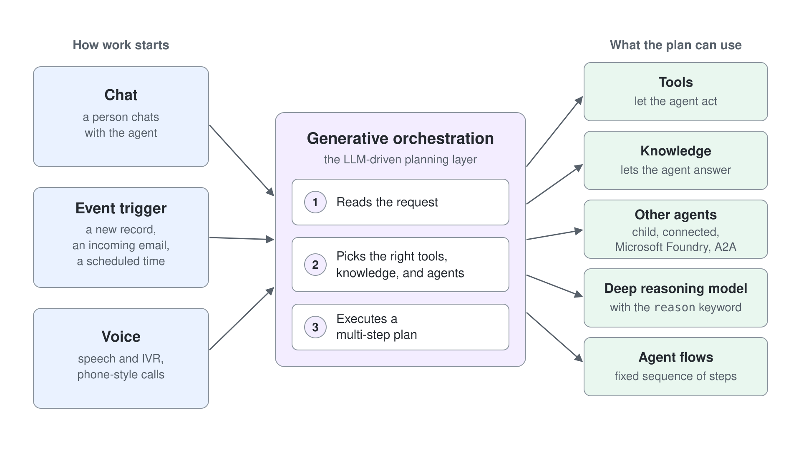
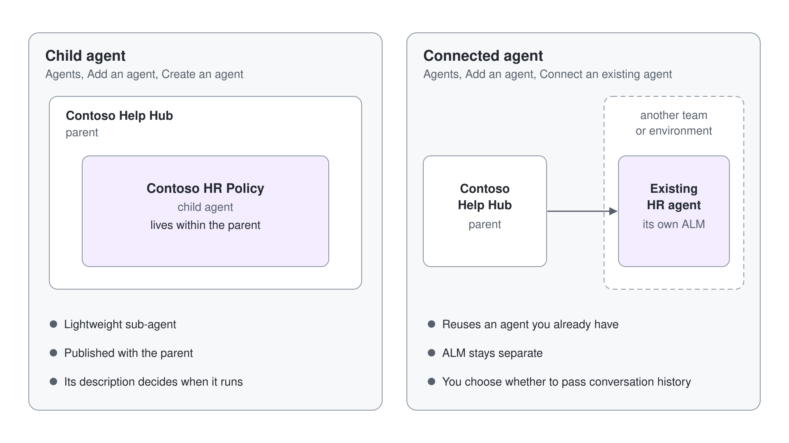

# Arbeit von einem Parent Agent an einen Child Agent routen

## Was Sie bauen

- Einen **Parent** Agent (Router), der mit **Generative Orchestration** entscheidet, wann er einen **Child** Agent aufruft.
- Der **Child** Agent ist auf eine enge Domain beschränkt (z. B. HR Policies). Der Parent bleibt der einzige Einstiegspunkt.



---

## Voraussetzungen

- Zugriff auf **Microsoft Copilot Studio** mit dem Recht, Agents in Ihrer Environment zu erstellen.
- Das Multi-Agent Feature (Child/Connected Agents) ist derzeit in **Preview**.

---

## Szenario

- **Parent**: “Grey Logistics Help Hub”: die Eingangstür, die allgemeine Fragen beantwortet und spezialisierte Anfragen routet.
- **Child**: “Grey Logistics HR Policy”: beantwortet nur Fragen zu HR Policies (Benefits, PTO, Feiertage) und gibt die Kontrolle danach automatisch an den Parent zurück.

---

## Schritt 1: Den Parent Agent erstellen

1. Öffnen Sie in **Copilot Studio** **Agents** → **More create options** → **Agent (Standard)**. Die voreingestellte Schaltfläche **New agent** erstellt einen anderen Agent-Typ. Geben Sie in **Name your agent** **Grey Logistics Help Hub** ein und wählen Sie **Create**.
2. Wählen Sie auf **Overview** den Befehl **Edit** in **Details** und geben Sie eine kurze **Description** ein; **Save** wird erst aktiv, wenn Sie etwas tippen. Wählen Sie dann **Edit** in **Instructions** und fügen Sie die Instructions unten ein.
3. Prüfen Sie unter **Settings** → **Generative AI** → **Orchestration**, dass **Yes - Responses will be dynamic…** ausgewählt ist. Das ist der Default.
4. (Optional) Fügen Sie allgemeine **Knowledge** Sources hinzu. **Web Search** ist standardmäßig eingeschaltet, daher beantwortet der Parent allgemeine Fragen aus öffentlichen Webergebnissen.

**Empfohlene Instructions für den Parent:**

```text
You are Grey Logistics Help Hub. Act as a front door:
- If the user asks about HR policy (benefits, PTO, holidays, leave eligibility, country-specific HR rules), delegate to the "Grey Logistics HR Policy" agent.
- Otherwise, answer directly using your knowledge and tools.
- Keep answers concise; cite sources when available.
- If unsure, ask a clarifying question rather than guessing.
```

## Schritt 2: Einen Child Agent im Parent hinzufügen

Child Agents erstellen Sie direkt aus dem Parent heraus. Child Agents sind schlanke Sub-Agents, die innerhalb des Parent leben.

1. Wählen Sie in Grey Logistics Help Hub auf **Overview** im Abschnitt **Agents** den Befehl **Add agent** und dann unter **Create a child agent** den Eintrag **New child agent**.
2. Das Feld **Name** ist mit `Agent` vorbelegt. Leeren Sie es und geben Sie dann **Grey Logistics HR Policy** ein.
3. Lassen Sie **When will this be used?** auf **The agent chooses - Based on description** und schreiben Sie eine präzise **Description**, die ein Pflichtfeld ist. Die Description bestimmt, wann Generative Orchestration diesen Child wählt:

```text
Only handle HR policy questions such as benefits, PTO/leave, holiday calendars, leave eligibility and policy rules. Don't answer IT, finance, or travel questions.
```

4. Fügen Sie unter **Instructions** für den Child diesen Text ein:

```text
You are Grey Logistics HR Policy.
- Answer only HR policy questions (benefits, PTO/leave, holidays, eligibility).
- If the query isn't about HR policy, return the conversation to the parent.
- Keep answers scoped and link to HR documents where possible.
```

5. Lassen Sie **After running** unter **Completion** auf dem Default **Don't respond** und wählen Sie **Save**.

Erwartetes Ergebnis: Der Child erscheint im Abschnitt **Agents** des Parent.

## Schritt 3: Das Routing testen (Parent → Child → Parent)

Öffnen Sie das Panel **Test** für Grey Logistics Help Hub (den Parent) und fragen Sie:

```text
How many PTO days do I get?
```

Erwartetes Ergebnis: Der Parent routet an Grey Logistics HR Policy, und der Child antwortet. Die Activity Map zeigt **The agent executed the Grey Logistics HR Policy tool**, was bestätigt, dass der Child genutzt wurde. Ohne HR-Dokumente kann der Child nur sagen, dass er Ihren Anspruch nicht prüfen kann.

Stellen Sie dann eine Frage außerhalb von HR:

```text
What's our Wi-Fi guest password policy?
```

Erwartetes Ergebnis: Der Parent antwortet selbst, ohne Aufruf des HR Policy Tools in der Activity Map. Er antwortet aus der Web Search und sagt, dass keine interne Policy gefunden wurde.



## Schritt 4: Das Routing wasserdicht machen

Schärfen Sie die **Description** des Child mit Formulierungen wie "only invoke when…" oder "such as…", um False Positives zu reduzieren, sodass Fragen außerhalb des Scopes beim Parent bleiben. Halten Sie die **Instructions** des Parent explizit darin, wann er delegiert und wann er direkt antwortet: Generative Orchestration nutzt beides, um Agents und Tools auszuwählen.

## Schritt 5: (Optional) Einen Connected Agent statt eines Child verwenden

Wenn Sie bereits anderswo einen HR Agent haben (in einem anderen Team oder einer anderen Environment) und Wiederverwendung sowie getrenntes ALM wollen:

1. Wählen Sie im Parent **Add agent**.
2. Wählen Sie den HR Agent unter **Select an agent in your environment** oder nutzen Sie **Connect to an external agent**.
3. Wenn der Dialog es anbietet, entscheiden Sie, ob Sie die Conversation History übergeben, und denken Sie an den Datenschutz.



## Schritt 6: Veröffentlichen und validieren

1. Wählen Sie **Publish** und dann **Publish** im Dialog, der auch **Force newest version** anbietet. Der Child wird mit dem Parent veröffentlicht.
2. Rechnen Sie damit, dass **Overview** die Warnung "No evaluation has been run on this agent" zeigt, bis Sie den Agent evaluieren.
3. Testen Sie in Ihrem Ziel-Channel (z. B. Teams) und beobachten Sie **Analytics** und **Activity**, um Routing und Antwortqualität mit der Zeit zu verbessern.
