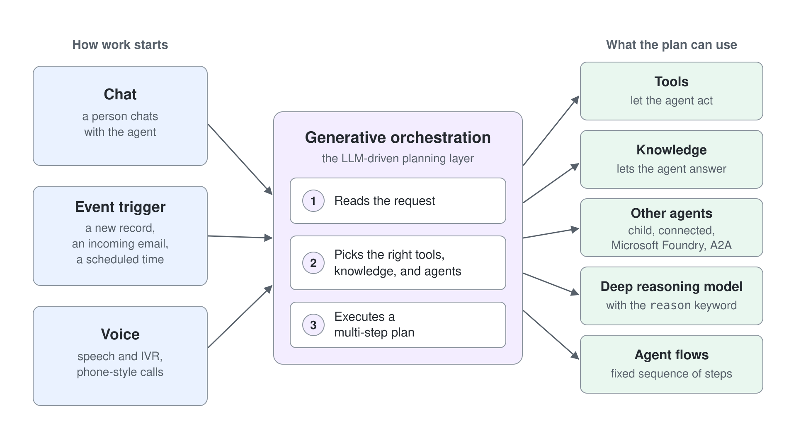
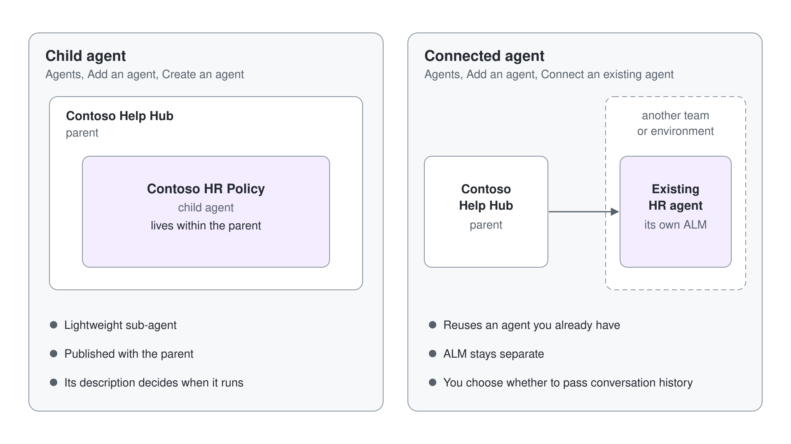

# Route Work from a Parent Agent to a Child Agent

## What You’ll Build

- A **Parent** agent (router) that uses **generative orchestration** to decide when to invoke a **Child** agent.
- The **Child** agent is scoped to a narrow domain (e.g., HR policies). The parent remains the single entry point.



---

## Prerequisites

- Access to **Microsoft Copilot Studio** with rights to create agents in your environment.
- Multi-agent (child/connected agents) feature is currently in **preview**.

---

## Scenario

- **Parent**: “Grey Logistics Help Hub”: the front door that answers general questions and routes specialized queries.
- **Child**: “Grey Logistics HR Policy”: answers HR policy questions only (benefits, PTO, holidays) and then hands control back to the parent automatically.

---

## Step 1: Create the Parent Agent

1. In **Copilot Studio**, open **Agents** → **More create options** → **Agent (Standard)**. The default **New agent** button creates a different agent type. In **Name your agent**, enter **Grey Logistics Help Hub** and select **Create**.
2. On **Overview**, select **Edit** in **Details** and enter a short **Description**; **Save** turns on only after you type. Then select **Edit** in **Instructions** and paste the instructions below.
3. Under **Settings** → **Generative AI** → **Orchestration**, confirm that **Yes - Responses will be dynamic…** is selected. It is the default.
4. (Optional) Add general **Knowledge** sources. **Web Search** is on by default, so the parent answers general questions from public web results.

**Recommended Parent Instructions:**

```text
You are Grey Logistics Help Hub. Act as a front door:
- If the user asks about HR policy (benefits, PTO, holidays, leave eligibility, country-specific HR rules), delegate to the "Grey Logistics HR Policy" agent.
- Otherwise, answer directly using your knowledge and tools.
- Keep answers concise; cite sources when available.
- If unsure, ask a clarifying question rather than guessing.
```

## Step 2: Add a Child Agent inside the Parent

You create child agents directly from the parent. Child agents are lightweight sub-agents that live within the parent.

1. In Grey Logistics Help Hub, on **Overview**, select **Add agent** in the **Agents** section, then **New child agent** under **Create a child agent**.
2. The **Name** field opens prefilled with `Agent`. Clear it, then enter **Grey Logistics HR Policy**.
3. Leave **When will this be used?** as **The agent chooses - Based on description** and write a precise **Description**, which is required. The description drives when generative orchestration chooses this child:

```text
Only handle HR policy questions such as benefits, PTO/leave, holiday calendars, leave eligibility and policy rules. Don't answer IT, finance, or travel questions.
```

4. In **Instructions** for the child, paste:

```text
You are Grey Logistics HR Policy.
- Answer only HR policy questions (benefits, PTO/leave, holidays, eligibility).
- If the query isn't about HR policy, return the conversation to the parent.
- Keep answers scoped and link to HR documents where possible.
```

5. Leave **After running** under **Completion** at its default, **Don't respond**, and select **Save**.

Expected: the child appears in the **Agents** section of the parent.

## Step 3: Test the Routing (Parent → Child → Parent)

Open the **Test** pane for Grey Logistics Help Hub (the parent) and ask:

```text
How many PTO days do I get?
```

Expected: the parent routes to Grey Logistics HR Policy and the child answers. The activity map shows **The agent executed the Grey Logistics HR Policy tool**, which confirms the child was used. Without HR documents the child can only say it cannot verify your entitlement.

Then ask a non-HR question:

```text
What's our Wi-Fi guest password policy?
```

Expected: the parent answers itself, with no HR Policy tool call in the activity map. It answers from web search and says that no internal policy was found.



## Step 4: Make Routing Bullet-Proof

Sharpen the child's **Description** with phrases like "only invoke when…" or "such as…" to reduce false positives, so that out-of-scope questions stay with the parent. Keep the parent **Instructions** explicit about when to delegate and when to answer directly: generative orchestration uses both to pick agents and tools.

## Step 5: (Optional) Use a Connected Agent instead of a Child

If you already have an HR agent elsewhere (another team or environment) and want reuse and separate ALM:

1. In the parent, select **Add agent**.
2. Pick the HR agent under **Select an agent in your environment**, or use **Connect to an external agent**.
3. If the dialog offers it, decide whether to pass the conversation history, and keep privacy in mind.



## Step 6: Publish and Validate

1. Select **Publish**, then **Publish** in the dialog, which also offers **Force newest version**. The child is published with the parent.
2. Expect the **Overview** to show the warning "No evaluation has been run on this agent" until you evaluate it.
3. Test in your target channel (e.g., Teams), and monitor **Analytics** and **Activity** to improve routing and answer quality over time.
