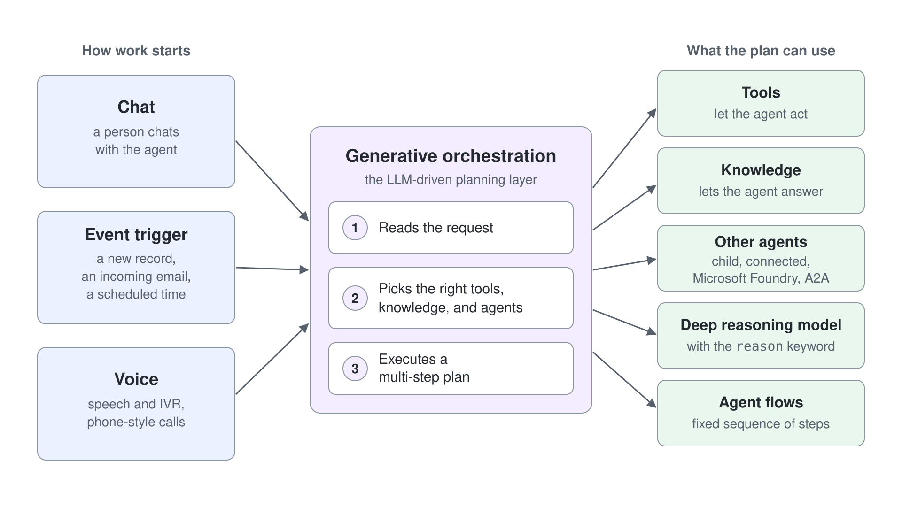

# Advanced Copilot Studio Agents

These labs take the Standard agent from answering questions to acting on its own, delegating to other agents and reasoning through a hard decision. The theory and demos for each topic are in [demos/05-cs-advanced](../../demos/05-cs-advanced/readme.md).

| Lab | Focus |
|-----|-------|
| [Create an Autonomous Agent](./01-autonomous-agents/lab-01-create-an-autonomous-agent.md) | An agent triggered by SharePoint uploads that writes candidate records through the HR MCP server |
| [Route Work from a Parent Agent to a Child Agent](./03-multi-agent/lab-01-parent-and-child-agents.md) | A parent agent that routes HR policy questions to a child agent through generative orchestration |
| [Recommend a Supplier with a Deep Reasoning Agent](./02-deep-reasoning/lab-01-supplier-recommendation.md) | Ten suppliers screened against a sourcing policy and an incident log, with the reason keyword on one instruction step and the deep reasoning node traced in the activity map |
| [Evaluate the HR Agent with a Test Set](./07-evaluations/lab-01-evaluate-the-hr-agent.md) (optional) | The HR agent from the Basics labs scored against ten HR questions with Meaning match and a Custom scope grader, one diagnosed fix, and a second run that proves it |

## More Practice on Microsoft Learn

- [Create your first autonomous agent](https://learn.microsoft.com/en-us/training/modules/autonomous-agent/exercise-create-your-first-autonomous-agent)
- [Use agent flows in Copilot Studio](https://learn.microsoft.com/en-us/training/modules/use-agent-flows/)
