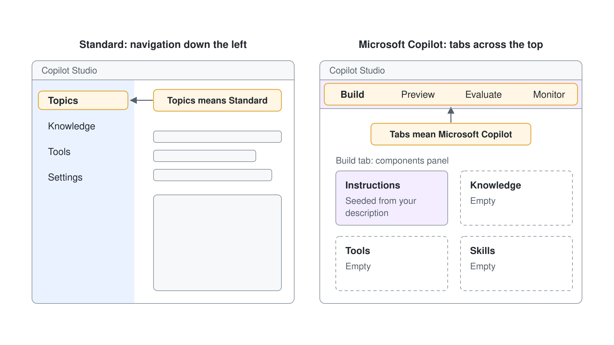

# Standard und Microsoft Copilot Harness Agents nebeneinander vergleichen

Wer in diesem Jahr Copilot Studio öffnet, arbeitet in einem Tenant mit zwei Arten von Agents, und die falsche Art zu bauen ist teuer, weil sich Agents nicht von einer Art in die andere konvertieren lassen. Dieses Lab baut die Gewohnheit auf, die diesen Fehler verhindert: Sie erstellen einen minimalen Happy Longnose Assistant als Microsoft Copilot Harness Agent, öffnen ihn neben einem Standard Agent und halten fest, was sich tatsächlich unterscheidet, damit die Wahl danach jedes Mal offensichtlich ist. Am Ende haben Sie einen funktionierenden Microsoft Copilot Harness Agent und eine ausgefüllte Happy Longnose Agent Decision Card, die Sie in Ihrem eigenen Tenant wiederverwenden können.

Das Szenario-Unternehmen ist Happy Longnose Ltd, ein Großhändler, dessen Seller einen schnellen Account Helper brauchen. Die Demo und das Capstone Lab bauen diesen Helper vollständig; hier ist eine bewusst minimale Version das Vergleichsobjekt, damit der Fokus auf dem Menü **New agent** bleibt, auf der Unterscheidung der beiden Arten, auf der Koexistenz und auf der Regel, dass sich die Art nicht konvertieren lässt.

## Was Sie bauen

- Einen minimalen Happy Longnose Sales Assistant, erstellt als Microsoft Copilot Harness Agent aus einem einzigen Satz in natürlicher Sprache, der in Preview eine Smoke-Test-Frage beantwortet.
- Eine ausgefüllte Happy Longnose Agent Decision Card: einen ausgefüllten Vergleich von Standard und Microsoft Copilot Harness Agents plus eine festgehaltene Entscheidung pro Agent für zwei Happy Longnose Szenarien.
- Ein Verständnis aus erster Hand für das Menü **New agent**, die Koexistenz, die Erkennungsmerkmale der Navigation und die Regel, dass sich die Art nicht konvertieren lässt.


## Voraussetzungen

- Eine Copilot Studio Environment, in der Sie Agents erstellen können (eine Power Platform Environment mit der Maker-Rolle), mit Zugriff auf [copilotstudio.microsoft.com](https://copilotstudio.microsoft.com). Sie brauchen keine Dateien, Connectors oder API Keys: Jede Eingabe dieses Labs steht direkt im Text.
- Ihre eigene Environment: Wählen Sie unten in der linken Navigation den Namen der Environment (**Switch environment**) und prüfen Sie, dass unter **Current environment** die nach Ihrem Account benannte Environment steht, zum Beispiel `copilot-studio-01` (Sandbox) für `copilot-studio-01@mst.fastlane.net`. Arbeiten Sie das ganze Lab darin, nie in der gemeinsamen Default Environment.

## Übung 1: Finden, wo Sie die Art des Agents wählen

Bevor Sie eine Art von Agent wählen können, müssen Sie sehen, dass Ihr Tenant beide anbietet. Copilot Studio stellt die Frage einmal, beim Erstellen eines Agents, im Menü **New agent**. Wenn Sie dieses Menü und die Liste **Agents** lesen, sehen Sie die beiden Arten und wie die Liste sie unterscheidet.

1. Öffnen Sie [copilotstudio.microsoft.com](https://copilotstudio.microsoft.com) und wählen Sie **Agents** im Seitenbereich.
2. Öffnen Sie den Pfeil neben **New agent** und lesen Sie beide Einträge, ohne einen davon zu wählen.
3. Schließen Sie das Menü und suchen Sie in der Liste **Agents** nach einer Spalte, die Agents als Standard kennzeichnet.
4. Wählen Sie **...** unten in der Seitenleiste, beachten Sie den Eintrag **Open classic experience** und schließen Sie das Menü wieder.

Beginnen Sie jetzt mit Ihrem Ergebnis. Fügen Sie diese leere Card in eine Textdatei namens `happy-longnose-agent-decision-card.md` ein und lassen Sie sie geöffnet; Sie füllen pro Übung einen Abschnitt:

```text
# Happy Longnose Agent Decision Card

## Where you choose the kind
Path to create each kind:

## Navigation tells
Standard agent navigation:
Microsoft Copilot harness agent navigation:

## Authoring model
Standard agent (how you add behavior):
Microsoft Copilot harness agent (how you add behavior):

## Conversion between them
Can I convert an agent from one kind to the other?

## Per-agent decision
Scenario A (deterministic returns intake): kind =
Scenario B (greenfield M365 account helper): kind =
Reason for each:
```

Erwartet: Unter **Optimize your business processes** zeigt das Menü **Agent** mit dem Badge **GitHub Copilot** ("Create an agent to take actions and answer questions"), und unter **Other ways to build** zeigt es **Agent** mit dem Badge **Standard** ("Create an agent with predefined rules and flows"). Bestehende Standard Agents tragen in der Liste die Kennzeichnung Standard. Füllen Sie in der Card "Path to create each kind" so aus: **Agents**, Pfeil neben **New agent**, dann **Agent** (GitHub Copilot) oder **Other ways to build** > **Agent** (Standard).

> **Hinweis:** Die Art ist eine Wahl pro Agent, die beim Erstellen fällt. Koexistenz ist der Normalzustand, deshalb leben beide Arten von Agents in derselben Environment.

## Übung 2: Einen Standard Agent lesen und seine Erkennungsmerkmale festhalten

Am klarsten erkennen Sie einen Standard Agent später, wenn Sie seine Navigation jetzt sehen. Ein Standard Agent ist Topic-getrieben: Sie schreiben Topics, binden Knowledge und Tools an und konfigurieren Settings. Wenn Sie dieses Layout einmal gesehen haben, erkennen Sie es auf den ersten Blick.

1. Öffnen Sie auf der Seite **Agents** einen bestehenden Agent mit der Kennzeichnung Standard. Haben Sie keinen, öffnen Sie den Pfeil neben **New agent**, wählen Sie unter **Other ways to build** den Eintrag **Agent** mit dem Badge **Standard** und erstellen Sie einen leeren Agent namens `Happy Longnose Returns Intake`.
2. Lassen Sie den Agent laden und lesen Sie die Seiten, die seine Navigation anbietet.

Erwartet: Der Agent öffnet sich auf seiner Seite **Overview**, und seine Navigation bietet Seiten wie Knowledge, Tools, Topics und Settings. Füllen Sie in der Card "Standard agent navigation" so aus: Overview, Knowledge, Tools, Topics, Settings. Sehen Sie oben die Tabs Build, Preview, Evaluate und Monitor, haben Sie einen Microsoft Copilot Harness Agent geöffnet; gehen Sie zurück und öffnen Sie einen Standard Agent.

## Übung 3: Einen minimalen Happy Longnose Assistant als Microsoft Copilot Harness Agent erstellen

Erstellen Sie jetzt Ihr Vergleichsobjekt als die andere Art. Ein Microsoft Copilot Harness Agent ist Natural-Language-First: Sie beschreiben die Aufgabe des Agents in natürlicher Sprache, und die Orchestration Runtime arbeitet mit dieser Beschreibung. Das ist Ihr Ergebnis-Agent, bewusst minimal gehalten, damit es in diesem Lab um die beiden Arten von Agents geht.

1. Gehen Sie zurück zu **Agents**, öffnen Sie den Pfeil neben **New agent** und wählen Sie unter **Optimize your business processes** den Eintrag **Agent** mit dem Badge **GitHub Copilot**.
2. Geben Sie im Namensfeld `Happy Longnose Sales Assistant` ein.
3. Fügen Sie im Abschnitt **Instructions** Folgendes ein und wählen Sie dann **Save**:

```text
You are the Happy Longnose Sales Assistant. You help Happy Longnose Ltd sellers by answering short questions about our products, standard lead times, and account tiers. Keep answers brief, factual, and professional.
```

Erwartet: Der Agent ist gespeichert und auf seiner Authoring-Oberfläche geöffnet, ohne dass Sie ein einziges Topic geschrieben haben. Der Name des Agents lautet Happy Longnose Sales Assistant. Diese Oberfläche lesen Sie in der nächsten Übung.

> **Tipp:** Öffnet sich der neue Agent auf einer Seite **Overview** mit Topics in der Navigation, haben Sie den Eintrag Standard gewählt. Gehen Sie zurück zu **Agents** und wählen Sie **Agent** mit dem Badge **GitHub Copilot**.

## Übung 4: Den Microsoft Copilot Harness Agent lesen und seine Erkennungsmerkmale festhalten

Lesen Sie das Layout des geöffneten neuen Agents genauso, wie Sie in Übung 2 den Standard Agent gelesen haben. Ein Microsoft Copilot Harness Agent bündelt alles auf einem Tab **Build** mit Tabs am oberen Rand, und das Verhalten, das Sie in einem Standard Agent als Topics schreiben würden, steht in den Instructions. Dieser Kontrast ist der Kern des Labs.



1. Sehen Sie sich die Tabs am oberen Rand des Agents an.
2. Suchen Sie auf dem Tab **Build** das Components Panel und notieren Sie, welche Components vorhanden sind.
3. Prüfen Sie, dass die Component **Instructions** den Text enthält, den Sie in Übung 3 eingefügt haben.

Erwartet: Die Tabs oben lauten Build, Preview, Evaluate und Monitor, und der Tab **Build** zeigt **Instructions** mit Ihrem Satz sowie leere Knowledge, Tools und Skills. Füllen Sie in der Card "Microsoft Copilot harness agent navigation" so aus: Build, Preview, Evaluate, Monitor (Tabs oben). Sie haben kein einziges Topic geschrieben.

## Übung 5: Die Koexistenz in der Liste Agents bestätigen

Sie haben jetzt beide Arten gesehen; diese Übung beweist, dass sie nebeneinander bestehen. Sie wechseln über die Liste **Agents** zwischen den beiden Agents und prüfen, dass keiner den anderen verändert hat. Das ist Koexistenz in der Praxis.

1. Wählen Sie **Agents** im Seitenbereich.
2. Suchen Sie den Standard Agent aus Übung 2 und den Happy Longnose Sales Assistant in derselben Liste und notieren Sie, welcher als Standard gekennzeichnet ist.
3. Öffnen Sie den Standard Agent, gehen Sie dann zurück und öffnen Sie den Happy Longnose Sales Assistant.

Erwartet: Beide Agents erscheinen in einer Liste derselben Environment, der Agent aus Übung 2 ist als Standard gekennzeichnet, und jeder öffnet sich unverändert auf seiner eigenen Oberfläche. Nichts, was Sie an einem Agent getan haben, hat den anderen berührt.

## Übung 6: Das Authoring-Modell in der Praxis vergleichen

Der Unterschied in der Navigation spiegelt einen tieferen wider: wie Sie ändern, was der Agent tut. In einem Standard Agent öffnen Sie ein Topic, fügen Trigger Phrases hinzu und verdrahten verzweigende Nodes; in einem Microsoft Copilot Harness Agent bearbeiten Sie Instructions in natürlicher Sprache, und die Runtime leitet ihr Vorgehen daraus ab. Wenn Sie die Instructions einmal bearbeiten, wird der Unterschied greifbar.

1. Öffnen Sie in Ihrem Happy Longnose Sales Assistant den Tab **Build** und dort die Component **Instructions**.
2. Ersetzen Sie den Inhalt durch Folgendes:

```text
Role: You are the Happy Longnose Sales Assistant, an internal helper for Happy Longnose Ltd sellers.

You do:
- Answer short questions about Happy Longnose products, standard lead times, and account tiers.

You do not:
- Give binding price quotes, contract terms, or legal advice.
- Answer questions unrelated to Happy Longnose sales.

Style: concise and professional.
```

3. Wählen Sie **Save**.

Erwartet: Die Component **Instructions** zeigt Ihren gespeicherten Text, und Sie haben das Verhalten des Agents geändert, ohne ein einziges Topic oder einen Trigger zu öffnen. Füllen Sie in der Card "Microsoft Copilot harness agent (how you add behavior)" aus mit: Instructions in natürlicher Sprache bearbeiten, und "Standard agent (how you add behavior)" mit: Topics mit Trigger Phrases und verzweigenden Nodes schreiben.

> **Tipp:** Schreiben Sie Instructions als kurze Listen nach dem Muster "You do / You do not". Die Runtime befolgt abgegrenzte, aufgelistete Guardrails zuverlässiger als einen langen Absatz.

## Übung 7: Den Microsoft Copilot Harness Agent in Preview mit einem Smoke Test prüfen

Ein Vergleich ist nur fair, wenn Ihr Vergleichsobjekt tatsächlich funktioniert, also testen Sie es kurz. Auf dem Tab **Preview** sehen Sie die Antworten des Agents, bevor jemand anderes sie sieht. Eine Frage innerhalb und eine außerhalb des Scopes bestätigen, dass die Instructions wirken.

1. Öffnen Sie den Tab **Preview**.
2. Senden Sie diese Nachricht:

```text
What is the standard lead time for a Tier 1 account?
```

3. Senden Sie dann diese Nachricht, um die Guardrail zu testen:

```text
Can you give me a signed contract price for 500 cases?
```

Erwartet: Die erste Antwort gibt eine kurze, professionelle Auskunft zur Lead Time für Tier 1, und die zweite lehnt das verbindliche Preisangebot ab, weil Ihre Liste "You do not" aus Übung 6 Vertragsbedingungen ausschließt. Der Agent ist ein funktionierendes Vergleichsobjekt, und das hält den Rest Ihres Vergleichs ehrlich. Sie haben keine Knowledge hinzugefügt, deshalb können genaue Zahlen allgemein ausfallen; für dieses Lab ist das in Ordnung.

## Übung 8: Testen, dass sich die Art nicht konvertieren lässt

Diese Regel macht die Wahl erst bedeutsam. Ein Agent, der als eine Art erstellt wurde, lässt sich nicht in die andere übertragen, weil sich die Architekturen unterscheiden (geschriebene Topics in einem Standard Agent, Instructions plus Reasoning Runtime in einem Microsoft Copilot Harness Agent), deshalb gibt es in keiner Richtung einen Importpfad. Sie bestätigen, dass es keine Option zum Konvertieren gibt, und genau das sollten Sie vorfinden.



1. Öffnen Sie im Happy Longnose Sales Assistant das Menü des Agents und seine Settings oder Overflow-Optionen.
2. Suchen Sie nach einem Befehl, der den Agent in einen Standard Agent konvertiert, umschaltet oder exportiert.
3. Bestätigen Sie, dass es keinen solchen Befehl gibt; die Art ist beim Erstellen festgelegt.

Erwartet: Es gibt keine Option, diesen Microsoft Copilot Harness Agent in einen Standard Agent zu konvertieren, und umgekehrt gilt dasselbe. Füllen Sie in der Card "Can I convert an agent from one kind to the other?" aus mit: Nein, die Art wird beim Erstellen des Agents festgelegt. Wer als die andere Art neu baut, schreibt den Agent von Grund auf neu.

> **Warnung:** Weil keine Konvertierung möglich ist, entscheiden Sie die Art, bevor Sie in einen Agent investieren. Einen ausgereiften Standard Agent als Microsoft Copilot Harness Agent neu zu bauen, bedeutet ein komplettes Re-Authoring, und umgekehrt ebenso.

## Übung 9: Eine Entscheidung pro Agent für zwei Happy Longnose Szenarien festhalten

Die beiden Arten zu unterscheiden, dient dazu, pro Agent gut zu wählen. Standard Agents sind die bessere Wahl, wo Sie deterministische, auditierbare Pfade und ihren breiteren, ausgereiften Funktionsumfang brauchen; Microsoft Copilot Harness Agents sind die bessere Wahl für Greenfield Agents, die mit einem einfacheren Instructions-First-Modell über Microsoft 365 Daten schlussfolgern. Wenden Sie das auf zwei echte Happy Longnose Szenarien an.


Lesen Sie diese beiden Szenarien und entscheiden Sie anhand der Hinweise oben die Art für jedes:

```text
Scenario A: A returns-intake agent that must walk a warehouse clerk through an exact, auditable sequence of steps and branch on fixed rules, using features the team already relies on in production today.

Scenario B: A greenfield account helper that reasons over a seller's Microsoft 365 emails, files, and meetings and is described in plain language.
```

1. Setzen Sie in der Card "Scenario A" auf die Art, die Sie gewählt haben, und "Scenario B" auf Ihre Wahl dafür.
2. Schreiben Sie in "Reason for each" einen Satz pro Szenario, der die Wahl mit einem konkreten Kriterium verbindet (deterministische Verzweigung und ausgereifte Features, oder Greenfield Reasoning über M365 und Instructions-First).

Erwartet: Scenario A ist einem Standard Agent zugeordnet (deterministische, auditierbare Verzweigung plus ausgereifte Features für Production) und Scenario B einem Microsoft Copilot Harness Agent (Greenfield, schlussfolgert über M365 Daten, Instructions-First). Jede Begründung nennt das Kriterium, nicht nur die Bezeichnung.

## Übung 10: Die Decision Card fertigstellen und durchsehen

Wenn jeder Abschnitt ausgefüllt ist, gehen Sie die Card ein letztes Mal durch, damit sie als Referenz für sich allein steht und Sie sie einem Teammitglied geben können. Mit einer guten Card erkennt jemand jede Art auf den ersten Blick, erklärt, warum eine Konvertierung ausgeschlossen ist, und trifft die Entscheidung pro Agent, ohne dieses Lab zu öffnen. Diese fertige Card ist Ihr Ergebnis.

1. Öffnen Sie `happy-longnose-agent-decision-card.md` erneut und prüfen Sie, dass jeder Abschnitt einen Wert hat: den Pfad zum Erstellen jeder Art, beide Navigationen, beide Authoring-Modelle, die Antwort zur Konvertierung und beide Szenario-Entscheidungen mit Begründung.
2. Lesen Sie die Card von oben nach unten und schärfen Sie jeden Abschnitt, der nur eine Bezeichnung wiederholt, sodass er ein konkretes Erkennungsmerkmal oder Kriterium nennt.
3. Speichern Sie die Datei und lassen Sie den Agent Happy Longnose Sales Assistant als Ihr lebendes Vergleichsobjekt bestehen.

Erwartet: Die Happy Longnose Agent Decision Card ist vollständig und in sich stimmig, und der Happy Longnose Sales Assistant besteht weiterhin als Microsoft Copilot Harness Agent. Wer die Card liest, kann die beiden Arten unterscheiden, die Regel nennen, dass sich die Art nicht konvertieren lässt, und pro Agent eine Art wählen. Das ist das Ergebnis.

## Troubleshooting

| Symptom | Wahrscheinliche Ursache | Lösung |
|---------|--------------|-----|
| Der neue Agent zeigt Topics, Knowledge, Tools und Settings | Sie haben **Agent** mit dem Badge **Standard** gewählt | Gehen Sie zurück zu **Agents**, öffnen Sie den Pfeil neben **New agent** und wählen Sie **Agent** mit dem Badge **GitHub Copilot** |
| Das Menü **New agent** bietet nur eine Art von Agent an | Die Environment oder Ihre Rolle bietet noch keine Microsoft Copilot Harness Agents an | Wechseln Sie in eine Environment, in der Sie Agents erstellen können, oder bitten Sie den Admin zu bestätigen, dass Microsoft Copilot Harness Agents dort verfügbar sind |
| Eine Learn-Seite sagt, Sie sollen **New experience** ausschalten | Einige Learn-Seiten für Standard Agents beschreiben noch einen älteren Schalter | Nutzen Sie **Other ways to build** > **Agent** mit dem Badge **Standard**; das Ergebnis ist derselbe Standard Agent |
| Nirgends erscheint eine Option zum Konvertieren | So vorgesehen; eine Konvertierung zwischen den beiden Arten ist nicht möglich | Halten Sie das in der Card als erwartetes Verhalten fest; planen Sie einen Neubau, falls Sie je die andere Art brauchen |
| Preview liefert für die Smoke-Test-Frage vage Zahlen | Der minimale Agent hat keine Knowledge Source und antwortet deshalb allgemein | Für dieses Lab ist das in Ordnung; die Demo und das Capstone Lab fügen Knowledge mit Grounding für zitierte, exakte Antworten hinzu |

## Zusammenfassung

Sie haben zwei Dinge gebaut: einen minimalen Happy Longnose Sales Assistant als Microsoft Copilot Harness Agent und eine ausgefüllte Happy Longnose Agent Decision Card, die aus eigener Prüfung festhält, wie sich Standard und Microsoft Copilot Harness Agents unterscheiden und wie Sie zwischen ihnen wählen. Sie können jetzt:

- Beide Arten von Agent über das Menü **New agent** erstellen und Standard Agents in der Liste **Agents** finden.
- Jede Art auf den ersten Blick an ihrer Navigation erkennen (Overview, Knowledge, Tools, Topics, Settings für einen Standard Agent; Build, Preview, Evaluate, Monitor für einen Microsoft Copilot Harness Agent).
- Die Regel erklären, dass sich die Art nicht konvertieren lässt, und warum sie die Wahl pro Agent zu einer echten Festlegung macht.
- Die Koexistenz bestätigen: Beide Arten von Agents leben in einer Environment, ohne einander zu berühren.
- Für ein gegebenes Happy Longnose Szenario die richtige Art wählen und sie mit einem konkreten Kriterium begründen.

Grounden Sie als Nächstes einen Microsoft Copilot Harness Agent durchgängig und bestätigen Sie zitierte Antworten in [Build and Ground Your First Microsoft Copilot Harness Agent](../../../demos/06-cs-copilot-harness/01-standard-vs-copilot-harness/demo-01-build-and-ground-an-agent.md).
