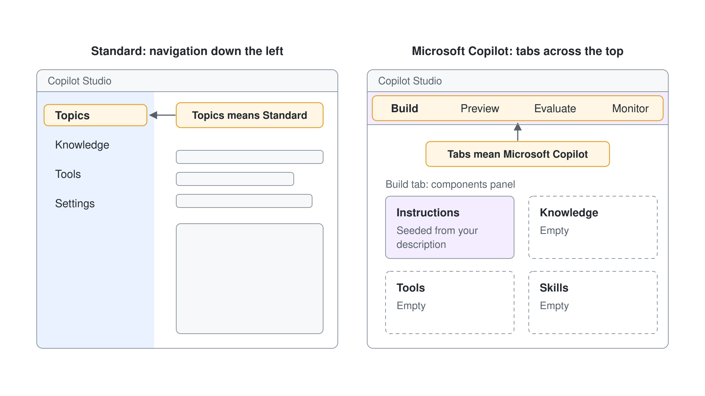

# Compare Standard and Microsoft Copilot Harness Agents Side by Side

Every maker who opens Copilot Studio this year works in a tenant that holds two kinds of agent, and building the wrong kind is expensive because agents can't be converted between them. This lab builds the habit that prevents that mistake: you create a minimal Happy Longnose assistant as a Microsoft Copilot harness agent, open it beside a Standard agent, and record what actually differs so the choice is obvious every time after. You leave with a working Microsoft Copilot harness agent and a completed Happy Longnose Agent Decision Card you can reuse on your own tenant.

The scenario company is Happy Longnose Ltd, a wholesale distributor whose sellers need a quick account helper. The demo and the capstone lab build that helper in full; here a deliberately minimal version is the specimen you compare, so the focus stays on the **New agent** menu, telling the two kinds apart, coexistence, and the one-way conversion rule.

## What you'll build

- A minimal Happy Longnose Sales Assistant created as a Microsoft Copilot harness agent from one plain-language sentence, answering a smoke-test question in Preview.
- A completed Happy Longnose Agent Decision Card: a filled comparison of Standard and Microsoft Copilot harness agents plus a recorded per-agent decision for two Happy Longnose scenarios.
- A first-hand understanding of the **New agent** menu, coexistence, the navigation tells, and the one-way conversion rule.


## Prerequisites

- A Copilot Studio environment where you can create agents (a Power Platform environment with the maker role), with access to [copilotstudio.microsoft.com](https://copilotstudio.microsoft.com). No files, connectors, or API keys are needed: every input in this lab is provided inline.
- Your own environment: select the environment name at the bottom of the left navigation (**Switch environment**) and check that **Current environment** shows the environment named after your account, for example `copilot-studio-01` (Sandbox) for `copilot-studio-01@mst.fastlane.net`. Work through the whole lab in it, never in the shared Default environment.

## Exercise 1: Find where you choose the kind of agent

Before you can choose a kind of agent, you need to see that both are offered in your tenant. Copilot Studio asks the question once, when you create an agent, from the **New agent** menu. Reading that menu and the **Agents** list shows you the two kinds and that the list alone doesn't tell them apart.

1. Open [copilotstudio.microsoft.com](https://copilotstudio.microsoft.com) and select **Agents** in the side pane.
2. Open the arrow next to **New agent** and read both entries without selecting one.
3. Close the menu and look at the **Agents** list: check whether any column marks an agent's kind.
4. Select **...** at the bottom of the side bar and note the **Open classic experience** entry, then close the menu.

Start your deliverable now. Paste this blank card into a text file named `happy-longnose-agent-decision-card.md` and keep it open; you fill one section per exercise:

```text
# Happy Longnose Agent Decision Card

## Where you choose the kind
Path to create each kind:

## Navigation tells
Standard agent navigation:
Microsoft Copilot harness agent navigation:

## Authoring model
Standard agent (how you add behavior):
Microsoft Copilot harness agent (how you add behavior):

## Conversion between them
Can I convert an agent from one kind to the other?

## Per-agent decision
Scenario A (deterministic returns intake): kind =
Scenario B (greenfield M365 account helper): kind =
Reason for each:
```

Expected: under **Optimize your business processes** the menu shows **Agent** with the **GitHub Copilot** badge ("Create an agent to take actions and answer questions"), and under **Other ways to build** it shows **Agent** with the **Standard** badge ("Create an agent with predefined rules and flows"). The **Agents** list has only a **Name** column and doesn't mark the kind; you tell the kinds apart by opening an agent, as the next exercises show. In the card, fill "Path to create each kind" with: **Agents**, arrow next to **New agent**, then **Agent** (GitHub Copilot) or **Other ways to build** > **Agent** (Standard).

> **Note:** The kind is a per-agent choice made at creation. Coexistence is the normal state, so both kinds of agent live in the same environment.

## Exercise 2: Read a Standard agent and capture its tells

The clearest way to recognize a Standard agent later is to see its navigation now. A Standard agent is topic-driven: you author Topics, wire Knowledge and Tools, and configure Settings. Seeing this layout once makes it unmistakable on sight.

1. On the **Agents** page, open an existing Standard agent (it opens on an **Overview** page). If you have none, open the arrow next to **New agent**, select **Agent** with the **Standard** badge under **Other ways to build**, and create a blank agent named `Happy Longnose Returns Intake`.
2. Let the agent load and read the pages its navigation offers.

Expected: the agent opens on its **Overview** page, with page tabs across the top such as Knowledge, Tools, Agents, Topics, Activity, Evaluation, Monitor, and Channels (in a narrow window they fold into a **+8** entry beside **Overview**), plus **Test** and Settings at the top right (under **...** in a narrow window). In the card, fill "Standard agent navigation" with: Overview, Knowledge, Tools, Topics, Settings. If you see Build, Preview, Evaluate, and Monitor tabs across the top (a **Build** drop-down in a narrow window), you opened a Microsoft Copilot harness agent; go back and open a Standard one.

## Exercise 3: Create a minimal Happy Longnose assistant as a Microsoft Copilot harness agent

Now create your comparison specimen as the other kind. A Microsoft Copilot harness agent is natural-language-first: you describe the agent's job in plain language and the orchestration runtime works from that description. This is your deliverable agent, kept minimal so the lab stays about the two kinds of agent.

1. Go back to **Agents**, open the arrow next to **New agent**, and under **Optimize your business processes** select **Agent** with the **GitHub Copilot** badge.
2. In the name field, enter `Happy Longnose Sales Assistant`.
3. In the **Instructions** section, paste the following, then select **Save** (the disk icon at the top right; in a narrow window, **...** > **Save**):

```text
You are the Happy Longnose Sales Assistant. You help Happy Longnose Ltd sellers by answering short questions about our products, standard lead times, and account tiers. Keep answers brief, factual, and professional.
```

Expected: "Your agent has been saved." appears and the agent stays open on its authoring surface without you having written a single topic. The agent name reads Happy Longnose Sales Assistant. You read that surface in the next exercise.

> **Tip:** If the new agent opens on an **Overview** page with Topics in its navigation, you picked the Standard entry. Go back to **Agents** and select **Agent** with the **GitHub Copilot** badge.

## Exercise 4: Read the Microsoft Copilot harness agent and capture its tells

With the new agent open, read its layout the same way you read the Standard agent in Exercise 2. A Microsoft Copilot harness agent gathers everything on one **Build** tab with tabs across the top, and the behavior you would author as topics in a Standard agent lives in Instructions. This contrast is the heart of the lab.



1. Look at the tabs across the top of the agent (in a narrow window they fold into a **Build** drop-down).
2. On the **Build** tab, find the components panel beside **Instructions** and note which components are present.
3. Confirm the **Instructions** component holds the text you pasted in Exercise 3.

Expected: the top tabs read Build, Preview, Evaluate, and Monitor, next to **Review** and **Publish**, and the **Build** tab shows **Instructions** with your sentence and a components panel with Model, Channels, Skills, Tools, Knowledge, Connected agents, and Memory. Skills is empty; Tools already holds **Work IQ** and Knowledge holds **Search all websites**, both added by default. In the card, fill "Microsoft Copilot harness agent navigation" with: Build, Preview, Evaluate, Monitor (top tabs). You authored zero topics.

## Exercise 5: Confirm coexistence in the Agents list

You have now seen both kinds; this exercise proves they live together. You move between the two agents from the **Agents** list and confirm that neither one changed the other. This is coexistence in action.

1. Select **Agents** in the side pane.
2. Find the Standard agent from Exercise 2 and the Happy Longnose Sales Assistant in the same list; the list shows names only, so you know each one's kind from the earlier exercises.
3. Open the Standard agent, then go back and open the Happy Longnose Sales Assistant.

Expected: both agents appear in one list of the same environment, the Exercise 2 agent opens on its **Overview** page and the Happy Longnose Sales Assistant on its **Build** tab, each with nothing altered. Nothing you did to one agent touched the other.

## Exercise 6: Contrast the authoring model in practice

The navigation difference reflects a deeper one: how you change what the agent does. In a Standard agent you open a Topic, add trigger phrases, and wire branching nodes; in a Microsoft Copilot harness agent you edit plain-language Instructions and the runtime reasons against them. Editing Instructions once makes the difference concrete.

1. On your Happy Longnose Sales Assistant, stay on the **Build** tab and select the text under **Instructions**.
2. Replace the contents with the following:

```text
Role: You are the Happy Longnose Sales Assistant, an internal helper for Happy Longnose Ltd sellers.

You do:
- Answer short questions about Happy Longnose products, standard lead times, and account tiers.

You do not:
- Give binding price quotes, contract terms, or legal advice.
- Answer questions unrelated to Happy Longnose sales.

Style: concise and professional.
```

3. Select **Save** at the top right.

Expected: **Instructions** shows your saved text, and you changed the agent's behavior without opening a single topic or trigger. In the card, fill "Microsoft Copilot harness agent (how you add behavior)" with: edit plain-language Instructions, and "Standard agent (how you add behavior)" with: author Topics with trigger phrases and branching nodes.

> **Tip:** Write instructions as short "You do / You do not" lists. The runtime follows scoped, itemized guardrails more reliably than one long paragraph.

## Exercise 7: Smoke-test the Microsoft Copilot harness agent in Preview

A comparison is only fair if your specimen actually works, so give it one quick test. **Preview** is where you see the agent respond before anyone else does. One in-scope question and one out-of-scope question confirm the Instructions took effect.

1. Open the **Preview** tab.
2. Send this message:

```text
What is the standard lead time for a Tier 1 account?
```

3. Then send this message to test the guardrail:

```text
Can you give me a signed contract price for 500 cases?
```

Expected: the first reply answers the lead-time question professionally, and because the agent holds no Happy Longnose data it says it found no Tier 1 standard or gives only a general figure from the web; the step list shows it searched with the default **Search all websites** and **Work IQ** tools. The second reply declines the binding quote because your Exercise 6 "You do not" list forbids contract terms. The agent is a working specimen, which keeps the rest of your comparison honest; the missing figure is fine for this lab.

## Exercise 8: Test the one-way conversion rule

This is the rule that makes the choice matter. An agent created as one kind can't be transferred to the other because the architectures differ (authored topics in a Standard agent, instructions plus the reasoning runtime in a Microsoft Copilot harness agent), so there is no import path either way. You confirm there is no convert option, which is exactly what you should find.



1. On the Happy Longnose Sales Assistant, open the agent menu and its settings or overflow options.
2. Look for any command that converts, switches, or exports the agent to a Standard agent.
3. Confirm no such command exists; the kind is fixed at creation time.

Expected: there is no option to convert this Microsoft Copilot harness agent to a Standard agent, and the same holds in reverse. In the card, fill "Can I convert an agent from one kind to the other?" with: No, the kind is fixed when the agent is created. Rebuilding as the other kind means authoring again from scratch.

> **Warning:** Because conversion is impossible, decide the kind before you invest in an agent. A mature Standard agent rebuilt as a Microsoft Copilot harness agent is a full re-author, and the reverse is too.

## Exercise 9: Record a per-agent decision for two Happy Longnose scenarios

The point of telling the two kinds apart is to choose well per agent. Standard agents lead where you need deterministic, auditable paths and their broader mature feature set; Microsoft Copilot harness agents lead for greenfield agents that reason over Microsoft 365 data with a simpler instructions-first model. Apply that to two real Happy Longnose scenarios.


Read these two scenarios and decide the kind for each using the guidance above:

```text
Scenario A: A returns-intake agent that must walk a warehouse clerk through an exact, auditable sequence of steps and branch on fixed rules, using features the team already relies on in production today.

Scenario B: A greenfield account helper that reasons over a seller's Microsoft 365 emails, files, and meetings and is described in plain language.
```

1. In the card, set "Scenario A" to your chosen kind and "Scenario B" to yours.
2. In "Reason for each", write one sentence per scenario tying the choice to a concrete driver (deterministic branching and mature features, or greenfield M365 reasoning and instructions-first).

Expected: Scenario A is assigned to a Standard agent (deterministic, auditable branching plus mature production features) and Scenario B to a Microsoft Copilot harness agent (greenfield, reasons over M365 data, instructions-first). Each reason names the driver as well as the label.

## Exercise 10: Complete and review the Decision Card

With every section filled, do a final pass so the card stands on its own as a reference you can hand to a teammate. A good card lets someone recognize each kind on sight, explain why conversion is off the table, and make the per-agent call without opening this lab. This completed card is your deliverable.

1. Reopen `happy-longnose-agent-decision-card.md` and confirm every section has a value: the path to create each kind, both navigations, both authoring models, the conversion answer, and both scenario decisions with reasons.
2. Read the card top to bottom and sharpen any section that only restates a label so it names a concrete tell or driver.
3. Save the file and keep the Happy Longnose Sales Assistant agent in place as your live specimen.

Expected: the Happy Longnose Agent Decision Card is complete and internally consistent, and the Happy Longnose Sales Assistant still stands as a Microsoft Copilot harness agent. Someone reading the card can tell the two kinds apart, state the one-way conversion rule, and choose a kind per agent. That is the deliverable.

## Troubleshooting

| Symptom | Likely cause | Fix |
|---------|--------------|-----|
| The new agent shows Topics, Knowledge, Tools, and Settings | You picked **Agent** with the **Standard** badge | Go back to **Agents**, open the arrow next to **New agent**, and select **Agent** with the **GitHub Copilot** badge |
| The **New agent** menu offers only one kind of agent | The environment or your role doesn't offer Microsoft Copilot harness agents yet | Switch to an environment where you can create agents, or ask the admin to confirm Microsoft Copilot harness agents are available there |
| A Learn page tells you to turn off **New experience** | Some Learn pages for Standard agents still describe an older switch | Use **Other ways to build** > **Agent** with the **Standard** badge; the result is the same Standard agent |
| No convert option appears anywhere | Working as designed; conversion between the two kinds isn't possible | Record this in the card as expected behavior; plan to rebuild if you ever need the other kind |
| Preview gives vague figures for the smoke-test question | The minimal agent has no Knowledge source of its own, only the default **Search all websites**, so it answers generally | This is fine for this lab; the demo and capstone lab add grounded Knowledge for cited, exact answers |
| Preview answers "You need credits to continue ... Error code: EnforcementUsageCredits" | The environment has no Copilot Credits left, and a Microsoft Copilot harness agent uses credits in Preview | Ask the admin to allocate Copilot Credits to the environment, then send the message again |

## Summary

You built two things: a minimal Happy Longnose Sales Assistant as a Microsoft Copilot harness agent and a completed Happy Longnose Agent Decision Card that captures, from first-hand inspection, how Standard and Microsoft Copilot harness agents differ and how to choose between them. You can now:

- Create either kind of agent from the **New agent** menu and find both kinds in the **Agents** list.
- Identify each kind on sight from its navigation (Overview, Knowledge, Tools, Topics, Settings for a Standard agent; Build, Preview, Evaluate, Monitor for a Microsoft Copilot harness agent).
- Explain the one-way conversion rule and why it makes the per-agent choice a real commitment.
- Confirm coexistence: both kinds of agent live in one environment, untouched by each other.
- Choose the right kind for a given Happy Longnose scenario and justify it with a concrete driver.

Next, ground a Microsoft Copilot harness agent end to end and confirm cited answers in [Build and Ground Your First Microsoft Copilot Harness Agent](../../../demos/06-cs-copilot-harness/01-standard-vs-copilot-harness/demo-01-build-and-ground-an-agent.md).
