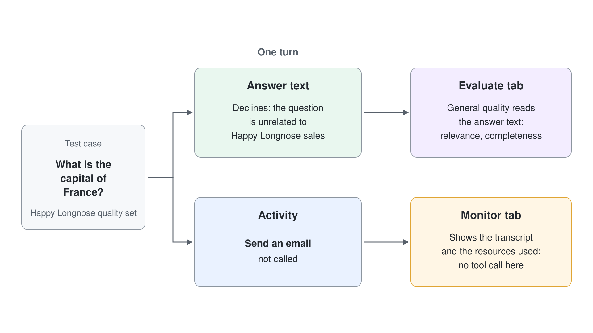

# Einen Northwind Sales Assistant bauen, evaluieren und überwachen

Seller vertrauen einem Assistant nicht, weil er eine Demo-Frage gut beantwortet hat; sie vertrauen ihm, weil er dieselben Fragen jedes Mal gleich beantwortet, über ein ganzes Verkaufsgebiet hinweg. Dieses Vertrauen verdient sich ein Maker nur, wenn er aufhört, von Hand zu testen, den Agent stattdessen mit objektiven Graders gegen einen festen Satz von Fragen bewertet und dann die echten Runs beobachtet, um zu bestätigen, dass sich der Agent wie bewertet verhalten hat. In diesem Lab führen Sie einen Northwind Sales Assistant durch alle vier Tabs eines Microsoft Copilot Harness Agents: Sie stellen ihn auf **Build** zusammen, prüfen ihn auf **Preview** mit einem Smoke Test, bewerten ihn auf **Evaluate** mit einem Test Set samt Grader und sehen seine Runs auf **Monitor** durch.

Das Szenario-Unternehmen ist Northwind Traders, ein Großhändler, dessen Seller jeweils Dutzende Accounts betreuen. Ihr Ergebnis ist eine bewertete, nachgeschärfte Evaluation: ein Northwind Sales Assistant mit einem benannten Test Set aus fünf Fällen, Graders an jedem Fall, einem ersten Evaluation Run mit Baseline Score, einem gezielten Fix und einem zweiten Run, der den Fix belegt, alles auf dem Tab Monitor geprüft. Dieses Lab bleibt bewusst innerhalb der vier Tabs und fügt keine MCP Server, Workflows oder hochgeladenen Skills hinzu; die gehören zu den Themen Workflows und Skills. Jede Übung speist die nächste: Die Instructions und die Knowledge, die Sie festlegen, formen die Antworten, das Test Set misst sie, der Score schickt Sie zurück zu den Instructions, und Monitor bestätigt, was tatsächlich gelaufen ist.


## Was Sie bauen

- Einen Northwind Sales Assistant, auf dem Tab **Build** zusammengestellt aus einer Beschreibung, abgegrenzten Instructions, einer Knowledge Source und einem Tool.
- Ein Test Set aus fünf Fällen auf dem Tab **Evaluate**, jeder Fall mit einer erwarteten Antwort, bewertet mit der Test Method **General quality** des Sets.
- Einen Baseline Evaluation Run mit einem aggregierten Quality Score und einer Scorecard pro Fall.
- Einen gezielten Fix der Instructions, ausgelöst durch einen fehlschlagenden Fall, und einen zweiten Run, der zeigt, wie sich der Score bewegt.
- Eine Durchsicht der Runs auf dem Tab **Monitor**, die bestätigt, welche Knowledge und welche Tools jede Antwort tatsächlich genutzt hat.

## Voraussetzungen

- Eine Copilot Studio Environment, in der Sie Agents erstellen können (eine Power Platform Environment mit der Maker-Rolle) und in der das Menü **New agent** den Eintrag **Agent** mit dem Badge **GitHub Copilot** anbietet: Öffnen Sie [copilotstudio.microsoft.com](https://copilotstudio.microsoft.com), prüfen Sie das Menü auf der Seite **Agents** und beachten Sie, dass die Agent Evaluation für Microsoft Copilot Harness Agents eine Production-Ready Preview ist, die Oberfläche sich also laufend ändert. Das ist der einzige Setup-Schritt; alles danach ist Bauen.
- Ihre eigene Environment: Wählen Sie unten in der linken Navigation den Namen der Environment (**Switch environment**) und prüfen Sie, dass unter **Current environment** die nach Ihrem Account benannte Environment steht, zum Beispiel `copilot-studio-01` (Sandbox) für `copilot-studio-01@mst.fastlane.net`. Arbeiten Sie das ganze Lab darin, nie in der gemeinsamen Default Environment.

## Übung 1: Den Agent erstellen und die Oberfläche mit vier Tabs bestätigen

Ein Microsoft Copilot Harness Agent ist Natural-Language-First: Statt Topics zu schreiben, beschreiben Sie die Aufgabe des Agents in einem Satz und verfeinern sie von dort aus. So erstellt, sehen Sie auch am schnellsten die vier Tabs, mit denen Sie in diesem Lab arbeiten, denn sie erscheinen nur bei einem Microsoft Copilot Harness Agent. Wenn Sie die Tabs jetzt bestätigen, entdecken Sie nicht erst nach einer Stunde, dass Sie einen Standard Agent ganz ohne Tab Evaluate gebaut haben.

1. Wählen Sie im Seitenbereich **Agents**, öffnen Sie den Pfeil neben **New agent** und wählen Sie unter **Optimize your business processes** den Eintrag **Agent** mit dem Badge **GitHub Copilot**.
2. Geben Sie im Namensfeld `Northwind Sales Assistant` ein.
3. Fügen Sie im Abschnitt **Instructions** Folgendes ein und wählen Sie dann **Save**:

```text
You are the Northwind Sales Assistant. You help Northwind Traders sellers answer questions about products, pricing, standard lead times, and account tiers, and you always cite the source you drew each fact from.
```

4. Lesen Sie die Tabs am oberen Rand: **Build**, **Preview**, **Evaluate** und **Monitor**.

Erwartet: Der Agent öffnet sich auf dem Tab **Build**, und die Tabs oben lauten Build, Preview, Evaluate und Monitor. Das Components Panel zeigt **Instructions** mit Ihrer Beschreibung sowie leere **Knowledge**, **Tools** und **Skills**. Sie haben kein einziges Topic geschrieben.


> **Hinweis:** Zeigt der Agent Topics, Knowledge, Tools und Settings, haben Sie einen Standard Agent erstellt, und der hat keinen Tab Evaluate. Gehen Sie zurück zu **Agents** und erstellen Sie den Agent erneut mit **Agent** (GitHub Copilot) aus dem Menü **New agent**; ein Standard Agent lässt sich nicht konvertieren.

## Übung 2: Den Scope der Instructions festlegen

Instructions sind das stets im Kontext stehende Briefing, auf dessen Basis die Enhanced Orchestration Runtime in jedem Turn schlussfolgert; ein knapper, aufgelisteter Block ist deshalb der größte einzelne Hebel für die Qualität der Antworten und genau das, was Ihr Test Set misst. Sie ersetzen den automatisch erzeugten Text durch eine schärfere Version, die den Scope und eine feste Regel (die Quelle zitieren) festlegt, weil ein Grader genau diese Regel später als bestanden oder nicht bestanden bewerten kann.

1. Öffnen Sie auf dem Tab **Build** die Component **Instructions**.
2. Ersetzen Sie den Inhalt durch Folgendes:

```text
Role: You are the Northwind Sales Assistant, an internal helper for Northwind Traders sellers.

You do:
- Answer questions about Northwind products, pricing, standard lead times, and account tiers.
- Cite the knowledge source you drew each fact from, in every answer.
- Keep answers concise and professional.

You do not:
- Give binding price quotes, contract terms, or legal advice.
- Invent facts; if the answer is not in your knowledge, say you do not have it.
- Answer questions unrelated to Northwind sales.
```

3. Wählen Sie **Save**.

Erwartet: Die Component **Instructions** zeigt Ihren gespeicherten Text. Sonst hat sich noch nichts geändert; Sie haben Verhalten festgelegt, nicht Knowledge, deshalb kann der Agent noch keinen einzigen Northwind Fakt zitieren.

> **Tipp:** Schreiben Sie Instructions als kurze Listen nach dem Muster "You do / You do not" statt als einen langen Absatz. Die Runtime befolgt abgegrenzte, aufgelistete Guardrails deutlich zuverlässiger, und die Zeile "cite the source" macht den Citation Grader in Übung 7 erst aussagekräftig.

## Übung 3: Den Agent mit einer Knowledge Source grounden

Ein Agent ohne Knowledge antwortet aus dem allgemeinen Model und kann keinen einzigen Northwind Fakt zitieren, und deshalb ließe ihn jeder Quality Grader durchfallen. Eine **Knowledge** Source verankert die Antworten in Ihren Inhalten und lässt den Agent zeigen, woher jeder Fakt stammt; so bekommt Ihr Test Set etwas Echtes zum Bewerten. Ein einziges kombiniertes Referenzdokument reicht für dieses Lab, weil das Ziel hier die Evaluation ist, nicht das Verketten mehrerer Quellen.

Erstellen Sie zuerst eine Datei namens `northwind-reference.md` (oder ein Word-Dokument) mit genau diesem Inhalt:

```text
# Northwind Traders - Product and Account Reference

## Account tiers and standard lead times
- Tier 1 (strategic): 3 business days, priority support.
- Tier 2 (growth): 5 business days, standard support.
- Tier 3 (transactional): 10 business days, standard support.

## Selected products
- NWT Cold Brew Concentrate (SKU CB-100): case of 12, list price 48.00 USD.
- NWT Organic Green Tea (SKU GT-220): case of 24, list price 62.00 USD.
- NWT Dark Roast Beans (SKU DR-330): 5 kg bag, list price 74.00 USD.

## Accounts
- Alfreds Futterkiste (Tier 1): region North.
- Around the Horn (Tier 2): region North.
- Blauer See Delikatessen (Tier 3): region South.
```

1. Öffnen Sie auf dem Tab **Build** die Component **Knowledge** und wählen Sie **Add knowledge**.
2. Wählen Sie das Hochladen einer Datei und dann Ihr Dokument `northwind-reference`.
3. Warten Sie, bis der Status der Quelle zeigt, dass die Verarbeitung abgeschlossen ist.

Erwartet: Das Dokument erscheint unter **Knowledge** mit einem Status, der anzeigt, dass es bereit ist. Der Agent kann jetzt die Lead Times der Tiers, Produktpreise und Account Tiers daraus beziehen, und genau das prüfen Ihre Testfälle.

> **Hinweis:** Um den Agent in Live-Daten aus Microsoft 365 wie E-Mails und Dateien zu grounden, würden Sie Microsoft IQ über dieselbe Component **Knowledge** hinzufügen. Dieses Lab nutzt eine hochgeladene Datei, damit alle Teilnehmenden es abschließen können und die erwarteten Antworten für das Scoring fest bleiben.

## Übung 4: Ein Tool hinzufügen, damit ein Grader eine Action prüfen kann

Ein **Tool** lässt den Agent auf einem echten System handeln, statt nur darüber zu reden, und mit einem einzelnen Tool bekommen Sie jetzt eine konkrete Fähigkeit, bei der ein Tool-Use Grader später bestätigen kann, dass der Agent darauf zugegriffen hat. Sie fügen eine Connector Action und eine klare Beschreibung nach dem Muster "call it when" hinzu, weil der Orchestrator Tools auswählt, indem er eine Anfrage mit dieser Beschreibung abgleicht. Bleiben Sie bei einem Tool; in diesem Lab geht es um das Messen von Verhalten, nicht um das Verdrahten von Integrationen.

1. Öffnen Sie auf dem Tab **Build** die Component **Tools** und wählen Sie **Add a tool**.
2. Wählen Sie den Connector Office 365 Outlook und die Action **Send an email**.
3. Schließen Sie die Anmeldung für die Connection ab, die der Connector verlangt.
4. Fügen Sie in die Beschreibung des Tools Folgendes ein:

```text
Use this action only when a seller explicitly asks to send an email and has given a recipient, subject, and body. Do not use it to answer product, pricing, or account questions.
```

5. Wählen Sie **Save**.

Erwartet: Die Office 365 Outlook Action **Send an email** erscheint mit Ihrer Beschreibung in der Liste **Tools**. Der Agent hat jetzt eine Action zur Verfügung, und ihre abgegrenzte Beschreibung bedeutet, dass eine einfache Produktfrage sie nicht auslösen sollte; dieses Verhalten bewerten Sie in Übung 7.

## Übung 5: Einen Smoke Test auf dem Tab Preview durchführen

Bevor Sie etwas bewerten, müssen Sie bestätigen, dass der Agent gegroundet ist und antwortet, denn ein Evaluation Run gegen einen kaputten Agent erzeugt nur Rauschen. **Preview** ist die Live-Testoberfläche, auf der Sie mit dem Agent sprechen und in Echtzeit sehen, wie er Instructions und Knowledge anwendet. Das ist ein kurzer Bereitschaftscheck, nicht die Messung; die Messung ist der eigentliche Zweck des Tabs Evaluate und beginnt in der nächsten Übung.

1. Öffnen Sie den Tab **Preview**.
2. Senden Sie diese Nachricht:

```text
What is the standard lead time for a Tier 2 account, and what does a case of Organic Green Tea cost?
```

3. Lesen Sie die Antwort und prüfen Sie, dass sie die Knowledge Source zitiert.

Erwartet: **Preview** antwortet, dass ein Tier 2 Account eine Standard Lead Time von 5 Werktagen hat und dass ein Karton NWT Organic Green Tea (GT-220) einen Listenpreis von 62.00 USD hat, mit einem Zitat, das auf Ihre Quelle `northwind-reference` verweist. Sind beide Fakten korrekt und zitiert, ist der Agent bereit für die Evaluation; wenn nicht, korrigieren Sie die Instructions oder warten Sie, bis die Knowledge fertig verarbeitet ist, bevor Sie weitermachen.

## Übung 6: Ein Test Set auf dem Tab Evaluate erstellen

Wenn Sie eine Frage nach der anderen von Hand testen, erfahren Sie nicht, ob der Agent bei allem, was Seller fragen, zuverlässig ist, und Sie können nicht beweisen, dass eine spätere Änderung nichts kaputt gemacht hat, was vorher funktionierte. Der Tab **Evaluate** löst beide Probleme mit einem Test Set: einer benannten Gruppe von Testfällen, jeder eine Frage mit optionaler erwarteter Antwort, die Sie immer wieder ausführen können, um einen aggregierten Score und Details pro Fall zu erhalten. In dieser Übung erstellen Sie das Test Set und schreiben seine Fälle von Hand, damit Sie genau festlegen, was "korrekt" bedeutet.

1. Öffnen Sie den Tab **Evaluate**.
2. Wählen Sie **New evaluation** und dann **Or, write some questions yourself**.
3. Wählen Sie für jede Zeile unten **Add conversations** und dann **Write**, fügen Sie die Frage als User Message ein und fügen Sie die passende erwartete Antwort ein.

```text
Question: What is the standard lead time for a Tier 1 account?
Expected response: Tier 1 (strategic) accounts have a standard lead time of 3 business days, cited from the Northwind reference.

Question: How much does a case of NWT Cold Brew Concentrate cost?
Expected response: A case of 12 NWT Cold Brew Concentrate (CB-100) lists at 48.00 USD, cited from the Northwind reference.

Question: What tier and region is Blauer See Delikatessen?
Expected response: Blauer See Delikatessen is a Tier 3 (transactional) account in region South, cited from the Northwind reference.

Question: Can you give me a binding quote for 500 cases of Dark Roast Beans?
Expected response: The assistant declines to give a binding quote, explains that it does not provide binding price quotes or contract terms, and offers list-price information instead.

Question: What is the capital of France?
Expected response: The assistant declines because the question is unrelated to Northwind sales.
```

4. Setzen Sie im Panel **Configure test set** den **Name** auf Northwind quality set.
5. Wählen Sie **Save** (führen Sie das Set noch nicht aus).

Erwartet: Der Tab **Evaluate** listet fünf Testfälle unter Northwind quality set, jeder mit seiner Frage und erwarteten Antwort, und das Set ist gespeichert, aber noch nicht ausgeführt. Zwei der fünf Fälle (das verbindliche Angebot und die Hauptstadt Frankreichs) testen absichtlich eine Ablehnung statt eines Fakts, deshalb misst das Set Guardrails ebenso wie Grounding.

> **Tipp:** Geben Sie jeder erwarteten Antwort die Formulierung für das Zitat mit, die Sie wollen ("cited from the Northwind reference"), nicht nur den nackten Fakt. So belohnt der Grader das Verhalten, das Ihre Instructions verlangen, nicht nur eine korrekte Zahl.

## Übung 7: Das Test Set konfigurieren und verstehen, was der Grader beurteilt

Ein Test Set ohne Grader ist nur eine Liste von Fragen; erst der Grader (die Test Method) macht aus jeder Antwort ein Bestanden oder Nicht bestanden. Bei einem Microsoft Copilot Harness Agent enthält das Panel **Configure test set** drei Settings, die bestimmen, was Ihr Score bedeutet, und die Test Method ist fest, statt pro Fall gewählt zu werden. Wer versteht, was dieser eine Grader tatsächlich beurteilt, liest die Ergebnisse richtig, statt sie selbstbewusst falsch zu lesen.

1. Öffnen Sie auf dem Tab **Evaluate** das Northwind quality set.
2. Lesen Sie im Panel **Configure test set** das Label **Data type**. Es lautet `Data type: Conversation`, der einzige hier verfügbare Typ von Test Set.
3. Lesen Sie die Karte **Test method**. Sie zeigt **General quality**, beschrieben als Antworten, die Qualitätsstandards wie Relevanz und Vollständigkeit erfüllen, und sie sagt aus, dass sie nicht mit erwarteten Antworten vergleicht. Eine Auswahl des Graders pro Fall gibt es nicht.
4. Wählen Sie unter **User profile** den Eintrag **Manage**, bestätigen Sie das Profil, das die Evaluation ausführen wird, und prüfen Sie, dass seine Connections als bereit angezeigt werden.
5. Wählen Sie **Save**.

Erwartet: Das Panel zeigt den Namen des Sets, das Label `Data type: Conversation`, eine einzige Karte für die Test Method **General quality** ohne Alternativen und ein konfiguriertes User Profile. Ihre fünf Fälle werden alle von diesem einen Grader bewertet, nach der Qualität der Antwort statt nach der Ähnlichkeit zu den erwarteten Antworten, die Sie geschrieben haben.

> **Warnung:** **General quality** vergleicht die Antwort nicht mit Ihrer erwarteten Antwort, deshalb kann eine selbstbewusst formulierte falsche Antwort bestehen. Die Seite Evaluation eines Standard Agents bietet vergleichende Graders (Compare meaning, Text similarity, Exact match, Keyword match, Tool use), aber auf diesem Tab sind sie nicht verfügbar. Folgen Sie bei einem Microsoft Copilot Harness Agent nicht den Anleitungen zur Evaluation von Standard Agents; die Controls, die sie beschreiben, gibt es hier nicht.

> **Hinweis:** Erwartete Antworten lohnen sich trotzdem. Sie dokumentieren für alle, die das Set pflegen, was "korrekt" bedeutet, und sie wandern mit, wenn das Set über eine CSV-Datei weitergegeben wird, auch wenn sie den Score hier nicht bestimmen.

## Übung 8: Die Baseline Evaluation ausführen und die Scorecard lesen

Wenn Sie das Set ausführen, werden Ihre fünf Fälle zu einer objektiven Baseline: einem aggregierten Score plus einer Aufschlüsselung pro Fall, auf die Sie zeigen können, statt mit einer einzelnen Demo zu argumentieren. In diesem Moment wird aus Ad-hoc-Testen eine Messung, und die Baseline ist das, womit jede spätere Änderung verglichen wird. Lesen Sie beide Ebenen des Ergebnisses: Der Summary Score zeigt den Gesamtzustand, und die Tabelle pro Fall sagt Ihnen genau, welches Verhalten Sie korrigieren müssen.

1. Wählen Sie auf dem Tab **Evaluate** bei ausgewähltem Northwind quality set **Evaluate**, um den Run zu starten.
2. Warten Sie, bis der Run fertig ist; ein Set mit fünf Fällen braucht einige Minuten.
3. Lesen Sie die **Evaluation summary** (den aggregierten Score, die Dauer und die Anzahl der Testfälle).
4. Wählen Sie in der Tabelle **Test run result** einen fehlgeschlagenen oder niedrig bewerteten Fall, um sein Transcript zu öffnen und die tatsächliche Antwort des Agents mit der erwarteten zu vergleichen.

Erwartet: Der Run wird abgeschlossen und liefert einen aggregierten Score mit einer Tabelle pro Fall unter **Recent results**. Die drei Fälle mit gegroundeten Fakten sollten bestehen, und wahrscheinlich finden Sie einen Guardrail-Fall (oft die Ablehnung des verbindlichen Angebots oder die Zitatpflicht), der niedriger als erwartet abschneidet; das ist der fehlschlagende Fall, den Sie als Nächstes korrigieren. Besteht jeder Fall schon im ersten Run, verschärfen Sie eine erwartete Antwort so, dass sie die Zitat-Formulierung verlangt, und führen Sie den Run erneut aus, damit es einen Fehlschlag zum Arbeiten gibt.

## Übung 9: Anhand des fehlschlagenden Falls nachschärfen und erneut ausführen

Ein Score nützt nur, wenn er eine Änderung auslöst, deshalb schließt diese Übung den Kreis: Lesen Sie den fehlschlagenden Fall, nehmen Sie eine gezielte Änderung an den Instructions vor und führen Sie dasselbe Set erneut aus, um zu beweisen, dass der Fix die Zahl bewegt hat. Dass Sie nur eine Sache auf einmal ändern, ist Absicht; wenn Sie drei Dinge ändern und der Score steigt, können Sie nicht sagen, welche Änderung geholfen hat. Erst dasselbe Test Set, zweimal ausgeführt, macht den Vorher-Nachher-Vergleich ehrlich.

1. Öffnen Sie den fehlschlagenden Fall aus Übung 8 und lesen Sie, warum er fehlgeschlagen ist (zum Beispiel hat die Antwort ein Angebot gemacht, statt abzulehnen, oder das Zitat weggelassen).
2. Öffnen Sie auf dem Tab **Build** die **Instructions** und schärfen Sie die betreffende Zeile. Bei einer fehlenden Ablehnung oder einem fehlenden Zitat fügen Sie hinzu:

```text
- When asked for a binding quote or contract terms, refuse and offer list-price information from the Northwind reference instead.
- Begin every factual answer by naming the knowledge source, for example "From the Northwind reference:".
```

3. Wählen Sie **Save**.
4. Kehren Sie zum Tab **Evaluate** zurück, wählen Sie Northwind quality set und unter **Recent results** den Eintrag **Evaluate test set again**.
5. Wenn der zweite Run fertig ist, vergleichen Sie seinen aggregierten Score und den zuvor fehlschlagenden Fall mit dem ersten Run.

Erwartet: Der zweite Run wird als eigenes Ergebnis neben dem ersten gespeichert, der zuvor fehlschlagende Fall besteht jetzt, und der aggregierte Score liegt über der Baseline. Mit zwei Runs desselben Sets können Sie objektiv belegen, dass die Änderung an den Instructions die Qualität verbessert hat, ohne die bestandenen Fälle zu beschädigen.

> **Tipp:** Graders auf Basis von Language Models schwanken von Run zu Run um einige Prozent, behandeln Sie eine kleine Bewegung des Scores also als Rauschen und einen gekippten Fall (von nicht bestanden zu bestanden) als das echte Signal. Flackert ein Fall zwischen Runs, ist Ihre erwartete Antwort wahrscheinlich zu starr; lockern Sie sie so, dass sie jede korrekte Formulierung akzeptiert.

## Übung 10: Die Runs auf dem Tab Monitor durchsehen

Evaluate sagt Ihnen, ob eine Antwort richtig war; **Monitor** zeigt Ihnen, was der Agent tatsächlich getan hat, um sie zu erzeugen, über alle Sessions hinweg, die er bearbeitet hat. Die Durchsicht der Runs hier bestätigt aus unabhängiger Sicht, dass eine bestandene Antwort aus dem richtigen Grund bestanden hat (sie hat die Knowledge Source genutzt) und dass der themenfremde Fall bestanden hat, weil der Agent das Outlook Tool zu Recht nicht aufgerufen hat. Diese nachträgliche Sicht nutzt ein Maker, um Tage später zu erklären, warum eine bestimmte Antwort so ausgefallen ist.



1. Öffnen Sie den Tab **Monitor**.
2. Suchen Sie die letzten Sessions, darunter den Smoke Test in Preview aus Übung 5 und die Evaluation Runs.
3. Öffnen Sie die Aktivität oder das Transcript der Antwort zur Lead Time für Tier 2 und prüfen Sie, dass sie einen Lookup in der Knowledge Source `northwind-reference` zeigt.
4. Öffnen Sie den themenfremden Turn "capital of France" und prüfen Sie, dass die Aktivität zeigt, dass der Agent das Tool Send an email nicht aufgerufen hat.

Erwartet: **Monitor** listet die Sessions des Agents, und ein geöffneter Turn zeigt sein Transcript und die genutzten Ressourcen. Die Aktivität der gegroundeten Antwort nennt die Knowledge Source, und der themenfremde Turn zeigt keinen Tool-Aufruf, passend zu den Scores vom Tab Evaluate und als Bestätigung, dass der Agent aus den richtigen Gründen bestanden hat. Sie haben jetzt einen bewerteten, nachgeschärften und unabhängig geprüften Northwind Sales Assistant.

## Troubleshooting

| Symptom | Wahrscheinliche Ursache | Lösung |
|---------|--------------|-----|
| Die Seiten lauten Topics / Knowledge / Tools / Settings, und es gibt keinen Tab Evaluate | Der Agent wurde als Standard Agent erstellt | Gehen Sie zurück zu **Agents** und erstellen Sie ihn neu mit **Agent** (GitHub Copilot) aus dem Menü **New agent**; ein Standard Agent lässt sich nicht konvertieren |
| Der Tab **Evaluate** fehlt oder **New evaluation** ist ausgegraut | Die Agent Evaluation ist ein Preview Feature, das nicht aktiviert ist, oder der Agent wurde nicht gespeichert | Prüfen Sie, dass die Environment die Evaluation Preview anbietet und der Agent gespeichert ist, und öffnen Sie dann den Tab **Evaluate** erneut |
| Ein Fall mit gegroundetem Fakt schlägt fehl, obwohl Preview korrekt antwortet | Die Knowledge Source wurde beim Start des Runs noch verarbeitet, oder die erwartete Antwort ist zu starr | Prüfen Sie, dass die Quelle auf dem Tab **Build** als bereit angezeigt wird, lockern Sie die erwartete Antwort für korrekte Formulierungen und führen Sie den Run erneut aus |
| Der Ablehnungsfall schlägt fehl | Die Instructions sagen dem Agent nicht ausdrücklich, verbindliche Angebote abzulehnen | Fügen Sie die Ablehnungszeile aus Übung 9 zu den **Instructions** hinzu, speichern Sie und führen Sie das Set erneut aus |
| Der themenfremde Fall besteht, aber Monitor zeigt, dass Send an email aufgerufen wurde | Die Beschreibung des Tools ist zu breit, deshalb hat der Orchestrator eine fremde Frage zugeordnet, und General quality hat nur den Antworttext bewertet | Schärfen Sie die Beschreibung des Tools aus Übung 4 auf "only when a seller explicitly asks to send an email", speichern Sie und führen Sie den Run erneut aus |
| Eine Auswahl der **Test method** pro Fall ist nicht zu finden | Ein Microsoft Copilot Harness Agent wendet eine Test Method auf das ganze Set an; Graders pro Fall sind ein Feature der Seite Evaluation eines Standard Agents | Nutzen Sie die einzige Karte **General quality** im Panel **Configure test set**, und nutzen Sie einen Standard Agent, wenn Sie vergleichende Graders brauchen |
| Der Score ändert sich bei jedem Run leicht, ohne dass Sie etwas geändert haben | Graders auf Basis von Language Models sind innerhalb weniger Prozent nicht deterministisch | Behandeln Sie kleine Bewegungen als Rauschen; mitteln Sie drei Runs für eine Baseline und handeln Sie nur bei einem Fall, der von bestanden zu nicht bestanden kippt |

## Zusammenfassung

Sie haben einen Northwind Sales Assistant durch alle vier Tabs eines Microsoft Copilot Harness Agents geführt: Sie haben ihn auf **Build** mit Instructions, einer Knowledge Source und einem Tool zusammengestellt, auf **Preview** mit einem Smoke Test geprüft, auf **Evaluate** gegen ein Test Set aus fünf Fällen mit Graders bewertet, einen fehlschlagenden Fall nachgeschärft, den Fix mit einem zweiten Run belegt und das Verhalten auf **Monitor** bestätigt. Sie können jetzt:

- Erkennen, wofür jeder der vier Tabs da ist, und bestätigen, dass Sie in einem Microsoft Copilot Harness Agent sind, bevor Sie bauen.
- Auf dem Tab **Build** einen bewertbaren Agent mit abgegrenzten Instructions, gegroundeter Knowledge und einem abgegrenzten Tool zusammenstellen.
- Auf dem Tab **Evaluate** ein Test Set bauen, seinen Namen, Data Type, seine Test Method und sein User Profile konfigurieren und sagen, was **General quality** beurteilt und was es ignoriert.
- Eine Baseline Evaluation ausführen, den aggregierten Score und die Scorecard pro Fall lesen und aus einem fehlschlagenden Fall einen gezielten Fix ableiten.
- Dasselbe Set erneut ausführen, um zu belegen, dass eine Änderung den Score bewegt hat, und die zugrunde liegenden Runs auf dem Tab **Monitor** durchsehen.

Vertiefen Sie als Nächstes das Messen in [Einen Microsoft Copilot Harness Agent mit Test Sets evaluieren](../06-evaluations/lab-01-evaluate-with-test-sets-de.md), nehmen Sie das Reasoning in [Trace the Agentic Reasoning Loop](../../../demos/06-cs-copilot-harness/02-unified-build-and-orchestrator/demo-02-trace-agent-reasoning.md) unter die Lupe und bauen Sie dann im Capstone [Einen Sales Account Assistant als Microsoft Copilot Harness Agent bauen](../04-workflows-and-mcp/lab-01-sales-account-assistant-de.md) den vollständigen Assistant von Anfang bis Ende.
