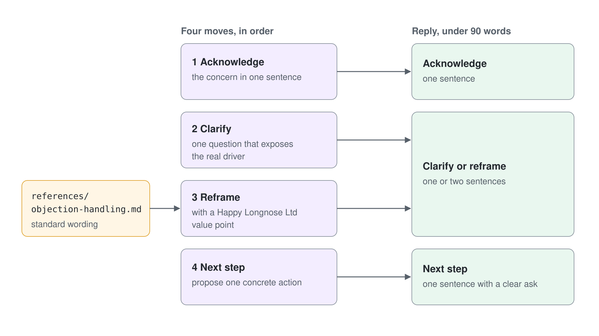

# Team-Wissen in einen portablen Skill packen

Die Seller von Happy Longnose Ltd hören jede Woche dieselben Einwände von Kunden: Preis, Timing und Mitbewerber. Statt diese Anleitung in die Instructions jedes Agents zu kopieren, erfassen Sie sie einmal als portablen Agent Skill und verwenden ihn überall wieder, wo er gebraucht wird. Dieses Lab führt einen Low-Code Maker von einer rohen, wiederkehrenden Aufgabe zu einem teilbaren Skill Package, das auf zwei verschiedenen Agents läuft.

Am Ende haben Sie ein Ergebnis: einen wiederverwendbaren Skill `objection-handling`, als ZIP verpackt, getestet, verfeinert und einem zweiten Agent hinzugefügt, um die Portabilität zu beweisen. Jeder Schritt baut auf dem vorherigen auf, lassen Sie also dieselbe Browser Session und dieselben Dateien die ganze Zeit geöffnet. Das Lab schließt mit einem Vergleich dieses Ansatzes mit dem Modell aus Topics und Trigger Phrases der Standard Agents, damit Sie erklären können, warum ein Skill die besser wiederverwendbare Wahl ist.

## Was Sie bauen

- Eine einzelne Datei `SKILL.md`: YAML Front Matter (Name plus eine keywordreiche Description), gefolgt von Instructions in Markdown.
- Ein ZIP Package mit `SKILL.md` im Root und einem Referenzdokument in `references/` daneben.
- Den Skill hochgeladen, in **Preview** auf Aktivierung getestet, dann verfeinert und auf dem ersten Agent an Ort und Stelle ersetzt.
- Das identische Package heruntergeladen und auf einem zweiten Agent wiederverwendet, als Beweis, dass der Skill portabel ist.


## Was dieses Lab abdeckt

| Schritt | Fokus | Geübtes Modulthema |
|------|-------|------------------------|
| 1 | Eine wiederkehrende Aufgabe finden, die sich zum Verpacken lohnt | [Agent Skills in Copilot Studio](../../../demos/06-cs-copilot-harness/03-agent-skills/readme.md) |
| 2 | Name und Description des Skills entwerfen | [Agent Skills in Copilot Studio](../../../demos/06-cs-copilot-harness/03-agent-skills/readme.md) |
| 3 | Front Matter und Instructions von SKILL.md schreiben | [Agent Skills in Copilot Studio](../../../demos/06-cs-copilot-harness/03-agent-skills/readme.md) |
| 4 | Eine Referenzdatei hinzufügen und ein ZIP packen | [Agent Skills in Copilot Studio](../../../demos/06-cs-copilot-harness/03-agent-skills/readme.md) |
| 5 | Den Skill auf einen Microsoft Copilot Harness Agent hochladen | [Standard vs. Microsoft Copilot Harness Agents](../../../demos/06-cs-copilot-harness/01-standard-vs-copilot-harness/readme.md) |
| 6 | Die Aktivierung auf dem Tab Preview testen | [The Two Copilot Studio Experiences](../../../demos/06-cs-copilot-harness/01-standard-vs-copilot-harness/readme.md) |
| 7 | Die Description verfeinern und den Skill mit Replace ersetzen | [Agent Skills in Copilot Studio](../../../demos/06-cs-copilot-harness/03-agent-skills/readme.md) |
| 8 | Den Skill auf einem zweiten Agent wiederverwenden | [Agent Skills in Copilot Studio](../../../demos/06-cs-copilot-harness/03-agent-skills/readme.md) |
| 9 | Mit dem Topic-Ansatz der Standard Agents vergleichen | [Standard vs. Microsoft Copilot Harness Agents](../../../demos/06-cs-copilot-harness/01-standard-vs-copilot-harness/readme.md) |

## Lab-Dateien

| Datei | Zweck |
|------|---------|
| `lab-01-portable-skill/` | Ordner mit dem fertigen Skill Package für dieses Lab. |
| `lab-01-portable-skill/SKILL.md` | Die Definition des Skills: YAML Front Matter (name, description) plus Instructions in Markdown. |
| `lab-01-portable-skill/references/objection-handling.md` | Begleitendes Referenzdokument mit den Standardantworten von Happy Longnose Ltd auf Einwände. |

## Voraussetzungen

- Eine Copilot Studio Environment, in der Sie Agents erstellen können (eine Power Platform Environment mit der Maker-Rolle).
- Ihre eigene Environment: Wählen Sie unten in der linken Navigation den Namen der Environment (**Switch environment**) und prüfen Sie, dass unter **Current environment** die nach Ihrem Account benannte Environment steht, zum Beispiel `copilot-studio-01` (Sandbox) für `copilot-studio-01@mst.fastlane.net`. Arbeiten Sie das ganze Lab darin, nie in der gemeinsamen Default Environment.
- Ein Microsoft Copilot Harness Agent. Haben Sie keinen, baut ihn [Den Sales Assistant einrichten](#den-sales-assistant-einrichten), oder Sie führen zuerst [Build and Ground Your First Microsoft Copilot Harness Agent](../../../demos/06-cs-copilot-harness/01-standard-vs-copilot-harness/demo-01-build-and-ground-an-agent.md) aus und lassen diesen Agent Sales Assistant geöffnet.
- Ein zweiter Agent der neuen Art, auf dem Sie den Skill wiederverwenden (zum Beispiel ein Account Manager). Sie können ihn in Schritt 8 erstellen, falls Sie ihn noch nicht haben.
- Ein einfacher Texteditor (Notepad, VS Code oder ähnlich) und das eingebaute ZIP-Tool Ihres Betriebssystems.

> **Hinweis:** Ein Skill besteht nur aus einem Namen, einer Description und Markdown in einer Datei `SKILL.md`. Dasselbe offene Format nutzen auch die Skills von Claude Code und GitHub Copilot, deshalb lässt sich ein Skill, den Sie hier schreiben, dort importieren, und Skills von dort lassen sich in Copilot Studio importieren.

## Den Sales Assistant einrichten

Der Skill braucht einen Microsoft Copilot Harness Agent. Haben Sie bereits einen, verwenden Sie ihn und überspringen diesen Abschnitt. Andernfalls erstellen Sie ihn jetzt:

1. Öffnen Sie in [Copilot Studio](https://copilotstudio.microsoft.com) die Seite **Agents**, öffnen Sie den Pfeil neben **New agent** und wählen Sie unter **Optimize your business processes** den Eintrag **Agent** mit dem Badge **GitHub Copilot**.
2. Geben Sie im Namensfeld `Sales Assistant` ein.
3. Fügen Sie im Abschnitt **Instructions** den folgenden Text ein und wählen Sie **Save** (das Disketten-Icon rechts oben; in einem schmalen Fenster **...** > **Save**).

```text
You are the Sales Assistant. You help Happy Longnose Ltd sellers by answering short questions about our products, standard lead times, and account tiers. Keep answers brief, factual, and professional.
```

Erwartet: "Your agent has been saved." erscheint, und der Sales Assistant bleibt auf seinem Tab **Build** geöffnet.

## Schritt 1: Eine wiederkehrende Aufgabe finden, die sich zum Verpacken lohnt

Skills lohnen sich, wenn dieselbe Anleitung immer wieder in verschiedenen Unterhaltungen oder Agents gebraucht wird. Der Umgang mit Einwänden ist ein starker Kandidat: Die Ratschläge sind stabil, sie gelten für alle Seller, und sie sind nur für einen schmalen Ausschnitt der Anfragen relevant. Sie in die Instructions eines Agents einzubauen, würde den stets im Kontext stehenden Instruction-Block aufblähen und Sie zwingen, denselben Text in jeden Agent zu kopieren, der ihn braucht, und dort zu pflegen.

Ein Skill löst beide Probleme auf einmal. Er wird einmal geschrieben und wiederverwendet, und nur sein Name und seine Description stehen im Kontext, bis eine Anfrage tatsächlich passt, deshalb lädt die vollständige Anleitung bei Bedarf statt in jedem Turn.

1. Schreiben Sie die Aufgabe in einem Satz auf und nutzen Sie die Formulierung unten als Testfall.

```text
Help a Happy Longnose seller respond to a customer objection about price, timing, or competitors.
```

2. Prüfen Sie, dass die Aufgabe die drei Skill-Tests besteht: Sie wiederholt sich, sie ist in sich abgeschlossen, und sie wird nur für bestimmte Anfragen gebraucht (nicht in jedem Turn).
3. Benennen Sie die Alternative, die Sie verwerfen: dieselbe Anleitung in die **Instructions** jedes Agents einzufügen und jede Kopie von Hand zu pflegen.

Erwartet: Sie können einen Grund nennen, warum ein Skill hier besser passt als Instructions, nämlich dass ein Skill einmal geschrieben und wiederverwendet wird, während Instructions pro Agent gelten und immer im Kontext stehen.

## Schritt 2: Name und Description des Skills entwerfen

Die Runtime hält von jedem Skill nur Name und Description im Kontext, bis eine Anfrage passt, deshalb leisten diese beiden Zeilen die gesamte Aktivierungsarbeit. Ein Name in Kleinbuchstaben mit Bindestrichen liest sich im offenen Agent Skills Format sauber, und eine keywordreiche Description macht die Aktivierung zuverlässig. Richten Sie die Description auf genau die Wörter aus, die Seller tippen, wenn sie nicht weiterkommen.


Schreiben Sie die Description so, dass sie sagt, was der Skill tut und wann er zum Einsatz kommt. Packen Sie die Trigger-Wörter hinein, die eine echte Anfrage enthalten würde: objection, push-back, price, timing, budget, competitor.

1. Wählen Sie den Namen: `objection-handling` (Kleinbuchstaben, mit Bindestrich, ohne Leerzeichen).
2. Entwerfen Sie die Description anhand des Blocks unten, der die Aufgabe und die Trigger Phrases nennt.

```text
Help a seller respond to common customer objections and push-back about price, timing, budget, or competitors during an active deal. Use when the user asks how to reply to, handle, or overcome a customer objection, a "too expensive" or "not the right time" comment, or a competitor comparison.
```

3. Lesen Sie sie noch einmal und prüfen Sie, dass sie beide Fragen beantwortet: "Was tut der Skill?" und "Wann soll die Runtime ihn wählen?".

Erwartet: Sie haben einen Namen und eine Description aus ein bis zwei Sätzen, deren Keywords zu den Formulierungen passen, die Seller tippen, wenn sie auf einen Einwand stoßen.

> **Tipp:** Die Keywords der Description sind Ihr Regler für die Aktivierung, keine Zusammenfassung. Löst ein Skill nicht aus, ergänzen Sie das echte Vokabular der Anfragenden ("too expensive", "not the right time"), bevor Sie die Instructions anfassen.

## Schritt 3: Die Instructions in SKILL.md schreiben

Ein Skill ist eine einzelne Datei `SKILL.md`: YAML Front Matter für Name und Description, danach Instructions in Markdown für das Verhalten. Halten Sie die Instructions auf diese eine Aufgabe fokussiert, mit einer klaren Methode, einem Antwortformat und mindestens einem Edge Case. Das Front Matter ist der einzige strukturierte Teil; alles unter dem zweiten `---` ist einfaches Markdown, das die Runtime liest, wenn der Skill aktiviert wird.

Nutzen Sie die Methode mit vier Moves unten (Acknowledge, Clarify, Reframe, Next step), damit jede Antwort dieselbe Form hat. Die mitgelieferte Datei `lab-01-portable-skill/SKILL.md` ist das fertige Beispiel; schreiben Sie Ihre eigene und vergleichen Sie sie damit.



1. Öffnen Sie Ihren Texteditor und erstellen Sie eine neue Datei namens `SKILL.md`.
2. Fügen Sie den vollständigen Inhalt unten ein und lassen Sie das Front Matter (zwischen den beiden Zeilen `---`) ganz oben in der Datei.

```markdown
---
name: objection-handling
description: Help a seller respond to common customer objections and push-back about price, timing, budget, or competitors during an active deal. Use when the user asks how to reply to, handle, or overcome a customer objection, a "too expensive" or "not the right time" comment, or a competitor comparison.
---

# Objection handling

## Task

Help a Happy Longnose Ltd seller reply to a customer objection during an active deal. Turn a raw push-back (too expensive, not the right time, or a competitor looks better) into a calm, specific response the seller can send or say out loud. Keep the buyer relationship intact and move the deal one step forward.

## Method

Follow these four moves in order:

1. Acknowledge the concern in one sentence so the buyer feels heard.
2. Clarify with one question that exposes the real driver behind the objection.
3. Reframe with a Happy Longnose Ltd value point (total cost of ownership, delivery reliability, or account support), drawing the standard wording from the reference file.
4. Next step: propose one concrete action (a scoped pilot, a revised quote, or a reference call).

Ground every price or comparison claim in the reference document `references/objection-handling.md`. Do not invent discounts, dates, or figures that the seller has not confirmed.

## Response format

Return the reply in three short labelled parts:

- Acknowledge: one sentence.
- Clarify or reframe: one or two sentences.
- Next step: one sentence with a clear ask.

Keep the whole reply under 90 words and use plain, non-defensive language.

## Edge case

If the buyer raises more than one objection at once (for example price and timing together), do not answer both in one block. Ask the seller which objection is actually blocking the deal, handle that one first with the four moves, then note the second objection as a follow-up.
```

3. Speichern Sie die Datei in einem neuen Ordner namens `lab-01-portable-skill`.

Erwartet: `lab-01-portable-skill/SKILL.md` existiert, öffnet sich als lesbares Markdown, und sein Front Matter entspricht dem Namen und der Description, die Sie in Schritt 2 entworfen haben.

## Schritt 4: Eine Referenzdatei hinzufügen und ein ZIP packen

Ein Skill kann begleitende Dateien (Scripts, Templates, Referenzdokumente) neben `SKILL.md` in einem ZIP bündeln. Hier enthält die Referenzdatei die Standardantworten von Happy Longnose Ltd auf Einwände, damit die Instructions kurz bleiben und Sie die Daten an einer Stelle pflegen. Die eine feste Regel: Das ZIP muss `SKILL.md` in seinem Root enthalten, nicht in einem verschachtelten Ordner, sonst wird der Upload abgelehnt.

1. Erstellen Sie in `lab-01-portable-skill` einen Unterordner `references`.
2. Speichern Sie die Antworten auf Einwände mit dem Inhalt unten als `references/objection-handling.md`.

```text
# Happy Longnose Ltd objection responses

| Objection                                    | Recommended response                                                                 |
|----------------------------------------------|--------------------------------------------------------------------------------------|
| "Your price is higher than the others."      | Shift to total cost of ownership: bundled onboarding, no overage fees, fixed 3-year rate. |
| "We do not have budget this quarter."         | Propose a scoped pilot now with a start-of-next-quarter rollout.                     |
| "A competitor offers the same thing cheaper." | Name Happy Longnose differentiators: 99.9% delivery reliability, named account manager, same-region support. |
| "We are happy with our current supplier."     | Do not attack the incumbent; ask what one thing they wish worked better, then map one strength to it. |
| "Send me information and I will look later."   | Send one focused one-pager, then book a 15-minute follow-up while still on the call. |
| "We need to think about it."                  | Ask which part needs the most thought (price, fit, or timing) so the real objection surfaces. |
```

3. Markieren Sie `SKILL.md` und den Ordner `references` zusammen und komprimieren Sie beide zu einem ZIP. Unter Windows markieren Sie beide Elemente, klicken mit der rechten Maustaste und wählen **Compress to ZIP file**.
4. Öffnen Sie das ZIP und prüfen Sie, dass `SKILL.md` im Root liegt und `references/objection-handling.md` daneben.

Erwartet: ein ZIP, dessen Root-Eintrag `SKILL.md` ist, mit `references/objection-handling.md` daneben und ohne umschließenden Ordner dazwischen.

> **Warnung:** Wenn Sie mit der rechten Maustaste auf den Ordner `lab-01-portable-skill` selbst klicken und ihn zippen, landet `SKILL.md` eine Ebene tiefer in einem Eintrag `lab-01-portable-skill/`, und der Upload schlägt fehl. Öffnen Sie zuerst den Ordner, markieren Sie den Inhalt und zippen Sie dann.

## Schritt 5: Den Skill auf einen Microsoft Copilot Harness Agent hochladen

Skills liegen auf dem Tab **Build** eines Microsoft Copilot Harness Agents, im Panel **Skills**. Der Upload importiert Ihr Package, damit der Agent es bei Bedarf aktivieren kann. Dasselbe Panel importiert auch Skills aus Claude Code oder GitHub Copilot, da sie das offene Format teilen.

Sie brauchen die Dateien aus dem Ordner `lab-01-portable-skill`, den Sie in den Schritten 3 und 4 erstellt haben (die `SKILL.md` und das ZIP). Öffnen Sie diesen Ordner in einem Datei-Explorer-Fenster, bevor Sie beginnen.

1. Öffnen Sie Ihren ersten Agent (zum Beispiel den Sales Assistant) unter [copilotstudio.microsoft.com](https://copilotstudio.microsoft.com).
2. Suchen Sie auf dem Tab **Build** die Überschrift **Skills** und wählen Sie ihr **+** (**Add skill**).
3. Bleiben Sie auf dem Tab **Upload a skill** (der andere Tab heißt **Create from blank**), navigieren Sie zu `lab-01-portable-skill` und wählen Sie Ihr ZIP.
4. Der Upload startet, sobald Sie das ZIP wählen, und zeigt "Saving skill..."; warten Sie, bis sich der Dialog schließt und `objection-handling` unter **Skills** erscheint.

Erwartet: `objection-handling` erscheint als Chip unter **Skills**; wählen Sie ihn, um die Description zu sehen, die Sie geschrieben haben. Nur Name und Description sind jetzt in den Kontext geladen; die vollständigen Instructions laden, wenn eine Anfrage passt.

## Schritt 6: Die Aktivierung auf dem Tab Preview testen

Auf dem Tab **Preview** bestätigen Sie, dass die Description den Skill tatsächlich auslöst. Sie senden einen realistischen Einwand und prüfen, dass `objection-handling` aktiviert wurde, statt dass der Agent aus seinen allgemeinen Instructions antwortet. Abzulesen, welcher Skill aktiviert wurde und welcher nicht, ist die zentrale Feedback-Schleife beim Schreiben von Skills.

Senden Sie zwei Nachrichten: eine, die den Skill aktivieren soll, und eine, die das nicht soll. Erst der Kontrast beweist, dass die Description richtig abgegrenzt ist und nicht bei allem auslöst, was mit Preisen zu tun hat.

1. Öffnen Sie den Tab **Preview** auf demselben Agent.
2. Senden Sie die Nachricht zur Aktivierung unten und lesen Sie ab, welchen Skill der Agent genutzt hat.

```text
A customer says we are more expensive than a competitor. How should I reply?
```

3. Senden Sie jetzt die Nachricht ohne Aktivierung unten, eine allgemeine Policy-Abfrage und keinen Einwand.

```text
What is our standard return policy?
```

4. Vergleichen Sie die beiden: Die erste sollte dem Format Acknowledge, Clarify or reframe, Next step aus Ihrem Skill folgen; die zweite sollte eine einfache Antwort ohne Aktivierung eines Skills sein.

Erwartet: Die Nachricht mit dem Einwand aktiviert `objection-handling`, und die Antwort folgt dem Format mit Labels, während die Nachricht zur Rückgabe-Policy den Skill nicht aktiviert. Dieser Kontrast bestätigt, dass die Description den Trigger richtig abgegrenzt hat.

> **Tipp:** Wenn die Antwort richtig aussieht, Sie aber nicht sicher sind, ob der Skill ausgelöst hat, klappen Sie in **Preview** das Reasoning des Agents auf: Eine Zeile **Used skill: objection-handling** nennt den genutzten Skill. Eine korrekt aussehende Antwort aus den allgemeinen Instructions ist nicht dasselbe wie eine Aktivierung des Skills.

## Schritt 7: Die Description verfeinern und den Skill mit Replace ersetzen

Aktiviert sich der Skill bei den falschen Anfragen (zum Beispiel bei jeder Preisabfrage, nicht nur bei Einwänden), liegt die Lösung in der Description, nicht in den Instructions. Sie schärfen die Formulierung, sodass er nur bei Fragen zu Einwänden und Push-back aktiviert wird, und nutzen dann **Replace**, um den hochgeladenen Skill an Ort und Stelle zu aktualisieren. **Replace** aktualisiert den bestehenden Skill, statt ein Duplikat hinzuzufügen, deshalb bleibt die Anzahl der Skills bei eins.

1. Ersetzen Sie im Texteditor die Zeile `description:` im Front Matter durch die engere Formulierung unten, die Push-back ausdrücklich nennt und allgemeine Abfragen ausschließt.

```text
description: Help a seller answer a customer objection or push-back during a live deal, such as "too expensive", "not the right time", "no budget this quarter", or a competitor comparison. Use only when the user is responding to resistance in a deal, not for general product, pricing, or policy lookups.
```

2. Speichern Sie `SKILL.md` und erstellen Sie das ZIP wie in Schritt 4 neu, mit `SKILL.md` im Root.
3. Wählen Sie unter **Skills** den Eintrag `objection-handling`, öffnen Sie oben rechts in seiner Dateiansicht das Menü **...** und wählen Sie **Replace**.
4. Wählen Sie das aktualisierte Package (der Upload startet sofort) und senden Sie dann beide Nachrichten aus Schritt 6 erneut in **Preview**.

Erwartet: Nach **Replace** aktiviert die Nachricht mit dem Einwand den Skill weiterhin und die allgemeine Policy-Frage weiterhin nicht, während die Liste **Skills** immer noch genau einen Eintrag `objection-handling` zeigt; das bestätigt, dass **Replace** aktualisiert und nicht dupliziert hat.

## Schritt 8: Den Skill auf einem zweiten Agent wiederverwenden

Portabilität ist der Gewinn: Einen einmal erstellten Skill können Sie vielen Agents hinzufügen. Sie laden den Skill mit **Download** vom ersten Agent herunter und dann mit **Upload a skill** auf einen zweiten Agent hoch, um zu beweisen, dass er ohne erneutes Schreiben mitwandert. Sie verteilen Skills pro Agent, deshalb bekommt jeder Agent seine eigene Kopie des Packages; einen gemeinsamen, tenantübergreifenden Katalog gibt es noch nicht.

1. Wählen Sie beim ersten Agent unter **Skills** den Eintrag `objection-handling`, öffnen Sie oben rechts das Menü **...** und wählen Sie **Download**, um das Package zu speichern.
2. Öffnen oder erstellen Sie einen zweiten Agent der neuen Art, zum Beispiel einen Agent Account Manager. Ein neuer Agent braucht vor **Save** einen Namen und Instructions, zum Beispiel `You are the Account Manager. You help Happy Longnose Ltd account managers with short answers about their accounts.`
3. Wählen Sie auf dem Tab **Build** des zweiten Agents das **+** neben **Skills**, bleiben Sie auf **Upload a skill** und wählen Sie das Package, das Sie eben heruntergeladen haben.
4. Öffnen Sie den Tab **Preview** des zweiten Agents und senden Sie die Nachricht zur Aktivierung unten, um zu bestätigen, dass der Skill mitgewandert ist.

```text
A customer says now is not the right time to buy. What should I say?
```

Erwartet: `objection-handling` läuft jetzt auf beiden Agents und erzeugt dieselbe Antwort mit Labels. Sie haben das identische Package ohne Änderungen wiederverwendet, und das zeigt, dass der Skill zwischen Agents portabel ist.

> **Hinweis:** Die Verteilung pro Agent ist so gewollt. Es gibt noch keinen gemeinsamen Katalog, der einen Skill auf einmal an jeden Agent verteilt, deshalb bedeutet ein neuer Agent ein neues **Upload a skill**, kein Abonnement einer zentralen Kopie.

## Schritt 9: Mit dem Topic-Ansatz der Standard Agents vergleichen

Wenn Sie verstehen, was Sie vermieden haben, wird der Wert greifbar. In einem Standard Agent hätten Sie das als Topic mit einer Reihe von Trigger Phrases, verzweigenden Nodes und Message Actions gebaut, alles innerhalb eines einzigen Agents. Dieses Topic ließe sich nicht herauslösen und als in sich geschlossenes Package auf einen anderen Agent setzen, so wie ein Skill.

Die Wiederverwendung ist der eigentliche Punkt. Ein Skill wird einmal geschrieben, verpackt, heruntergeladen und jedem Microsoft Copilot Harness Agent hinzugefügt, während ein Topic in einem Standard Agent an den Agent gebunden ist, in dem es gebaut wurde.

1. Skizzieren Sie die Version als Standard Agent in Ihren Notizen.

```text
Topic: Objection Handling
Trigger phrases: "too expensive", "not the right time", "competitor is cheaper"
Nodes: branch on objection type, then send a scripted message per branch
Scope: lives inside one agent only
```

2. Notieren Sie die Grenzen des Standard Agents: Die Logik ist an einen Agent gebunden, und sie wiederzuverwenden heißt, das Topic anderswo von Hand neu zu bauen.
3. Notieren Sie die Vorteile des Skills: einmal geschrieben, verpackt, heruntergeladen und jedem Microsoft Copilot Harness Agent hinzugefügt.
4. Halten Sie die Regel fest, dass es keinen Weg zurück gibt: Microsoft Copilot Harness Agents lassen sich nicht in Standard Agents konvertieren, deshalb ist der Skill-Ansatz der Weg nach vorn für diese Agents.

Erwartet: Sie können in ein oder zwei Sätzen erklären, warum der portable Skill besser wiederverwendbar ist als ein Topic in einem Standard Agent, und Sie können sagen, dass sich Microsoft Copilot Harness Agents nicht in Standard Agents konvertieren lassen.

## Troubleshooting

| Symptom | Wahrscheinliche Ursache | Lösung |
|---------|--------------|-----|
| Der Skill wird bei einer Nachricht mit Einwand nie aktiviert | Der Description fehlt das echte Vokabular der Anfragenden | Ergänzen Sie die genauen Trigger-Wörter ("too expensive", "not the right time", "competitor") in der `description` und ersetzen Sie den Skill dann mit **Replace** |
| Der Skill wird bei den falschen Nachrichten aktiviert (bei jeder Preis- oder Policy-Frage) | Die Description ist zu breit und überschneidet sich mit allgemeinen Abfragen | Engen Sie die Description wie in Schritt 7 ein, sodass sie Einwand und Push-back ausdrücklich nennt und allgemeine Abfragen ausschließt, und nutzen Sie dann **Replace** |
| Der Upload wird abgelehnt, oder der Skill erscheint nicht | `SKILL.md` liegt im ZIP in einem umschließenden Ordner statt im Root | Zippen Sie erneut aus `lab-01-portable-skill` heraus, sodass `SKILL.md` im Root des ZIP liegt und `references/` daneben |
| Der Upload schlägt mit einem Front-Matter- oder Formatfehler fehl | Das YAML Front Matter ist fehlerhaft (eine Zeile `---` fehlt, `name` oder `description` fehlt, oder ein Doppelpunkt steht in einem Wert ohne Anführungszeichen) | Prüfen Sie, dass beide Zeilen `---` vorhanden sind, `name` und `description` beide gesetzt sind und jeder Wert mit Doppelpunkt in Anführungszeichen steht; speichern Sie und laden Sie erneut hoch |
| Nach dem Bearbeiten erscheint eine zweite Kopie des Skills | Sie haben erneut **Add skill** statt **Replace** genutzt | Löschen Sie das Duplikat mit dem **X** auf seinem Chip und nutzen Sie dann **Replace** im Menü **...** von `objection-handling`, um an Ort und Stelle zu aktualisieren |

## Prüfen

Sie haben das Ziel des Labs erreicht, wenn alle folgenden Punkte zutreffen:

1. `lab-01-portable-skill/SKILL.md` hat gültiges Front Matter (Name `objection-handling` plus eine keywordreiche Description) und Instructions in Markdown mit der Methode der vier Moves.
2. Das ZIP Package enthält `SKILL.md` im Root mit `references/objection-handling.md` daneben.
3. Der Skill wird in **Preview** bei einer Nachricht mit Einwand aktiviert und bleibt bei der Anfrage zur Rückgabe-Policy still.
4. Dasselbe heruntergeladene Package läuft auf einem zweiten Agent und erzeugt dieselbe Antwort mit Labels, als Beweis der Portabilität.

## Zusammenfassung

Sie haben Team-Wissen in einen portablen Skill `objection-handling` gepackt: eine einzelne `SKILL.md` mit keywordreichem Front Matter und einer Methode aus vier Moves, mit einer Referenzdatei zu einem ZIP gebündelt, in **Preview** getestet, mit **Replace** verfeinert und mit **Download** auf einem zweiten Agent wiederverwendet. Sie können jetzt:

- Entscheiden, wann eine wiederkehrende Aufgabe in einen Skill gehört statt in die stets im Kontext stehenden Instructions eines Agents.
- Front Matter und Instructions von `SKILL.md` schreiben und ein gültiges ZIP mit `SKILL.md` im Root packen.
- Einen Skill hochladen, seine Aktivierung testen und seine Description als den Hebel verfeinern, der steuert, wann er auslöst.
- Einen einmal geschriebenen Skill über **Download** und **Upload a skill** auf mehreren Microsoft Copilot Harness Agents wiederverwenden.

Binden Sie als Nächstes ein externes System an denselben Agent an, in [Connect an MCP Server and Publish a Workflow](../../../demos/06-cs-copilot-harness/04-workflows-and-mcp/demo-04-connect-mcp-and-workflow.md).

## Aufräumen

Löschen Sie den Skill aus jedem Agent, wenn die Agents nur für dieses Lab gedacht waren: Wählen Sie unter **Skills** das **X** auf dem Chip `objection-handling` (**Remove skill**) und dann **Delete** in **Delete skill?**. Entfernen Sie alle Wegwerf-Agents, die Sie erstellt haben (öffnen Sie die Liste der Agents, wählen Sie den Agent und dann **Delete**). Behalten Sie den lokalen Ordner `lab-01-portable-skill` und sein ZIP, wenn Sie den Skill in einem späteren Lab wiederverwenden möchten.
